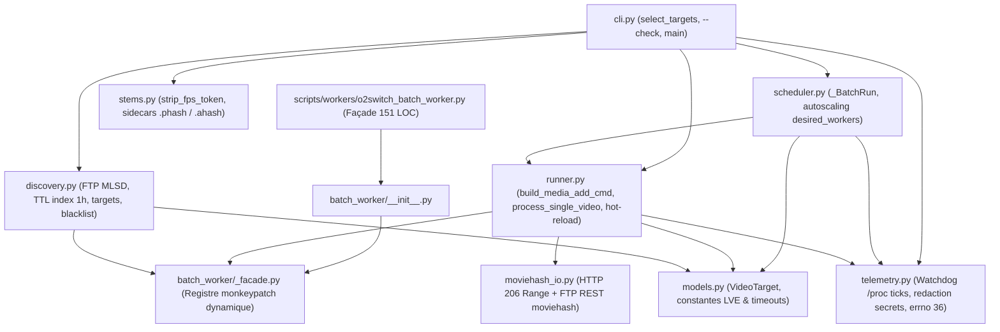

# 🛠️ Modularisation SoC du Batch Worker & Pièges du Pipeline Multi-Nœuds (`RPi4` ↔ `Freebox` ↔ `o2switch`)

Ce journal d'ingénierie consigne la découpe modulaire de `scripts/workers/o2switch_batch_worker.py` (`1 479` LOC → façade de `151` LOC + package `scripts/workers/batch_worker/` où chaque sous-module est $\le 285$ LOC, Ticket `#74`) ainsi que les **six pièges opérationnels découverts en production** lors de l'audit croisé des trois nœuds (`Station locale` ↔ `Appliance RPi4` ↔ `Cloud o2switch`) sur de nouveaux médias 2160p UHD téléchargés en novembre 2026.

---

## 🏗️ Architecture Modulaire `scripts/workers/batch_worker/` (SoC & Façade Sans Régression)

Sur l'hébergement mutualisé CloudLinux `o2switch`, le démon batch s'exécute via `/opt/alt/python313/bin/python3` (`./bin/python3` uniquement stdlib, zéro dépendance tierce `pip`/`uv`) depuis une arborescence plate `~/dbsrt/scripts/`, tandis que le dépôt Git organise les scripts dans `scripts/workers/`.

> [!IMPORTANT] Compatibilité Bi-Arborescence & Tests Hermétiques
> Le module `batch_worker/_facade.py` maintient une référence vers la façade racine `o2switch_batch_worker`. Toute surcharge d'attribut (`monkeypatch.setattr(worker, "REPO_ROOT", ...)` ou `monkeypatch.setattr(worker, "list_nas_videos_ftp", ...)`) effectuée par les suites de tests existantes est résolue dynamiquement via `facade_attr()` sans couplage circulaire.

---

## 🔍 Journal des 6 Pièges Opérationnels Multi-Nœuds (`A + C` Field Notes)

### 1. Désalignement d'Arborescence `scripts/ingestion/` vs Déploiement Plat `RPi4` (`B1`)

#### 1.1 Problématique & Mécanisme racine
Lors de la réorganisation de l'arborescence du dépôt (`PR #70`), `scripts/infra/rpi4/freebox_batch_ctl.sh` a référencé `${REPO_ROOT}/scripts/ingestion/scan_freebox_targets.py`. Or `scripts/infra/rpi4/rpi4_supervisor_ctl.sh` déploie tous les scripts de supervision **à plat** dans `rpi4:~/dbsrt/scripts/` (`~/dbsrt/scripts/scan_freebox_targets.py`).

#### 1.2 Conséquences concrètes
- **Empiriquement prouvé** sur `rpi4:~/dbsrt/logs/rpi4_supervisor.log` : à chaque fin de cycle `movies`, la rotation vers `freebox` échouait immédiatement avec `python3: can't open file '<home>/dbsrt/scripts/ingestion/scan_freebox_targets.py': [Errno 2] No such file or directory`. Aucun nouveau téléchargement Freebox n'était plus transmis à `o2switch`.

#### 1.3 Solution / Invariant opéré
Résolution bi-layout explicite dans `freebox_batch_ctl.sh` : recherche prioritaire de `${REPO_ROOT}/scripts/ingestion/scan_freebox_targets.py`, repli automatique sur `${SCRIPT_DIR}/scan_freebox_targets.py`, et arrêt immédiat explicite si aucun des deux chemins n'existe.

#### 1.4 Avantages, Inconvénients & Limites résiduelles
Fonctionne à l'identique depuis un worktree Git développeur et depuis l'appliance `RPi4` sans dupliquer l'arborescence sur la carte SD/SSD du `RPi4`. L'élimination définitive de ces divergences d'arborescence passera par la convergence vers un binaire compilé unique.

---

### 2. Écrasement Régressif Croisé `RPi4` → `o2switch` (`B2` & `B3`)

#### 2.1 Problématique & Mécanisme racine
Le superviseur autonome `RPi4` invoque `o2switch_ctl.sh batch-tvshow` et `batch-movies` toutes les 30 minutes, ce qui exécute un `rsync` de sa copie locale `rpi4:~/dbsrt/scripts/o2switch_batch_worker.py` vers `o2switch:~/dbsrt/scripts/`. À l'inverse, `freebox_batch_ctl.sh start` lançait le worker distant sans synchroniser ni la façade ni le package `batch_worker/`.

#### 2.2 Conséquences concrètes
- **Empiriquement prouvé** : tant que `task rpi4:supervisor:sync` n'avait pas été exécuté après un refactoring sur `develop`, le `RPi4` ré-écrasait silencieusement `o2switch` avec une version obsolète du worker (`48 Ko` du 10 novembre contre `59 Ko`), annulant les déploiements directs effectués depuis le poste de développement.

#### 2.3 Solution / Invariant opéré
Synchronisation atomique systématique du couple `(o2switch_batch_worker.py, batch_worker/)` avec `--delete --exclude='__pycache__'` dans **les trois contrôleurs** : `o2switch_ctl.sh` (`sync_remote_batch_worker`), `rpi4_supervisor_ctl.sh` (`sync_scripts`), et `freebox_batch_ctl.sh` (`sync_worker_to_o2switch`). De plus, `script_updated()` inspecte désormais le `mtime` maximal de tous les fichiers `batch_worker/*.py` afin de déclencher le rechargement gracieux (`os.execv`) dès qu'un sous-module est mis à jour.

#### 2.4 Avantages, Inconvénients & Limites résiduelles
Élimine la corruption partielle d'imports Python entre façade et sous-modules. Tant que deux machines (`Station` et `RPi4`) peuvent pousser vers `o2switch`, l'opérateur doit synchroniser le `RPi4` lors des mises à jour du worker ; la détection automatique de dérive de SHA-256 inter-nœuds est tracée dans le ticket `#90`.

---

### 3. Court-Circuit Permanent du Scan FTP par un Cache `nas_ftp_index.json` Périmé (`B4`)

#### 3.1 Problématique & Mécanisme racine
`list_nas_videos_ftp()` lisait inconditionnellement `data/reports/nas_ftp_index.json` dès que le fichier existait et contenait au moins une entrée, sans vérifier son ancienneté (`mtime`) ni le drapeau `--fresh-only`, et `o2switch_ctl.sh` re-poussait systématiquement le fichier local s'il était présent.

#### 3.2 Conséquences concrètes
- **Empiriquement prouvé** sur `o2switch` : un fichier `data/reports/nas_ftp_index.json` figé au **3 novembre** (`383 Ko`) empêchait toute commande `MLSD` FTP vers le NAS Synology ; tout média ajouté sur `/video` ou `/tvshow` après cette date restait invisible indéfiniment.

#### 3.3 Solution / Invariant opéré
Introduction de `DEFAULT_FTP_INDEX_MAX_AGE_SECS = 3600.0` (`is_ftp_index_fresh`) et du paramètre `bypass_index_cache=bool(args.fresh_only)` :

1. En mode `--fresh-only`, le worker interroge toujours l'état réel du serveur FTP (`_walk_nas_videos_ftp`).
2. Hors `--fresh-only`, un index vieux de plus d'une heure est ignoré au profit d'un scan FTP frais, et `o2switch_ctl.sh` ne transfère `nas_ftp_index.json` que s'il a moins de 60 minutes (`find -mmin -60`).

#### 3.4 Avantages, Inconvénients & Limites résiduelles
Garantit la découverte immédiate des nouveaux médias Synology tout en conservant l'accélération du cache lors de relances rapprochées hors `--fresh-only`. Coût résiduel : ~2 à 5 secondes de parcours `MLSD` FTP par cycle de 30 minutes.

---

### 4. Ignorance Silencieuse de `--mode {phash,ahash,both}` à l'Invocation `dbsrt media:add` (`B5`)

#### 4.1 Problématique & Mécanisme racine
Bien que `select_targets()` filtrât correctement les cibles selon `--mode`, `process_single_video()` construisait toujours la ligne de commande `dbsrt media:add` avec `--phash-dir` ET `--ahash-dir` sans jamais passer `--skip-phash` en mode `ahash` ni omettre `--ahash-dir` en mode `phash`.

#### 4.2 Conséquences concrètes
- **Hermétiquement prouvé par tests unitaires** (`test_build_media_add_cmd_honors_batch_mode`) : un rattrapage audio seul (`--mode ahash`) aurait décodé l'intégralité du flux vidéo 4K HEVC (~12 min CPU sur 14 Go) au lieu de n'extraire que la piste audio (~15 s).

#### 4.3 Solution / Invariant opéré
Extraction de la fonction pure `build_media_add_cmd(..., mode)` dans `batch_worker/runner.py` :

- `mode == "ahash"` → `--skip-phash --ahash-dir <dir>` (aucun décodage vidéo FFmpeg),
- `mode == "phash"` → `--phash-dir <dir>` (aucune extraction audio),
- `mode == "both"` → extraction conjointe `.phash` + `.ahash`.

#### 4.4 Avantages, Inconvénients & Limites résiduelles
Gain d'un ordre de grandeur CPU sur les campagnes ciblées `--mode ahash` sur conteneurs UHD 2160p.

---

### 5. Masquage Silencieux `"state": "healthy"` des Échecs de Rotation Superviseur (`#90`)

#### 5.1 Problématique & Mécanisme racine
Dans `rpi4_o2switch_supervisor.py`, `freebox` appartient à `OPTIONAL_BATCH_TYPES` afin qu'une coupure WAN domestique ne bloque pas l'ingestion Synology : en cas d'échec de `freebox`, `_relaunch_step` bascule immédiatement sur `tvshow`. Or `push_supervisor_telemetry_to_remote` calculait `"state": "healthy"` sur le seul statut courant du batch de repli (`tvshow` = `running`/`finished`), sans mémoriser l'échec de lancement de `freebox`.

#### 5.2 Conséquences concrètes
- **Empiriquement prouvé** sur `o2switch:~/dbsrt/run/supervisor_status.json` : le portail web et l'API affichaient `"state": "healthy"` pendant plusieurs jours alors que `recent_logs` contenait `❌ Failed starting batch` toutes les heures sur `freebox`.

#### 5.3 Solution / Invariant opéré
Ajout de `launch_error_count` et du dictionnaire persistant par source `failed_batch_types: Dict[str, str]` dans `_LoopState` (`_record_launch_outcome` + `_resolve_supervisor_health_state`) : tant qu'un type de batch ayant échoué n'a pas réussi un lancement ultérieur, `supervisor_status.json` publie `"state": "degraded"` avec le message d'erreur exact dans `failed_batch_types["freebox"]`.

#### 5.4 Avantages, Inconvénients & Limites résiduelles
Visibilité immédiate de toute régression d'un sous-pipeline optionnel sans sacrifier la continuité d'activité sur les autres bibliothèques. Ce mécanisme local au superviseur prépare l'agrégateur centralisé multi-nœuds spécifié dans l'Issue `#90`.

---

### 6. Dérive des Listes de Cibles selon la Machine Appelante & Défaut `--fresh-only`

#### 6.1 Problématique & Mécanisme racine
Deux divergences rendaient la sélection de cibles non déterministe d'un lancement à l'autre :

1. `--fresh-only` valait `False` par défaut en CLI manuelle (`task o2switch:batch:*`), remettant l'intégralité du NAS (`2 534` vidéos) en file dès que le drapeau était omis.
2. Lorsque `o2switch_ctl.sh` était invoqué depuis un poste disposant d'un montage CIFS local Synology, il exécutait `batch_media_add_tvshow.py` contre `data/__PHASH__` **local** (purgé depuis `#85`), générant un `selected_batch_targets.json` erroné qualifiant toute la médiathèque de vierge, alors qu'un appel depuis le `RPi4` ou en 4G évaluait l'état sur `o2switch`.

#### 6.2 Conséquences concrètes
- **Empiriquement prouvé** dans `logs/batch_worker.log` : alternance entre `Selected 0` (`RPi4`), `Selected 2534 (fresh_only=False)` (CLI sans flag), et `Selected 487` / `2535` (scan local PC contre disque local vide).

#### 6.3 Solution / Invariant opéré
1. Inversion sécurisée du défaut dans `batch_worker/cli.py` : `--fresh-only` est activé par défaut (`default=True`), tandis qu'un recalcul intégral exige explicitement `--force-all` (`--no-fresh-only`).
2. Élimination du scan local `LOCAL_SCAN_DIR` dans `o2switch_ctl.sh` : `o2switch` demeure l'**unique source de vérité (`SSOT`)** comparant le parcours FTP trié lexicographiquement (`rel_path`) à ses répertoires `data/__PHASH__` et `data/__AHASH__`.

#### 6.4 Avantages, Inconvénients & Limites résiduelles
Un même appel `task o2switch:batch:movies` produit désormais **exactement la même liste triée** depuis le PC en Wi-Fi, le PC en 4G, ou le `RPi4`. L'affichage dans `dbsrt top` de la source active (`freebox`/`tvshow`/`movies`) et du calcul d'avancement des pipes audio `aHash` fait l'objet d'un ticket Rust dédié.
