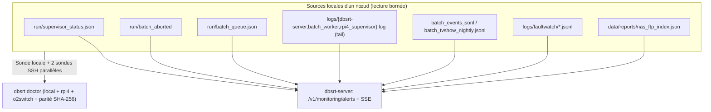

# 🩺 Observabilité Distribuée des Erreurs, Hub d'Alertes & Diagnostic Cluster (`dbsrt doctor`)

Ce journal d'ingénierie consigne l'architecture du hub d'alertes temps réel (`GET /v1/monitoring/alerts` + flux SSE `/v1/monitoring/stream` + bandeau permanent `/monitoring`) et de l'outil de diagnostic fédéré `dbsrt doctor` (`task status:cluster`, Issue `#90`), ainsi que les **trois pièges opérationnels découverts lors des essais canary sur les journaux réels d'`o2switch` et `RPi4+`**.

---

## 🏗️ Corrélation Multi-Sources & Diagnostic Fédéré en Une Passe (`< 1,3 s`)

---

## 🔍 Journal des 3 Pièges d'Observabilité Réelle (`A + C` Field Notes)

### 1. Journaux `batch_worker.log` Append-Only Multi-Sessions Sans Horodatage par Ligne & Traces `[DEBUG]`

#### 1.1 Problématique & Mécanisme racine
Sur `o2switch`, `logs/batch_worker.log` (`> 7 Mo`) est alimenté en mode append sur plusieurs semaines d'exécutions successives, chacune ouverte par la bannière `=== [1/4] Scanning local catalogs and couplings ===`. Contrairement à `dbsrt-server.log` et `rpi4_supervisor.log` qui préfixent chaque ligne d'un timestamp ISO/crochets, les lignes courantes de `batch_worker.log` ne portent pas d'horodatage individuel et incluent parfois des traces diagnostiques verbeuses (`--> [DEBUG] dbsrt ERROR (returncode 1): ...`). Une lecture naïve d'une fenêtre de fin de fichier (`256 KiB`) agrège plusieurs runs historiques terminés et assimile toute ligne non datée à une alerte critique active.

#### 1.2 Conséquences concrètes
- **Empiriquement prouvé** lors du test `task o2switch:canary` sur le serveur de production `o2switch` : alors que le batch Freebox actif présentait `0` cible en échec (`log_errors_1h = 0`, `log_errors_24h = 0`, `log_errors_72h = 0`), `/v1/monitoring/alerts` remontait `status: "critical"` avec `6` signatures issues de runs Synology antérieurs achevés plusieurs jours plus tôt et d'une trace `[DEBUG]`.

#### 1.3 Solution / Invariant opéré
1. **Cloisonnement par session de batch (`BATCH_SESSION_START_MARKER = "=== [1/"`)** : pour le composant `batch_worker`, toute ligne dépourvue d'horodatage située avant la dernière bannière `=== [1/` appartient à une session révolue et est ignorée ; l'héritage d'horodatage (`inherited_ts`) est également réinitialisé à chaque nouvelle bannière de session. Les lignes explicitement horodatées restent évaluées sur les fenêtres glissantes `1h` / `24h` / `72h`.
2. **Exclusion des lignes `[DEBUG]`** dans `classify_error_line` (`dbsrt-server`) et `is_error_line` (`dbsrt-cli`).
3. **Graduation de sévérité** : les erreurs unitaires non datées non fatales (`❌` / `ERROR`) sont classées `Warning` (cohérent avec `failed_targets > 0` dans `batch_queue.json`), réservant `Critical` aux marqueurs fatals (`🛑`, `FATAL`), au sentinel `batch_aborted`, au superviseur dégradé et aux erreurs horodatées dans la dernière heure (`1h`).

#### 1.4 Avantages, Inconvénients & Limites résiduelles
- **Avantages** : Zéro faux positif `CRITICAL` sur les logs append-only de production (`Empirically Proven` sur `o2switch`), détection immédiate de toute erreur survenant dans le run actif.
- **Limites résiduelles** : Si un run `batch_worker` échoue sans horodatage puis qu'un nouveau run démarre immédiatement (`=== [1/4]`), l'historique par fenêtre `24h`/`72h` des échecs précédents repose sur les fichiers d'événements structurés NDJSON (`batch_tvshow_nightly.jsonl` / `batch_events.jsonl`, horodatés en ISO-8601) plutôt que sur le texte libre non daté.

---

### 2. Pollution des Sondes LVE `faultwatch` par des Journaux Texte Non-JSONL (`watch.log`)

#### 2.1 Problématique & Mécanisme racine
Le répertoire `logs/faultwatch/` sur `o2switch` contient les relevés structurés par minute `YYYY-MM-DD.jsonl` produits par la sonde CloudLinux LVE, mais également un fichier texte historique `watch.log` (`24` lignes de bannières de démarrage non-JSON). Lorsque l'analyseur local acceptait tous les fichiers réguliers du dossier et traitait par défaut les lignes non-JSON comme des événements actifs, chaque ligne de `watch.log` était comptabilisée comme une faute LVE récente.

#### 2.2 Conséquences concrètes
- **Empiriquement prouvé** sur `o2switch` via `./preview/dbsrt doctor --local-only` : remontée erronée de `24 LVE events in 24h` provenant d'un fichier `watch.log` vieux de plus de deux semaines alors qu'aucune saturation LVE n'avait eu lieu sur les dernières 24 heures (`lve_fault_entries_24h = 0`).

#### 2.3 Solution / Invariant opéré
1. Filtrage strict sur l'extension `.jsonl` et sur `mtime <= 48h` lors de l'énumération locale de `logs/faultwatch/` (en parité exacte avec le glob distant `logs/faultwatch/*.jsonl`).
2. Rejet explicite (`None`) de toute ligne non conforme au schéma JSON `faultwatch` dans `dbsrt-server` et `dbsrt-cli`.

#### 2.4 Avantages, Inconvénients & Limites résiduelles
- **Avantages** : Alignement exact `0 == 0` entre `/v1/monitoring/alerts` et `dbsrt doctor` sur `o2switch` (`Empirically Proven`), immunité aux fichiers `.log` ou `.bak` annexes déposés dans `logs/faultwatch/`.
- **Limites résiduelles** : Tout futur producteur d'événements LVE doit écrire au format NDJSON `.jsonl` documenté (`minute`/`timestamp`, `faults`/`anyf`, `secs_over_100`, `run_delay_ms_max`).

---

### 3. Parité SHA-256 en Mode `--local-only` sur Nœud Worker Déployé Hors Dépôt Git

#### 3.1 Problématique & Mécanisme racine
Un espace de développement Git contient l'intégralité des 5 scripts suivis (`scripts/workers/...` et `scripts/infra/...`). En revanche, le répertoire d'exécution déployé sur le worker cloud `o2switch` (`~/dbsrt/scripts/`) ne reçoit légitimement que les scripts worker requis (`o2switch_batch_worker.py` et `batch_worker/cli.py`), sans les scripts propres à l'appliance `RPi4` (`rpi4_o2switch_supervisor.py`, `freebox_batch_ctl.sh`). Or `dbsrt doctor --local-only` exécuté directement sur `o2switch` prenait `~/dbsrt` comme référence `local` et signalait `SHA256_DRIFT (missing on local)` sur ces scripts optionnels.

#### 3.2 Conséquences concrètes
- **Empiriquement prouvé** sur `o2switch` : `./preview/dbsrt doctor --local-only` retournait `exit 2` (`sha256_drift_count: 2`) sur une installation cloud pourtant saine et conforme.
- Par ailleurs, en mode fédéré 3 nœuds depuis la station de développement, `dbsrt doctor` a immédiatement détecté en conditions réelles une copie résiduelle obsolète `~/dbsrt/scripts/o2switch_ctl.sh` sur `o2switch` (`SHA256_DRIFT`).

#### 3.3 Solution / Invariant opéré
En mode autonome uniquement (`!rpi4.reachable && !o2switch.reachable`) et lorsqu'au moins un script suivi est présent localement (`!local.script_hashes.is_empty()`), l'absence d'un script non universel (`!(required_on_rpi4 && required_on_o2switch)`) est classée `LOCAL_ONLY` (`optional script not deployed on standalone tier`) au lieu de `SHA256_DRIFT`. En mode cluster 3 nœuds ou si un script universel worker manque, `SHA256_DRIFT` (`exit 2`) demeure strictement appliqué.

#### 3.4 Avantages, Inconvénients & Limites résiduelles
- **Avantages** : Permet d'exécuter `dbsrt doctor --local-only` comme sonde de santé locale aussi bien sur un poste développeur que directement sur `RPi4` ou `o2switch` (`4 ms`, `exit 0` vérifié en réel sur `o2switch`), sans affaiblir la détection de dérive inter-nœuds.
- **Limites résiduelles** : Sur un poste développeur exécuté avec `--local-only`, la suppression accidentelle d'un script optionnel `RPi4` ne serait signalée en `SHA256_DRIFT` que lors d'une exécution cluster standard (sans `--local-only`).
