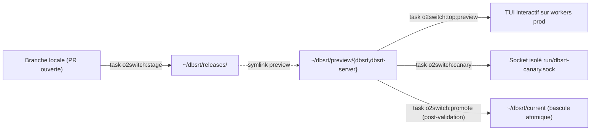

# 🎛️ Télémétrie PCM `aHash` dans `dbsrt top` & Staging/Canary Pré-Merge (`o2switch` & `RPi4`)

Ce journal d'ingénierie documente l'architecture de mesure de progression multimodale (`VideoPhash` vs `AudioAhash`) introduite dans `dbsrt top` (Issue `#92`) ainsi que les **quatre pièges bas niveau (Linux `/proc`, mémoire virtuelle `RPi4`, BuildKit ARM64)** découverts et résolus lors de l'instrumentation du pipeline de staging et canary pré-merge (`task o2switch:stage`, `task o2switch:canary`, `task rpi4:stage`, `task rpi4:canary`).

---

## 🏗️ Pipeline de Staging & Canary Pré-Merge Sans Impact Production

Pour valider empiriquement une branche de développement sur les jeux de données et processus réels (`o2switch` et `RPi4+`) **avant tout merge dans `develop`**, le déploiement sépare strictement le canal `preview` du canal `current` :

---

## 🔍 Journal des 4 Pièges Techniques (`A + C` Field Notes)

### 1. Dénominateur Conteneur `.mkv` vs Flux Audio PCM `f32le` sur `/proc/<pid>/io`

#### 1.1 Problématique & Mécanisme racine
Un worker vidéo `pHash` décode l'intégralité des trames visuelles d'un conteneur `.mkv`/`.mp4` (`rchar` convergeant vers `total_bytes` du fichier source). À l'inverse, un worker audio `aHash` (`ffmpeg ... -vn -ac 1 -ar 5512 -f f32le -`) ignore le flux vidéo HEVC/H.264 par démultiplexage (`-vn`) et n'émet sur son tube standard (`wchar`) qu'un flux PCM mono 32-bit float à $5\,512\text{ Hz}$, soit exactement $5\,512 \times 4 = 22\,048\text{ octets/s}$ ($\approx 79,37\text{ Mo/h}$). En outre, lorsque `ffmpeg` est invoqué via un sous-shell distant (`sh -c`), l'arbre de processus contient des wrappers shell sans activité média propre, et un snapshot unique (`dbsrt top --json`) ne dispose d'aucun intervalle $\Delta t$ initial pour calculer la vitesse temps réel (`x RT`).

#### 1.2 Conséquences concrètes
- **Empiriquement prouvé** sur `o2switch` lors d'un batch Freebox 2160p (`11,5 Go`) : rapporter `rchar`/`wchar` (`98 Mo` PCM) à la taille du conteneur `.mkv` (`11 510 Mo`) affichait `0.9% (98/11510 MB) | ETA 14h13m` alors que l'extraction audio était déjà à mi-parcours et se terminait en moins de 8 minutes.
- **Empiriquement prouvé** en local Linux : l'absence de filtrage des wrappers `sh`/`bash`/`ssh` créait des entrées fantômes `0.0%` dans `ActiveJobs`, et `dbsrt top --json` retournait `rt_factor: null` au premier tick.

#### 1.3 Solution / Invariant opéré
1. Classification explicite `StreamKind::{VideoPhash, AudioAhash, SubtitleExtract}` à partir de la ligne de commande `/proc/<pid>/cmdline`.
2. Pour `AudioAhash`, lecture exclusive de `wchar` rapportée à $\text{durée\_média\_s} \times 22\,048\text{ B/s}$, où la durée média est résolue en $\mathcal{O}(1)$ sans aucun `ffprobe` réseau bloquant (index paresseux Rayon des sidecars `<moviehash>.json` et `.phash`, `couplings.json`, `media_browser_cache.json`, ou argument `-t <secs>`).
3. Exclusion des binaires enveloppes (`sh`, `bash`, `dash`, `zsh`, `ssh`) lors de la collecte des candidats et pré-chauffage à 2 ticks séparés par `--refresh-ms` dans `probe_telemetry_snapshot`.

#### 1.4 Avantages, Inconvénients & Limites résiduelles
- **Avantages** : Précision exacte du pourcentage temporel (`1h17/2h45`), du facteur `x RT` (`14.7x–22.3x RT` mesurés sur `o2switch`) et de l'ETA, zéro surcharge I/O sur Freebox/NAS.
- **Limites résiduelles** : Si un média tout juste découvert n'a encore aucun sidecar `.phash`, ni entrée dans `couplings.json` ou `media_browser_cache.json`, ni borne `-t`, le dénominateur total reste inconnu (`total_bytes = None`) et le TUI affiche le volume PCM traité et le multiplicateur `x RT` sans extrapoler un pourcentage erroné.

---

### 2. Saturation RAM & Swap Thrashing sur `RPi4` (`4 Go`) lors du Canary `dbsrt-server`

#### 2.1 Problématique & Mécanisme racine
Sur `o2switch` (serveur CloudLinux NVMe haute capacité), lancer une instance canary `./preview/dbsrt-server` chargeant `catalog.dbphash` (`4 981` médias) et `catalog.dbahash` (`2 764` médias) prend $< 1,5\text{ s}$ sous contrainte `RAYON_NUM_THREADS=2` (respect du plafond LVE `NPROC = 20`). Sur l'appliance `RPi4` (`3 794 MiB` de RAM physique, stockage SD/USB), le service systemd de production `dbsrt-server.service` occupe déjà l'empreinte mémoire des catalogues. Démarrer un **second** `dbsrt-server` pointant sur `~/dbsrt/data/catalog.dbphash` duplique les allocations en mémoire anonyme au-delà de la RAM physique disponible.

#### 2.2 Conséquences concrètes
- **Empiriquement prouvé** sur `RPi4` : le lancement simultané du canary avec chargement complet des catalogues a fait chuter la mémoire libre à `50 MiB` et poussé le swap à `1 811 MiB / 2 047 MiB`, provoquant l'expiration des nouvelles connexions SSH (`Connection timed out during banner exchange`) jusqu'à l'arrêt du processus canary.

#### 2.3 Solution / Invariant opéré
Sur `RPi4`, `scripts/infra/rpi4/rpi4_cli.sh canary` construit un répertoire racine éphémère (`mktemp -d`) contenant uniquement des liens symboliques vers `~/dbsrt/run`, `~/dbsrt/logs`, `~/dbsrt/data/reports` et `~/dbsrt/data/SRT`, sans exposer `catalog.dbphash` ni `catalog.dbahash`, et démarre `dbsrt-server` sous `RAYON_NUM_THREADS=2` avec nettoyage garanti (`SIGINT` + `SIGKILL` sous `trap EXIT` et `curl --noproxy '*' --max-time 2`). Sur `o2switch`, `o2switch_ctl.sh canary` applique `RAYON_NUM_THREADS=2` sur socket Unix isolé `run/dbsrt-canary.sock`.

#### 2.4 Avantages, Inconvénients & Limites résiduelles
- **Avantages** : Exécution de `task rpi4:canary` en `< 1,5 s` avec `< 15 MiB` de RSS additionnelle, zéro pression swap, tout en validant les routes `/v1/health`, `/v1/status` et `/v1/monitoring/alerts` contre les vrais journaux et états `run/` de l'appliance.
- **Limites résiduelles** : Sur `RPi4`, le canary valide le binaire ARM64 GLIBC 2.31, le routeur HTTP et la télémétrie live, mais ne re-teste pas le chargement complet de `catalog.dbphash` (déjà couvert sur `o2switch:canary` et par les tests d'intégration).

---

### 3. Dépendance Implicite `binfmt_misc` (`qemu-aarch64`) dans `Dockerfile.cli.rpi4`

#### 3.1 Problématique & Mécanisme racine
`docker/Dockerfile.cli.rpi4` comporte deux stages : `builder` (`FROM --platform=$BUILDPLATFORM rust:slim-bullseye`, compilation croisée native `x86_64` via `gcc-aarch64-linux-gnu`) et `tester` (`FROM --platform=linux/arm64 debian:bullseye-slim`, exécutant `dbsrt --version`). Sans cible explicite `--target builder`, `docker build` tente d'exécuter le stage `tester` ARM64 sur l'hôte `x86_64`.

#### 3.2 Conséquences concrètes
- **Empiriquement prouvé** sur station Linux `x86_64` sans interpréteur `binfmt_misc` enregistré dans le noyau : `docker build` échouait à l'étape `tester` avec `exec /bin/sh: exec format error`, bloquant l'extraction des binaires ARM64 pourtant déjà compilés avec succès à l'étape `builder`.

#### 3.3 Solution / Invariant opéré
L'action `build` de `scripts/infra/rpi4/rpi4_cli.sh` cible explicitement `--target builder` et extrait `/out/dbsrt` et `/out/dbsrt-server` depuis le conteneur `builder`. L'émulation QEMU reste confinée à l'action optionnelle `test`, tandis que la validation réelle s'exécute nativement sur le Cortex-A72 via `task rpi4:stage` et `task rpi4:canary`.

#### 3.4 Avantages, Inconvénients & Limites résiduelles
- **Avantages** : Cross-compilation ARM64 100 % déterministe et rapide sur n'importe quel hôte Linux `x86_64`, sans privilège root requis pour enregistrer `binfmt_misc`.
- **Limites résiduelles** : `rpi4_cli.sh test` (simulation locale sans RPi4 accessible) requiert toujours `qemu-user-static` sur l'hôte.

---

### 4. Collision d'Horodatage (`mtime`) BuildKit `--mount=type=cache,target=/src/target` Inter-Branches

#### 4.1 Problématique & Mécanisme racine
Dans `docker/Dockerfile.cli.rpi4`, le cache persistant BuildKit `/src/target` est partagé entre builds successifs de branches ou worktrees distincts. BuildKit `COPY` préserve les `mtime` des fichiers sources de l'arbre Git hôte. Lorsqu'on compile une branche `B` dont les sources `crates/dbsrt-tui` ont un `mtime` antérieur au binaire `.rlib` laissé dans `/src/target` par une branche `A` plus récente, l'heuristique d'invalidation par `mtime` de Cargo conserve l'ancien `libdbsrt_tui.rlib` tout en recompilant `dbsrt-cli`.

#### 4.2 Conséquences concrètes
- **Empiriquement prouvé** lors de la cross-compilation croisée entre les branches `#92` et `#90` : échec de compilation `error[E0063]: missing field batch_type in initializer of dbsrt_tui::BatchQueueTelemetry` alors que l'arbre source de la branche compilait sans erreur hors cache Docker.

#### 4.3 Solution / Invariant opéré
Avant `cargo build --release` dans `docker/Dockerfile.cli.rpi4`, exécution de `find crates -name '*.rs' -exec touch {} +` à l'intérieur du stage `builder`. Toutes les caisses tierces Cargo (`tokio`, `axum`, `ratatui`, `reqwest`) demeurent en cache chaud dans `/src/target`, tandis que les 5 caisses internes du workspace sont systématiquement revalidées en quelques secondes.

#### 4.4 Avantages, Inconvénients & Limites résiduelles
- **Avantages** : Élimine toute corruption croisée d'artefacts `.rlib` entre branches/worktrees tout en conservant un temps de rebuild ARM64 incrémental de `~8–12 s`.
- **Limites résiduelles** : Ajoute la recompilation systématique des 5 crates locales du workspace (`~8 s`) même si aucun fichier `.rs` n'a changé entre deux appels `build`.

---

### 5. Isolation absente de `/proc/net/dev` (`eno1` 10 GbE) sous CloudLinux CageFS / LVE

#### 5.1 Problématique & Mécanisme racine
Sur un hébergement mutualisé CloudLinux / CageFS (`sapin.o2switch.net`), le noyau cloisonne la visibilité des processus (`/proc/<pid>`, `hidepid=2`) ainsi que les quotas CPU/RAM du locataire (`uapi ResourceUsage`), mais **ne virtualise pas l'espace de noms réseau Linux**. Le fichier `/proc/net/dev` expose donc le compteur matériel de l'interface physique `eno1` (10 GbE) partagée par l'ensemble des centaines de comptes hébergés sur la lame bare-metal.

#### 5.2 Conséquences concrètes
- **Empiriquement prouvé** sur `sapin.o2switch.net` lors de la validation visuelle `task o2switch:top:preview` : `Réseau Net RX` affichait `69–115 MB/s` (`554–920+ Mbps`), correspondant au trafic agrégé de toute la lame 10 GbE (y compris à l'arrêt complet des workers), alors qu'une mesure simultanée des compteurs `/proc/<pid>/io` (`rchar`) des workers `ffmpeg` du compte montrait un flux entrant réel de `15,2 MiB/s` (`~128 Mbps`, conforme à l'upload fibre Freebox/Synology).

#### 5.3 Solution / Invariant opéré
Lorsqu'un environnement mutualisé CloudLinux LVE est détecté (`account_ram_limit_gib`, `account_cpu_pct`, OS `CloudLinux` ou noyau `.lve.`), `dbsrt top` bascule automatiquement l'indicateur en **`Réseau compte RX`** (en cohérence avec `CPU compte` et `RAM compte`) et calcule le débit entrant à partir de la somme des deltas par PID $\Delta\text{rchar}/\Delta t$ (`/proc/<pid>/io`) des seuls workers en streaming distant (`http://`, `https://`, `ftp://`, `ftps://`, `sftp://`), en ignorant les processus parents `dbsrt` ayant délégué le décodage à un `ffmpeg` enfant. Sur les hôtes dédiés (`station locale`, `RPi4+`), la lecture de l'interface physique `/proc/net/dev` (`Réseau Net RX`) est intégralement conservée.

#### 5.4 Avantages, Inconvénients & Limites résiduelles
- **Avantages** : Affiche le débit réseau réel du compte utilisateur (`~15 MiB/s` en batch actif, `0.0 MB/s` au repos), insensible au bruit des co-locataires 10 GbE, sans double comptage des tunnels SSH loopback ni saut lors de la terminaison d'un PID.
- **Limites résiduelles** : Sur CloudLinux LVE, `Réseau compte RX` reflète les flux médias `ffmpeg`/`dbsrt` actifs et n'inclut pas d'éventuels transferts `rsync` d'administration exécutés hors workers médias.
