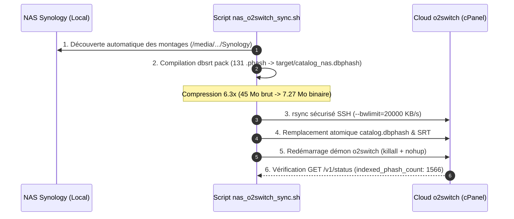

# 💡 Architecture du Cache Hybride Local-First & Déport Cloud o2switch

> Ce document de référence conceptuelle explicite les compromis d'ingénierie, la hiérarchie des niveaux de cache et les garde-fous anti-collision régissant l'orchestration entre le client local VLC, l'agent démon dbsrt et l'infrastructure Cloud o2switch.

---

## 🎯 Problématique & Compromis d'Ingénierie

La synchronisation automatisée de sous-titres par consensus perceptuel (`pHash`) confronte le système à deux contraintes antagonistes :

1. **La vitesse d'exécution (< 100 ms)** : Un utilisateur ouvrant un épisode dans VLC attend un affichage quasi-instantané des pistes de sous-titres disponibles, sans blocage de l'interface graphique.
2. **L'empreinte mémoire et stockage** : Un catalogue complet de séries et films sur NAS représente des dizaines de milliers de plans de coupe et de trames clés. Charger l'intégralité des empreintes brutes `.phash` (plusieurs centaines de mégaoctets) en RAM sur un poste client léger ou une appliance Raspberry Pi 4 est prohibitif.

Pour concilier ces exigences, l'architecture `dbsrt` adopte un modèle **hiérarchique à double niveau (Local-First & Cloud Relay)** complété par des filtres stricts de classification linguistique et d'entropie visuelle.

---

## 🏗️ Topologie Hiérarchique du Système

```mermaid
flowchart TD
    VLC["🎬 Lecteur VLC (Plugin vlsub_dbsrt.lua)"] -->|HTTP POST /v1/search (127.0.0.1:8765)| LocalAgent["🛡️ Démon Local dbsrt-server"]

    subgraph "Niveau 0 : Cache Local (Ultra-Rapide)"
        LocalAgent -->|1. Lookup direct < 2ms| LocalRAM["⚡ Index MIH Local (catalog.dbphash en RAM)"]
    end

    subgraph "Niveau 1 : Déport Cloud HTTPS (~70-90ms)"
        LocalAgent -->|2. Fallback si absent localement| CloudRelay["☁️ Cloud o2switch (O2SWITCH_URL, ex: https://&lt;your-domain&gt;/dbsrt)"]
        CloudRelay -->|Reconnaissance pHash| CloudRAM["⚡ Multi-Index Hashing Cloud (catalog.dbphash distant)"]
        CloudRelay -->|Sous-titres certifiés| CloudStore["🗄️ Dépôt SRT Cloud"]
    end

    subgraph "Système de Fichiers Local / NAS Synology"
        LocalAgent -->|3. Découverte sidecars & pistes locales| LocalDisk["📁 Vidéo locale + .srt (sidecar 1:1)"]
    end

    LocalRAM -->|Résultat local| LocalAgent
    CloudRelay -->|Candidats distants certifiés| LocalAgent
    LocalDisk -->|Sous-titres sidecar locaux| LocalAgent

    LocalAgent -->|Réponse unifiée avec tags [LOCAL] ou [CLOUD]| VLC
```

### Niveaux d'Exécution & Latences Associées

| Niveau | Mécanisme | Latence Typique | Empreinte RAM Client | Disponibilité Hors-Ligne |
| :--- | :--- | :--- | :--- | :--- |
| **Tier 0 (Local RAM)** | Multi-Index Hashing (`catalog.dbphash` chargé localement) | **< 2 ms** | Modérée (~7 à 25 Mo) | **100% (Air-Gapped)** |
| **Tier 1 (Cloud HTTPS)** | Déport d'empreinte via POST `/v1/recognize` vers `o2switch` | **70 - 95 ms** | Quasi-nulle (~5 Mo) | Nécessite connexion Internet |
| **Tier 2 (NAS Direct)** | Compilation et synchronisation périodique via `task o2switch:sync-nas` | Hors ligne (batch) | N/A | Centralisation partagée |

---

## 🛡️ Garde-Fous Algorithmiques & Anti-Collision

### 1. Rejet d'Entropie Nulle sur Écrans Noirs Dithérisés

Lorsqu'un lecteur multimédia ouvre un fichier vidéo, les premières trames ($t=0$ à $t=2$ secondes) correspondent souvent à un carton noir, un logo de distributeur ou une transition d'ouverture.

- **Le Piège Algorithmique** : En transformée en cosinus discrète 2D (DCT-II), une trame noire d'encodage avec léger dithering 0/1 produit une empreinte invariable :
  `0x8f4c_7233_588e_457e` ou `0x8fcc_7233_588e_453e`.
  Bien qu'ayant exactement 32 bits à 1 (échappant aux filtres naïfs de type `hash == 0`), cette empreinte présente une entropie spatiale nulle.
- **La Conséquence sans Filtrage** : Deux séries complètement distinctes (ex. *Beacon 23* et *Silicon Valley*) commençant toutes deux par des trames noires entraient en collision métrique avec 100% de similarité dans l'index MIH.
- **La Solution `dbsrt`** : La fonction `is_blank_phash` intègre une table d'exclusion formelle des signatures uniformes dithérisées. Toute requête micro-échantillonnée contenant ces trames statiques est immédiatement rejetée avec `confidence = 0.0` et `found = false`.

### 2. Filtrage Linguistique Strict (ISO-639-2)

Les releases multi-langues modernes (WEB-DL, BluRay remux) contiennent fréquemment des dizaines de pistes de sous-titres encapsulées ou extraites (`_ind_22.srt`, `_tha_24.srt`, `_vie_23.srt`, `_fre_5.srt`).

- **Le Bogue de Fallback Historique** : Lorsqu'un parseur ne reconnaissait pas les codes à 3 lettres comme l'indonésien (`ind`), le thaï (`tha`) ou le vietnamien (`vie`), une logique de repli permissif réassignait la langue demandée par l'utilisateur (`fr`). Résultat : l'interface affichait 7 pistes candidates en prétendant qu'elles étaient françaises.
- **La Règle de Filtrage Stricte** :
  1. Toute piste dont le jeton linguistique ne correspond pas exactement à la langue sollicitée est **immédiatement écartée** (`continue`).
  2. **Exception Sidecar 1:1** : Si un fichier `.srt` porte exactement le même nom de tige (*stem*) que la vidéo (ex. `Film.mkv` et `Film.srt` sans suffixe de langue), il est conservé comme sous-titre local prioritaire.

---

## 🔄 Synchronisation NAS vers Cloud (`task o2switch:sync-nas`)

Pour alimenter l'index Cloud sans exposer le NAS Synology directement sur l'Internet public, le pipeline applique le principe de compilation unidirectionnelle :



Ce mode opératoire garantit que le serveur distant dispose toujours d'un index Multi-Index Hashing compilé en mémoire vive, offrant des temps de réponse sous les 10 ms côté serveur (et moins de 90 ms aller-retour réseau pour le client VLC).
