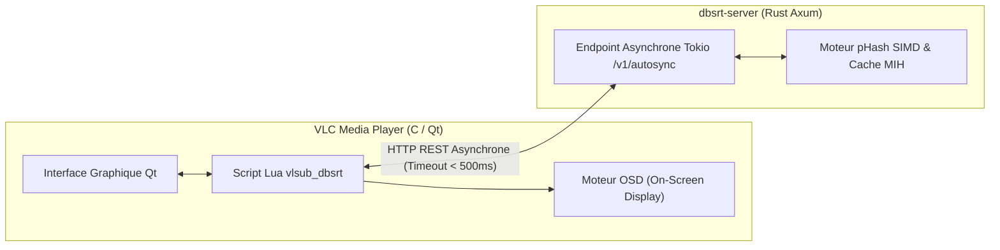

# 💡 Explication : Architecture Démon Axum & Intégration VLC OSD

Cet article détaille l'architecture découplée entre le lecteur multimédia **VLC** (moteur C/Qt et scripts Lua) et le microservice **`dbsrt-server`** (Rust Axum), ainsi que les choix d'ingénierie garantissant une réactivité fluide de l'interface utilisateur sans blocage.

---

## 1. La Contrainte Critique du Moteur Lua de VLC

L'environnement de script de VLC impose des contraintes architecturales sévères :

1. **Exécution synchrone sur le thread d'interface Qt** : Dans l'architecture de VLC, les extensions Lua de type dialogue (`vlsub_dbsrt.lua`) s'exécutent dans le contexte direct de la boucle d'événements de l'interface graphique.
2. **Risque de gel de l'application (Hang / Unresponsive)** : Tout appel bloquant (tel qu'un calcul lourd d'empreintes vidéo en Lua ou un appel réseau HTTP qui attend un timeout de 30 secondes) fige instantanément la fenêtre de VLC, provoquant une invite de plantage du gestionnaire de fenêtres du système d'exploitation.

---

## 2. Le Découpage en 3 Couches

Pour éliminer définitivement tout risque de gel de l'interface, le système délègue tout le travail lourd au démon externe :

### 1. La Couche Découverte & Configuration Dynamique
Au démarrage de `dbsrt-server`, celui-ci écrit un fichier éphémère atomique sous `/tmp/dbsrt-server.json` consignant son port d'écoute et son jeton de session.
Le script Lua lit ce fichier pour s'auto-configurer sans imposer à l'utilisateur de configurer manuellement une adresse IP ou un port.

### 2. Le Protocole HTTP Asynchrone & Timeouts Stricts
Tous les appels HTTP initiés depuis le script Lua vers le démon appliquent un **timeout strict de 500 millisecondes**. Si le démon ne répond pas immédiatement, la requête est interrompue, l'interface graphique est immédiatement libérée et un message d'information non-bloquant est affiché.

### 3. Les Notifications OSD Natives (On-Screen Display)
Plutôt que d'obliger l'utilisateur à garder une fenêtre de dialogue ouverte au-dessus de la vidéo, le plugin utilise le canal OSD natif de VLC (`vlc.osd.message(...)`). Les informations de recalage, la confiance et le décalage temporel (\( \Delta t \)) s'affichent directement sur l'image vidéo en surimpression pendant 3 secondes, sans perturber le visionnage plein écran.

---

## 3. Dégradation Gracieuse & Mode Hors-Ligne

Si `dbsrt-server` n'est pas démarré sur la machine locale :

- L'extension détecte immédiatement l'absence de socket active sur `/tmp/dbsrt-server.json`.
- Le plugin bascule gracieusement en mode standard OpenSubtitles (téléchargement classique de sous-titres par hash de fichier).
- Aucun message d'erreur bloquant n'interrompt la lecture de l'utilisateur.
