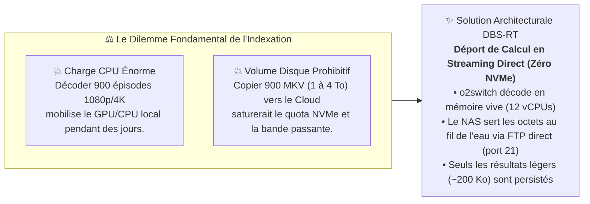
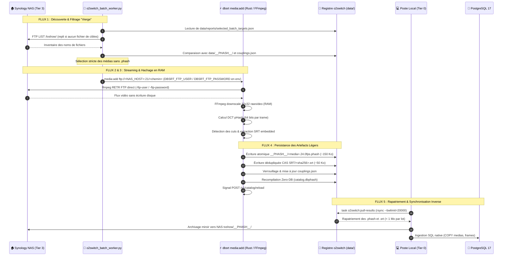
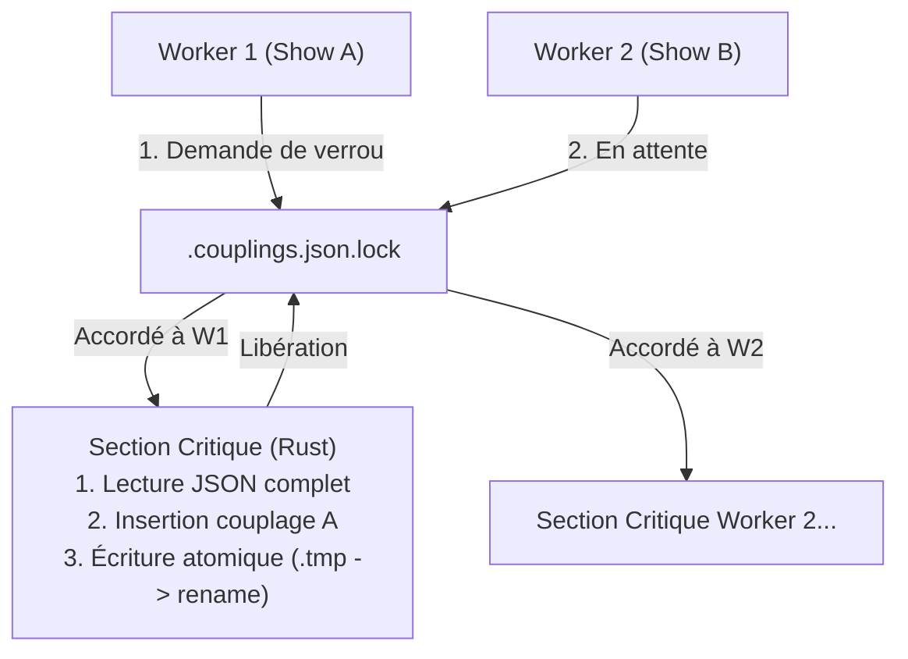
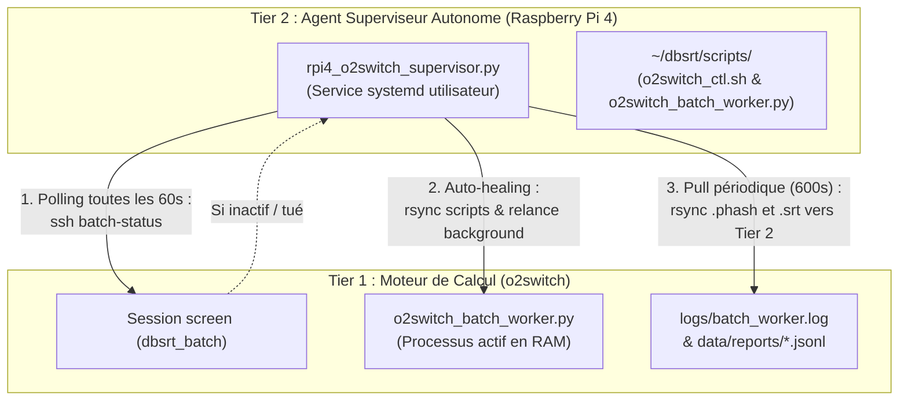

# 💡 Architecture : Déport de Calcul pHash, Stockage Multi-Niveaux & Synchronisation o2switch

> Ce document d'architecture explicite les choix d'ingénierie, les contrats d'interface (IN-OUT), la topologie physique multi-niveaux et les garanties d'idempotence régissant le déport de calcul du hachage perceptuel (`pHash`) sur l'infrastructure Cloud mutualisée **o2switch**, la synchronisation des catalogues et la réconciliation sans conflit avec le **NAS Synology** et la station locale.

---

## 🎯 1. Problématique & Compromis Fondamentaux

L'ingestion et l'indexation de vastes bibliothèques multimédias (plus de 900 épisodes "Vierges" identifiés sur le NAS) confrontent l'architecture à deux contraintes physiques antagonistes :



1. **La saturation des ressources locales** : Décoder des centaines de fichiers HEVC/H.264 1080p et 4K sur une station de travail ou un PC portable monopolise le ventilateur, la batterie et le GPU pendant des dizaines d'heures. L'hébergement Cloud o2switch dispose d'une offre dotée de **12 vCPUs** capables d'absorber ces calculs en tâche de fond.
2. **L'impossibilité de copier les vidéos sur le Cloud** : Un compte d'hébergement mutualisé n'est pas un data-lake de stockage brut. Y téléverser des téraoctets de conteneurs `.mkv` ferait exploser les quotas disques, violerait les conditions d'utilisation et prendrait des semaines de transfert montant.
3. **Le paradigme retenu : Découplage Flux Vidéo vs Métadonnées** : La vidéo ne réside **jamais** sur le disque d'o2switch. Elle transite en flux mémoire continu (streaming direct via FTP, lu par `ffmpeg` sans relais intermédiaire), est décodée en trames 32x32 rawvideo dans la RAM, puis immédiatement relâchée. Seuls les artefacts finaux ultra-légers (empreinte `.phash` de 150 Ko et sous-titres `.srt` de 50 Ko) sont enregistrés.

---

## 🗺️ 2. Topologie Physique des 4 Niveaux de Stockage

L'état du système est partitionné sur 4 paliers physiques complémentaires, chacun assurant une responsabilité spécialisée :

```mermaid
flowchart TD
    subgraph Tier3["Tier 3 : Stockage Maître & Vérité Terrain Vidéo (NAS Synology)"]
        NAS_VID["📁 /volume1/tvshow/*.mkv (Téraoctets)<br/>Conteneurs originaux immuables"]
        NAS_PHASH["📁 /volume1/tvshow/__PHASH__/*.phash<br/>Archive permanente des empreintes"]
    end

    subgraph WAN["🌐 Réseau Étendu & Sécurité Périmétrique"]
        FBX["Freebox OS : Redirection NAT port 21 (FTP)<br/>Filtrage IP strict : Seule l'IP sortante o2switch est admise"]
    end

    subgraph Tier1["Tier 1 : Moteur de Calcul Déporté & Serveur Cloud (o2switch)"]
        O2_CPU["⚙️ 12 vCPUs (1-8 workers dynamiques, 2-5 en autoscaling RPi4)"]
        O2_RAM["⚡ Mémoire RAM (Index MIH catalog.dbphash & Décodage FFmpeg)"]
        O2_DATA["💾 Stockage Léger NVMe (~/dbsrt/data/)<br/>• __PHASH__/*.phash (~150 Ko)<br/>• SRT/*.srt (~50 Ko CAS)<br/>• SRT/couplings.json"]
    end

    subgraph Tier0["Tier 0 / 2 : Poste Local & Base Relationnelle (Station de Travail)"]
        LOC_PG["🐘 PostgreSQL 17 SP-GiST<br/>Tables relationnelles medias & frames"]
        LOC_SRT["📁 data/SRT/ & data/__PHASH__/<br/>Cache de travail local"]
        LOC_VLC["🎬 Lecteur Multimédia VLC (Plugin vlsub_dbsrt.lua)"]
    end

    NAS_VID -->|1. Flux FTP en clair (compte lecture seule)| FBX
    FBX -->|2. Stream Réseau Mémoire| O2_CPU
    O2_CPU -->|3. Extraction à la volée| O2_DATA
    O2_DATA -->|4. Recompilation Zero-DB| O2_RAM
    O2_DATA -.->|5. task o2switch:pull-results| LOC_SRT
    LOC_SRT -->|6. Import SQL batch| LOC_PG
    LOC_SRT -.->|7. Sauvegarde pérenne| NAS_PHASH
    LOC_VLC -->|8. Requête HTTP /v1/search| O2_RAM
```

### Matrice des Responsabilités par Palier

| Palier Physique | Équipement & Rôle | Données Hébergées | Protocole d'Échange | Garantie d'Intégrité |
| :--- | :--- | :--- | :--- | :--- |
| **Tier 3 (Maître Vidéo)** | **NAS Synology**<br/>(hôte LAN privé) | Fichiers vidéos volumineux (`.mkv`, `.mp4`) et archive `.phash` miroir. | Serveur FTP (port 21), compte en lecture seule, NAT restreint à l'IP sortante d'o2switch. | Immuabilité des fichiers sources (Lecture seule `RO`). |
| **Tier 1 (Calcul & Cloud)** | **Cloud o2switch**<br/>(serveur mutualisé cPanel) | Moteur de calcul, index `catalog.dbphash` en RAM, magasin CAS `data/SRT/`. | HTTPS public (`/v1/search`), SSH interne (port 2022/22). | Zéro fichier vidéo stocké. Empreinte totale $\le 500$ Mo pour toute la bibliothèque. |
| **Tier 0 / 2 (Local)** | **Station Développeur**<br/>(Machine locale) | Base PostgreSQL 17 SP-GiST, code source, orchestration `Taskfile`. | Sockets Unix, TCP interne `127.0.0.1:8765`, rsync SSH. | Source de vérité relationnelle et gouvernance Git. |

---

## 🔄 3. Spécification Détaillée des Flux de Données (Dataflows IN - OUT)

Le traitement déporté s'articule autour de **5 flux transactionnels stricts**. Chaque flux possède des préconditions, des entrées-sorties typées et des garanties d'isolation.



---

### Flux 1 : Découverte & Filtrage des Médias "Vierges"
- **Entrée (IN)** : Fichier de cibles `data/reports/selected_batch_targets.json` (`--targets-file`), résolu localement par `o2switch_ctl.sh` depuis le montage NAS quand il est disponible. À défaut, le worker liste le dossier partagé NAS en FTP. `--retry-failed` restreint la file aux derniers échecs du journal d'événements.
- **Traitement** :
  1. Extraction du nom de fichier canonique (`stem`).
  2. Vérification d'existence locale sur o2switch : le fichier `~/dbsrt/data/__PHASH__/<stem>.*.phash` existe-t-il ?
  3. Vérification dans le registre `couplings.json` : le média est-il déjà certifié ?
- **Sortie (OUT)** : Liste ordonnée des vidéos au statut `IngestionStatus::Virgin` (0 empreinte calculée, prête pour ingestion).

---

### Flux 2 & 3 : Streaming Réseau Mémoire & Décodage à la Volée
- **Entrée (IN)** : URL FTP directe `ftp://<NAS_HOST>:21/<chemin>` passée par le worker à `dbsrt media:add`, sans identifiants dans l'URL.
- **Traitement** :
  1. Le worker positionne `DBSRT_FTP_USER` / `DBSRT_FTP_PASSWORD` dans l'environnement de chaque processus `dbsrt` enfant (identifiants lus depuis `etc/.nas_config` et `etc/.nas_pass`, mode 600).
  2. `dbsrt` transmet ces identifiants à `ffmpeg` / `ffprobe` via `-ftp-user` / `-ftp-password`. Ils ne sont jamais journalisés, et la partie userinfo des URLs journalisées est expurgée. Le `ffmpeg` statique d'o2switch ne supporte pas SFTP : FTP est le seul transport direct disponible.
  3. `ffmpeg` lit le flux FTP au fil de l'eau (`DBSRT_FFMPEG_THREADS`, `2` posé par le worker) sans chercher à stocker le fichier complet sur le disque.
  4. Les trames vidéo sont converties à la volée en niveaux de gris $32 \times 32$ pixels bruts (`rawvideo Y800`), injectées directement via pipe mémoire dans le moteur Rust de DCT (Discrete Cosine Transform).
  5. Simultanément, les flux de sous-titres intégrés au conteneur Matroska (pistes `ass` ou `srt`) sont extraits en mémoire texte.
- **Sortie (OUT)** :
  - Vecteur en mémoire des empreintes 64 bits : `Vec<u64>`.
  - Pistes de sous-titres décodées en mémoire : `Vec<(PathBuf, LangStatus)>`.
  - **Volume disque écrit : 0 octet**.

---

### Flux 4 : Persistance Atomique des Artefacts sur o2switch
- **Entrée (IN)** : Vecteur d'empreintes et chaînes de sous-titres normalisées.
- **Traitement** :
  1. **Écriture de l'empreinte pHash** :
     - Écriture dans un fichier temporaire : `~/dbsrt/data/__PHASH__/<media>.<fps>fps.phash.tmp`.
     - Renommage atomique via `rename(2)` pour garantir qu'aucun processus lecteur ne lise un fichier partiel.
     - Poids moyen : **150 Ko** pour un épisode de 45 minutes.
  2. **Magasin CAS des sous-titres** :
     - Calcul du hash cryptographique : $\text{SHA-256}(\text{contenu SRT normalisé})$.
     - Écriture sous `~/dbsrt/data/SRT/<subtitles_hash>.srt` si non déjà existant.
     - Poids moyen : **50 Ko**.
  3. **Registre de Vérité Terrain (`couplings.json`)** :
     - Acquisition du verrou inter-processus `RegistryLock` (`.couplings.json.lock`).
     - Insertion de la relation `(media_hash, subtitles_hash, lang, sub_frames)`.
     - Sérialisation atomique avec écriture temporaire et remplacement.
  4. **Recompilation Zero-DB & Hot-Reload** :
     - Exécution de `dbsrt pack` : regroupe toutes les empreintes de `__PHASH__/` dans l'index binaire ultra-dense `catalog.dbphash` en **0.05 seconde**.
     - Appel HTTP interne `curl -X POST http://127.0.0.1:8765/v1/catalog/reload` pour charger instantanément les nouvelles trames en RAM sans redémarrage de démon.
- **Sortie (OUT)** : Artefacts persistés et serveur Cloud opérationnel pour répondre aux requêtes de VLC.

---

### Flux 5 : Rapatriement Ascendant & Réconciliation Locale
- **Entrée (IN)** : Déclenchement de la synchronisation inverse via `task o2switch:pull-results`.
- **Traitement** :
  1. **Rapatriement sécurisé par rsync bridé** :
     ```bash
     rsync -avz --bwlimit=20000 o2switch:dbsrt/data/__PHASH__/ data/__PHASH__/
     rsync -avz --bwlimit=20000 o2switch:dbsrt/data/SRT/ data/SRT/
     ```
     - Le commutateur `--bwlimit=20000` (20 Mo/s) garantit le respect absolu du quota I/O CloudLinux d'o2switch (42 Mo/s max).
     - Le volume total transféré pour 100 épisodes n'excède pas **20 Mo**. Le transfert dure moins de 2 secondes.
  2. **Archivage pérenne sur le NAS Synology** :
     - Les fichiers `.phash` sont répliqués dans le dossier partagé du NAS (`/volume1/tvshow/__PHASH__/`) pour accompagner les vidéos de manière définitive.
  3. **Ingestion Relationnelle PostgreSQL 17 SP-GiST** :
     - Exécution de `task db:import:all-phash` sur la station locale.
     - Les empreintes sont injectées via le protocole binaire ultra-rapide `COPY` dans les tables `medias` et `frames`, alimentant l'arbre SP-GiST BK-Tree pour les requêtes SQL locales.
- **Sortie (OUT)** : Alignement 100% bit-à-bit entre le Cloud o2switch, le NAS et la base locale.

---

## 🛡️ 4. Résolution des Conflits, Idempotence & Intégrité

Sur un système distribué multi-cibles, les pannes réseau, les interruptions de processus et les exécutions concurrentes ne doivent **jamais** corrompre les données.

### A. Idempotence Native par Stockage CAS (Content-Addressed Storage)

Les fichiers de sous-titres ne sont pas identifiés par leur nom de fichier d'origine, mais par leur empreinte SHA-256 :

$$\text{Key} = \text{SHA-256}(\text{Corps du sous-titre en UTF-8})$$

- **Déduplication automatique** : Si deux releases distinctes d'un même épisode intègrent la même piste de sous-titres, un seul fichier `.srt` est écrit sur le disque.
- **Zéro écrasement destructeur** : Un sous-titre existant portant le même hash ne sera jamais écrasé ni altéré.

---

### B. Gestion de Concurrence sur `couplings.json` (Cross-Process Lock)

Le fichier `couplings.json` matérialise l'ancrage certifié entre trames vidéo et texte. Pour éviter toute corruption lors de traitements parallèles :



1. **Verrou exclusif système (`dbsrt_core::RegistryLock`)** : Chaque opération d'écriture pose un verrou exclusif via la primitive `flock(2)` sur le fichier `.couplings.json.lock`.
2. **Commit atomique à deux phases** :
   - Le JSON mis à jour est sérialisé dans un fichier temporaire adjacent `couplings.json.tmp.<pid>`.
   - Le fichier temporaire remplace l'ancien via un appel système atomique `rename(2)`.
   - Si le serveur plante au milieu de l'écriture, le fichier `couplings.json` initial reste 100% intact.

---

### C. Détection et Gestion des Conflits de Version

| Scénario de Conflit | Cause Racine | Comportement DBS-RT | Résolution |
| :--- | :--- | :--- | :--- |
| **Double traitement d'un même épisode** | Relance accidentelle du batch sur un média déjà haché. | `media_add` inspecte les signatures existantes : `reg.is_already_certified(...)` renvoie `true`. | **Saut idempotent (`skipped_idempotent`)**. Aucun calcul redondant, message d'information dans les logs. |
| **Coupure réseau FTP en plein milieu du flux** | Micro-coupure WiFi ou liaison Freebox pendant le streaming. | FFmpeg renvoie une erreur I/O ou se bloque. Le worker classe la vidéo en `ERROR`, `STALLED` (aucune activité CPU prolongée) ou `TIMEOUT` (`--max-extraction-secs` dépassé) et tue le groupe de processus. | **Nettoyage automatique**. Le fichier partiel `.phash.tmp` est purgé, le média reste `Vierge`. Relance ciblée avec `--retry-failed`. |
| **Fichier vidéo réencodé ou modifié sur le NAS** | Remplacement d'une version 720p par une version 1080p remasterisée. | Les trames changent, le digest `media_hash` résultant est distinct. | Un nouveau couplage est créé sous le nouveau `media_hash`. L'ancien couplage reste valide pour les utilisateurs possédant l'ancienne release. |
| **Conflit de synchronisation bidirectionnelle** | Exécution simultanée d'un hachage local et d'un hachage Cloud. | Les deux environnements ont généré des couplages disjoints dans leur `couplings.json` respectif. | L'outil `task catalog:verify` fusionne les clés de couplage par union ensembliste CAS ($\text{Registry}_A \cup \text{Registry}_B$) sans perte d'information. |

---

## 🤖 4. Superviseur Autonome RPi4 & Modèle de Tolérance aux Pannes (Auto-Healing)

Pour découpler l'intervention de l'opérateur humain de l'avancement des batchs, un agent de surveillance autonome (**Watchdog Supervisor**) s'exécute en démon 24/7 sur un équipement basse consommation (Raspberry Pi 4 / Tier 2) :



### Mécanique de l'Auto-Healing et Déploiement Multi-Niveaux

1. **Cycle de Polling (60 secondes)** : L'agent lit la ligne `BATCH_STATE=<running|stopped|finished|crashed|absent> PID=<pid|none> TYPE=<tvshow|movies>` renvoyée par `batch-status`. Il relance le batch en arrière-plan (`screen -dmS`) uniquement s'il est `crashed` ou `absent` ; un batch `stopped` (marqueur `run/batch_stopped`) ou `finished` n'est jamais relancé.
2. **Synchronisation du Code** : Lors d'une relance, le superviseur s'assure que la version locale de `scripts/o2switch_batch_worker.py` présente sur le RPi4 est projetée sur o2switch.
3. **Persistance en Mémoire RAM** : Le processus Python actif sur o2switch conserve son code chargé en mémoire vive. Pour charger un nouveau code, arrêtez le batch (`task o2switch:batch:stop`) puis relancez-le explicitement (`batch-tvshow` / `batch-movies`), ce qui efface le marqueur d'arrêt.
4. **Autoscaling en boucle fermée** : L'agent ajuste la concurrence entre 2 et 4 workers via `run/desired_workers` selon la charge CPU LVE (cible 78% à 92%).
5. **Reprise Idempotente Ciblée** : Grâce à l'argument `--fresh-only` (ou `--retry-failed`), le worker redémarré ignore instantanément tous les médias dont les empreintes `.phash` ont déjà été validées sur disque, évitant tout recalcul inutile.

---

## 📊 5. Tableau Synthétique des Contrats d'Interface IN / OUT

| Étape de Pipeline | Entrée (IN) | Sortie (OUT) | Volume Moyen | Protocole Réseau | Mécanisme d'Idempotence |
| :--- | :--- | :--- | :--- | :--- | :--- |
| **1. Découverte** | Chemin racine NAS (`/tvshow/`) | Liste d'objets `MediaCandidate` | Quelques Ko JSON | Fichier de cibles local ou `LIST` FTP | Filtre d'exclusion sur présence `.phash` |
| **2. Streaming Décodeur** | Flux distant continu (URL `ftp://`) | Trames brutes $32 \times 32$ en RAM (`rawvideo`) | En mémoire vive (zéro disque) | FTP direct (port 21) lu par `ffmpeg` | Flux jetable non persistant |
| **3. Hachage DCT** | Trames $32 \times 32$ | Empreintes pHash 64 bits (`Vec<u64>`) | En mémoire vive | CPU interne (SIMD / Rayon) | Algorithme DCT déterministe bit-à-bit |
| **4. Export Fichier** | Empreintes 64 bits | Fichier binaire `*.phash` | **~150 Ko** par vidéo | Système de fichiers o2switch | Écriture atomique via `.tmp` puis `rename` |
| **5. Extraction SRT** | Flux sous-titres conteneur | Piste texte `*.srt` normalisée UTF-8 | **~50 Ko** par langue | Mémoire $\rightarrow$ Disque NVMe | Dépôt CAS basé sur SHA-256 du texte |
| **6. Certification** | Hash média + Hash sous-titres | Entrée ajoutée dans `couplings.json` | ~500 octets par entrée | Verrouillage fichier `flock` | Vérification CAS `is_already_certified` |
| **7. Packaging Zero-DB** | Répertoire de fichiers `__PHASH__/*.phash` | Fichier binaire unique `catalog.dbphash` | **~18 Mo** pour 5M trames | Mmap / SIMD local | Index immutable compacté |
| **8. Rapatriement** | Artefacts distants o2switch | Miroir local et base PostgreSQL 17 | $\le 200$ Ko par épisode | `rsync` SSH bridé à 20 Mo/s | Checksum natif rsync + COPY PostgreSQL |

---

## 🔗 Voir Aussi

- [Architecture du Cache Hybride Local & Cloud o2switch](architecture-cache-hybride-local-cloud.md)
- [Stockage Décentralisé CAS & Distribution](stockage-decentralise-cas-et-distribution.md)
- [Guide Pratique : Déployer sur Hébergement Mutualisé o2switch](../how-to/deployer-o2switch-cloud-cpanel.md)
- [Guide Pratique : Interconnecter NAS Synology et o2switch en FTP](../how-to/interconnecter-nas-synology-et-o2switch-ftp.md)
