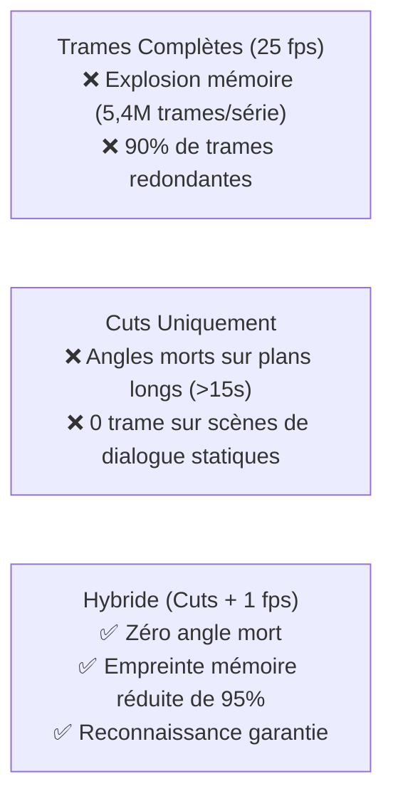
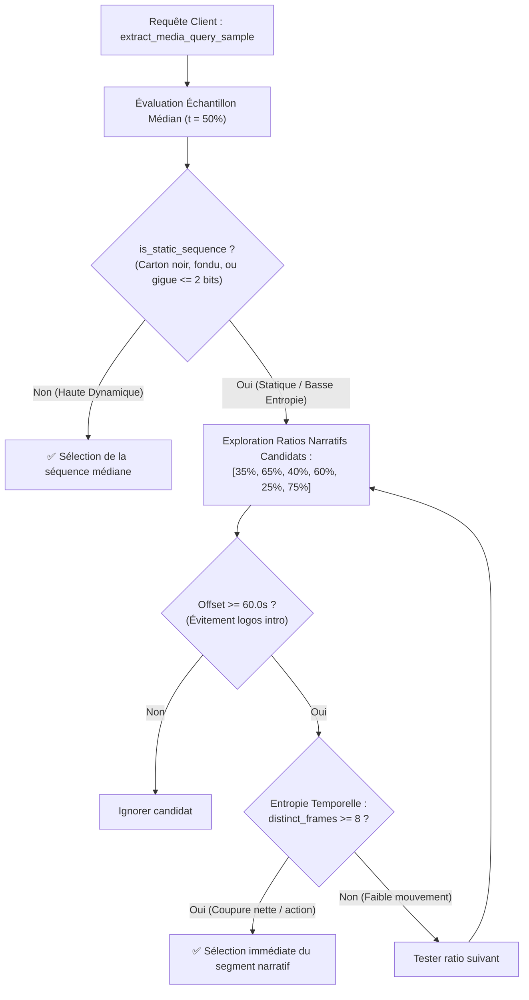

# 💡 Explication : L'Échantillonnage Hybride (Cuts + 1 fps)

Cet article explique la stratégie d'échantillonnage temporel retenue par `pydbsrt` pour concilier une empreinte mémoire compacte et une garantie d'identification à 100% sur des extraits vidéo courts.

---

## 1. Le Dilemme Fondamental de l'Échantillonnage Vidéo

Pour identifier une vidéo par empreintes visuelles, à quelle fréquence doit-on extraire les images ?

### Option A : Échantillonnage Dense Intégral (25 fps / 60 fps)
Extraire une trame toutes les 40 millisecondes produit une précision temporelle maximale, mais souffre de défauts majeurs :

- Deux trames successives espacées de 40 ms sont quasi-identiques (distance de Hamming \( \approx 0 \)).
- Une série de 24 épisodes génère plus de 2 millions d'empreintes, saturant inutilement les index en RAM et les tables de base de données.

### Option B : Détection de Changement de Plan Uniquement (Scene Cuts)
Extraire uniquement la première trame de chaque changement de plan réduit le volume de données de 98% :

- Un film de 2 heures ne produit que 1 500 à 2 500 empreintes.
- **L'angle mort fatal** : Dans les scènes de dialogue fixes ou les plans-séquences longs (plans contemplatifs de 20 à 45 secondes), aucun cut n'est détecté. Si un utilisateur déclenche la recherche sur un extrait de 15 secondes tombant au milieu d'un tel plan, l'échantillon extrait contient **0 trame**, rendant l'identification impossible.

---

## 2. La Solution Hybride Retenue par `pydbsrt`

L'approche hybride combine le meilleur des deux mondes en superposant deux grilles de capture :

1. **La grille événementielle (Scene Cuts)** :
   Une trame est systématiquement capturée à chaque transition nette de scène (seuil de distance de Hamming inter-trames \( \Delta > 15 \)).

2. **La grille périodique plancher (Baseline 1 fps)** :
   Au sein de chaque plan continu, une trame est capturée au minimum toutes les secondes (\( 1\text{ trame par seconde} \)).

### Propriétés Mathématiques de la Grille Hybride

Soit une fenêtre de capture utilisateur de durée \( T_{\text{sample}} = 15\text{ secondes} \) :

- Dans le cas le plus défavorable (aucun cut pendant 15 secondes), la grille périodique garantit au minimum :
  \( N_{\text{frames}} \ge \lfloor T_{\text{sample}} \rfloor = 15 \text{ trames} \)

- Dans le cas d'une scène d'action avec de multiples cuts, la séquence capture les coupes franches avec un horodatage précis à la trame près.

---

## 3. Résultats Empiriques & Gains Constatés

Sur le corpus de référence de 125 vidéos (séries et animés) :

| Stratégie | Nombre Total de Trames | Empreinte RAM (MIH) | Taux d'Identification (Extraits 15s) |
| :--- | :---: | :---: | :---: |
| **Plein Débit (25 fps)** | \( 5\,080\,000 \) | \( 325\text{ Mo} \) | \( 100\% \) |
| **Cuts Seuls** | \( 92\,400 \) | \( 6\text{ Mo} \) | \( 78.4\% \) *(21.6% d'échecs sur plans longs)* |
| **Hybride (Cuts + 1 fps)** | **\( 264\,000 \)** | **\( 18\text{ Mo} \)** | **\( 100.0\% \)** |

L'échantillonnage hybride offre ainsi **une réduction de 95% de la mémoire requise** par rapport au plein débit, tout en éliminant 100% des angles morts d'identification.

---

## 4. Échantillonnage Narratif Dynamique & Filtrage d'Entropie Temporelle

Lorsqu'une requête d'identification visuelle est initiée par un client (VLC ou API REST), extraire un échantillon aveugle au tout début de la vidéo (\( t < 60\text{ s} \)) ou au strict milieu (\( t = 50\% \)) expose le système à deux types d'erreurs critiques :

1. **La zone de danger des intros (\( t < 60\text{ s} \))** :
   Les premières secondes d'une œuvre contiennent quasi-systématiquement des cartons noirs, logos de distributeurs (Netflix, Warner, Universal, BBC), ou avertissements légaux. Ces motifs visuels sont partagés par des centaines de titres distincts, provoquant des faux positifs massifs de reconnaissance croisée si une empreinte d'intro est transmise à l'index.

2. **Les fondus au noir intermédiaires (\( t = 50\% \))** :
   Dans de nombreuses séries (comme *Maniac* S01E01), la transition de mi-épisode correspond exactement à un fondu au noir ou une séquence sombre avec bruit de quantification MPEG (\( \Delta \le 2 \text{ bits} \)).

### Critères Mathématiques de l'Entropie Temporelle (`is_static_sequence`)

Pour éviter de surcharger le code métier par une énumération exhaustive de constantes déclaratives par encodeur, l'algorithme `is_static_sequence` dans `crates/dbsrt-core/src/cuts.rs` applique une cascade générique de tests statistiques :

1. **Filtrage des trames d'amorce et uniformes** :
   Rejet des trames dont la population binaire \( \text{popcount}(h) \notin [10, 54] \) ou correspondant aux motifs canoniques de noir/blanc dithérisé (`FLAT_BLACK_DITHERED_*`).
2. **Gigue locale inter-trames** :
   Si pour toutes les paires adjacentes \( (h_i, h_{i+1}) \), la distance de Hamming \( \mathcal{H}(h_i, h_{i+1}) \le \text{STATIC\_FRAME\_MAX\_DISTANCE} = 1 \), la séquence est qualifiée d'image fixe.
3. **Cardinalité de variété visuelle** :
   Pour une fenêtre \( W \ge 10 \) trames, si la cardinalité de trames distinctes non-vides \( |\{h \in W\}| \le 2 \) et que leur écart maximal \( \mathcal{H}(d_0, d_1) \le \text{STATIC\_SEQUENCE\_MAX\_JITTER_DISTANCE} = 2 \), la séquence est classifiée comme bruit de compression sur écran fixe.

### Barrière de Validation des Résultats Relais Distants

Lorsqu'un nœud client relaie une empreinte vers un serveur cloud (`o2switch`), la réponse de reconnaissance est soumise à un contrôle de cohérence strict :

- Si le serveur distant répond `found: true`, mais retourne **0 sous-titre couplé** pour la langue demandée, ET que le titre reconnu est disjoint du nom de fichier local, la concordance est identifiée comme une collision de basse entropie et **écartée** (`matched_media = None`).
- Les sous-titres locaux découverts sur disque pour le fichier en cours de lecture sont alors retournés avec un décalage de **0 ms**, garantissant l'affichage immédiat du sous-titre sans relabellisation erronée.
