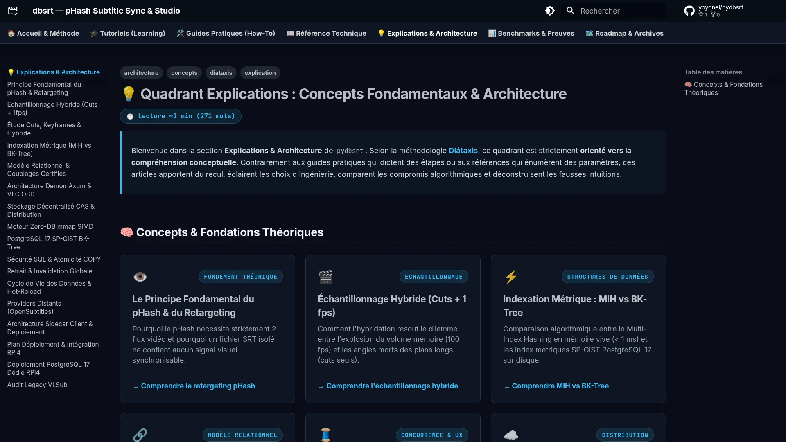

# 💡 Quadrant Explications : Concepts Fondamentaux & Architecture

> Bienvenue dans la section **Explications & Architecture** de `pydbsrt`.
> Selon la méthodologie **[Diátaxis](https://diataxis.fr/)**, ce quadrant est strictement **orienté vers la compréhension conceptuelle**.
> Contrairement aux guides pratiques qui dictent des étapes ou aux références qui énumèrent des paramètres, ces articles apportent du recul, éclairent les choix d'ingénierie, comparent les compromis algorithmiques et déconstruisent les fausses intuitions.

---

## 📸 Aperçu du Quadrant Explications

<figure markdown="1">
  
  <figcaption>Figure 1 : Interface du portail des explications conceptuelles et d'architecture.</figcaption>
</figure>

---

## 🧠 Concepts & Fondations Théoriques

  

    

      👁️
      FONDEMENT THÉORIQUE
    

    <h3>Le Principe Fondamental du pHash &amp; du Retargeting</h3>
    
Pourquoi le pHash nécessite strictement 2 flux vidéo et pourquoi un fichier SRT isolé ne contient aucun signal visuel synchronisable.

    

      <a href="principe-fondamental-phash-et-retargeting/">→ Comprendre le retargeting pHash</a>
    

  

  

    

      🎬
      ÉCHANTILLONNAGE
    

    <h3>Échantillonnage Hybride (Cuts + 1 fps)</h3>
    
Comment l'hybridation résout le dilemme entre l'explosion du volume mémoire (100 fps) et les angles morts des plans longs (cuts seuls).

    

      <a href="echantillonnage-hybride-cuts-et-1fps/">→ Comprendre l'échantillonnage hybride</a>
    

  

  

    

      ⚡
      BENCHMARKS &amp; ACCÉLÉRATION
    

    <h3>Performances Décodage &amp; Accélération GPU</h3>
    
Démystification de la contention CIFS (108 MB/s réels) et accélération par 4x à 9x via décodage matériel GPU VA-API face au CPU.

    

      <a href="performances-decodage-phash-et-contentions/">→ Comprendre les performances &amp; GPU</a>
    

  

  

    

      ⚡
      STRUCTURES DE DONNÉES
    

    <h3>Indexation Métrique : MIH vs BK-Tree</h3>
    
Comparaison algorithmique entre le Multi-Index Hashing en mémoire vive (< 1 ms) et les index métriques SP-GiST PostgreSQL 17 sur disque.

    

      <a href="indexation-metrique-mih-vs-bktree/">→ Comprendre MIH vs BK-Tree</a>
    

  

  

    

      🔗
      MODÈLE RELATIONNEL
    

    <h3>Vérité Terrain &amp; Couplages Certifiés</h3>
    
Pourquoi les médias vidéo et les sous-titres sont strictement découplés en base, et comment la certification garantit l'alignement N:M.

    

      <a href="modele-relationnel-couplages-certifies/">→ Comprendre la vérité terrain</a>
    

  

  

    

      🧵
      CONCURRENCE &amp; UX
    

    <h3>Architecture Démon Axum &amp; VLC OSD</h3>
    
Comment le modèle asynchrone non-bloquant prévient le gel de l'interface graphique de VLC lors des requêtes de calcul pHash.

    

      <a href="architecture-daemon-axum-et-vlc-osd/">→ Comprendre l'intégration VLC</a>
    

  

  

    

      ⚡
      CACHE &amp; CLOUD
    

    <h3>Cache Hybride Local-First &amp; Cloud o2switch</h3>
    
Hiérarchie des tiers de latence (Tier 0 RAM < 2ms vs Tier 1 Cloud ~70ms), anti-collision sur écrans noirs et filtrage linguistique strict.

    

      <a href="architecture-cache-hybride-local-cloud/">→ Comprendre le cache hybride</a>
    

  

  

    

      ☁️
      DISTRIBUTION
    

    <h3>Stockage Décentralisé CAS &amp; Distribution</h3>
    
Principes du stockage adressable par le contenu (Content-Addressable Storage) pour la réplication et la distribution de sous-titres.

    

      <a href="stockage-decentralise-cas-et-distribution/">→ Comprendre le stockage CAS</a>
    

  

