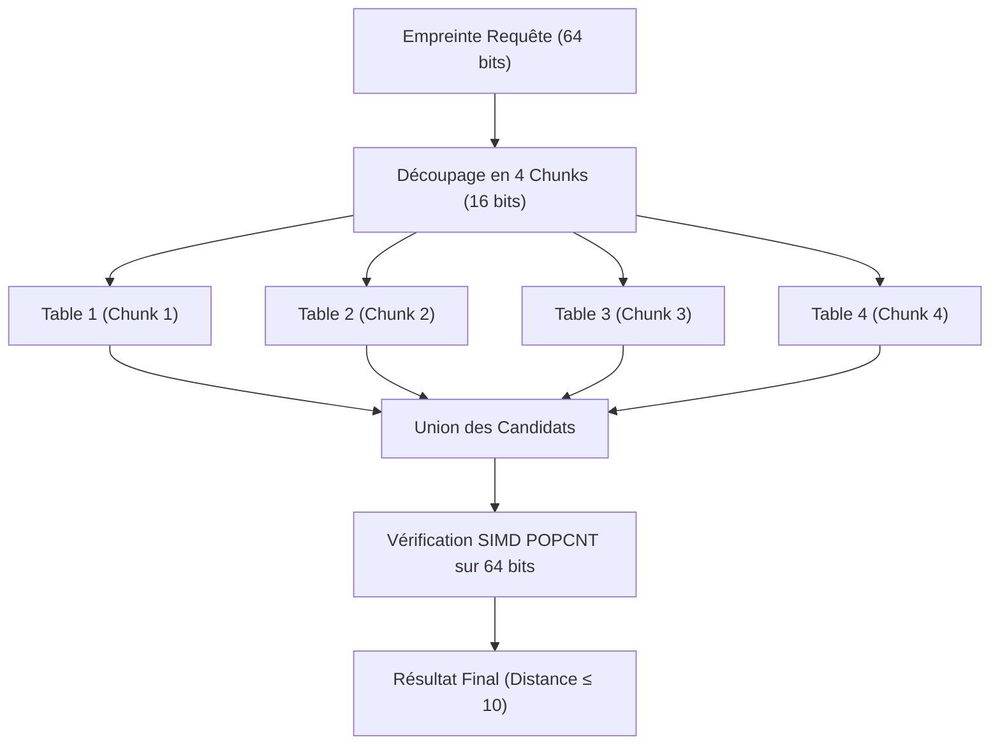

# 💡 Explication : Indexation Métrique (MIH vs BK-Tree)

Cet article analyse les deux structures d'indexation sous-linéaires en distance de Hamming exploitées dans `pydbsrt` : le **Multi-Index Hashing (MIH)** en mémoire vive et l'arbre métrique **BK-Tree SP-GiST** dans PostgreSQL 17.

---

## 1. La Problématique de la Recherche en Distance de Hamming

Une empreinte visuelle `pHash` est un entier 64-bit non-signé (\( h \in \{0, 1\}^{64} \)).
La similarité entre deux trames \( A \) et \( B \) se mesure par la **distance de Hamming** \( \mathcal{D}_H(A, B) \), soit le nombre de bits différents :

\[
\mathcal{D}_H(A, B) = \text{POPCNT}(A \oplus B)
\]

Sur un catalogue de \( N = 10\,000\,000 \) de trames, un balayage linéaire complet (brute-force) nécessiterait 10 millions d'opérations XOR et POPCNT à chaque seconde de vidéo analysée. Pour garantir des temps de réponse sous la milliseconde (\( < 1\text{ ms} \)), des structures d'indexation sous-linéaires sont indispensables.

---

## 2. Multi-Index Hashing (MIH) : Le Moteur In-Memory Ultra-Rapide

Le Multi-Index Hashing (introduit par Norouzi et al.) repose sur le **principe des tiroirs de Dirichlet** :

> [!NOTE] Théorème des Tiroirs Appliqué aux Chunks Binaires
> Si l'on découpe un mot binaire de \( b = 64 \) bits en \( m = 4 \) sous-blocs disjoints de \( k = 16 \) bits chacun (\( h = [c_1, c_2, c_3, c_4] \)), alors toute paire d'empreintes distante de \( \mathcal{D}_H(A, B) \le r \) (ex: \( r = 10 \)) doit obligatoirement présenter **au moins un sous-bloc** où la distance est inférieure ou égale à :
> \( d_{\text{chunk}} \le \lfloor r / m \rfloor = \lfloor 10 / 4 \rfloor = 2 \text{ bits} \)

### Avantages de l'Implémentation Rust de `pydbsrt`
- **Complexité quasi \( O(1) \)** : L'accès aux candidats se fait par indexation directe dans un tableau de hachage de \( 2^{16} = 65\,536 \) entrées.
- **Accélération SIMD** : Le filtrage final des candidats exploite l'instruction assembleur native `POPCNT` (x86_64 SSE4.2 / ARM NEON).
- **Latence mesurée** : Moins de **\( 0.3\text{ ms} \)** pour interroger un corpus de plusieurs millions de trames.

---

## 3. BK-Tree SP-GiST : La Persistance Métrique dans PostgreSQL 17

Le Multi-Index Hashing requiert que l'intégralité des tables réside en mémoire vive. Lorsque le corpus grandit ou que la persistance relationnelle avec contraintes ACID est requise, `pydbsrt` s'appuie sur l'arbre de Burkhard-Keller (**BK-Tree**) au sein de PostgreSQL 17 via l'infrastructure `SP-GiST`.

### Propriété Métrique et Inégalité Triangulaire

Dans un espace métrique discret vérifiant l'inégalité triangulaire, pour un nœud pivot \( P \) et une cible de recherche \( Q \) avec un rayon maximal \( r \) :

\[
|\mathcal{D}_H(P, Q) - \mathcal{D}_H(P, X)| \le \mathcal{D}_H(Q, X) \le r
\]

Le parcours de l'arbre peut donc **éliminer récursivement des branches entières** sans examiner leurs nœuds enfants :

- Tout sous-arbre dont la distance au pivot n'appartient pas à l'intervalle \( [\mathcal{D}_H(P, Q) - r, \, \mathcal{D}_H(P, Q) + r] \) est ignoré.

---

## 4. Synthèse Comparative des Deux Approches

| Critère | Multi-Index Hashing (MIH Rust) | SP-GiST BK-Tree (PostgreSQL 17) |
| :--- | :--- | :--- |
| **Support de stockage** | Mémoire vive (RAM) / `mmap` | Disque (pages de base de données PostgreSQL) |
| **Latence d'interrogation** | **\( < 0.5\text{ ms} \)** (Ultra-basse latence) | **\( 2\text{ à }8\text{ ms} \)** (E/S disque et verrous) |
| **Garanties transactionnelles**| Lecture seule / rechargement atomique | **ACID complet**, transactions `COPY`, verrous fins |
| **Montée en charge mémoire** | Proportionnelle au nombre de trames | Économique (seul le cache tampon est en RAM) |
| **Rôle dans `pydbsrt`** | **Hot-cache de reconnaissance en direct** (VLC / API) | **Source de vérité durable et requêtes relationnelles** |
