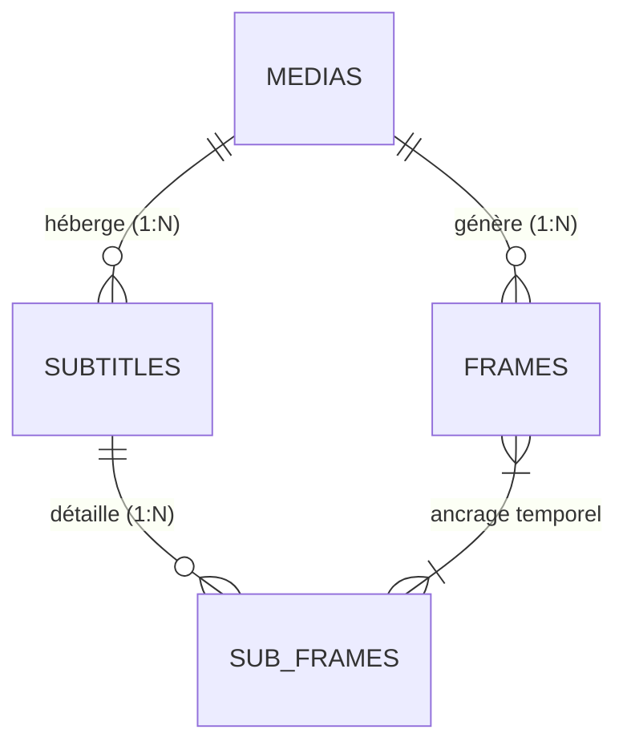

# 💡 Explication : Modèle Relationnel & Couplages Certifiés

Cet article détaille l'architecture des données relationnelles de `pydbsrt`, justifiant le découplage strict entre flux vidéo et fichiers de sous-titres, ainsi que la modélisation à double niveau de la vérité terrain.

---

## 1. La Réalité des Écosystèmes Multimédia : Une Relation \( N \times M \)

Dans l'écosystème de la distribution vidéo, associer de façon rigide un fichier de sous-titre à un fichier vidéo unique est un anti-pattern :

1. **Une vidéo possède \( N \) sous-titres** : Une même release vidéo peut accueillir des sous-titres en français, anglais, espagnol, ainsi que des pistes spécifiques pour malentendants (SDH) ou des sous-titres forcés pour les passages en langue étrangère.
2. **Un sous-titre correspond à \( M \) releases vidéo** : Un sous-titre rédigé pour une édition Blu-ray peut s'appliquer à une diffusion Web-DL, sous réserve d'un décalage temporel constant (\( \Delta t \)) ou d'une compensation de cadence (\( 24\text{ fps} \leftrightarrow 25\text{ fps} \)).

Pour modéliser fidèlement cette réalité, `pydbsrt` sépare strictement l'entité vidéo (`medias`), l'entité sous-titres (`subtitles`), et la table d'ancrage temporel de vérité terrain (`sub_frames`).

---

## 2. Les Deux Niveaux d'Ancrage Temporel

### Niveau 1 : Le Couplage Macro (`subtitles`)
Au niveau macroscopique, la table `subtitles` relie un flux vidéo de référence à une piste de sous-titres :

- `media_id` : Clé étrangère pointant vers la vidéo ayant servi à la certification.
- `subtitles_hash` : Empreinte cryptographique garantissant que le texte n'a pas été corrompu ou altéré.
- `lang` : Code langue normalisé.
- `certified` : Drapeau booléen attestant que l'alignement a été validé.

### Niveau 2 : L'Ancrage Micro-Temporel (`sub_frames`)
Le recalage algorithmique précis ne peut pas se contenter d'un simple offset global pour tout le film (qui échouerait en cas de publicités insérées ou de coupes au montage).
La table `sub_frames` enregistre pour **chaque réplique individuelle** :

- `start_frame_offset` : L'indice précis de la trame vidéo où la réplique doit apparaître.
- `end_frame_offset` : L'indice de la trame où la réplique doit disparaître.
- `text` : Le texte exact de la réplique.

Cet ancrage fin permet à `dbsrt` de :

1. Calculer une régression temporelle robuste (détection de dérive affine PAL/NTSC).
2. Valider visuellement dans **dbsrt Studio** la superposition exacte du texte sur l'image correspondante.
3. Détecter automatiquement les désynchronisations partielles causées par des jingles publicitaires au milieu d'un épisode.

---

## 3. Intégrité Référentielle & Suppression en Cascade

Toutes les relations de dépendance sont sécurisées par des contraintes `ON DELETE CASCADE` :

- Si un média de référence obsolète est purgé de la table `medias`, ses millions de trames pHash dans `frames`, ses sous-titres dans `subtitles` et l'ensemble de ses ancres dans `sub_frames` sont nettoyés atomiquement par le moteur PostgreSQL, éliminant tout risque d'enregistrements orphelins.
