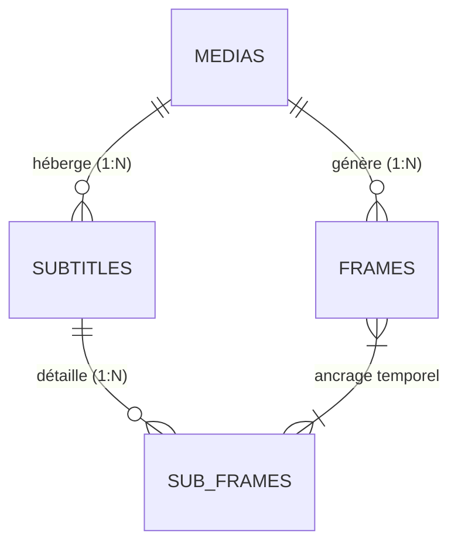
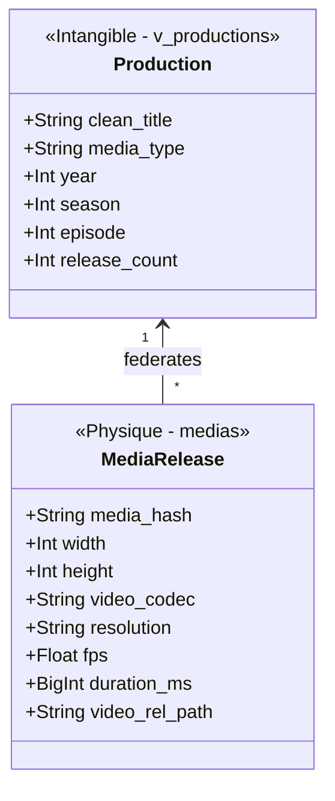
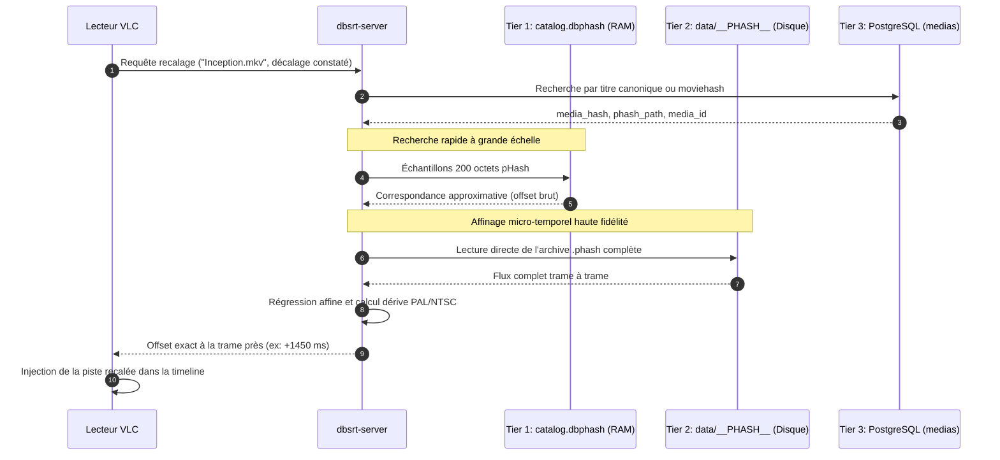

# 💡 Explication : Modèle Relationnel & Couplages Certifiés

Cet article détaille l'architecture des données relationnelles de `pydbsrt`, justifiant le découplage strict entre flux vidéo et fichiers de sous-titres, ainsi que la modélisation à double niveau de la vérité terrain.

---

## 1. La Réalité des Écosystèmes Multimédia : Une Relation \( N \times M \)

Dans l'écosystème de la distribution vidéo, associer de façon rigide un fichier de sous-titre à un fichier vidéo unique est un anti-pattern :

1. **Une vidéo possède \( N \) sous-titres** : Une même release vidéo peut accueillir des sous-titres en français, anglais, espagnol, ainsi que des pistes spécifiques pour malentendants (SDH) ou des sous-titres forcés pour les passages en langue étrangère.
2. **Un sous-titre correspond à \( M \) releases vidéo** : Un sous-titre rédigé pour une édition Blu-ray peut s'appliquer à une diffusion Web-DL, sous réserve d'un décalage temporel constant (\( \Delta t \)) ou d'une compensation de cadence (\( 24\text{ fps} \leftrightarrow 25\text{ fps} \)).

Pour modéliser fidèlement cette réalité, `pydbsrt` sépare strictement l'entité vidéo (`medias`), l'entité sous-titres (`subtitles`), et la table d'ancrage temporel de vérité terrain (`sub_frames`).

---

## 2. Les Deux Niveaux d'Ancrage Temporel

### Niveau 1 : Le Couplage Macro (`subtitles`)
Au niveau macroscopique, la table `subtitles` relie un flux vidéo de référence à une piste de sous-titres :

- `media_id` : Clé étrangère pointant vers la vidéo ayant servi à la certification.
- `subtitles_hash` : Empreinte cryptographique garantissant que le texte n'a pas été corrompu ou altéré.
- `lang` : Code langue normalisé.
- `certified` : Drapeau booléen attestant que l'alignement a été validé.

### Niveau 2 : L'Ancrage Micro-Temporel (`sub_frames`)
Le recalage algorithmique précis ne peut pas se contenter d'un simple offset global pour tout le film (qui échouerait en cas de publicités insérées ou de coupes au montage).
La table `sub_frames` enregistre pour **chaque réplique individuelle** :

- `start_frame_offset` : L'indice précis de la trame vidéo où la réplique doit apparaître.
- `end_frame_offset` : L'indice de la trame où la réplique doit disparaître.
- `text` : Le texte exact de la réplique.

Cet ancrage fin permet à `dbsrt` de :

1. Calculer une régression temporelle robuste (détection de dérive affine PAL/NTSC).
2. Valider visuellement dans **dbsrt Studio** la superposition exacte du texte sur l'image correspondante.
3. Détecter automatiquement les désynchronisations partielles causées par des jingles publicitaires au milieu d'un épisode.

---

## 3. Intégrité Référentielle & Suppression en Cascade

Toutes les relations de dépendance sont sécurisées par des contraintes `ON DELETE CASCADE` :

- Si un média de référence obsolète est purgé de la table `medias`, ses millions de trames pHash dans `frames`, ses sous-titres dans `subtitles` et l'ensemble de ses ancres dans `sub_frames` sont nettoyés atomiquement par le moteur PostgreSQL, éliminant tout risque d'enregistrements orphelins.

---

## 4. Séparation des Préoccupations (SoC) : Œuvre Conceptuelle vs Flux Numérique Physique

À partir des migrations V4 et V5, l'architecture relationnelle explicite une distinction fondamentale du domaine audiovisuel :

### 1. L'Œuvre / Production (Intangible)
Définit la création intellectuelle (film, épisode, documentaire) indépendamment de ses artefacts de diffusion :

* Titre canonique épuré (`clean_title`)
* Classification éditoriale (`media_type`)
* Année de production, saison et épisode

### 2. Le Média / Release (Physique)
Définit l'instance numérique concrète hébergée sur le stockage (NAS ou disque local) :

* Signature perceptuelle cryptographique (`media_hash`, empreinte invariante des images)
* Caractéristiques matérielles du conteneur (`width`, `height`, `video_codec`) mesurées par sonde `ffprobe`
* Localisation sur le système de fichiers (`video_rel_path`, `phash_path`)

Cette séparation permet d'agréger sous une même entité conceptuelle (`v_productions`) plusieurs encodages (ex: WEB-DL 720p, BluRay 1080p, Remux 4K) tout en conservant une traçabilité physique stricte pour le recalage pHash.

---

## 5. Cas d'Usage Concrets : Présents et Futurs

### Cas 1 (Opérationnel Actuel) : Recalage Instantané d'un Sous-Titre par VLC

Dans le flux nominal de synchronisation via le plugin VLC `vlsub_dbsrt.lua` ou le démon local `dbsrt-server` :

1. **Recherche de l'Identité** : Le serveur interroge la table `medias` par titre propre (`clean_title`) ou par empreinte OpenSubtitles (`moviehash`).
2. **Récupération des Pointers** : Il extrait le `media_hash` et le chemin physique `phash_path`.
3. **Scan Rapide en RAM** : Si une identification immédiate à grande échelle est requise, il interroge l'index mémoire MIH (`catalog.dbphash`) via `media_id` sans accès I/O disque.
4. **Affinage Sub-Frame sur Disque** : Pour un recalage ultra-fin à la trame près (compensation de génériques ou de montages), le serveur lit directement le fichier physique ciblé par `phash_path` pour exécuter une corrélation de Hamming complète.
5. **Livraison au Lecteur** : Le sous-titre ajusté est directement appliqué dans la lecture sans rechargement de fichier.

---

### Cas 2 (Opérationnel Actuel) : Ingestion Distribuée Haute Performance (o2switch / RPi4)

Le traitement de plusieurs téraoctets de vidéos sur un hébergement mutualisé ou une appliance domestique se heurte aux limites de stockage local :

* **Zéro Copie Disque Vidéo** : FFmpeg lit directement les flux conteneurs en streaming FTP/NFS depuis le NAS. Aucun fichier vidéo de plusieurs gigaoctets n'est téléchargé sur le nœud de calcul.
* **Extraction Découplée** : Seule l'empreinte binaire légère (quelques kilo-octets) est générée dans `data/__PHASH__/`.
* **Persistance Atomique** : L'outil `task db:backfill:medias` enregistre l'empreinte et les métadonnées dans PostgreSQL en 1 seule passe, tandis que `task db:probe` interroge le NAS pour verrouiller les résolutions natives réelles.

---

### Cas 3 (Vision Cible) : Synchronisation Trans-Releases par Consensus pHash

Lorsqu'une communauté d'utilisateurs dispose de versions physiques hétérogènes d'un même contenu :

* **Situation** : Une release BluRay 1080p (`media_hash_A`) bénéficie d'un sous-titre français certifié vérité-terrain dans la table `subtitles`. Un utilisateur lit une release WEB-DL 720p ou Remux 4K (`media_hash_B`).
* **Résolution Conceptuelle** : La vue `v_productions` relie immédiatement les deux releases physiques à la même œuvre (`Production`).
* **Recalage Automatisé** : Le serveur compare les flux d'empreintes de `media_hash_A` et `media_hash_B`. Il calcule le décalage temporel relatif entre les deux vidéos (par exemple un décalage de logo d'intro de 1 200 ms) et retarget automatiquement le sous-titre certifié de A vers B, sans aucune action manuelle de l'utilisateur.

---

### Cas 4 (Vision Cible) : Détection de Coupures de Montage et d'Encarts Publicitaires

Les diffusions télévisées (replays, versions broadcast) insèrent fréquemment des encarts publicitaires ou des coupes de censure par rapport aux éditions cinéma :

* **Granularité `sub_frames`** : Chaque réplique étant balisée par `start_frame_offset` et `end_frame_offset`, le comparateur pHash ne cherche pas un simple offset global unique.
* **Analyse de Linéarité Temporelle** : Il détecte les discontinuités dans la matrice de corrélation temporelle. Si un segment de 60 secondes de vidéo supplémentaire (publicité) apparaît à la 20e minute, les répliques antérieures conservent un décalage \( \Delta t_1 \), et les répliques postérieures adoptent automatiquement un décalage compensé \( \Delta t_2 = \Delta t_1 + 60\text{s} \).
