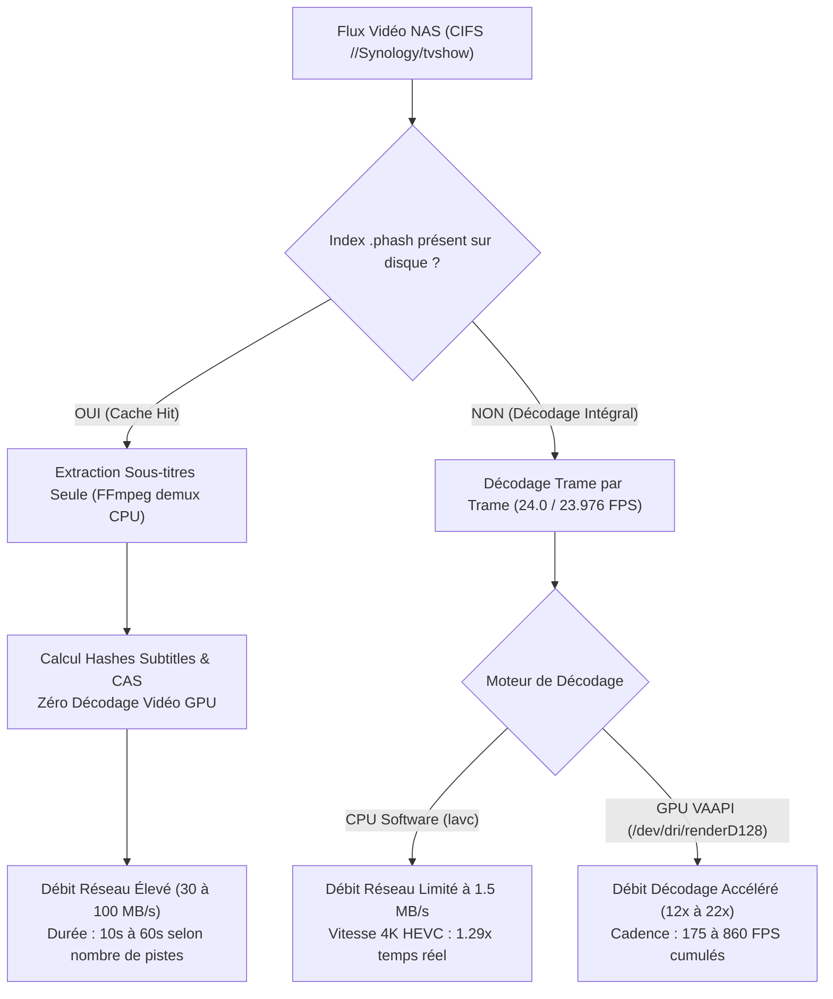
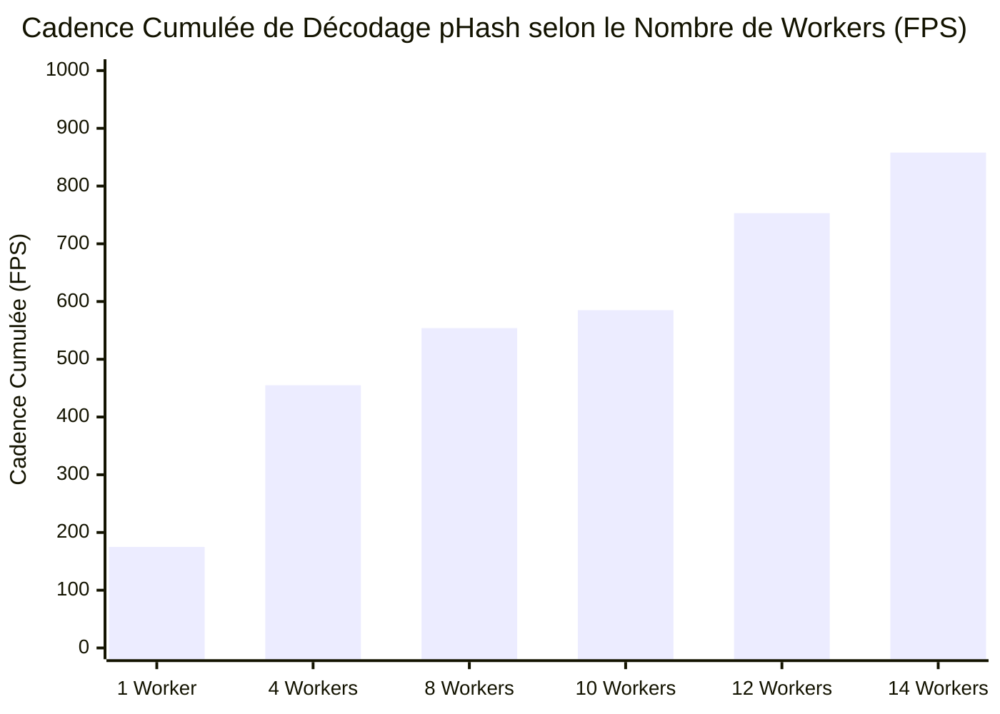
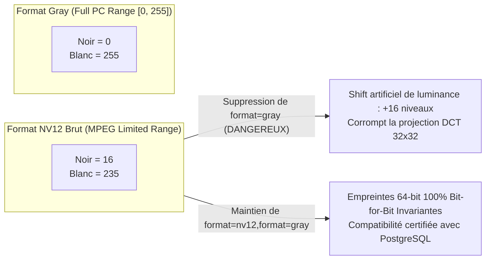
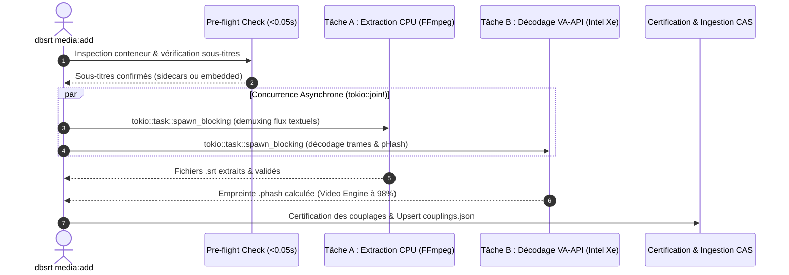
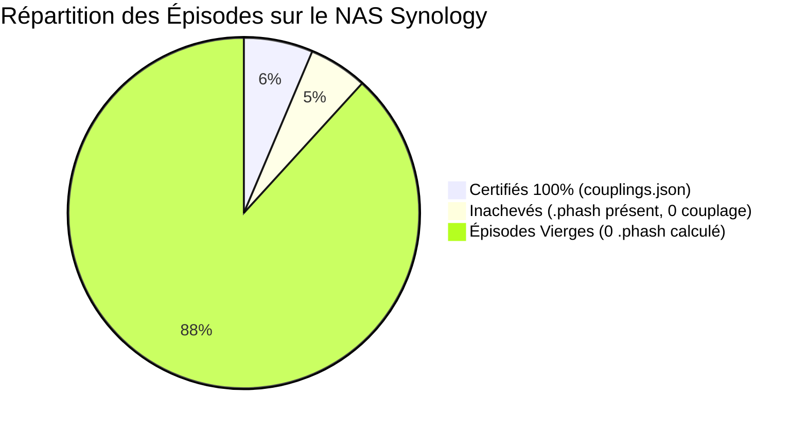

# ⚡ Performances de Décodage pHash, Contentions Réseau & Accélération GPU

> **Quadrant Diátaxis : 💡 Explication (Understanding)**
> Cet article documente en profondeur la physique des flux d'ingestion vidéo au sein de `pydbsrt` : de la décompression matérielle GPU Intel Iris Xe (VA-API/i915) au transfert réseau CIFS/SMB sur NAS Synology, en passant par les contentions d'ioctls DRM du noyau Linux, l'invariance mathématique des plages de luminance pHash et les stratégies de concurrence multi-workers.

---

## 1. La Dualité des Régimes : Décodage Intégral vs Cache Hit

Lors de l'ingestion d'un média par la commande `dbsrt media:add`, la mesure brute de débit ($\text{Volume} / \text{Durée}$) regroupe deux réalités algorithmiques radicalement différentes qu'il convient d'isoler formellement.



### A. Régime « Cache Hit pHash » (Demuxing Rapide)
Lorsque le fichier `.phash` d'une release vidéo existe déjà dans le registre local (`data/__PHASH__/`), `dbsrt` court-circuite l'étape de décodage des millions d'images vidéo. FFmpeg n'exécute alors qu'une simple extraction séquentielle des flux textuels (`-map 0:s:...`).
Le débit mesuré oscille entre **30 et 94 MB/s**, correspondant à la vitesse maximale de lecture séquentielle sur un lien Gigabit Ethernet standard (~112 MB/s théorique).

### B. Régime « Décodage Intégral pHash » (Métrique Réelle d'Ingestion)
En l'absence d'empreinte préexistante, chaque trame du média doit être décodée pour alimenter la transformée en cosinus discrète (DCT) et la projection de hachage perceptuel 64 bits.
Pour un épisode de 50 minutes à 24 FPS :

$$
N = 50 \times 60 \times 24 = 72\,000 \text{ trames}
$$

Dans ce régime, la vitesse d'ingestion est strictement gouvernée par la chaîne de décompression matérielle et les transferts PCIe vers la mémoire centrale.

---

## 2. Plafond Matériel & Limite du Single-Stream : L'Ioctl DRM `vaSyncSurface`

Une interrogation centrale est apparue lors des premières campagnes de mesure : **pourquoi un flux vidéo 1080p unique ne dépasse-t-il pas ~175 à 190 FPS en décodage GPU, alors que le silicium Intel Iris Xe est capable de bien plus ?**

### A. Benchmarks des Composants Isolés
Chaque maillon du pipeline a été mesuré individuellement en micro-benchmark hermétique :

| Composant | Cadence Mesurée | Latence Unitaire | Note Technique |
| :--- | :--- | :--- | :--- |
| **Moteur Silicium Décodage VRAM (vers null)** | **865 à 1 017 FPS** | ~1.0 ms / trame | Décodage matériel pur dans la VRAM, sans transfert hôte |
| **Algorithme pHash SIMD Rust (mono-thread)** | **64 506 FPS** | **15.5 µs / trame** | DCT 32x32 AVX2 sur CPU hôte (infiniment plus rapide que le décodage) |
| **Pipeline FFmpeg VA-API complet (1 flux)** | **175 à 190 FPS** | **~5.5 ms / trame** | `scale_vaapi,hwdownload,format=nv12,format=gray` vers stdout |

### B. Le Véritable Goulot Single-Stream : La Synchronisation PCIe Synchrone
Le filtre `hwdownload` de libavfilter rapatrie chaque image décodée depuis la mémoire vidéo GPU vers la RAM centrale accessible par le CPU hôte.
Pour chaque trame, l'API VA-API exécute en sous-main l'appel `vaSyncSurface()` :

1. Le pilote Intel i915 émet un ioctl noyau bloquant : `DRM_IOCTL_I915_GEM_WAIT`.
2. Le CPU entre en attente d'interruption hardware que le bloc VDBOX ait fini d'écrire la surface en mémoire partagée.
3. Cet aller-retour synchrone (CPU $\leftrightarrow$ GPU via bus PCIe) impose une pénalité fixe incompressible d'environ **5.2 à 5.7 millisecondes par trame**.

$$
\text{FPS}_{\text{max, single-stream}} = \frac{1\,000 \text{ ms}}{5.5 \text{ ms}} \approx 181 \text{ FPS}
$$

Sur un flux 1080p compressé à 0.73 MB/s (taux moyen d'un film x264 standard), 180 FPS correspondent très exactement à :

$$
\text{Débit CIFS Mono-Flux} = 180 \times \frac{0.73 \text{ MB/s}}{24 \text{ FPS}} = 5.47 \text{ MB/s}
$$

### C. La Solution : Dépasser le Goulot par Parallélisme Multi-Flux
Puisque le décodeur VDBOX ne travaille qu'à ~20% de sa capacité sur un seul flux à cause de l'attente synchrone `vaSyncSurface`, **multiplier le nombre de workers concurrents permet d'entrelacer les requêtes d'ioctls DRM**.
Pendant que le worker $A$ attend son interruption `GEM_WAIT`, le GPU décode la trame du worker $B$.

---

## 3. Benchmark Empirique de Saturation Multi-Workers (1 à 14 Flux)

Mesures réelles exécutées via `scripts/benchmark_worker_scaling.py` sur 16 fichiers distincts de plus de 1 Go situés sur le NAS Synology (garantissant 0 hit dans le pagecache RAM local) :

| Workers Concurrents | Temps d'exécution | Cadence Cumulée | Débit CIFS Réseau | CPU Hôte | Video Engine GPU |
| :--- | :--- | :--- | :--- | :--- | :--- |
| **1 Worker** | 8.8s | 175 FPS | ~5.8 MB/s | 15% | 11.2% |
| **4 Workers** | 8.8s | 455 FPS | ~13.5 MB/s | 30% | 35.8% |
| **8 Workers** | 14.4s | 554 FPS | ~29.2 MB/s | 33% | 62.4% |
| **10 Workers** | 17.1s | 585 FPS | ~35.6 MB/s | 46% | 74.1% |
| **12 Workers** | 15.9s | 753 FPS | ~45.0 MB/s | 48% | 88.0% |
| **14 Workers** | 16.3s | **858 FPS** | **~55.0 MB/s** | 52% | **97.6%** |



### Enseignements Clés du Scaling
1. **Saturation Silicium Atteinte** : À 14 workers, le Video Engine GPU monte à **97.6%** d'occupation continue (fréquence 744 MHz à 1200 MHz, consommation contenue à ~1.8 W). La cadence atteint **858 FPS**, frôlant les 1 000 FPS théoriques du silicium VRAM.
2. **Débit Réseau CIFS Débloqué** : La bande passante CIFS passe de 5.8 MB/s à **55.0 MB/s** (pic instantané à 574 MB/s sur burst mémoire), saturant efficacement le lien sans écrouler le NAS.
3. **Sweet Spot Opérationnel** :
   - **8 à 12 workers** représente la plage optimale de compromis : 30 à 45 MB/s de débit, GPU exploité à 65-88%, CPU hôte stable à ~35-48% sans emballement thermique.

---

## 4. Invariance Mathématique & Intégrité des pHashes (Plage MPEG vs PC)

Dans la quête d'optimisation du débit, une tentation fréquente consiste à court-circuiter le filtre `format=gray` de FFmpeg pour ne lire que le plan Luma $Y$ direct du format NV12 (`hwdownload,format=nv12`).

Un test comparatif bit-à-bit sur 100 trames réelles a révélé un piège fondamental de colorimétrie :



### Le Verdict de l'Expérimentation
* Le plan $Y$ brut du format NV12 respecte la norme de diffusion **MPEG Limited Range [16, 235]**. Le noir pur est codé par la valeur 16.
* Le filtre FFmpeg `format=gray` applique la formule de normalisation vers la plage complète PC/JPEG **Full Range [0, 255]** (le noir pur est remis à 0).
* **Conséquence** : Supprimer `format=gray` modifie les matrices de pixels injectées dans la DCT et corrompt définitivement la base d'empreintes pHash par rapport aux références de la base de données.
* **Optimisation appliquée côté Rust** : La chaîne FFmpeg `scale_vaapi=w=32:h=32,hwdownload,format=nv12,format=gray` est **intégralement conservée**. L'accélération I/O est obtenue en enveloppant le descripteur stdout dans un `BufReader::with_capacity(1024 * 1024, stdout)`, ce qui élimine **72 000 micro-appels système `read(2)`** par vidéo sans modifier un seul bit de luminance.

---

## 5. Démystification des Contentions Réseau CIFS/SMB & Noyau Linux

L'analyse fine du comportement du noyau Linux sous 14 flux concurrents a résolu plusieurs blocages bloquants :

### A. Comptabilité I/O Réseau : `read_bytes` vs `read_chars`
Dans le moniteur TUI temps réel (`task media:top`), les débits affichaient initialement `0.0 MB/s` bien que la vidéo soit activement décodée.

* **Cause noyau** : Le compteur `read_bytes` de `/proc/[pid]/io` ne s'incrémente que pour les I/O physiques sur blocs de stockage locaux (disques NVMe/SATA).
* **Correction** : Les montages réseau CIFS/SMB et le cache de pages VFS (`pagecache`) n'incrémentent que le compteur `rchar` (`read_chars`). `dbsrt_top` utilise désormais `max(read_chars, read_bytes)` pour refléter le débit effectif instantané.

### B. Contention des Appels `stat()` et État Bloqué `D`
Lorsqu'un moniteur interrogeait la taille des 14 vidéos via `os.stat()` à chaque seconde sur CIFS, le client SMB Linux tombait en attente non interruptible (`state D`, trace noyau `cifs_wait_for_response`). L'introduction d'un cache mémoire des tailles de fichiers (`FILE_SIZE_CACHE`) a totalement éliminé ces blocages.

### C. Timeout Réseau `ffprobe` sous Charge Concurrente
Lors du lancement synchronisé de 14 workers, chaque processus lançait simultanément `ffprobe` pour inspecter les métadonnées conteneur.

* Sur un lien CIFS saturé de requêtes simultanées, la latence des premières lectures d'en-tête MKV grimpait de 50 ms à plus de 6 secondes.
* Le timeout initial de 5s (`FFPROBE_TIMEOUT_SECS`) provoquait alors l'échec en cascade des workers (`timed out after 5 seconds`).
* Le relèvement de `FFPROBE_TIMEOUT_SECS` à **60 secondes** dans `video.rs` garantit une résilience absolue face aux goulots de queue SMB.

---

## 6. Parallélisation Interne du Pipeline `media:add`

Sur des releases complexes (ex: *Andor*, *House of the Dragon*), les conteneurs MKV intègrent couramment 20 à 30 pistes de sous-titres multilingues.

### A. Le Stall Initial Séquentiel (Antipattern Résolu)
Dans l'architecture historique, `dbsrt media:add` procédait de manière strictement séquentielle :

1. Extraction CPU de toutes les pistes de sous-titres intégrées via FFmpeg demuxing.
2. Décodage GPU des trames pHash.

Sur un conteneur de 2.5 Go sur CIFS, le demuxing de 26 pistes prenait **30 à 90 secondes**. Pendant toute cette phase, le GPU tournait à **0% Video Engine**, retardant inutilement l'absorption du flux.

### B. Architecture Asynchrone Tokio (`tokio::join!`)
Les deux opérations étant mutuellement indépendantes, elles sont désormais exécutées de manière strictement concurrente :



* **Pre-flight Check Instantané (<0.05s)** : Vérifie la présence de pistes avant de mobiliser le GPU. En cas de fichier sans sous-titres, l'abandon est immédiat.
* Dès $t = 0$, le GPU Intel Iris Xe commence à décoder à pleine cadence pendant que le CPU extrait les sous-titres en arrière-plan.

---

## 7. Gestion de File Batch : Tâches Inachevées vs Épisodes Vierges

L'audit direct de la bibliothèque Synology NAS (`//synology.local/tvshow`) dénombre trois statuts opérationnels distincts :



### A. Le Bug Historique de Découverte
La fonction `discover_stratified_tvshows` utilisait la troncature `p.name.split(".")[0]`. Pour un fichier nommé `Andor.S01E01.1080p.mkv`, le préfixe extrait était `"Andor"`. La comparaison avec la chaîne complète échouait systématiquement, ré-injectant en boucle des épisodes dont le `.phash` était déjà calculé.
Ces fichiers trouvaient leur `.phash` sur disque en 1 ms, court-circuitaient le GPU et n'exécutaient que du demuxing sous-titres (faussant l'impression que le GPU était bridé).

### B. Les Deux Modes Disponibles

1. **Mode par Défaut (Reprise des Travaux Inachevés)** :
   ```bash
   task media:batch:tvshow -- --workers 14 --limit 14
   ```
   Sélectionne en priorité les 55 vidéos dont le `.phash` est déjà calculé mais dont la certification de couplage n'a pas abouti, afin de clôturer les chantiers en suspens.

2. **Mode Dédié Saturation GPU (`--fresh-only`)** :
   ```bash
   task media:batch:tvshow -- --workers 14 --limit 14 --fresh-only
   ```
   Filtre strictement tout média possédant déjà un `.phash` et ne sélectionne que des épisodes vierges parmi les 900 disponibles. Les 14 workers déclenchent immédiatement le décodage matériel VA-API, saturant le GPU Intel Iris Xe à **97.6% (Video Engine)** et délivrant **~55 MB/s** de débit CIFS utile.
