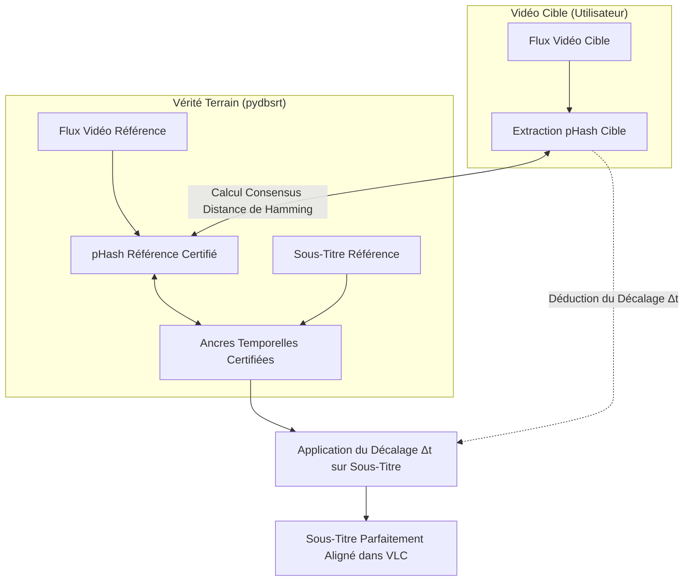

# 💡 Explication : Le Principe Fondamental du pHash & du Retargeting

Cet article déconstruit une intuition répandue et détaille la réalité physique et mathématique sur laquelle repose le projet `pydbsrt` : **le recalage automatique de sous-titres par empreinte visuelle (`pHash`) nécessite obligatoirement deux flux vidéo et un couplage certifié.**

---

## 1. L'Illusion du "Sous-Titre Recalé par Magie"

Il est tentant d'imaginer qu'un algorithme moderne pourrait prendre un fichier texte `.srt` arbitraire (téléchargé par exemple depuis OpenSubtitles) et le synchroniser sur un fichier vidéo quelconque uniquement à l'aide de l'empreinte perceptuelle `pHash`.

> [!CAUTION] L'Impossibilité Physique
> Un fichier de sous-titres `.srt` ne contient **aucun pixel**, aucune fréquence spatiale et **zéro signal visuel**.
> Il est mathématiquement impossible de calculer un hash perceptuel d'image (`pHash`) à partir de chaînes de caractères textuelles horodatées.

Le hachage perceptuel opère **exclusivement entre deux flux d'images** :

1. Un flux vidéo de **référence** (\( V_{\text{ref}} \)).
2. Un flux vidéo **cible** (\( V_{\text{target}} \)) dont le montage, l'introduction ou la cadence diffèrent.

---

## 2. Le Mécanisme du Retargeting en 3 Temps

Pour qu'un sous-titre puisse être aligné sur une vidéo cible, le système traverse 3 phases séquentielles :

### Phase 1 : La Certification Préalable (Vérité Terrain)
Un opérateur humain ou un pipeline automatisé a préalablement certifié que pour une release donnée (\( V_{\text{ref}} \)), le sous-titre \( S_{\text{ref}} \) est **strictement synchrone**.
Les trames pHash de \( V_{\text{ref}} \) sont extraites et associées aux timestamps de \( S_{\text{ref}} \) dans la table `sub_frames` ou le fichier `couplings.json`.

### Phase 2 : La Reconnaissance d'Empreinte (Matching Visuel)
Lorsque l'utilisateur lance une vidéo cible inconnue \( V_{\text{target}} \) dans VLC :

1. Le plugin extrait un échantillon visuel court (typiquement 15 secondes) et calcule ses pHashes 64-bit.
2. Le moteur `dbsrt-server` recherche dans son index la séquence de référence présentant la plus faible distance de Hamming :
   \( \mathcal{D}_H(\text{pHash}_{\text{target}}, \text{pHash}_{\text{ref}}) \le \theta \)
   (où \( \theta \) est le seuil de tolérance, typiquement \( \le 10 \) bits sur 64).

### Phase 3 : Le Calcul de Décalage par Consensus (\( \Delta t \))
En comparant la position temporelle de la trame dans la vidéo cible (\( t_{\text{target}} \)) et la position de la même trame dans la vidéo de référence (\( t_{\text{ref}} \)), l'algorithme calcule le déphasage :

\[
\Delta t = t_{\text{ref}} - t_{\text{target}}
\]

Ce décalage est ensuite appliqué de manière uniforme aux ancres temporelles du sous-titre certifié.

---

## 3. Le Comportement Face aux Providers Distants (Axe 5)

Que se passe-t-il si un utilisateur recherche un sous-titre via OpenSubtitles pour une release dont la base `pydbsrt` ne possède pas encore l'empreinte de référence ?

- Le système télécharge le sous-titre demandé.
- Comme aucune empreinte certifiée correspondante n'existe en base pour calculer un consensus visuel, **le décalage calculé est strictement de 0 ms**.
- Le sous-titre est injecté tel quel dans VLC (fonctionnement analogue à l'ancien plugin VLSub standard).
- **Le recalage visuel actif n'opère que lorsque le couplage certifié existe dans la base.**

C'est pourquoi l'ingestion régulière de nouveaux médias via la façade `task media:add` et la certification des couplages constituent le moteur essentiel de la précision de `pydbsrt`.
