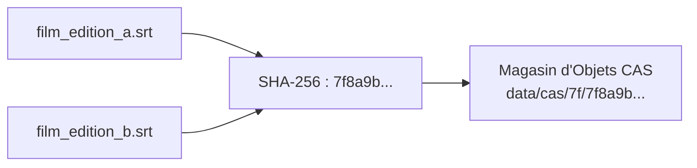

# 💡 Explication : Stockage Décentralisé CAS & Distribution

Cet article expose les principes du stockage adressable par le contenu (**Content-Addressable Storage - CAS**) et l'architecture de synchronisation décentralisée retenue pour distribuer les sous-titres et empreintes de `pydbsrt`.

---

## 1. Pourquoi un Stockage Adressable par le Contenu ?

Dans un système classique de partage de fichiers multimédia, les sous-titres sont référencés par des chemins ou des noms de fichiers arbitraires (`film_vostfr.srt`, `film_bluray.srt`). Cette approche entraîne deux pathologies majeures :

1. **La duplication massive** : Dix releases d'un même film partagent souvent le même fichier de sous-titres texte, dupliqué sous 10 noms distincts.
2. **L'altération silencieuse** : Une modification accidentelle d'un fichier (réencodage UTF-8 cassé, suppression de réplique) rompt les correspondances sans qu'aucun système d'alerte ne se déclenche.

### Le Principe du CAS dans `pydbsrt`
Chaque ressource (fichier sous-titres `.srt` ou bloc d'empreintes `.phash`) est stockée sous une clé correspondant strictement au hash cryptographique **SHA-256** de son contenu normalisé :

\[
\text{Clé CAS} = \text{SHA-256}(\text{Contenu Décodé UTF-8 Sans Espace Superflu})
\]

---

## 2. Propriétés Clés du Magasin CAS

- **Déduplication Native Idempotente** : L'ingestion d'un sous-titre déjà présent dans le magasin CAS est instantanément résolue sans écriture disque redondante.
- **Immuabilité Garantie** : Le contenu ne peut jamais être modifié ; toute altération produit un hash différent, préservant l'intégrité de la vérité terrain.
- **Vérification d'Intégrité Instantanée** : Tout client ou appliance locale peut vérifier la validité d'un sous-titre téléchargé en recalculant localement son hash avant de l'injecter dans VLC.

---

## 3. Synchronisation et Réplication Décentralisée

L'architecture CAS facilite la synchronisation entre des noeuds hétérogènes :

1. **Le poste de développement local** : héberge le catalogue de référence.
2. **L'appliance domestique Raspberry Pi 4** : réplique uniquement les clés CAS nécessaires (`task rpi4:sync`).
3. **Le miroir distant (Relais Cloud / o2switch)** : sert de cache statique public à haut débit pour les extensions VLC sans exposer les bases de données internes.

Grâce à l'adressage par hash, deux noeuds peuvent échanger leurs catalogues en comparant simplement un arbre de Merkle ou une liste de signatures, réduisant la bande passante requise au strict minimum.
