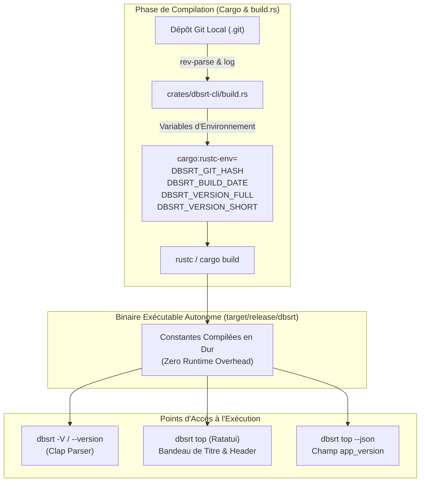

# Traçabilité & Versioning des Binaires Distribués

## 1. Contexte Opérationnel & Problématique de la « Dérive Silencieuse »

Dans une architecture distribuée et hétérogène telle que celle de `pydbsrt` — orchestrant un poste de développement x86_64 avec accélération matérielle Intel Iris Xe, une appliance locale Raspberry Pi 4 ARM64 (Cortex-A72) et un serveur d'hébergement distant CloudLinux/o2switch multi-cœurs (Xeon Gold 96 threads) —, les composants logiciels sont compilés, synchronisés et exécutés sur des nœuds physiquement disjoints.

L'un des écueils opérationnels majeurs des systèmes distribués est l'**anti-pattern de la dérive silencieuse** (*Silent Drift* ou *Ghost Bug*) :

1. Un opérateur ou développeur observe une anomalie ou un comportement inattendu lors d'une session interactive distante (ex: `task o2switch:top`).
2. L'opérateur présume qu'il observe la version du code source actuellement présente dans son espace de travail local Git (`HEAD`).
3. En réalité, le binaire exécuté sur le serveur distant a été compilé lors d'un déploiement antérieur, ne contient pas les derniers correctifs ou fonctionnalités, et produit des métriques divergentes sans qu'aucun avertissement visuel n'alerte l'utilisateur.

Pour éliminer définitivement cette ambiguïté, chaque point d'entrée d'observation — qu'il s'agisse de la ligne de commande CLI standard (`-V / --version`), de l'interface plein écran TUI (`dbsrt top`) ou de la sonde d'observabilité non-interactive (`dbsrt top --json`) — doit répondre de manière instantanée, non équivoque et vérifiable à la question fondamentale :

> **« Quelle version exacte du code source a produit le binaire que je suis en train d'exécuter ou d'observer ? »**

---

## 2. Le Format Standard Universel & Inspirations Techniques

### 2.1 La Formule Canonique

L'état de l'art en ingénierie des systèmes (GNU, Rust, Go, Kubernetes, Docker) converge vers une formule canonique universelle combinant la sémantique de version de release, l'empreinte cryptographique de l'arbre source Git et l'horodatage de compilation :

$$\text{Version String} = \texttt{\{SemVer\} (\{git-short-hash\}\{dirty?\} \{commit-or-build-date\})}$$

Exemple appliqué dans `pydbsrt` :

```text
v0.1.0 (e79795f 2026-10-29)
```

En cas de modification locale non committée lors de la compilation sur le poste de développement :

```text
v0.1.0 (e79795f-dirty 2026-10-29)
```

### 2.2 Inspirations & Littérature de Référence

Ce format repose sur plusieurs décennies d'évolution des standards de compilation et de traçabilité logicielle :

#### 1. GNU Coding Standards (§4.4 `--version`)

Les standards GNU historiques définissent les règles d'or pour l'option standard `--version` : le nom du programme doit être suivi immédiatement par la version, sans ambiguïté sur la première ligne, permettant aux scripts d'automatisation de parser l'empreinte de manière déterministe.

- Référence : [GNU Coding Standards - Standards for Command Line Interfaces](https://www.gnu.org/prep/standards/html_node/_002d_002dversion.html)

#### 2. The Reproducible Builds Initiative & `SOURCE_DATE_EPOCH`

L'initiative internationale *Reproducible Builds* vise à garantir que deux compilations du même code source produisent des binaires bit-à-bit identiques. Dans ce cadre, l'utilisation de dates de compilation dynamiques (`now()`) est proscrite car elle brise la reproductibilité ; le standard préconise d'extraire la date du dernier commit Git (`git log -1 --format=%cs`) ou la variable normalisée `SOURCE_DATE_EPOCH`.

- Référence : [Reproducible Builds: Timestamps & SOURCE_DATE_EPOCH](https://reproducible-builds.org/docs/source-date-epoch/)

#### 3. Conventions de l'Écosystème Rust (`rustc` & `cargo`)

Le compilateur `rustc` et le gestionnaire `cargo` appliquent rigoureusement ce pattern :

```text
$ rustc -Vv
rustc 1.84.0 (9fc6b4312 2025-01-07)
binary: rustc
commit-hash: 9fc6b43126469e3858e2fe86cafb4f0ef5068866
commit-date: 2025-01-07
host: x86_64-unknown-linux-gnu
release: 1.84.0
```

- Référence : [The Cargo Book: Environment Variables Provided by Cargo](https://doc.rust-lang.org/cargo/reference/environment-variables.html)

#### 4. Pattern `-ldflags` en Go / Kubernetes / Docker

Dans l'écosystème Go et conteneurs (utilisé par `docker`, `kubectl`, `helm`, `k9s`), l'injection de l'empreinte Git et de la date se fait systématiquement au moment du linkage :

```bash
go build -ldflags "-X main.version=${TAG} -X main.gitCommit=${SHA} -X main.buildDate=${DATE}"
```

- Référence : [Kubernetes Architecture: Component Versioning Guidelines](https://github.com/kubernetes/community/blob/master/contributors/devel/sig-architecture/api_changes.md#versioning)

#### 5. Spécifications SLSA (Supply-chain Levels for Software Artifacts)

Le framework open-source SLSA (Google, OpenSSF) formalise la provenance logicielle (*Provenance Requirements*). Le niveau SLSA 2+ impose que tout artéfact exécutable contienne ou référence de façon infalsifiable l'identifiant cryptographique immuable du dépôt source (`commit_sha`).

- Référence : [SLSA: Supply-chain Levels for Software Artifacts](https://slsa.dev/spec/v1.0/provenance)

---

## 3. Architecture d'Implémentation dans `pydbsrt`

L'architecture retenue dans `pydbsrt` privilégie une approche **hermétique, sans dépendance externe superflue**, basée sur le script de compilation natif `build.rs` de Cargo.



### 3.1 Script de Compilation (`crates/dbsrt-cli/build.rs`)

Le script `build.rs` s'exécute automatiquement avant la compilation du binaire CLI :

1. **Recompilation Déclenchée par Git** : Les directives `cargo:rerun-if-changed=.git/HEAD` et `cargo:rerun-if-changed=.git/index` indiquent à Cargo de réexécuter `build.rs` dès qu'un nouveau commit est créé ou qu'un fichier est indexé.
2. **Extraction de l'Empreinte Git** : `git rev-parse --short HEAD` extrait les 7 caractères hexadécimaux du commit courant.
3. **Détection de l'État Modifié (`-dirty`)** : `git diff --quiet` teste si des modifications non committées sont présentes dans l'espace de travail. Si oui, le suffixe `-dirty` est ajouté.
4. **Extraction de la Date Normalisée** : `git log -1 --format=%cs` capture la date ISO standard du commit (sans décalage horaire instable).
5. **Repli Gracieux (Graceful Fallback)** : Si le binaire est compilé en dehors d'un dépôt Git (ex: archive tarball, conteneur Docker épuré), le script n'échoue jamais et produit un identifiant de repli propre (`release`).

### 3.2 Exposition dans l'Interface CLI & TUI

1. **Ligne de Commande** :
   ```text
   $ dbsrt --version
   dbsrt 0.1.0 (e79795f 2026-10-29)
   ```
2. **Titre du Moniteur TUI `dbsrt top`** :
   Le bandeau de titre Ratatui intègre la version courte :
   ```text
   ┌ pydbsrt top v0.1.0 (e79795f) ── Moniteur de Décodage pHash & Ingestion Temps Réel ────────────────────────┐
   ```
3. **Sonde JSON non-interactive** :
   Le champ `app_version` est exposé dans `host_info` :
   ```json
   {
     "host_info": {
       "hostname": "<o2switch_server>",
       "os_name": "CloudLinux",
       "kernel": "4.18.0-553.157.1.lve.el8.x86_64",
       "arch": "x86_64",
       "cpu_brand": "Intel(R) Xeon(R) Gold 6263CY CPU @ 2.60GHz",
       "cpu_cores_logical": 96,
       "cpu_cores_physical": 48,
       "gpu_name": "Non détecté",
       "app_version": "v0.1.0 (e79795f)"
     }
   }
   ```

---

## 4. Cycle de Vie & Déploiement Multi-Cibles

### 4.1 Pourquoi `task o2switch:top` requiert `interactive: true`

Lors de l'appel d'une commande interactive à travers le gestionnaire de tâches Taskfile (`task o2switch:top`), Taskfile exécute les commandes avec `stdin` capturé et redirigé par défaut.

Sur une session distante SSH exécutant Ratatui et Crossterm :

- Crossterm a impérativement besoin d'un terminal de contrôle (TTY) pour configurer les modes bruts (*Raw Mode*) et capturer les événements clavier sous Linux (`/dev/tty`).
- Sans allocation explicite d'un pseudo-terminal (PTY), l'appel système `crossterm::terminal::enable_raw_mode()` échoue immédiatement avec l'erreur système :
  `Error: No such device or address (os error 6)`.
- Pour résoudre ce blocage opérationnel :
  1. Déclaration obligatoire de `interactive: true` dans `taskfiles/o2switch.yml`.
  2. Forçage de l'allocation d'un terminal PTY via l'option `ssh -tt` dans `scripts/o2switch_ctl.sh`.

### 4.2 Procédure pour Valider la Version Déployée

Pour mettre à jour et observer le binaire sur o2switch :

```bash
# 1. Cross-compiler le binaire statique musl avec la dernière empreinte Git
task o2switch:build

# 2. Synchroniser le binaire et les dépendances vers o2switch
task o2switch:sync

# 3. Lancer la session interactive TUI et constater la nouvelle version dans le titre
task o2switch:top
```
