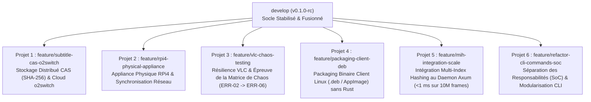

# Feuille de Route Post-Merge `develop` & Découpage des Projets v0.2+

> [!IMPORTANT] Clôture de la Phase v0.1 & Découplage
> La fusion de la [PR #8](https://github.com/yoyonel/pydbsrt/pull/8) dans la branche `develop` scelle le socle technique fondamental de `pydbsrt` : l'extension VLC v2.0 (`vlsub_dbsrt.lua`), le modèle relationnel PostgreSQL 17 SP-GiST BK-Tree + Zero-DB `couplings.json`, le backoffice web `dbsrt Studio` (`:8765/studio`), l'ordonnanceur modulaire `Taskfile.yml` (`taskfiles/`), et le banc de test hermétique systemd Docker (`task test:recipe:debian`).
>
> Pour éviter l'effet "fourre-tout" et accélérer les cycles de livraison, les développements post-merge s'organisent en **5 chantiers thématiques autonomes**, isolés dans leurs propres branches de features et suivis dans le tableau de bord [GitHub Projects](https://github.com/yoyonel/pydbsrt/projects).

---

## 1. Vue d'Ensemble & Arbre des Chantiers Post-Merge



---

## 2. Spécification Détaillée des 5 Chantiers

### Projet 1 : Stockage Distribué CAS & Connecteur Cloud o2switch
* **Branche Git cible** : `feature/subtitle-cas-o2switch`
* **Objectif** : Implémenter le stockage décentralisé de sous-titres adressable par contenu (CAS - Content Addressed Storage) basé sur l'empreinte SHA-256 du texte SRT. Permettre la synchronisation bidirectionnelle entre le serveur local et un miroir distant hébergé (o2switch ou bucket S3/MinIO).
* **Documents de conception associés** :
  * [Architecture de distribution sous-titres o2switch et stockage décentralisé](2026-10-20-architecture-distribution-sous-titres-o2switch-et-stockage-decentralise.md)
  * [Architecture subtitle service CAS et comparatif REST vs gRPC](2026-10-20-architecture-subtitle-service-cas-et-comparatif-rest-grpc.md)
* **Critères d'Acceptation (DoD)** :
  1. Client CAS Rust implémentant le dédoublonnage par hash SHA-256 des fichiers `.srt`.
  2. Endpoint `/v1/subtitles/cas/{hash}` avec compression gzip à la volée.
  3. Tests d'intégration automatisés validant la reprise sur panne et le cache local.

---

### Projet 2 : Appliance Domestique RPi4 & Déploiement Réseau Réel
* **Branche Git cible** : `feature/rpi4-physical-appliance`
* **Objectif** : Valider le fonctionnement du serveur sur le matériel physique réel Raspberry Pi 4 (dépasser la simulation locale QEMU `sim:rpi4`). Éprouver le streaming pHash sur le réseau local 1 Gbps et synchroniser les catalogues `.dbphash` en continu.
* **Documents de conception associés** :
  * [Plan de déploiement et intégration remote RPi4](../explanation/2026-10-20-plan-deploiement-et-integration-remote-rpi4.md)
* **Critères d'Acceptation (DoD)** :
  1. Déploiement réussi sur RPi4 via `task rpi4:push` et `task rpi4:up`.
  2. Télémétrie HTTP (`task rpi4:status`) confirmant la connexion à PostgreSQL 15.2 embarqué.
  3. Démonstration live interactive `task rpi4:demo` validée avec moins de 50 ms de latence réseau LAN.

---

### Projet 3 : Résilience VLC & Campagne de Chaos Engineering
* **Branche Git cible** : `feature/vlc-chaos-testing`
* **Objectif** : Éprouver et traiter systématiquement les cas limites répertoriés dans la cartographie des défaillances pour garantir que l'extension VLC ne freeze jamais l'interface graphique Qt.
* **Documents de conception associés** :
  * [Registre des incidents, matrice de chaos testing et post-mortem VLC socket hang](2026-10-20-registre-incidents-chaos-testing-et-post-mortem-vlc-hang.md)
* **Critères d'Acceptation (DoD)** :
  1. Traitement de `ERR-02` (latence réseau > 5s) sans déclenchement du watchdog VLC (`DEFAULT_RELAY_TIMEOUT_MS = 3500ms`, `connect_timeout = 2000ms`).
  2. Traitement de `ERR-03` : échappement strict RFC 8259 (`json_escape`) des caractères spéciaux et chemins UTF-8 NFD dans `vlsub_dbsrt.lua`.
  3. Traitement de `ERR-04` : écriture et repli automatique dans `~/.cache/dbsrt/subtitles/` lorsque le dossier source est un partage NFS/SMB monté en lecture seule.
  4. Tests unitaires Lua (42 assertions passées) et suite Rust dédiée `test_chaos_resilience.rs` validant chaque scénario de chaos.

---

### Projet 4 : Packaging Client Linux (.deb / AppImage)
* **Branche Git cible** : `feature/packaging-client-deb`
* **Objectif** : Fournir un installateur autonome prêt à l'emploi pour les utilisateurs finaux Linux (Debian, Ubuntu, Mint), ne nécessitant ni `cargo`, ni `uv`, ni compilation locale.
* **Documents de conception associés** :
  * [Tutoriel : Installation & Administration du Client VLC et Service systemd](../tutorials/2026-10-20-tutoriel-installation-client-linux-vlc-et-service-systemd.md)
  * [Stratégie de Test d'Infrastructure & Recettes systemd Hermétiques](2026-10-21-strategie-tests-infrastructure-et-recettes-systemd-hermetiques.md)
* **Critères d'Acceptation (DoD)** :
  1. Génération automatisée d'un paquet Debian `.deb` contenant `dbsrt-agent`, `vlsub_dbsrt.lua` et les scripts de post-installation systemd.
  2. Validation du paquet dans le conteneur de test hermétique via `task test:recipe:debian`.
  3. Publication d'un artefact installable en une ligne (`sudo apt install ./dbsrt-agent.deb`).

---

### Projet 5 : Intégration Multi-Index Hashing (MIH) au Daemon Axum
* **Branche Git cible** : `feature/mih-integration-scale`
* **Objectif** : Remplacer le balayage linéaire en mémoire vive du daemon par l'index métrique Multi-Index Hashing (MIH) éprouvé lors du stress-test 100M frames. Permettre des recherches de sous-titres sub-millisecondes sur des catalogues de plus de 10 millions de frames avec une empreinte RAM minimale.
* **Documents de conception associés** :
  * [Rapport de benchmark MIH 100M frames](2026-10-19-mih-100m-scale-benchmark-report.md)
  * [Indexation métrique et Multi-Index Hashing](2026-10-19-indexing-metric-trees-and-multi-index-hashing.md)
* **Critères d'Acceptation (DoD)** :
  1. Module `dbsrt-index::MihIndex` branché sur le routeur Axum `POST /v1/search`.
  2. Latence p99 < 1.0 ms mesurée sur le dataset réel de 12 millions de frames.
  3. Parité stricte des résultats de matching par rapport au moteur brute-force.

---

### Projet 6 : Séparation des Responsabilités (SoC) & Modularisation CLI
* **Branche Git cible** : `feature/refactor-cli-commands-soc`
* **Objectif** : Décomposer le monolithe `crates/dbsrt-cli/src/main.rs` (1889 lignes) en modules de commandes cohésifs sous `src/commands/` selon le principe de Séparation des Responsabilités (SoC). Éliminer tous les magic numbers/literals en introduisant un module dédié `constants.rs`, formaliser `cli.rs` et exposer `lib.rs` pour permettre le test unitaire direct des fonctions CLI sans dépendance binaire stricte.
* **Critères d'Acceptation (DoD)** :
  1. `crates/dbsrt-cli` structuré avec `src/lib.rs`, `src/constants.rs`, `src/cli.rs`, `src/commands/` et un `main.rs` orchestrateur concis (< 100 lignes).
  2. Zéro magic numbers : toutes les valeurs numériques, seuils et facteurs de conversion temporelle typés et documentés.
  3. Parité stricte 100% avec les sous-commandes existantes et passage au vert de la suite de tests (`task test:rs` et tests CLI).

---

## 3. Protocole pour Démarrer un Chantier Post-Merge

Chaque développeur reprenant un chantier doit suivre le protocole standardisé suivant :

```bash
# 1. Se positionner sur develop et récupérer la dernière version fusionnée
git checkout develop
git pull origin develop

# 2. Créer la branche dédiée au projet ciblé
git checkout -b feature/<nom-du-projet>

# 3. Consulter le document d'architecture lié sous docs/
# 4. Développer, valider via Taskfile :
task fmt
task lint
task test:rs
task ci:local

# 5. Ouvrir la PR ciblée vers develop
```
