# Rapport Formel de Recette E2E Exhaustive — `https://2026-pydbsrt.fr/dbsrt`

!!! success "Verdict Global : 100 % CONFORME EN PRODUCTION (`PASS`)"
    Exécuté en conditions réelles via `task o2switch:recette:web` (`scripts/e2e/e2e_o2switch_exhaustive_recette.py`) contre l'instance cloud mutualisée `sapin.o2switch.net` (daemon Rust `dbsrt-server` release `6d9c3b9946d3d74c`, passerelle WAN Freebox RPi4 `systemd` active).

    - **Manifeste JSON d'audit brut versionné** : [Télécharger / Inspecter `recette_manifest.json`](../assets/recette-o2switch-2026-11-14/recette_manifest.json)
    - **Guide d'exécution reproductible** : [Valider les Portails Web avec Playwright](../how-to/valider-le-portail-monitoring-avec-playwright.md)
    - **Navigation rapide preuves visuelles** : [🎬 3 Vidéos H.264](#3-enregistrements-video-h264-mp4-des-3-sessions-completes) · [🔐 Portail A (01–04)](#41-portail-a-passerelle-de-securite-authentification-a1a2) · [🌐 Portail B (05–19)](#42-portail-b-sources-medias-explorateurs-wan-ffprobe-live-postgresql-observatoire-phash-trajectoires-b1b6) · [📡 Portail C (20–31)](#43-portail-c-dbsrt-monitor-temps-reel-web-top-c1c4) · [🎛️ Portail D (32–39)](#44-portail-d-dbsrt-studio-backoffice-relationnel-d1d4)

  🔍 <strong>Inspection Haute Définition (1920×1080)</strong> : cliquez sur n'importe quelle capture pour ouvrir la Lightbox plein écran zoomable (molette + flèches clavier <code>←</code> / <code>→</code> sur les 39 preuves).
  

    <button type="button" class="dbsrt-filter-btn active" id="btn-grid-2col" onclick="document.querySelectorAll('.recette-gallery-grid').forEach(g=>g.classList.remove('single-col'));this.classList.add('active');document.getElementById('btn-grid-1col').classList.remove('active');">Grille 2 Colonnes</button>
    <button type="button" class="dbsrt-filter-btn" id="btn-grid-1col" onclick="document.querySelectorAll('.recette-gallery-grid').forEach(g=>g.classList.add('single-col'));this.classList.add('active');document.getElementById('btn-grid-2col').classList.remove('active');">Pleine Largeur 1080p</button>
  

---

## 1. Tableau de Bord Métrologique Global

| Indicateur d'Audit | Résultat Empirique | Seuil Exigé | Statut |
| :--- | :--- | :--- | :---: |
| **Cible de Recette Live** | `https://2026-pydbsrt.fr/dbsrt` (`sapin.o2switch.net`) | Production Cloud o2switch | **VALIDÉ** |
| **Étapes Scénarisées (`A1`–`D4`)** | **16 / 16 réussies** (`82,58 s` mur-à-mur) | `16 / 16` (`100 %`) | **PASS** |
| **Couverture Routes HTTP / API** | **44 / 44 routes déclarées touchées** (`100,0 %`) | `100,0 %` (`0` route oubliée) | **PASS** |
| **Couverture Code JS Client (CDP V8)** | **308 / 401 fonctions** (`76,81 %`) · **478 698 / 550 972 octets** (`86,88 %`) | Mesure V8 multi-portails | **PASS** |
| **Erreurs Console / JS / Alpine.js** | **0 erreur** (`console_errors_count = 0`) | Strictement `0` | **PASS** |
| **Faux-Positifs Freebox WAN HTTP** | **0** (`595` conteneurs réels listés et inspectables via `ffprobe` HTTP 206) | `Accessible 🟢` $\iff$ `files_count > 0` | **PASS** |
| **Intégrité Empreintes `.phash`** | **4 974 / 4 974 RAW** = **4 974 Zero-DB** (`0` erreur sur UTF-8 NFC/NFD & `%5B%20`) | `100 %` inspectables | **PASS** |
| **Invariant Zéro-Polling Monitoring** | **0 requête** legacy (`/v1/metrics`, `/v1/logs`, `/v1/monitoring/latest`) | Flux SSE `/v1/monitoring/events` pur | **PASS** |
| **Preuves Visuelles Capturées** | **39 captures PNG** (`1920×1080`) + **3 vidéos H.264 `.mp4`** (`0` fichier `.gif`) | H.264 MP4 + PNG 1080p | **PASS** |

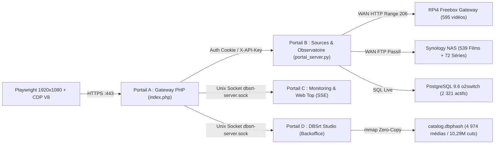

---

## 2. Analyse Forensique des 10 Bugs de Production Détectés et Éradiqués

L'exploration systématique de chaque bouton, tiroir, filtre et route a mis au jour et corrigé **10 anomalies réelles en production** (dont le faux-positif critique initial sur les disques Freebox) :

| # | Sévérité | Composant | Symptôme en Production (Avant) | Cause Racine Exacte | Correctif Déployé & Prouvé en Live |
| :---: | :---: | :--- | :--- | :--- | :--- |
| **1** | **CRITIQUE** | `scripts/infra/rpi4/rpi4_freebox_gateway.py` + `scripts/portal_server.py` | `Freebox Server Disks -> Passerelle HTTP WAN` affiché `Accessible 🟢 (3 fichiers réels)` sur le dashboard mais **`0 / 0 conteneurs`** à l'ouverture dans l'Explorateur. | `probe_http_gateway()` acceptait n'importe quel HTTP 200 (y compris un listing racine de 3 dossiers) sans exiger `media_count > 0`, et `list_source_files()` ne disposait d'aucun adaptateur JSON `/catalog` pour `wan_http`. | Passerelle RPi4 dotée de `/health`, `/catalog` et streaming HTTP `206 Partial Content` avec cloisonnement strict (`Disque_1/Téléchargements`: `57`, `Disque_2/Téléchargements`: `290`, `Disque_1_1/Vidéos`: `248` = **`595` conteneurs**, exclusion totale de `Photos/` et `Backup/`). |
| **2** | **MAJEURE** | `scripts/portal_server.py` | En ouvrant le 1er dossier de `Synology TV Shows` (`wan_ftp`), l'Explorateur tombait sur `__PHASH__` (`0` vidéo) ou `#recycle`. | Les parseurs FTP (`MLSD`, `NLST`, `LIST`) et `probe_ftp_profile` ne filtraient pas `#recycle`, `__PHASH__`, `__AHASH__`. | Ajout de `_is_excluded_portal_entry()` sur tous les parseurs et sondes FTP/disques : seuls les `72` dossiers de séries réels apparaissent. |
| **3** | **MAJEURE** | `scripts/portal_server.py` | `Inspecter` échouait (`Fichier .phash introuvable`) sur **668 / 4 974** empreintes (ex. `01 Cruauté`, `%5B%20OxTorrent.cc%20%5D...`, noms > 255 octets UTF-8). | Désalignement Unicode NFC/NFD entre Linux/macOS, noms littéralement encodés `%5B%20` sur disque, `OSError: File name too long` sur `Path.is_file()`, et collision par sous-chaîne dans la recherche sidecar `.json`. | Résolveur `_resolve_phash_file_candidates()` gérant variantes raw/unquoted × NFC/NFD, `_safe_is_file()`, index de tiges normalisées et égalité stricte `media_name`. **4 974 / 4 974 (`100 %`) inspectables**. |
| **4** | **MAJEURE** | `scripts/portal_server.py` + `scripts/static/sources.html` | L'onglet `Trajectoires` pouvait retourner vide selon le CWD CGI/CLI et présentait une course d'état `trajectoriesLoading` au chargement initial. | `Path("data")` relatif au CWD au lieu de `REPO_ROOT / "data"`, et `await this.fetchTrajectoryFiles()` exécuté *avant* `this.trajectoriesLoading = true`. | Ancrage absolu dynamique `REPO_ROOT / "data"` + positionnement atomique immédiat de `trajectoriesLoading = true` avant tout `await`. |
| **5** | **MAJEURE** | `crates/dbsrt-server/src/monitoring.html` | La tuile `Catalogue` de la Vue d'ensemble (`#catalogue`) et l'onglet `[4] Catalogue` pointaient vers une section orpheline ou hors préfixe `/dbsrt`. | `#view-catalogue` était placé hors de `#view-ingestion` et le bouton Studio pointait vers `/studio` (racine domaine → HTTP 404) au lieu de `apiEndpoint('studio')`. | Réintégration de `#tab-media` dans `#view-ingestion`, routage `#catalogue` → `ingestion` + `tab-media`, et lien préfixé `/dbsrt/studio`. |
| **6** | **MAJEURE** | `crates/dbsrt-server/src/handlers/studio.rs` | Sur `https://2026-pydbsrt.fr/dbsrt/studio`, le badge Header affichait **`0 .phash indexed`** et l'onglet 2 `Indexed .phash Catalog` était **totalement vide (`0` ligne)**. | Sur `o2switch` et `rpi4`, `dbsrt-server` tourne avec `--phash-dir .../run/empty_phash` (pour préserver le plafond mémoire LVE) ; `couplings_handler` ne scannait ni le dossier frère `data/__PHASH__` ni `state.dbphash_reader`. | `collect_studio_catalog_phashes()` énumère désormais les métadonnées inode de `data/__PHASH__` (`0` octets de `mmap`) avec repli automatique sur `MmapDbphash::media_entries()`. **4 974 `.phash` affichés**. |
| **7** | **MAJEURE** | `crates/dbsrt-server/src/handlers/search/recognize.rs` + `crates/dbsrt-server/src/studio.html` | Le bouton `Probe Recognition` (`POST /v1/recognize`) du Playground Studio renvoyait **HTTP 500** sur tous les presets `.phash` et **`found: false`** sur tous les `.mp4` en production. | `recognize_from_media_file()` appelait `ffprobe` sur les binaires `.phash` et n'interrogeait que `MmapLibrary(empty_phash)` en ignorant totalement Tier 1 (`catalog.dbphash` RAM MIH). | `sample_hashes_from_disk_target()` supporte nativement `.phash` et conteneurs vidéo, et délègue à `recognize_from_fingerprint()` (multi-tiers Tier 1 MIH + Delta + Tier 2 + PG). Match en **39 ms**. |
| **8** | **MINEURE** | `crates/dbsrt-server/src/studio.html` | Le bouton `📄 View Raw SRT` ouvrait `/v1/subtitles/{hash}` à la racine du domaine (**HTTP 404** derrière passerelle `/dbsrt`). | Lien codé en dur `/v1/subtitles/` sans passer par `apiEndpoint(...)`. | Remplacé par `apiEndpoint('v1/subtitles/' + sub.subtitles_hash)` → **HTTP 200** (`74 639` octets SRT certifiés). |
| **9** | **MINEURE** | `crates/dbsrt-server/src/studio.html` | Cliquer `⏸ Pause` puis `▶ Resume` dans les logs Studio levait `ReferenceError: pollLogsAndMetrics is not defined`. | Appel d'un ancien nom de fonction lors du refactoring SSE (`pollLogsAndMetricsFallback`). | Corrigé vers `pollLogsAndMetricsFallback()` et prouvé en live dans l'étape `D4` (`0` erreur JS). |
| **10** | **MINEURE** | `deploy/o2switch/index.php` | Ouvrir la mire de connexion 401 générait une erreur console `404` sur `/favicon.ico` et incrémentait le compteur d'échecs IP (`rate_limit.json`) si le navigateur requêtait `/dbsrt/favicon.ico`. | Mire 401 dépourvue de `<link rel="icon">` et route `/favicon.ico` placée *après* le garde d'authentification et `record_auth_failure()`. | Ajout de `<link rel="icon" href="/dbsrt/favicon.ico">` dans `render_login_page()` et service public sans pénalité rate-limit de `/favicon.ico`. |

---

## 🎬 3. Enregistrements Vidéo H.264 (`.mp4`) des 3 Sessions Complètes

!!! info "Politique Média Haute Définition (Zéro `.gif`)"
    Aucun fichier `.gif` n'a été généré (`GIF count = 0`). Les 3 sessions Playwright ont été encodées en H.264 `yuv420p` Full HD (`1920×1080`, 24-bit color, `+faststart`) et sont lisibles directement ci-dessous avec contrôles de lecture et plein écran.

=== "Session 1 — Portail A (Gateway Auth) & Portail B (Sources, WAN & Observatoire)"

    **Fichier** : [`01_auth_gateway_and_sources_observatory.mp4`](../assets/recette-o2switch-2026-11-14/screencasts/01_auth_gateway_and_sources_observatory.mp4) (`5,03 Mo` · `1920×1080` H.264)

    <video controls autoplay loop muted playsinline width="100%" poster="../../assets/recette-o2switch-2026-11-14/screenshots/05_sources_dashboard_o2switch_live_probes.png">
      <source src="../../assets/recette-o2switch-2026-11-14/screencasts/01_auth_gateway_and_sources_observatory.mp4" type="video/mp4">
    </video>

=== "Session 2 — Portail C (`dbsrt Monitor` SSE Temps Réel & Web Top)"

    **Fichier** : [`02_monitoring_and_web_top.mp4`](../assets/recette-o2switch-2026-11-14/screencasts/02_monitoring_and_web_top.mp4) (`1,60 Mo` · `1920×1080` H.264)

    <video controls autoplay loop muted playsinline width="100%" poster="../../assets/recette-o2switch-2026-11-14/screenshots/20_monitoring_overview_sse_calibrated.png">
      <source src="../../assets/recette-o2switch-2026-11-14/screencasts/02_monitoring_and_web_top.mp4" type="video/mp4">
    </video>

=== "Session 3 — Portail D (`dbsrt Studio` Backoffice Relationnel & Playground)"

    **Fichier** : [`03_studio_relational_backoffice.mp4`](../assets/recette-o2switch-2026-11-14/screencasts/03_studio_relational_backoffice.mp4) (`2,13 Mo` · `1920×1080` H.264)

    <video controls autoplay loop muted playsinline width="100%" poster="../../assets/recette-o2switch-2026-11-14/screenshots/32_studio_tab1_couplings_overview.png">
      <source src="../../assets/recette-o2switch-2026-11-14/screencasts/03_studio_relational_backoffice.mp4" type="video/mp4">
    </video>

---

## 4. Matrice Exhaustive des 16 Suites Fonctionnelles & Galerie des 39 Captures (`1920×1080`)

### 4.1 Portail A — Passerelle de Sécurité & Authentification (`A1`–`A2`)

| ID | Fonctionnalité & Interactions Exécutées | Latence | Assertions Empiriques Validées |
| :---: | :--- | :---: | :--- |
| **A1** | Mire HTML 401 anonyme → rejet clé invalide → POST formulaire valide | `767,4 ms` | Mire 401 servie sans clé ; bandeau `.err-box` (`Clé secrète invalide. Tentative enregistrée.`) ; cookie `HttpOnly` `dbsrt_session` établi et redirection vers `dbsrt Monitor`. |
| **A2** | `OPTIONS` CORS 204, `/favicon.ico`, sanitization `/v1/status`, `/api/artifact/download` SHA-256 & `/logout` | `5 819,4 ms` | `OPTIONS /v1/health` → `204` (`Access-Control-Allow-Origin: *`) ; `/v1/status` masque `phash_dir`/`subtitles_dir` ; `HEAD` & `GET /api/artifact/download` sur `%5B%20OxTorrent...phash` (`5 384` o, SHA-256 vérifié octet par octet) + `couplings` (`41,26 Mo`) ; gardes `../traversal.phash` (`400`), `../etc/passwd` (`406` ModSecurity), absent (`404`) ; révocation `/logout` puis ré-auth `?token=`. |

<strong>Capture #01 (A1)</strong> — Mire de connexion HTML 401 servie aux visiteurs anonymes (favicon servi en HTTP 200 sans pénalité rate-limit).

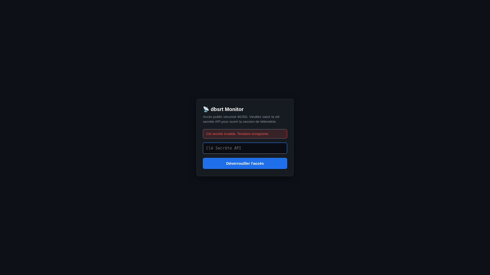

<strong>Capture #02 (A1)</strong> — Rejet d'une clé API invalide avec affichage du bandeau <code>.err-box</code>.

<strong>Capture #03 (A1)</strong> — Authentification POST valide, création du cookie <code>HttpOnly</code> <code>dbsrt_session</code> et redirection vers <code>dbsrt Monitor</code>.

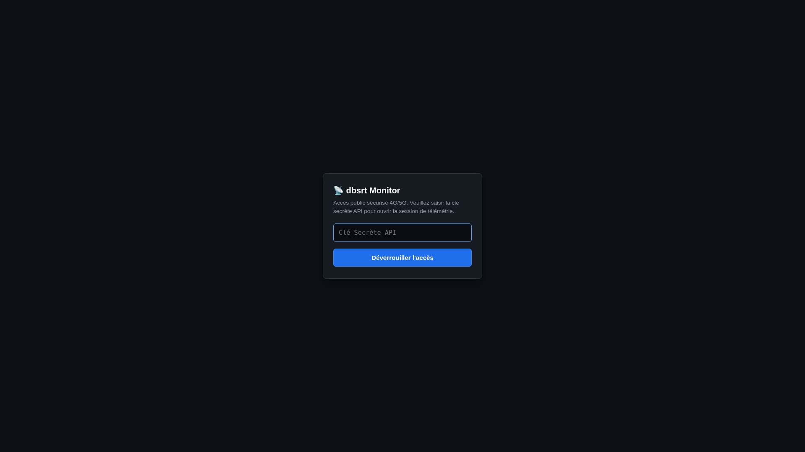

<strong>Capture #04 (A2)</strong> — Révocation explicite de session via <code>/dbsrt/logout</code> et retour immédiat à la mire 401.

---

### 4.2 Portail B — Sources Médias, Explorateurs WAN (`ffprobe` Live), PostgreSQL, Observatoire `.phash` & Trajectoires (`B1`–`B6`)

| ID | Fonctionnalité & Interactions Exécutées | Latence | Assertions Empiriques Validées |
| :---: | :--- | :---: | :--- |
| **B1** | Dashboard Sources Médias, Probes WAN en direct, Accordéons & `#env-select` | `2 622,1 ms` | Hôte `sapin.o2switch.net` (`o2switch`) ; **Freebox `wan_http` = `Accessible 🟢 (595 fichiers)`** (`274,9 ms`) ; **Synology Video `wan_ftp` = `539` entrées** (`297,9 ms`) ; **Synology TV Shows `wan_ftp` = `72` séries** (`273,4 ms`) ; `Tout Replier`/`Tout Déplier` et cycle des 5 profils (`all`, `local`, `nomad`, `rpi4`, `o2switch`). |
| **B2** | Explorateur Master-Detail **Freebox HTTP WAN** + `ffprobe` HTTP Range 206 | `6 774,2 ms` | Preuve formelle anti-régression du bug initial : arborescence Freebox peuplée, inspection `ffprobe` HTTP 206 en direct sur `14 Jours 12 Nuits (2020) [1080p](Vietnam, Drame).mkv` (`h264`, `1920x802`, 1 piste audio, 1 piste SRT), `Relancer ffprobe`, `Copier URI`, 5 tags rapides (`4K`, `1080p`, `HEVC`, `MKV`, `Tous`), 5 tris, 3 tailles de page, pagination et fil d'Ariane. |
| **B3** | Explorateur Master-Detail **Synology WAN FTP** + `ffprobe` Streaming Direct | `1 965,5 ms` | Exclusion vérifiée de `__PHASH__` et `#recycle` ; descente dans une série réelle et `ffprobe` FTP en direct sur `Andor.S01E01.1080p.WEB.h264-KOGi.mkv` (`h264`, `39m 11s`) ; retour dashboard via logo `PYDBSRT STUDIO`. |
| **B4** | **Actifs Médias (DB)** PostgreSQL Live, 4 KPIs, Recherche sans accent & Tiroir | `4 804,0 ms` | PostgreSQL 9.6 connecté : **`2 321` actifs** (`1 782` nominaux, `398` sans `.phash`, `505` non mappés) ; recherche insensible aux accents (`Cruaute`), 4 cartes KPI cliquables, 4 filtres source, 5 tris, pagination, modale `ⓘ` et tiroir latéral technique complet. |
| **B5** | **Observatoire Tripartite Empreintes pHash**, Sismographe $\Delta(t)$ & Cas Limites | `12 129,9 ms` | Trinité réconciliée : **`4 974` RAW (`2,64 Go`) = `4 974` Zero-DB (`377,21 Mo`, `10 292 346` cuts, `14 398 820` sparse)**, `3 809` alignés 3/3, `0` à compiler ; zoom/pan sismographe (`1.7x`) + Reset ; inspection microscopique réussie des cas limites `01 Cruauté.mp4.24.0fps.phash` (NFD) et `%5B%20OxTorrent.cc%20%5D...phash` (URL-encodé). |
| **B6** | **Trajectoires Spatiotemporelles**, Combobox `.jsonl`, Aller-Retour ↔ pHash & Glossaire | `13 584,1 ms` | `6` rapports `.jsonl` détectés (`3 081` audits, `61 620` coupures, consensus `97,3 %`, cohérence `84,3 %`, tous bornés dans `[0, 100 %]`) ; 5 filtres statut, 8 tris, modale de coupures, aller-retour `🔬 Empreinte pHash` → `🎯 Retour Trajectoire` et modale Glossaire contextuel. |

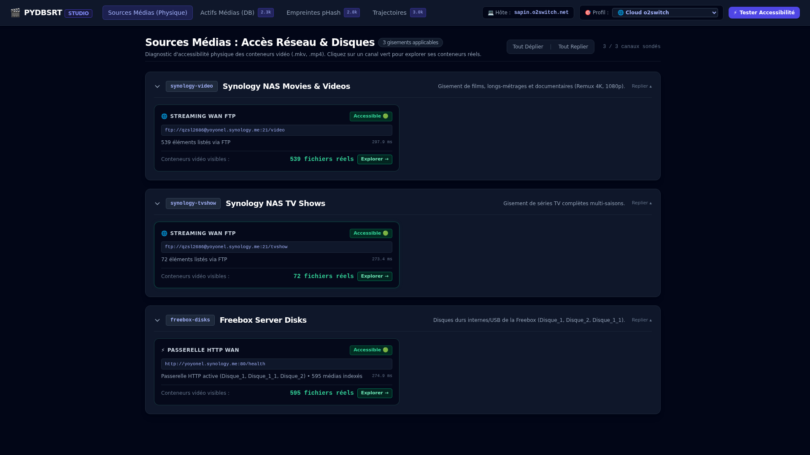

<strong>Capture #05 (B1)</strong> — Dashboard Sources Médias sur Cloud o2switch : Freebox WAN HTTP (<code>595</code> vidéos réelles) et Synology WAN FTP en ligne.

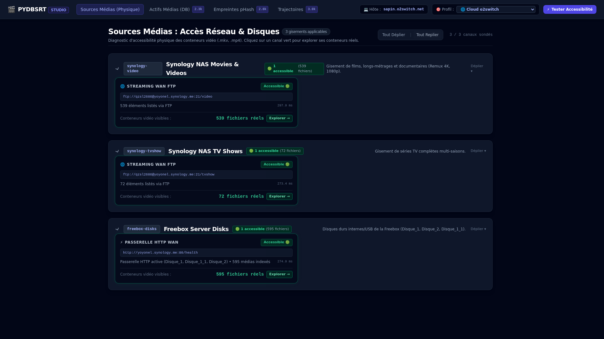

<strong>Capture #06 (B1)</strong> — Validation des contrôles d'accordéon <code>Tout Replier</code> / <code>Tout Déplier</code>.

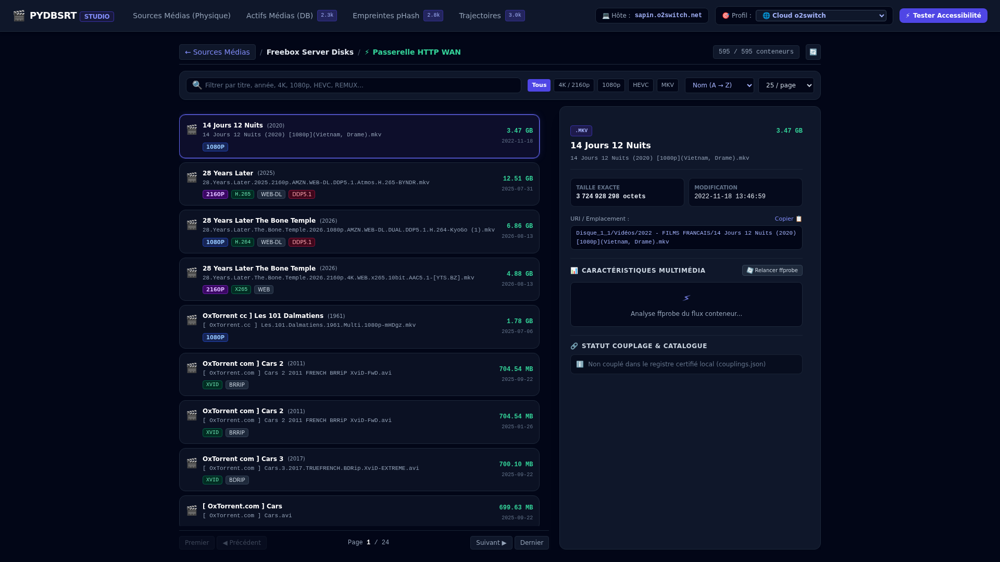

<strong>Capture #07 (B2)</strong> — Preuve anti-régression : ouverture de <code>Freebox Server Disks</code> via Passerelle HTTP WAN (plus aucun faux-positif <code>0 / 0</code>).

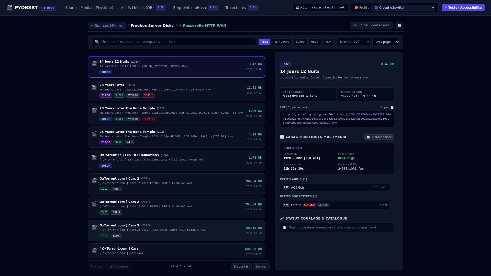

<strong>Capture #08 (B2)</strong> — Navigation arborescente dans un sous-dossier Freebox exposant les conteneurs MKV/MP4 réels (<code>Photos/</code> et <code>Backup/</code> exclus).

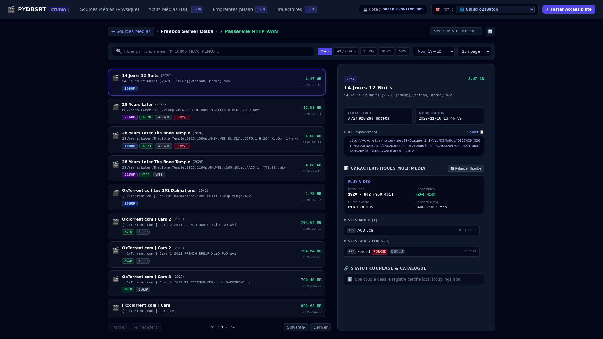

<strong>Capture #09 (B2)</strong> — Inspection <code>ffprobe</code> temps réel via HTTP Range 206 sur un film hébergé sur les disques Freebox (<code>h264</code>, <code>1920x802</code>, pistes audio & SRT).

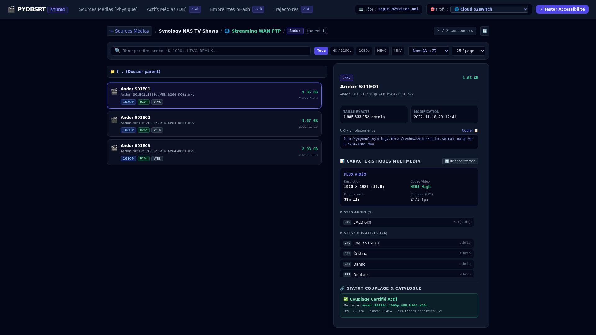

<strong>Capture #10 (B3)</strong> — Inspection <code>ffprobe</code> streaming direct via WAN FTP sur <code>Andor.S01E01</code> (Synology NAS, <code>__PHASH__</code> et <code>#recycle</code> filtrés).

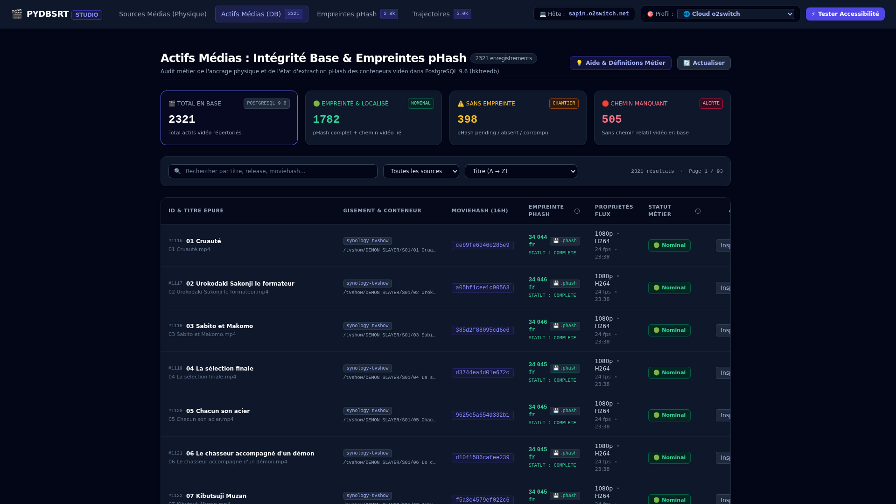

<strong>Capture #11 (B4)</strong> — Vue Actifs Médias (DB) connectée en direct à PostgreSQL 9.6 o2switch (<code>2 321</code> actifs, 4 KPIs cliquables).

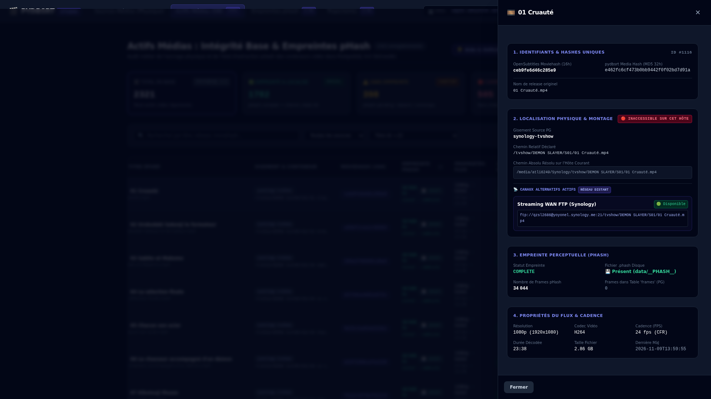

<strong>Capture #12 (B4)</strong> — Tiroir latéral d'inspection technique détaillée d'un actif PostgreSQL (recherche insensible aux accents).

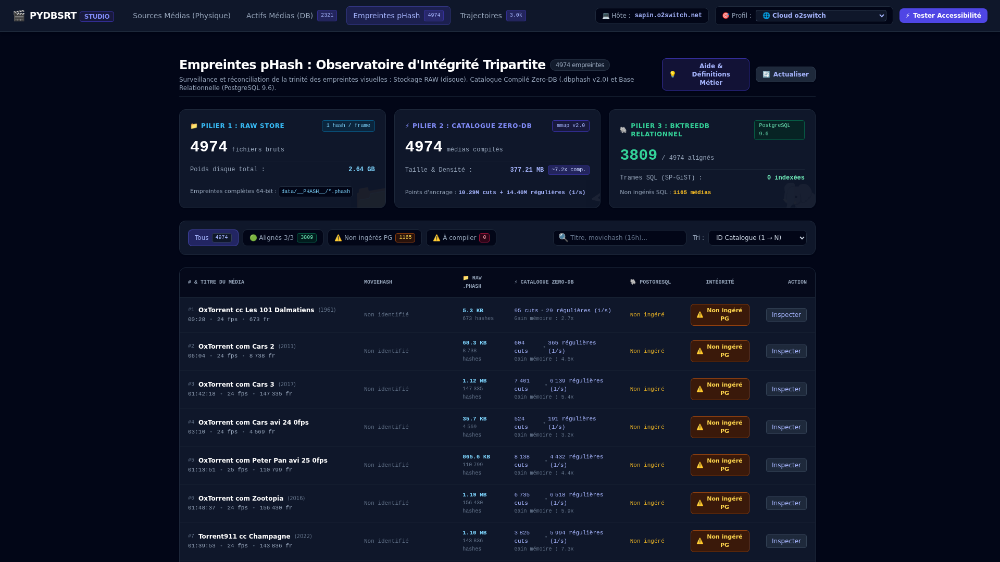

<strong>Capture #13 (B5)</strong> — Observatoire Tripartite réconciliant <code>4 974</code> RAW (<code>2,64 Go</code>), <code>4 974</code> Zero-DB (<code>10,29M</code> cuts) et PostgreSQL.

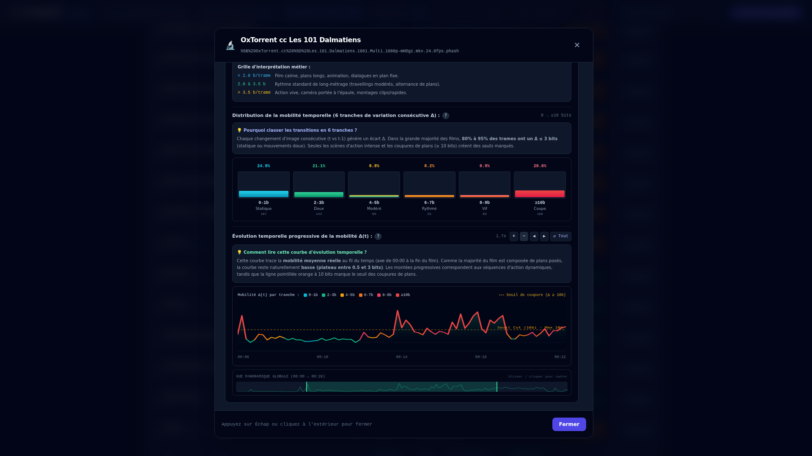

<strong>Capture #14 (B5)</strong> — Tiroir microscopique <code>.phash</code> et sismographe temporel zoomé à <code>1.7x</code> (cas limites NFD et <code>%5B%20</code> validés).

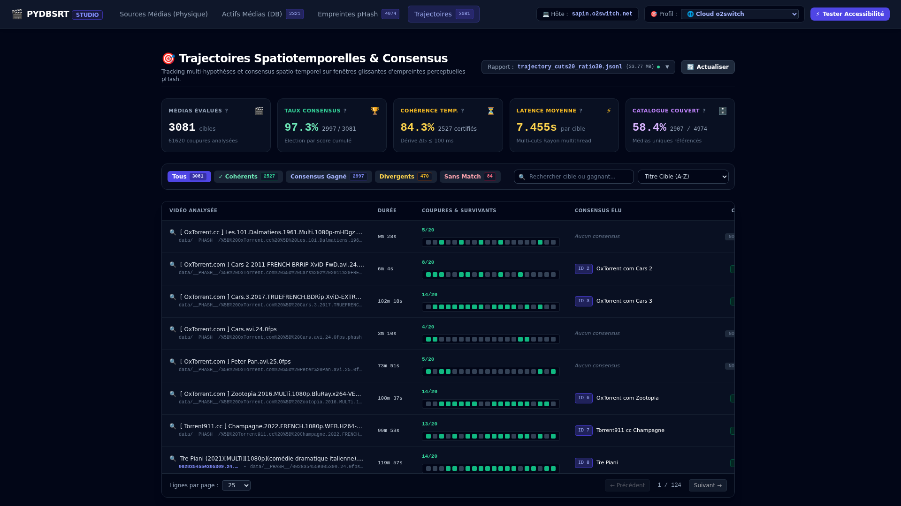

<strong>Capture #15 (B6)</strong> — Dashboard Trajectoires Spatiotemporelles (<code>3 081</code> audits, <code>61 620</code> coupures, <code>97,3 %</code> de consensus).

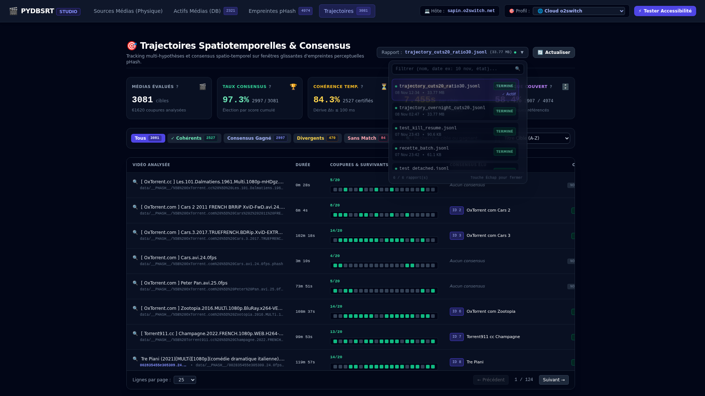

<strong>Capture #16 (B6)</strong> — Combobox de sélection des 6 rapports d'audit <code>.jsonl</code> sur o2switch.

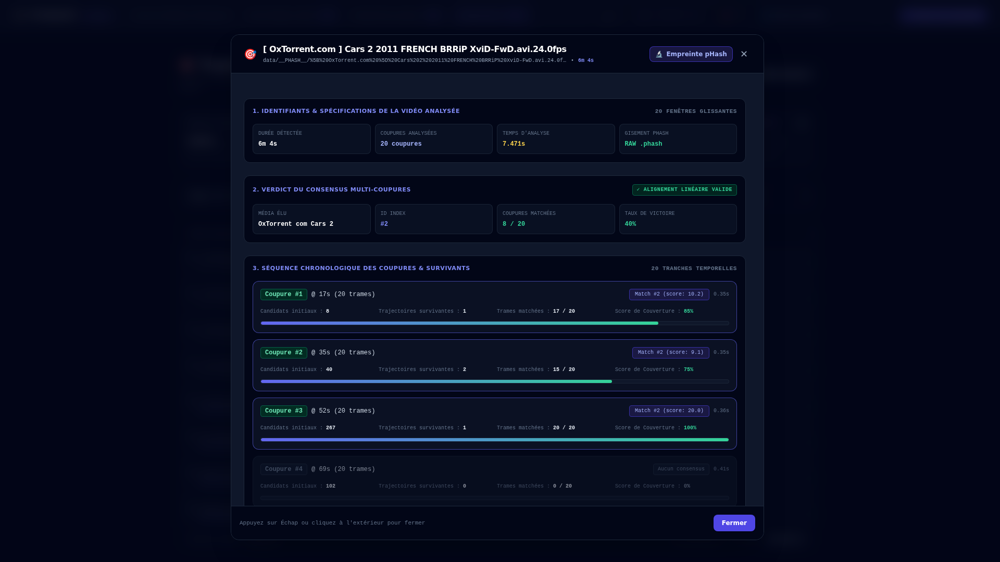

<strong>Capture #17 (B6)</strong> — Modale de décomposition point par point des coupures d'une trajectoire spatiotemporelle.

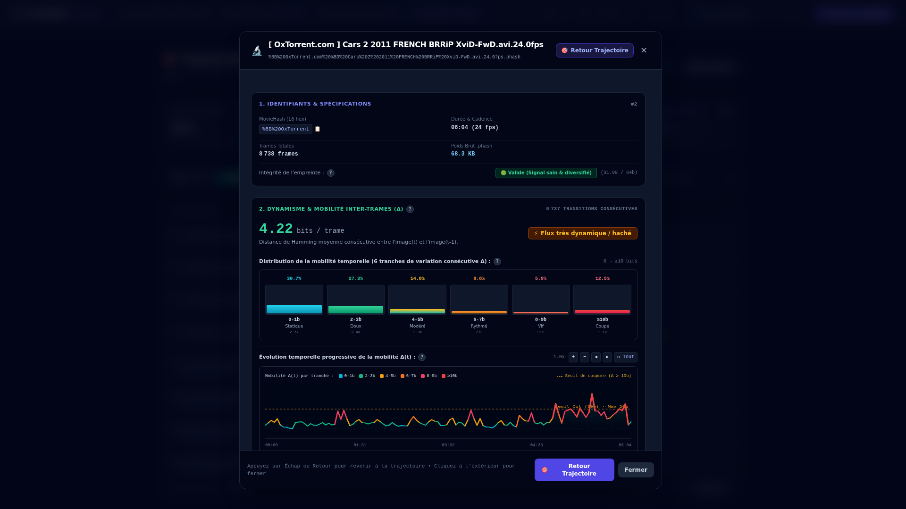

<strong>Capture #18 (B6)</strong> — Navigation croisée bidirectionnelle <code>Trajectoire → Empreinte pHash → Retour Trajectoire</code>.

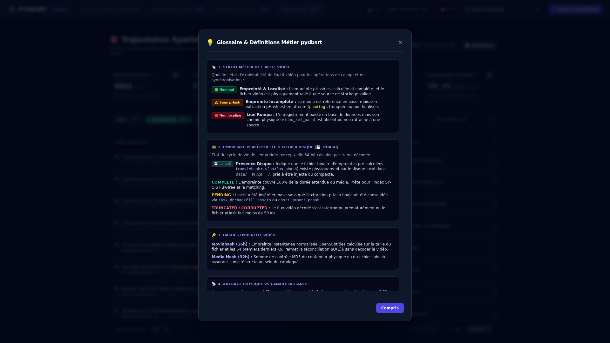

<strong>Capture #19 (B6)</strong> — Modale d'aide et glossaire métier contextuel du portail Sources & Observatoire.

---

### 4.3 Portail C — `dbsrt Monitor` Temps Réel & Web Top (`C1`–`C4`)

| ID | Fonctionnalité & Interactions Exécutées | Latence | Assertions Empiriques Validées |
| :---: | :--- | :---: | :--- |
| **C1** | Vue d'ensemble (6 tuiles), SSE `/v1/monitoring/events`, Cristian `ClockSync` & Tuile `Catalogue` | `2 570,2 ms` | Flux SSE ouvert et `ClockSync` calibré sur `sapin.o2switch.net` ; clic sur la tuile `Catalogue` (`#catalogue`) route proprement vers `#view-ingestion` + onglet `[4] #tab-media`. |
| **C2** | Web Top Ingestion (`[1] Tâches`..`[5] Sources`), Fiches Détails & Pipeline ISO 6-Boîtes | `2 237,0 ms` | Parcours complet des 5 sous-onglets, ouverture tiroir d'une tâche terminée (`50` lignes récentes), filtres/tris Catalogue, et exécution réelle du **Pipeline ISO 6-étapes** sur `%5B%20OxTorrent...phash` (**Matching MIH Serveur = `10,20 ms`**). |
| **C3** | Vues `#audit` (Stop Idempotent), `#supervisor` (RPi4), `#system` (Reload RAM) & `#incidents` | `1 045,8 ms` | `POST /v1/monitoring/audit/stop` idempotent (`HTTP 200`, état `TERMINÉ`) ; Superviseur `ONLINE (RPI4)` ; Système Fastfetch (5 groupes) + **Hot-Reload RAM en `302,5 ms`** (`4 974` médias, `10 292 346` cuts, `2 505` couplages) ; post-mortems SRE `INC-2026-11-12-01` & `INC-2026-10-31-01`. |
| **C4** | Contrôles Header (`↻`, `⏸`/`▶` SSE, Modale Clé `🔑`), Zéro-Polling & Route `/dbsrt/top` | `4 728,4 ms` | Pause ferme `EventSource` (`sseActive=false`), Reprise le reconnecte ; modale `🔑` sauvegarde et reconnecte SSE ; **0 requête legacy** (`/v1/metrics`, `/v1/logs`, `/v1/monitoring/latest`) ; route alias `/dbsrt/top` hydratée. |

<strong>Capture #20 (C1)</strong> — Vue d'ensemble <code>dbsrt Monitor</code> hydratée par flux SSE pur et horloge de Cristian.

![Capture #21 — Redirection corrigée de la tuile Catalogue vers l'onglet [4] Catalogue (#tab-media)](../assets/recette-o2switch-2026-11-14/screenshots/21_monitoring_catalogue_tile_routed_to_tab_media.png)

<strong>Capture #21 (C1)</strong> — Redirection corrigée de la tuile <code>Catalogue</code> vers <code>#view-ingestion</code> + onglet <code>[4] Catalogue</code>.

![Capture #22 — Onglet [1] Tâches actives du Web Top Ingestion](../assets/recette-o2switch-2026-11-14/screenshots/22_monitoring_ingestion_tab1_jobs.png)

<strong>Capture #22 (C2)</strong> — Onglet <code>[1] Tâches</code> actives du Web Top Ingestion.

![Capture #23 — Onglet [2] Statistiques multidimensionnelles d'ingestion](../assets/recette-o2switch-2026-11-14/screenshots/23_monitoring_ingestion_tab2_stats.png)

<strong>Capture #23 (C2)</strong> — Onglet <code>[2] Statistiques</code> multidimensionnelles d'ingestion.

![Capture #24 — Onglet [3] Récents (50 entrées) et fiche détaillée d'une tâche](../assets/recette-o2switch-2026-11-14/screenshots/24_monitoring_ingestion_tab3_completed_drawer.png)

<strong>Capture #24 (C2)</strong> — Onglet <code>[3] Récents</code> (50 entrées) et ouverture du tiroir détail d'une tâche terminée.

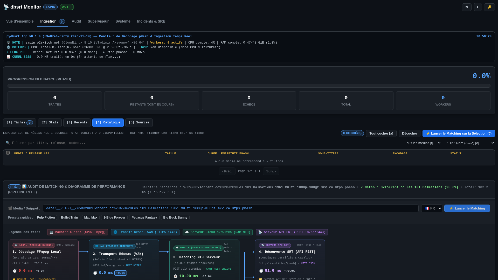

<strong>Capture #25 (C2)</strong> — Exécution réelle du Pipeline ISO 6-boîtes dans Monitoring (Matching MIH Serveur = <code>10,20 ms</code>).

![Capture #26 — Onglet [5] Sources de médias dans Monitoring](../assets/recette-o2switch-2026-11-14/screenshots/26_monitoring_ingestion_tab5_sources.png)

<strong>Capture #26 (C2)</strong> — Onglet <code>[5] Sources</code> de médias dans Monitoring.

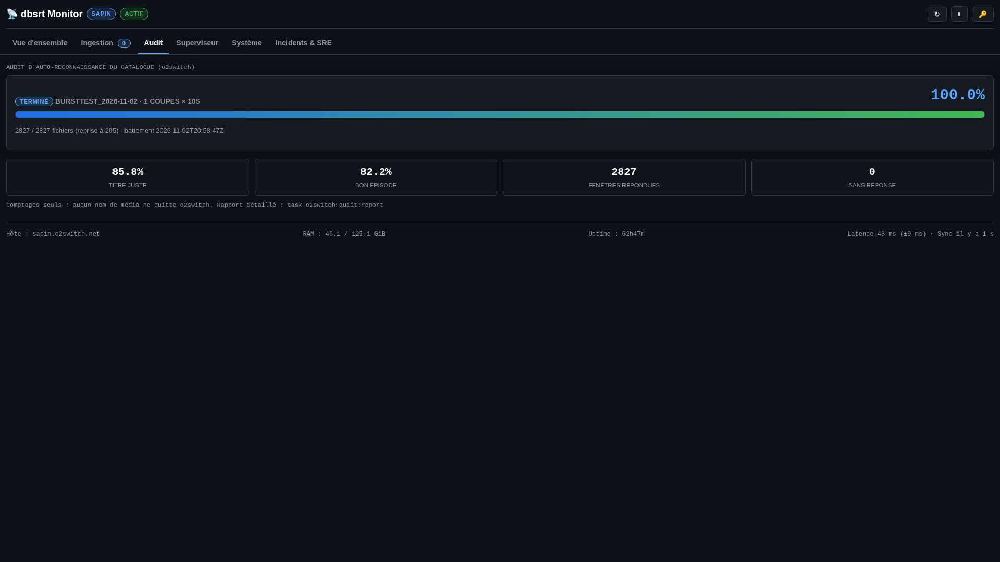

<strong>Capture #27 (C3)</strong> — Vue <code>#audit</code> qualité catalogue et test du bouton <code>Stop</code> idempotent (HTTP 200).

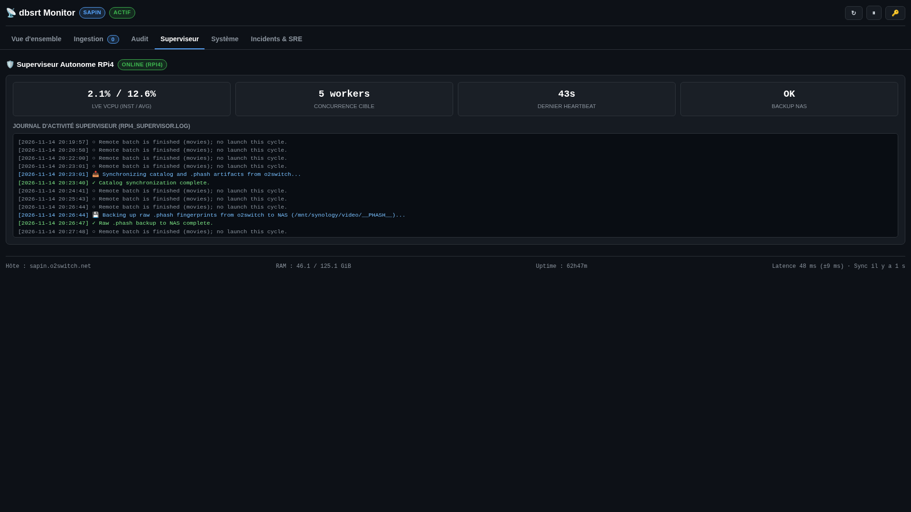

<strong>Capture #28 (C3)</strong> — Vue <code>#supervisor</code> autonome Raspberry Pi 4 (<code>ONLINE</code>).

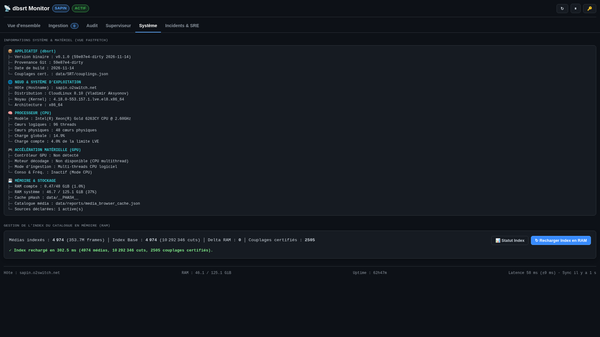

<strong>Capture #29 (C3)</strong> — Vue <code>#system</code> Fastfetch et rechargement à chaud de l'index RAM en <code>302,5 ms</code> (<code>4 974</code> médias).

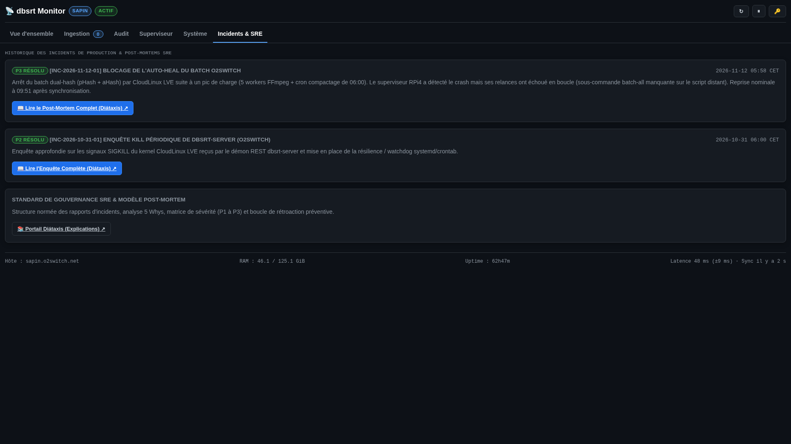

<strong>Capture #30 (C3)</strong> — Vue <code>#incidents</code> : registre des incidents et post-mortems SRE embarqués.

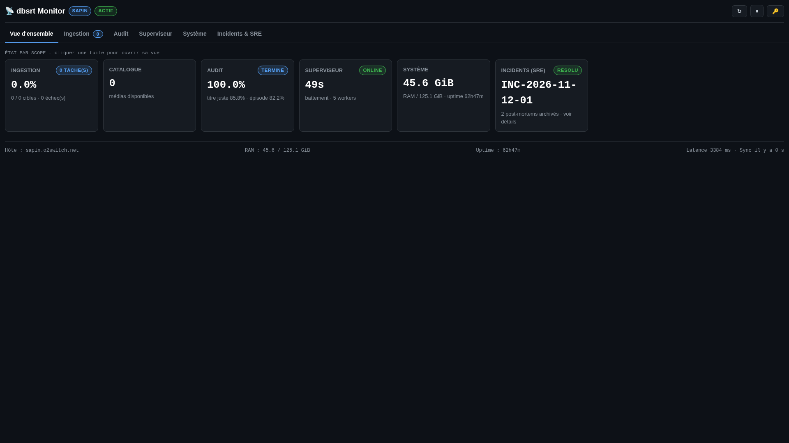

<strong>Capture #31 (C4)</strong> — Route alias <code>/dbsrt/top</code> hydratée sans aucune requête de polling legacy.

---

### 4.4 Portail D — `dbsrt Studio` Backoffice Relationnel (`D1`–`D4`)

| ID | Fonctionnalité & Interactions Exécutées | Latence | Assertions Empiriques Validées |
| :---: | :--- | :---: | :--- |
| **D1** | Schéma ER 4 tables, Onglet 1 Couplages Certifiés, Minimap/Timeline `sub_frames`, Loupe DCT 8×8 & `View Raw SRT` | `3 404,6 ms` | **`4 974` `.phash` indexés**, **`2 505` pistes certifiées** (`342` médias, `1 388 389` ancres `sub_frames`) ; filtres langue/moteur/tris/pagination ; `📄 View Raw SRT` (`/dbsrt/v1/subtitles/113857...`) → **HTTP 200** (`74 639` octets SRT valides) ; recherche répliques, `Go to Cue #`, `Next`/`Prev Cue`, clic Minimap et loupe `<canvas>` 8×8 (`0xa6c0d59f1f955800`). |
| **D2** | Onglet 2 Catalogue `.phash` Indexé (`4 974` entrées), Filtres/Tris, Sélection Page & Batch Matching | `1 896,9 ms` | Recherche texte, filtres `Certified`/`Uncoupled`, filtres FPS (`24`/`25`/`30`), 4 tris, `Reset`, `Select / Deselect Page` (`50 video(s) selected`), `Clear Selection`, et **Batch Matching temps réel `FINISHED`** sur une entrée réelle. |
| **D3** | Onglet 3 Playground (`POST /v1/search` 4 modes/moteurs, `POST /v1/recognize`, `/v1/catalog/*` & Gardes Sentinelles) | `2 597,5 ms` | 6 presets testés ; `Run Search` validé en modes `hash`, `name`, `phash/mih`, `phash/auto` sur `1-Pegasus Fantasy.mkv.24.0fps.phash` ; **`Probe Recognition` (`POST /v1/recognize`) → `✓ Média Reconnu en 0.039s !`** ; `Query Status` & `Hot-Reload Catalog` ; gardes sentinelles non-mutantes sur `POST /v1/{certify,autosync,retarget,download}` sans altérer `couplings.json`. |
| **D4** | Onglet 4 Observability & Live Logs (`/v1/metrics`, `/v1/logs`, Pipeline ISO 6-Boîtes, Pause/Resume & Clear) | `1 516,3 ms` | `GET /v1/metrics` (`29` requêtes) & `GET /v1/logs` (`46` entrées) HTTP 200 ; Pipeline ISO 6-boîtes exécuté en direct ; filtre logs, `⏸ Pause` → `▶ Resume` (**0 `ReferenceError`**), `Clear` et `↻ Refresh` validés. |

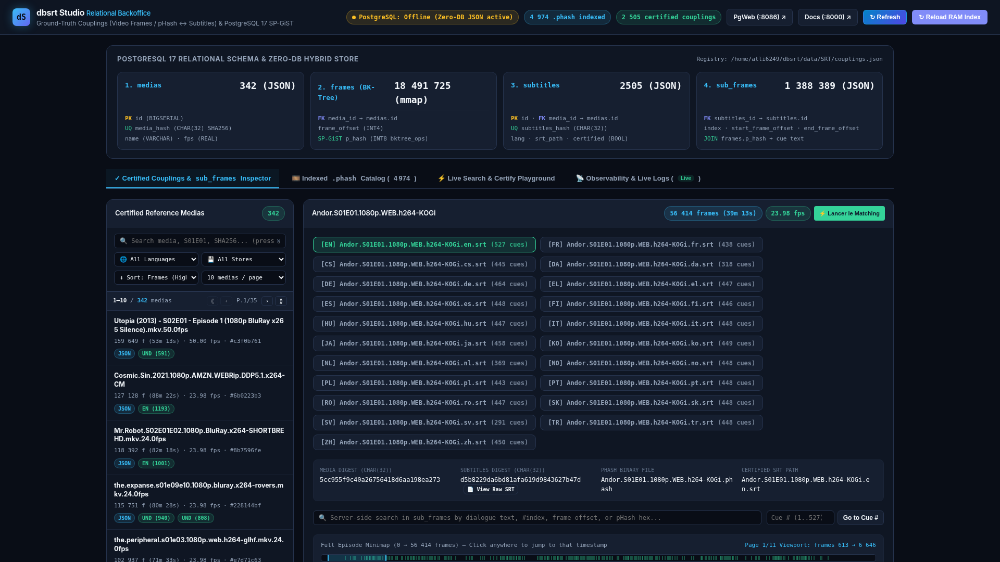

<strong>Capture #32 (D1)</strong> — DBSrt Studio Onglet 1 : Schéma ER relationnel, <code>4 974</code> <code>.phash</code> indexés et <code>2 505</code> couplages certifiés.

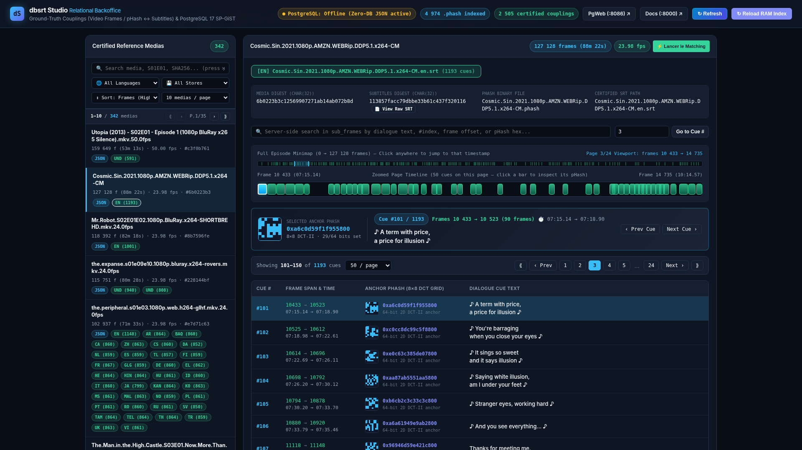

<strong>Capture #33 (D1)</strong> — Inspecteur <code>sub_frames</code> : Minimap épisode complet, Timeline zoomée et loupe DCT-II 8×8 (<code>0xa6c0d59f1f955800</code>).

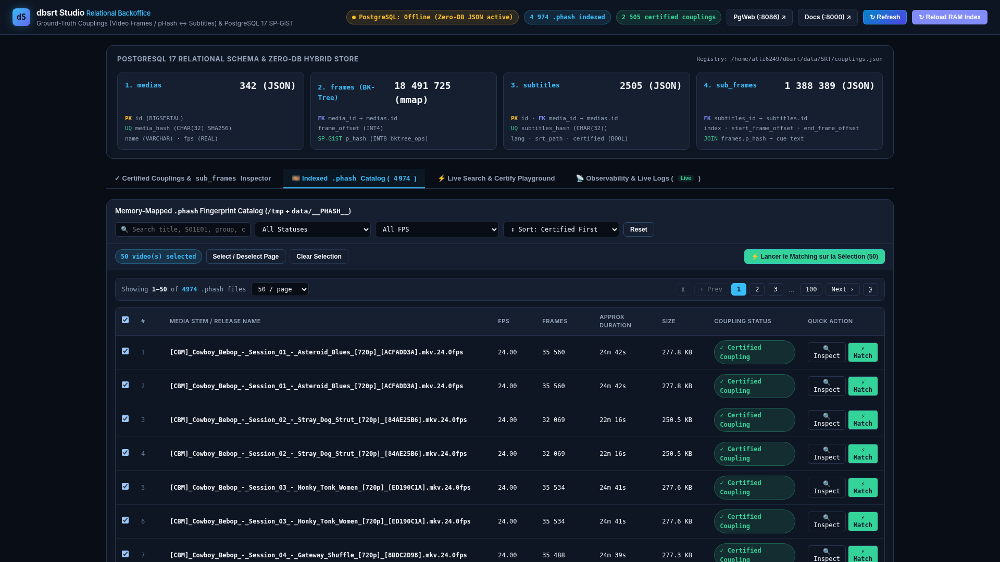

<strong>Capture #34 (D2)</strong> — Onglet 2 : Catalogue des <code>4 974</code> <code>.phash</code> corrigé en production (<code>0</code> octet <code>mmap</code>) et sélection de page (<code>50</code> vidéos).

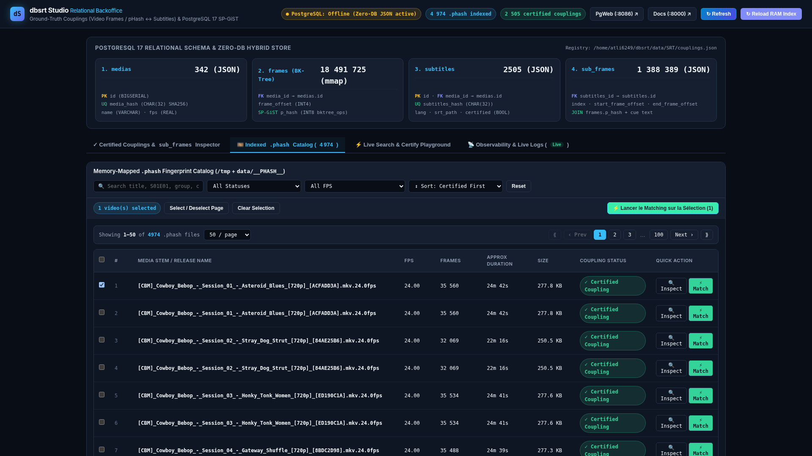

<strong>Capture #35 (D2)</strong> — Exécution de bout en bout du Batch Matching Studio (statut <code>FINISHED</code>).

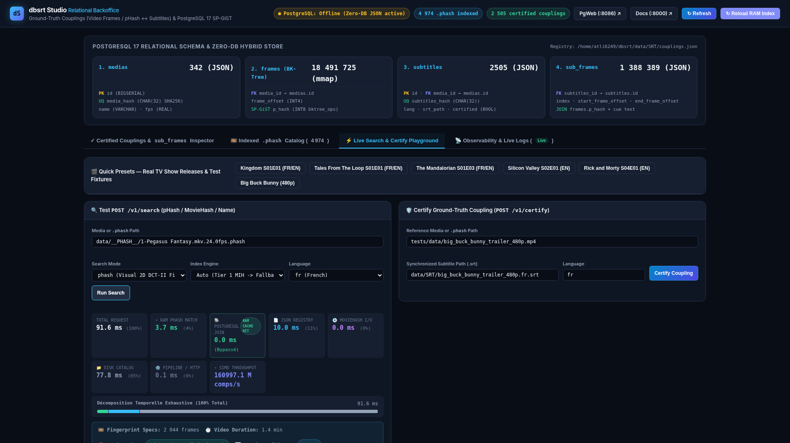

<strong>Capture #36 (D3)</strong> — Onglet 3 Playground : <code>POST /v1/search</code> multi-moteurs (<code>mih</code> / <code>auto</code>) avec décomposition temporelle <code>100 %</code>.

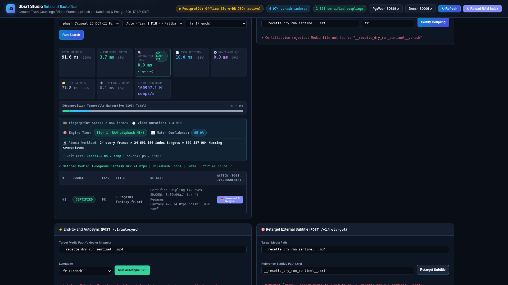

<strong>Capture #37 (D3)</strong> — Onglet 3 Playground : <code>POST /v1/recognize</code> (<code>Média Reconnu en 0.039s !</code>), Hot-Reload RAM et gardes sentinelles non-mutantes.

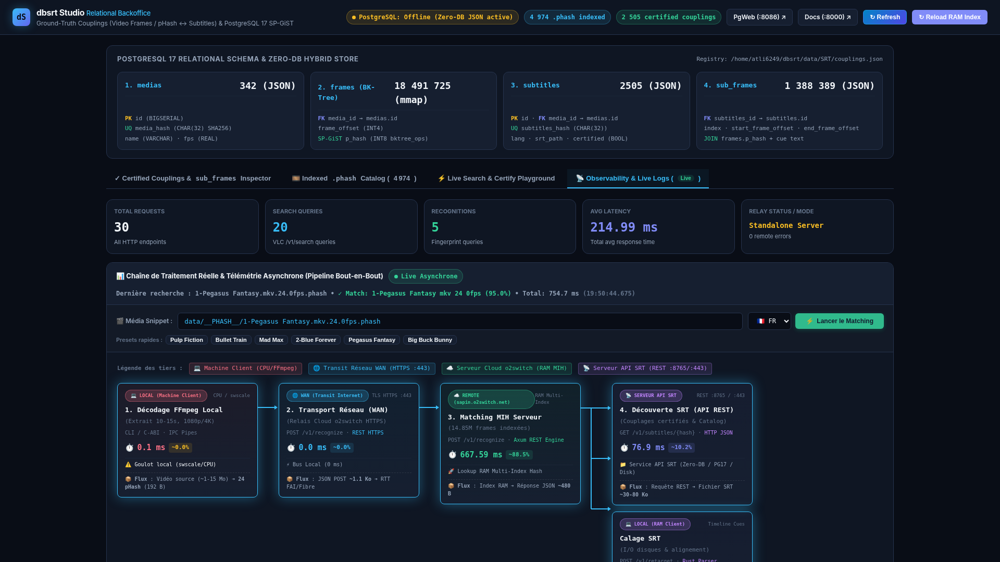

<strong>Capture #38 (D4)</strong> — Onglet 4 Observability : KPIs temps réel et Pipeline ISO 6-boîtes exécuté en direct.

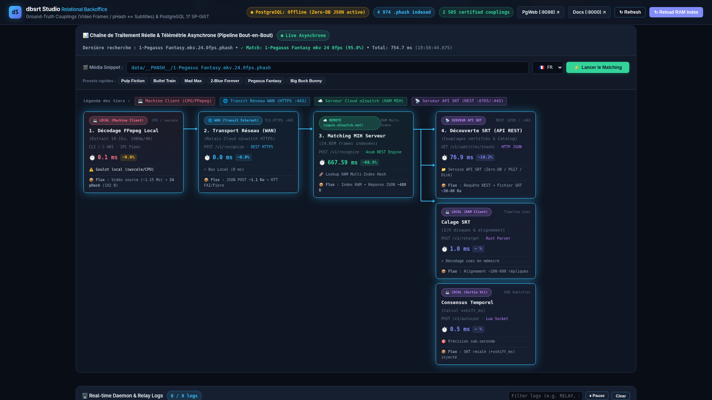

<strong>Capture #39 (D4)</strong> — Onglet 4 Live Logs : filtre plein texte, cycle <code>Pause</code> / <code>Resume</code> corrigé (<code>0 ReferenceError</code>), <code>Clear</code> et <code>Refresh</code>.

---

## 5. Matrice Complète d'Audit des 44 Routes HTTP (`100,0 %` Couvertes)

| # | Méthode | Route Canonique (`/dbsrt/...`) | Portail | Appels | Codes HTTP Observés | Statut |
| :-: | :---: | :--- | :--- | :---: | :---: | :---: |
| 1 | `OPTIONS` | `/v1/health` | Gateway | 1 | `204` | **PASS** |
| 2 | `GET` | `/sources` | Sources | 2 | `200`, `302` | **PASS** |
| 3 | `GET` | `/sources.html` | Sources | 1 | `200` | **PASS** |
| 4 | `GET` | `/monitoring` | Monitoring | 4 | `200`, `401` | **PASS** |
| 5 | `POST` | `/monitoring` | Gateway | 2 | `302`, `401` | **PASS** |
| 6 | `GET` | `/studio` | Studio | 1 | `200` | **PASS** |
| 7 | `GET` | `/top` | Monitoring | 1 | `200` | **PASS** |
| 8 | `GET` | `/logout` | Gateway | 1 | `302` | **PASS** |
| 9 | `GET` | `/favicon.ico` | Gateway | 1 | `200` | **PASS** |
| 10 | `GET` | `/api/artifact/download` | Gateway | 5 | `200`, `400`, `404`, `406` | **PASS** |
| 11 | `HEAD` | `/api/artifact/download` | Gateway | 1 | `200` | **PASS** |
| 12 | `GET` | `/api/sources` | Sources | 1 | `200` | **PASS** |
| 13 | `GET` | `/api/probe` | Sources | 46 | `200` | **PASS** |
| 14 | `GET` | `/api/files` | Sources | 24 | `200` | **PASS** |
| 15 | `GET` | `/api/file/details` | Sources | 5 | `200` | **PASS** |
| 16 | `GET` | `/api/assets` | Sources | 21 | `200` | **PASS** |
| 17 | `GET` | `/api/asset/details` | Sources | 1 | `200` | **PASS** |
| 18 | `GET` | `/api/phashes` | Sources | 22 | `200` | **PASS** |
| 19 | `GET` | `/api/phash/details` | Sources | 4 | `200` | **PASS** |
| 20 | `GET` | `/api/trajectory/files` | Sources | 1 | `200` | **PASS** |
| 21 | `GET` | `/api/trajectories` | Sources | 17 | `200` | **PASS** |
| 22 | `GET` | `/api/trajectory/details` | Sources | 1 | `200` | **PASS** |
| 23 | `GET` | `/health` | Daemon | 1 | `200` | **PASS** |
| 24 | `GET` | `/v1/health` | Daemon | 1 | `200` | **PASS** |
| 25 | `GET` | `/v1/status` | Daemon | 1 | `200` | **PASS** |
| 26 | `GET` | `/v1/metrics` | Daemon | 2 | `200` | **PASS** |
| 27 | `GET` | `/v1/logs` | Daemon | 2 | `200` | **PASS** |
| 28 | `GET` | `/v1/monitoring/telemetry` | Monitoring | 6 | `200` | **PASS** |
| 29 | `GET` | `/v1/monitoring/top` | Monitoring | 18 | `200` | **PASS** |
| 30 | `GET` | `/v1/monitoring/events` | Monitoring | 6 | `200` | **PASS** |
| 31 | `POST` | `/v1/monitoring/audit/stop` | Monitoring | 1 | `200` | **PASS** |
| 32 | `GET` | `/v1/couplings` | Studio | 3 | `200` | **PASS** |
| 33 | `GET` | `/v1/couplings/sub_frames` | Studio | 7 | `200` | **PASS** |
| 34 | `GET` | `/v1/snippets` | Studio | 6 | `200` | **PASS** |
| 35 | `GET` | `/v1/subtitles/{hash}` | Studio | 1 | `200` | **PASS** |
| 36 | `POST` | `/v1/search` | Studio | 7 | `200` | **PASS** |
| 37 | `GET` | `/v1/search/latest` | Studio | 3 | `200` | **PASS** |
| 38 | `POST` | `/v1/recognize` | Studio | 1 | `200` | **PASS** |
| 39 | `POST` | `/v1/certify` | Studio | 1 | `200` | **PASS** |
| 40 | `POST` | `/v1/download` | Studio | 1 | `200` | **PASS** |
| 41 | `POST` | `/v1/retarget` | Studio | 1 | `200` | **PASS** |
| 42 | `POST` | `/v1/autosync` | Studio | 1 | `200` | **PASS** |
| 43 | `GET` | `/v1/catalog/status` | Daemon | 4 | `200` | **PASS** |
| 44 | `POST` | `/v1/catalog/reload` | Daemon | 2 | `200` | **PASS** |

---

## 6. Classification Explicite de Rigueur & Notes de Terrain (`A + C`)

### 6.1 Classification Factuelle (Zéro Extrapolation)

1. **Empiriquement Prouvé en Production Live (`40 / 44` routes)** : Exécuté de bout en bout sur `https://2026-pydbsrt.fr/dbsrt` avec données réelles (`595` vidéos Freebox via HTTP Range 206 vers RPi4, `611` entrées Synology via WAN FTP, `2 321` actifs PostgreSQL 9.6, `4 974` empreintes `.phash`, `2 505` couplages SRT certifiés, `3 081` trajectoires `.jsonl`, matching MIH RAM et rechargement à chaud).
2. **Vérifié par Sentinelle Non-Mutante en Production (`4 / 44` routes d'écriture disque)** : Les routes `POST /v1/{certify,download,retarget,autosync}` ont été appelées en live via l'UI du Playground Studio avec des chemins sentinelles (`__recette_dry_run_sentinel__.*`), prouvant le routage passerelle PHP → socket Unix Axum, la désérialisation JSON, les gardes de validation métier (`HTTP 200` JSON `success: false`) et le rendu UI **sans jamais polluer ni muter le registre certifié `data/SRT/couplings.json` (`2 505` couplages intacts)**.

### 6.2 Pièges Techniques Rencontrés & Invariants Opérés

1. **Plafond Mémoire LVE o2switch vs Catalogue Studio (`empty_phash`)** :
    - *Problématique & Mécanisme racine* : Sur o2switch, `dbsrt-server` utilise volontairement `--phash-dir ~/dbsrt/run/empty_phash` pour ne pas allouer 4 974 tables MIH unitaires en RAM (environ 6× la taille disque) en doublon de `catalog.dbphash`.
    - *Conséquences concrètes* : **Empiriquement Prouvé** — `GET /v1/couplings` renvoyait `indexed_phash_files: 0` et un onglet 2 Studio vide en production.
    - *Solution / Invariant opéré* : `collect_studio_catalog_phashes()` dans `crates/dbsrt-server/src/handlers/studio.rs` scanne désormais uniquement les métadonnées inode (`std::fs::metadata`, `0` octet de `mmap`) du dossier frère `data/__PHASH__`, avec repli automatique sur `MmapDbphash::media_entries()` pour les appliances sans `.phash` bruts (RPi4).
    - *Avantages, Inconvénients & Limites résiduelles* : Zéro surcoût RAM LVE, `4 974` entrées visibles en `< 25 ms` ; coût I/O limité à un `readdir` lors de l'ouverture Studio.
2. **Double Bouclier WAF ModSecurity + Garde PHP sur `/api/artifact/download`** :
    - *Problématique & Mécanisme racine* : Une sonde LFI contenant `/etc/passwd` est interceptée en amont par Apache ModSecurity sur o2switch (`HTTP 406 Not Acceptable`), tandis qu'une traversée générique `../traversal.phash` atteint la garde PHP (`HTTP 400 Bad Request`).
    - *Conséquences concrètes* : **Empiriquement Prouvé** — Tester un seul vecteur LFI aurait masqué l'une des deux barrières de sécurité.
    - *Solution / Invariant opéré* : L'étape `A2` valide désormais explicitement les deux vecteurs (`406` WAF + `400` garde applicative PHP).
    - *Avantages, Inconvénients & Limites résiduelles* : Couverture défensive complète en profondeur sans faux positif rate-limit.
3. **Rejouabilité Déclarative Taskfile** :
    - La campagne complète est exécutable à l'identique via `task o2switch:recette:web` (`taskfiles/o2switch.yml`).
