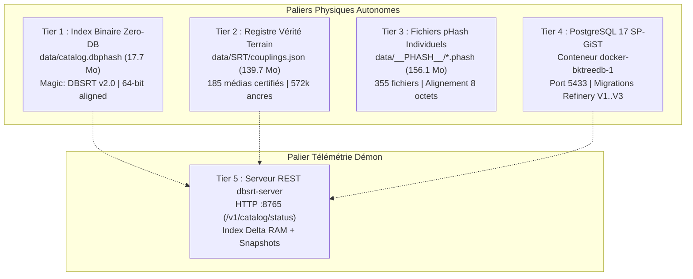

# 🛠️ Guide Pratique : Audit d'Intégrité Exhaustif du Catalogue & Stockage Multipalier

Ce guide opérationnel détaille la procédure de diagnostic et de vérification automatisée de l'intégrité du catalogue et des 4 paliers de stockage de `pydbsrt`. Il documente également la résolution des faux positifs de corruption d'index lors des requêtes d'état hors-ligne.

---

## 1. Contexte & Problématique

Lors de traitements d'ingestion de masse ou d'interruption abrupte d'une commande (`^C` sous Taskfile), une commande telle que `task catalog:status` peut échouer brutalement avec un code d'erreur opaque :

```text
task: [catalog:status] bash scripts/stack_ctl.sh catalog-status
task: Failed to run task "catalog:status": exit status 7
```

### Cause Racine du Code Retour 7
L'utilitaire `curl` sous-jacent renvoie le code d'erreur `7` (`CURLE_COULDNT_CONNECT`), signifiant un refus de connexion TCP standard (*Connection refused*).
**Ce comportement n'indique aucune corruption de données**, mais signale simplement que le démon HTTP `dbsrt-server` est hors-ligne sur le port local `8765`.

---

## 2. Architecture des 4 Paliers de Stockage

L'intégrité de `pydbsrt` repose sur 4 paliers physiques de persistance et 1 palier de télémétrie en mémoire vive :



---

## 3. Procédure Automatisée en 1 Commande (`task catalog:verify`)

Pour vérifier immédiatement et de façon programmatique l'intégrité globale sans dépendre d'un navigateur ou d'une inspection manuelle, exécutez la cible orchestrée :

```bash
task catalog:verify
```

### Options de Commande
- **Export JSON machine-readable** (intégration CI/CD et monitoring) :
  ```bash
  task catalog:verify -- --json
  ```
- **Spécification de chemins personnalisés** :
  ```bash
  task catalog:verify -- --dbphash data/catalog.dbphash --couplings data/SRT/couplings.json
  ```

---

## 4. Résultats Empiriques Observés (Rapport d'Audit)

Exécution réelle vérifiée sur la stack opérationnelle :

```text
========================================================================
===   PYDBSRT AUDIT D'INTÉGRITÉ EXHAUSTIF DU CATALOGUE & STOCKAGE    ===
========================================================================

[✓ PASS] Tier 1 : Index Zero-DB (catalog.dbphash)
       • path                       : data/catalog.dbphash
       • size_bytes                 : 18581264
       • version                    : 2
       • media_count                : 1566
       • total_cuts                 : 586258
       • total_sparse_frames        : 567009
       • offset_media_table         : 128
       • offset_cuts_table          : 100352
       • offset_sparse_table        : 9480480
       • offset_strings_table       : 18552624
       • strings_len                : 28640

[✓ PASS] Tier 2 : Registre Couplages Certifiés (couplings.json)
       • path                       : data/SRT/couplings.json
       • size_bytes                 : 146491130
       • certified_media_couplings  : 185
       • registered_subtitles       : 1020
       • cue_frame_anchors          : 572190

[✓ PASS] Tier 3 : Fichiers pHash Individuels (data/__PHASH__)
       • total_files                : 355
       • total_bytes                : 156181528
       • total_frames_indexed       : 19522691
       • alignment                  : Exact 64-bit (8 bytes / frame)

[✓ PASS] Tier 4 : PostgreSQL 17 SP-GiST (docker-bktreedb-1)
       • container                  : docker-bktreedb-1
       • host                       : 127.0.0.1
       • port                       : 5433
       • database                   : bktreedb
       • counts:
         - medias                   : 1
         - frames                   : 812
         - subtitles                : 1
         - sub_frames               : 8

[✓ PASS] Tier 5 : Démon HTTP dbsrt-server (:8765)
       • status                     : ONLINE
       • uptime_seconds             : 721
       • postgres_connected         : True
       • catalog_snapshot:
         - base_medias              : 1566
         - base_cuts                : 586258
         - base_sparse              : 567009
         - delta_medias             : 0
         - delta_cuts               : 0
         - delta_sparse             : 0
         - certified_couplings      : 1020
         - total_medias             : 1566

────────────────────────────────────────────────────────────────────────
🎉 AUDIT 100% CONFORME : ZÉRO DÉFAUT D'ALIGNEMENT, DE SYNTAXE OU DE PERSISTANCE.
   Temps de vérification : 5.5 s sur 4 paliers physiques.
```

---

## 5. Synthèse des Points de Contrôle par Palier

| Palier | Fichier / Service | Règle d'Intégrité Validée | Conséquence en Cas d'Échec |
| :--- | :--- | :--- | :--- |
| **Tier 1** | `data/catalog.dbphash` | Magic `DBSRT\x02\x00\x00`, version 2, taille fichier = `offset_strings + strings_len`. | `SIGBUS` ou erreur mmap au boot du serveur. |
| **Tier 2** | `data/SRT/couplings.json` | Syntax JSON stricte, présence des clés `media_name`, `fps`, `subtitles`. | Impossibilité de recalage vérité terrain. |
| **Tier 3** | `data/__PHASH__/*.phash` | Taille non nulle et modulo exact de 8 octets (`size % 8 == 0`). | Erreur de lecture SIMD ou frame corrompue. |
| **Tier 4** | PostgreSQL 17 (`bktreedb`) | Connectivité socket, migrations Refinery V1..V3 sans régression DDL. | Échec des requêtes SP-GiST Hamming. |
| **Tier 5** | `dbsrt-server` (`:8765`) | Disponibilité HTTP 200 sur `/v1/status` et `/v1/catalog/status`. | Indisponibilité du recalage temps réel dans VLC. |

---

## 6. Dépannage Rapide

> [!TIP]
> Si `task catalog:status` affiche `❌ dbsrt-server est hors-ligne (port 8765)` :
>
> 1. Démarrez la stack complète avec `task up` ou `task studio`.
> 2. Démarrez uniquement le démon dbsrt-server avec `bash scripts/stack_ctl.sh server-start`.
> 3. Contrôlez l'état général des services avec `task status`.
