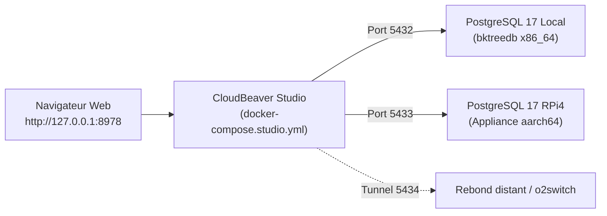

# Studio Web Multi-Bases CloudBeaver (`task db:studio`)

Ce guide pratique décrit comment démarrer, utiliser et dépanner le studio web de gestion de bases de données **CloudBeaver**, provisionné de manière déclarative pour l'écosystème `pydbsrt`.

---

## 1. Contexte & Bénéfices Opérationnels

Pour observer et manipuler visuellement les bases de données réparties sans installer d'application cliente lourde sur votre poste :

- **Provisionnement 100 % programmatique** : Zéro écran de bienvenue (*Setup Wizard*), zéro saisie manuelle de mot de passe, zéro configuration manuelle.
- **Multi-Bases Out-of-the-Box** : Les connexions vers la base locale (`bktreedb`) et l'appliance Raspberry Pi 4 sont pré-enregistrées et prêtes au premier chargement.
- **Pérennité & Reproductibilité** : Repart de zéro à l'identique sur une nouvelle machine ou dans un an sans dépendance envers une IA.



---

## 2. Démarrage et Arrêt du Studio

Toutes les opérations d'exploitation s'effectuent via `Taskfile` :

### Lancer le Studio

```bash
task db:studio
```

*Résultat attendu* : Le conteneur Docker `dbsrt-cloudbeaver` démarre sur le port `8978` et affiche :

```text
🌐 CloudBeaver Studio ready on http://127.0.0.1:8978
```

Ouvrez l'URL dans votre navigateur :

```text
http://127.0.0.1:8978
```

### Arrêter le Studio

Pour libérer les ressources lorsque l'observation est terminée :

```bash
task db:studio:down
```

---

## 3. Connexions Pré-configurées

Dès l'ouverture, le volet de gauche de CloudBeaver présente les connexions pré-provisionnées :

| Nom de Connexion | Cible Réseau | Rôle Opérationnel | Identifiants Déclarés |
| :--- | :--- | :--- | :--- |
| **`01. Local bktreedb (x86_64)`** | `bktreedb:5432` | Base active de développement local (2 321 médias, sources CIFS). | `docker` / `docker` |
| **`02. RPi4 Appliance (aarch64)`** | `rpi4:5433` | Base PostgreSQL 17 dédiée embarquée sur le Raspberry Pi 4. | `docker` / `docker` |

Pour explorer une base :

1. Dépliez la connexion souhaitée dans l'arborescence à gauche.
2. Dépliez **`Databases` $\to$ `bktreedb` $\to$ `Schemas` $\to$ `public` $\to$ `Tables`**.
3. Double-cliquez sur une table (ex: `medias`, `media_sources`, `subtitles`) pour afficher directement ses données, filtres et métadonnées.

---

## 4. Architecture & Fichiers de Définition

Le fonctionnement déclaratif repose sur deux fichiers versionnés dans le dépôt :

1. **`docker/docker-compose.studio.yml`** : Déclare le conteneur CloudBeaver, les variables d'environnement d'auto-configuration (`CB_SERVER_NAME`, `CB_ADMIN_NAME`, `CB_ADMIN_PASSWORD`) et l'accès réseau externe (`docker_default`).
2. **`docker/cloudbeaver/conf/initial-data-sources.conf`** : Fichier JSON définissant les connexions, les pilotes JDBC et les paramètres de sécurité injectés au démarrage.

---

## 5. Dépannage & Diagnostic

| Problème | Cause Probable | Solution |
| :--- | :--- | :--- |
| `Connexion refusée sur http://127.0.0.1:8978` | Conteneur non démarré | Exécuter `task db:studio` et vérifier l'état avec `docker ps --filter name=dbsrt-cloudbeaver`. |
| `02. RPi4 Appliance en erreur de connexion` | RPi4 éteint ou conteneur `dbsrt-pg17` arrêté | Vérifier la connectivité réseau avec le RPi4 ou vérifier le statut distant via `task rpi4:db:status`. |
| `Conflit de port 8978` | Un autre service écoute sur le port 8978 | Définir un port alternatif via variable d'environnement : `CLOUDBEAVER_PORT=8980 task db:studio`. |
