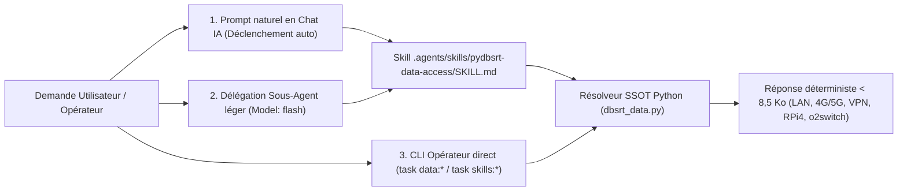

# 🛠️ Utiliser les Agent Skills par l'Exemple (`pydbsrt-data-access`) & Preuves Empiriques (`flash` / `flash_lite`)

Ce guide pratique montre **par des exemples concrets prêts à l'emploi** comment invoquer et exploiter les **Agent Skills** du dépôt (`.agents/skills/pydbsrt-data-access/` et le résolveur SSOT `scripts/data_access/`), aussi bien en **langage naturel dans une session IA**, par **délégation à un sous-agent léger (`flash` / `flash_lite`)**, qu'en **ligne de commande directe (`task data:*` / `task skills:*`)**, avec la **preuve empirique formelle à l'aveugle** validant son exécution sur moteurs légers.

---

## 1. Les 3 Modes d'Utilisation d'un Agent Skill

Un skill déposé sous `.agents/skills/<nom>/SKILL.md` n'est pas une commande magique cachée : son résumé d'en-tête YAML (`name` + `description`) est exposé en permanence à l'agent IA, qui n'ouvre `SKILL.md` que lorsque votre demande correspond à son périmètre (**divulgation progressive**). Vous pouvez l'exploiter de **3 manières complémentaires** :



| Mode d'invocation | Ce que vous tapez | Quand le privilégier | Coût & Latence typiques |
| :--- | :--- | :--- | :--- |
| **1. Chat IA naturel** | Une question métier normale, **sans citer le skill ni aucune commande** | Usage quotidien pendant le développement ou le débogage | Automatique (`1` lecture `SKILL.md` + `1–2` appels JSON) |
| **2. Sous-agent `flash`** | *« Délègue à un sous-agent `flash` la vérification / recherche de... »* | Inventaires, audits de fraîcheur, inspections `ffprobe` sans consommer le contexte ni le quota `pro` | **`37 s` à `46 s` à froid** (`~90 k` tokens `flash`, `0` pollution du fil principal) |
| **3. Terminal `task data:*`** | `task data:status`, `task data:query`, `task data:inspect`, `task data:fetch` | Vérification humaine instantanée dans un shell sans ouvrir de session IA | **`< 0,2 s`** (cache chaud SWR) / `1–3 s` à froid |

---

## 2. Cinq Exemples Concrets en Conversation IA (Prompts & Résultats)

### Exemple 1 — Localiser un film/épisode physique et inspecter ses flux `ffprobe`

**Ce que vous demandez à l'agent (en langage naturel) :**

```text
Trouve le film « Boîte Noire » sur la Freebox et l'épisode S01E01 de « Locke and Key » sur le NAS Synology :
donne leurs chemins exacts, leurs tailles, les codecs/résolutions ffprobe de Boîte Noire, et vérifie si Locke and Key a des sous-titres certifiés.
```

**Ce que fait automatiquement l'agent grâce au skill (zéro `find`, zéro `ls` à l'aveugle) :**

1. Il ouvre `.agents/skills/pydbsrt-data-access/SKILL.md`.
2. Il lance **1 seule requête groupée** résolvant simultanément les 3 disques Freebox (`Disque_1`, `Disque_2`, `Disque_1_1`), l'arborescence `Series/Season` du NAS Synology et le croisement `couplings.json` / `.phash` / `.ahash` :

```bash
python3 .agents/skills/pydbsrt-data-access/scripts/dbsrt_data.py query "freebox:Boite Noire" "tvshow:Locke and Key S01E01"
```

3. Il lance **1 inspection `ffprobe`** ciblée :

```bash
python3 .agents/skills/pydbsrt-data-access/scripts/dbsrt_data.py inspect freebox "Boite Noire"
```

**Résultat obtenu :**

- **Boîte Noire (`Freebox`)** : `Disque_1_1/Vidéos/2022 - FILMS FRANCAIS/Boite Noire (2021)[1080p](Thriller , Drame, Pierre Niney).mkv` (`9 387 647 743` octets, vidéo `h264` `1920x800` `24/1`, audio `dts` `6` canaux `fre`, `0` piste sous-titres intégrée).
- **Locke and Key `S01E01` (`Synology tvshow`)** : `Locke and Key [1080p]/S01/Locke.and.Key.S01E01.Welcome.to.Matheson.1080p.NF.WEB-DL.DDP5.1.x264-NTG.mkv` (`2 455 763 846` octets, `moviehash` `ffb6fed130ab99c8`, `.phash` `ffb6fed130ab99c8.24.0fps.phash`, **`26` sous-titres certifiés couplés** dans `couplings.json`).

---

### Exemple 2 — Retrouver une empreinte `.ahash` ou `.phash` par titre humain (même sans accents)

Les empreintes binaires récentes portent un nom hexadécimal opaque (`01f6f860fd5d63ed.86.1fps.ahash`) dont le titre humain ne figure que dans le sidecar JSON compagnon (`01f6f860fd5d63ed.json`). Sans le skill, un `ls *Hopital*` échoue systématiquement.

**Ce que vous demandez à l'agent :**

```text
Retrouve le fichier .ahash, le moviehash et la durée de « Hopital la republique en panne » ainsi que de « Tre Piani ».
```

**Commande unique exécutée en coulisse (ou par vous via `task`) :**

```bash
task data:query -- "ahash:Hopital la republique en panne" "ahash:Tre Piani"
```

**Extrait JSON réel retourné par l'index O(1) des sidecars :**

```json
{
  "ahash_file": "01f6f860fd5d63ed.86.1fps.ahash",
  "sidecar_file": "01f6f860fd5d63ed.json",
  "moviehash": "01f6f860fd5d63ed",
  "media_name": "Ep.04 | Hôpital, la république en panne.mp4",
  "duration_sec": 2462.69,
  "frames": 212099,
  "audio_codec": "aac",
  "size_bytes": 1696968,
  "phash_file": "01f6f860fd5d63ed.24.0fps.phash"
}
```

---

### Exemple 3 — Travailler en mobilité 4G/5G (`nomad_wan`) ou sous VPN d'entreprise (`work_vpn`)

> [!WARNING]
> **Piège mortel évité par le skill** : hors du Wi-Fi domestique (partage 4G/5G ou VPN d'entreprise `ppp0` capturant une plage privée `/16`), les montages SMB `$MEDIA_MOUNT_ROOT/$USER/{Synology,Freebox}` restent affichés dans `/proc/mounts` mais tout `ls` ou `stat` fige le processus en sommeil noyau ininterruptible (`D-state`), et le pare-feu SSH (`:22`) d'`o2switch` bloque les IP mobiles CGNAT.

**Ce que vous demandez à l'agent en déplacement 4G/5G :**

```text
Je suis en partage 4G : vérifie sur quel disque Freebox est l'épisode S01E01 d'Arcane,
inspecte ses pistes vidéo/audio/sous-titres, et télécharge localement l'ahash 01f6f860fd5d63ed.86.1fps.ahash s'il manque.
```

**Ce que fait automatiquement le résolveur :**

1. Il lit `/proc/net/route`, classe le profil en `nomad_wan` (`cifs_safe_to_stat: false`) et bloque tout appel système CIFS local.
2. Il interroge la Freebox et lance `ffprobe` à distance via le rebond authentifié `HTTPS :443` `o2switch` (`GET /api/files?source=freebox-disks&profile=wan_http` puis `GET /api/file/details` avec `X-API-Key`).
3. Pour `fetch`, il contourne `SSH :22` et télécharge l'artefact via `GET /api/artifact/download` sur `HTTPS :443` en vérifiant son empreinte `X-Checksum-SHA256`.

---

### Exemple 4 — Préparer un nouveau `git worktree` et vérifier la fraîcheur `local` / `rpi4` / `o2switch`

**Ce que vous demandez à l'agent à l'ouverture d'une branche isolée :**

```text
Initialise les symlinks data/ de ce worktree et vérifie si mon catalog.dbphash et mes corpus .phash/.ahash locaux sont à jour par rapport à rpi4 et o2switch.
```

**Équivalent direct côté terminal :**

```bash
task data:seed-worktree
task data:status
```

Le rapport distingue immédiatement `packed_catalog` (`catalog.dbphash`), `packed_ahash_catalog` (`catalog.dbahash` v1 — `UP_TO_DATE` ou `STALE_LOCAL` avec `delta_bytes`, `delta_medias` et `sync_cmd` prête à lancer) et les corpus incrémentaux (`phash_corpus` : ex. `local: 4580`, `o2switch: 4974`, `rpi4: 5400` ; `ahash_corpus` : `local: 2503`, `o2switch: 2548`, `rpi4: 0`).

---

### Exemple 5 — Économiser votre quota `pro` en déléguant à un sous-agent `flash`

Lorsque votre session principale tourne sur un modèle de raisonnement lourd (`pro`) pour coder du Rust complexe, **ne gaspillez ni vos tokens `pro` ni la fenêtre de contexte principale** sur des recherches de fichiers ou d'inventaires : déléguez-les explicitement à `flash` !

**Prompt prêt à copier-coller dans votre session principale :**

```text
Lance un sous-agent avec Model="flash" pour vérifier sur Freebox et Synology les chemins, tailles, codecs ffprobe
et couplages SRT des épisodes de la saison 1 d'Andor, ainsi que l'état de fraîcheur de catalog.dbphash, puis résume-moi le résultat.
```

---

## 3. Aide-Mémoire CLI Opérateur (`task data:*` & `task skills:*`)

Toutes les capacités du skill sont invocables directement par l'humain via `Taskfile.yml` :

```bash
# 1. Diagnostic global (< 0,2 s à chaud) : profil réseau, sûreté CIFS, fraîcheur local / rpi4 / o2switch
task data:status
task data:status -- --force-refresh

# 2. Recherche groupée multi-sources en 1 seul appel dédupliqué (sidecars, Freebox 3 disques, Synology, snippets)
task data:query -- "ahash:Hopital la republique en panne" "freebox:Boite Noire" "tvshow:Locke and Key S01E01"

# 3. Inspection ffprobe unifiée (locale pour snippets / LAN domestique, rebond HTTPS :443 o2switch en 4G/5G et VPN)
task data:inspect -- freebox "Boite Noire"
task data:inspect -- video "Belfast"
task data:inspect -- tvshow "Locke and Key S01E01"
task data:inspect -- snippets "Andor S01E01"

# 4. Synchronisation / téléchargement depuis le nœud autoritaire joignable (SSH/rsync ou fallback HTTPS :443)
task data:fetch -- catalog --dry-run
task data:fetch -- ahash --item 01f6f860fd5d63ed.86.1fps.ahash --dry-run

# 5. Câblage automatique des symlinks data/ dans un git worktree vierge
task data:seed-worktree -- --dry-run
task data:seed-worktree

# 6. Tester en conditions réelles le comportement nomade 4G/5G (0 CIFS, 0 LAN, 0 SSH :22) depuis le poste fixe
DBSRT_FORCE_LIVE_PROFILE=nomad_wan task data:inspect -- freebox "Arcane S01E01"
```

---

## 4. Preuve Empirique Formelle sur Sous-Agents Légers à l'Aveugle (`flash` & `flash_lite`)

Pour prouver formellement qu'un modèle léger (`flash` ou `flash_lite`) s'en sort **réellement de bout en bout sans aide humaine, sans indice et sans blocage**, une campagne expérimentale stricte a été exécutée et notée par un évaluateur Python **100 % déterministe (zéro juge LLM)**.

### 4.1 Protocole d'évaluation sans biais

1. **Départ 100 % à froid** : cache isolé vierge supprimé avant chaque exécution (`hit: false`).
2. **Divulgation progressive à l'aveugle avec leurres** : le sous-agent reçoit `6` skills dans son catalogue système (`5` leurres : `code-review`, `diagnosing-bugs`, `doc-server-integration`, `domain-modeling`, `tdd` + `pydbsrt-data-access`). L'énoncé utilisateur ne mentionne **jamais** le nom du skill ni `dbsrt_data.py`, et aucun titre testé ne figure dans `SKILL.md`.
3. **Notation déterministe (`16/16` assertions regex par suite)** : `scripts/benchmarks/eval_skill_data_access.py` vérifie automatiquement chaque hash hexadécimal, chemin exact, disque Freebox, taille à l'octet près, codec/résolution `ffprobe`, compteur de sous-titres et statut inter-nœuds.
4. **Profilage temporel seconde par seconde (`task skills:profile`)** : `scripts/benchmarks/profile_skill_transcript.py` mesure séparément le temps outils et le temps IA et traque les 4 anomalies connues (`OUTPUT_TXT_SPILL_10KB`, `RTK_TEE_TRUNCATION`, `PARALLEL_TOOL_STAMPEDE`, `THINKING_LOOP_SPIKE`).

### 4.2 Tableau comparatif des résultats mesurés (Empiriquement Prouvé)

| Exécution à l'aveugle (Cache froid) | Modèle | Score déterministe | Temps total | Outils / IA | Appels d'outil | Tokens totaux | Anomalies (`task skills:profile`) |
| :--- | :--- | ---: | ---: | ---: | ---: | ---: | :--- |
| **Baseline Sans Skill** (exploration manuelle du dépôt) | `pro` | Référence initiale | `451,0 s` (`7m 31s`) | `82,0 s` / `369,0 s` | `34` | `1 083 513` | Exploration de 20 fichiers + `RTK_TEE_TRUNCATION` |
| **`flash_lan_v2` (LAN domestique : sidecar `.ahash` + Freebox `ffprobe` + Synology `tvshow` + fraîcheur)** | **`flash`** | **`16 / 16` (`100 %`)** | **`37,0 s`** | `9,0 s` / `28,0 s` | **`4` (min. physique)** | `90 646` | **`[]` (0 anomalie)** |
| **`flash_nomad_v2` (4G/5G `nomad_wan` réel : CIFS interdit, LAN coupé, SSH `:22` bloqué, rebond HTTPS `:443` `o2switch`)** | **`flash`** | **`16 / 16` (`100 %`)** | **`46,0 s`** | `11,0 s` / `35,0 s` | **`4` (min. physique)** | `91 527` | **`[]` (0 anomalie, 0 appel CIFS/SSH)** |
| **`flash_lan_v2` (Modèle ultra-léger `thinking = 0`)** | **`flash_lite`** | **`16 / 16` (`100 %`)** | **`29,0 s`** | `18,0 s` / `11,0 s` | `11` | `227 537` | `RTK_TEE_TRUNCATION` (a deviné le chemin avant de lire `SKILL.md`, rattrapé seul via `--help`) |

> [!IMPORTANT]
> **Borne inférieure physique atteinte (`4` appels d'outil)** : lorsqu'un énoncé combine recherche multi-sources **et** inspection `ffprobe` d'un conteneur, aucun sous-agent découvrant un skill ne peut physiquement faire moins de **4 appels** :
>
> 1. `read_file` sur `.agents/skills/pydbsrt-data-access/SKILL.md`
> 2. `1` appel groupé `dbsrt_data.py query ...` (`< 4,5 Ko` stdout)
> 3. `1` appel `dbsrt_data.py inspect ...` (`< 2,2 Ko` stdout)
> 4. Envoi de la réponse finale (`send_message`)
>
> Le moteur **`flash` atteint exactement ces 4 appels du premier coup**, tant en LAN domestique (`37,0 s`, **gain `÷ 12,2` en temps** et **`÷ 11,9` en tokens** face à `pro` sans skill) qu'en mobilité 4G/5G (`46,0 s`, `16/16`).

### 4.3 Traces complètes des 3 exécutions à l'aveugle (`flash` & `flash_lite`)

=== "Scénario A — `flash` Home LAN (`37,0 s`, `16/16`, `4` appels)"

    **Énoncé exact envoyé à l'aveugle (zéro indice sur le skill ou le CLI) :**

    ```text
    Réponds de manière factuelle et exacte aux 4 questions suivantes :
    1. Retrouve l'empreinte audio .ahash correspondant à « Hôpital, la république en panne » :
       nom exact du fichier .ahash, moviehash hexadécimal, durée (duration_sec) et nombre de frames ?
    2. Trouve le film « Boîte Noire » sur les disques de la Freebox : sur quel disque (Disque_...)
       et à quel chemin exact se trouve le .mkv, quelle est sa taille (size_bytes), et quelles sont
       ses caractéristiques ffprobe (codec vidéo + résolution, codec audio + nombre de canaux) ?
    3. Trouve l'épisode S01E01 de « Locke and Key » sur le NAS Synology (tvshow) : chemin relatif exact,
       size_bytes, moviehash (ou .phash), et combien de sous-titres certifiés lui sont couplés dans couplings.json ?
    4. Combien de fichiers .ahash sont présents sur local, rpi4 et o2switch, et quel est le statut actuel
       de catalog.dbphash (UP_TO_DATE ou STALE_LOCAL) ainsi que son media_count ?
    ```

    **Trajectoire exacte exécutée d'elle-même par `flash` (`4` appels, `0` anomalie) :**

    ```bash
    # Tour 1 : sélection autonome du skill parmi les 6 skills proposés -> read_file SKILL.md
    # Tour 2 : requête groupée unique (sidecar .ahash + Freebox 3 disques + Synology tvshow + fraîcheur)
    python3 .agents/skills/pydbsrt-data-access/scripts/dbsrt_data.py query \
      "ahash:Hôpital, la république en panne" "freebox:Boîte Noire" "tvshow:Locke and Key S01E01"
    # Tour 3 : inspection ffprobe ciblée du conteneur Freebox résolu
    python3 .agents/skills/pydbsrt-data-access/scripts/dbsrt_data.py inspect freebox \
      "Disque_1_1/Vidéos/2022 - FILMS FRANCAIS/Boite Noire (2021)[1080p](Thriller , Drame, Pierre Niney).mkv"
    # Tour 4 : transmission de la synthèse factuelle complète (16/16 assertions validées)
    ```

    **Réponse restituée par `flash` :**

    - **1. `.ahash` « Hôpital, la république en panne »** : `01f6f860fd5d63ed.86.1fps.ahash`, `moviehash` `01f6f860fd5d63ed`, `duration_sec` `2462.69` s, `frames` `212099`.
    - **2. « Boîte Noire » (`Freebox`)** : `Disque_1_1`, chemin `Disque_1_1/Vidéos/2022 - FILMS FRANCAIS/Boite Noire (2021)[1080p](Thriller , Drame, Pierre Niney).mkv`, `size_bytes` `9387647743`, vidéo `h264` `1920x800` (`24/1`), audio `dts` `6` canaux (`fre`).
    - **3. « Locke and Key `S01E01` » (`Synology tvshow`)** : `Locke and Key [1080p]/S01/Locke.and.Key.S01E01.Welcome.to.Matheson.1080p.NF.WEB-DL.DDP5.1.x264-NTG.mkv`, `size_bytes` `2455763846`, `moviehash` `ffb6fed130ab99c8` (`ffb6fed130ab99c8.24.0fps.phash`), **`26` sous-titres certifiés couplés**.
    - **4. Corpus `.ahash` & `catalog.dbphash`** : `local: 2503`, `rpi4: 0`, `o2switch: 2548` ; `catalog.dbphash` `UP_TO_DATE` (`media_count: 4974`, `395529096` octets).

=== "Scénario B — `flash` Mobilité 4G/5G (`46,0 s`, `16/16`, `0` CIFS / `0` SSH)"

    **Énoncé exact envoyé à l'aveugle sous contrainte `DBSRT_FORCE_LIVE_PROFILE=nomad_wan` :**

    ```text
    Tu opères depuis un partage de connexion mobile 4G/5G nomade (DBSRT_FORCE_LIVE_PROFILE=nomad_wan :
    CIFS interdit/dangereux, LAN injoignable, SSH port 22 bloqué). Réponds aux 4 questions :
    1. Empreinte audio .ahash de « Tre Piani » : nom exact, size_bytes, duration_sec et .phash associé ?
    2. Épisode S01E01 de « Arcane » sur Freebox malgré la 4G/5G : disque, chemin exact, size_bytes,
       et inspection ffprobe (codec vidéo + résolution, codec audio, subtitle_streams_count) ?
    3. Film « Belfast » sur Synology (video) : chemin relatif exact, size_bytes, .phash et .ahash associés ?
    4. Par quel canal distant (via / via_channel) la recherche Freebox et l'inspection ffprobe ont-elles
       transité sans CIFS ni SSH, et quel est le media_count du catalog.dbphash distant sur o2switch ?
    ```

    **Trajectoire exacte exécutée d'elle-même par `flash` (`4` appels, `0` anomalie) :**

    ```bash
    # Tour 1 : read_file sur SKILL.md
    # Tour 2 : requête groupée en profil nomade (rebond HTTPS :443 o2switch automatique)
    DBSRT_FORCE_LIVE_PROFILE=nomad_wan python3 .agents/skills/pydbsrt-data-access/scripts/dbsrt_data.py query \
      "ahash:Tre Piani" "freebox:Arcane S01E01" "video:Belfast"
    # Tour 3 : inspection ffprobe distante via HTTPS :443 o2switch (/api/file/details)
    DBSRT_FORCE_LIVE_PROFILE=nomad_wan python3 .agents/skills/pydbsrt-data-access/scripts/dbsrt_data.py inspect freebox \
      "Disque_1/Téléchargements/__ANIMATIONS__/Arcane (2021) Season 1 S01 (1080p NF WEB-DL x265 HEVC 10bit EAC3 5.1 t3nzin)/Arcane (2021) - S01E01 - Welcome to the Playground (1080p NF WEB-DL x265 t3nzin).mkv"
    # Tour 4 : transmission de la synthèse factuelle complète (16/16 assertions validées)
    ```

    **Réponse restituée par `flash` :**

    - **1. `.ahash` « Tre Piani »** : `Tre Piani (2021)[MULTi][1080p](comédie dramatique italienne).mkv.86.1fps.ahash`, `size_bytes` `4760912`, `duration_sec` `6909.63` s, `.phash` associé `002835455e305309.24.0fps.phash`.
    - **2. « Arcane `S01E01` » (`Freebox` via WAN)** : `Disque_1`, `size_bytes` `1188423670`, vidéo `hevc` (`Main 10`, `1920x816`), audio `eac3` (`6` canaux), `subtitle_streams_count` : **`33` pistes**.
    - **3. « Belfast » (`Synology video`)** : `Belfast (2021)[1080p](fr srt, MKV)/Belfast.2021.1080p.AMZN.WEBRip.DDP5.1.Atmos.x264-NOGRP.mkv`, `size_bytes` `5505707453`, `.phash` `9f4a607676fe9342.24.0fps.phash`, `.ahash` `9f4a607676fe9342.86.1fps.ahash`.
    - **4. Transit nomade & catalogue distant** : recherche via `o2switch_https_bounce`, `ffprobe` via `o2switch_https_api` (`HTTPS :443`), `catalog.dbphash` distant sur `o2switch` : **`4974` médias**.

=== "Scénario C — `flash_lite` Ultra-Léger (`29,0 s`, `16/16`, enseignement clé)"

    Soumis exactement au même questionnaire que le Scénario A, le modèle le plus petit (`flash_lite`, `thinking_chars = 0`) termine encore plus vite (**`29,0 s`**, dont seulement **`11,0 s` de génération IA** et `2,0 s` de rédaction finale) et décroche lui aussi **`16 / 16` (`100 %`)**.

    **Enseignement révélé par `task skills:profile` :**

    - Sans budget de `thinking`, `flash_lite` a sauté l'ouverture initiale de `SKILL.md` au tour 1 et tenté de deviner le chemin du script Python, déclenchant 3 recherches `find` rapides avant de lire `dbsrt_data.py --help` et de résoudre les 4 questions sans aucune erreur factuelle.
    - **Règle pratique** : utilisez **`flash` par défaut** pour déléguer des tâches outillées par skill (`4` appels propres, `0` anomalie, `2,5×` moins de tokens lus que `flash_lite`), et réservez `flash_lite` aux extractions unitaires où vous précisez explicitement *« Lis d'abord `SKILL.md` avec `read_file` »*.

---

## 5. Valider, Noter et Profiler les Skills du Workspace

Chaque modification d'un skill ou d'un script sous `scripts/data_access/` est vérifiable de façon hermétique et reproductible :

```bash
# Lister et valider statiquement tous les skills (.agents/skills/*, liens, zéro chemin local, trigger_evals.json)
task skills:list
task skills:validate

# Exécuter la validation statique + les 15 tests unitaires et hermétiques (sidecars, multi-réseaux zéro-CIFS, HTTPS)
task skills:test

# Noter de façon 100 % déterministe (zéro LLM) une transcription JSONL de sous-agent
task skills:eval-benchmark -- --suite flash_lan_v2 <chemin/vers/transcript_full.jsonl>
task skills:eval-benchmark -- --suite flash_nomad_v2 <chemin/vers/transcript_full.jsonl>

# Profiler seconde par seconde (temps outils vs temps IA) et détecter toute anomalie
task skills:profile -- --summary-only <chemin/vers/transcript_full.jsonl>
```

Pour l'analyse complète de l'architecture interne du profilage temporel, des compromis `Python` vs `Rust` (`0,17 s` à chaud) et des 5 pièges de conception éliminés (`10 Ko`, `rtk`, quotas de caractères, rafales parallèles), consultez [Méthodologie d'Ingénierie, Profiling et Optimisation des Agent Skills](../explanation/2026-11-14-methodologie-ingenierie-profiling-et-optimisation-agent-skills.md).
