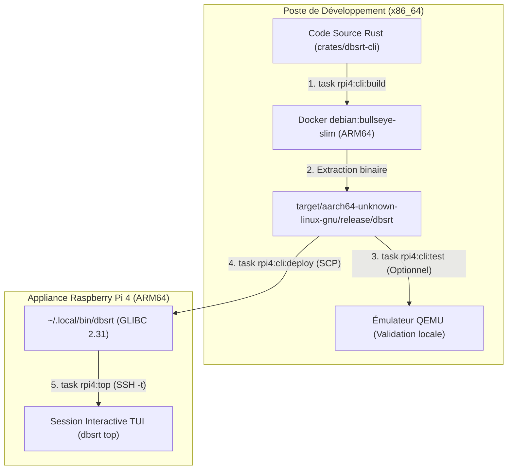

# Comment compiler, tester, déployer et lancer le CLI dbsrt top sur Raspberry Pi 4 (ARM64)

Ce guide pratique détaille la recette opérationnelle pour compiler l'exécutable autonome `dbsrt` en architecture ARM64 (aarch64), valider son intégrité localement via émulation QEMU, le déployer sur une appliance Raspberry Pi 4 et lancer une session de monitoring temps réel TUI (`dbsrt top`) à distance.

---

## 🎯 Problème et Contexte Opérationnel

Lors du développement de nouvelles fonctionnalités dans la console TUI (`dbsrt top`) ou de nouvelles sous-commandes CLI, le binaire doit être exécuté sur le processeur ARM64 du Raspberry Pi 4 (Cortex-A72).

Deux contraintes majeures s'imposent :

1. **Parité GLIBC** : Le Raspberry Pi OS (Debian Bullseye 11) utilise la GLIBC 2.31. Un binaire compilé avec une GLIBC hôte plus récente (ex: Ubuntu 24.04 / GLIBC 2.39) provoque une erreur fatale `libc.so.6: version 'GLIBC_2.34' not found` à l'exécution sur le Pi.
2. **Séparation stricte des responsabilités Taskfile** : Les cibles Docker serveur (`task rpi4:build`) et de synchronisation des données (`task rpi4:sync`) ne manipulent **aucun** binaire CLI.

---

## ⚠️ Piège fréquent : Pourquoi `task rpi4:build && task rpi4:sync && task rpi4:top` échoue

Il est fréquent de tenter l'enchaînement suivant :

```bash
# ❌ ERREUR DE CIBLE : Ne met pas à jour le CLI dbsrt sur le Raspberry Pi 4 !
task rpi4:build && task rpi4:sync && task rpi4:top
```

Voici pourquoi cette suite ne déploie pas le nouveau code CLI :

| Commande exécutée | Ce qu'elle fait réellement | Impact sur le CLI / TUI |
| :--- | :--- | :--- |
| `task rpi4:build` | Compile l'image Docker ARM64 de **`dbsrt-server`** (`docker/Dockerfile.server`). | ❌ Ne produit pas le binaire CLI `dbsrt`. |
| `task rpi4:sync` | Synchronise par `rsync` les fichiers de données (`catalog.dbphash`, `data/SRT`, `docker-compose`). | ❌ Ne transfère aucun exécutable binaire. |
| `task rpi4:top` | Ouvre une session SSH et lance `~/.local/bin/dbsrt top` sur le Raspberry Pi 4. | ⚠️ Exécute l'**ancien** binaire déjà présent. |

---

## 🏗️ Architecture du Pipeline de Cross-Compilation et Déploiement



---

## 🛠️ Recette Opérationnelle : Les Bonnes Commandes

### Commande unique (One-Liner de déploiement complet)

Pour compiler, déployer et lancer directement le nouveau moniteur `top` :

```bash
task rpi4:cli:build && task rpi4:cli:deploy && task rpi4:top
```

---

### Étapes détaillées pas à pas

#### Étape 1 : Cross-compiler le binaire ARM64

Exécutez la compilation sous conteneur Docker ARM64 Debian Bullseye pour garantir la parité stricte avec la GLIBC 2.31 du système d'exploitation du Raspberry Pi :

```bash
task rpi4:cli:build
```

*Le script extrait les binaires `dbsrt` et `dbsrt-server` vers `target/aarch64-unknown-linux-gnu/release/`.*

#### Étape 2 (Optionnelle) : Valider le binaire localement sous QEMU

Avant tout transfert réseau, vous pouvez vérifier le binaire sur votre machine hôte via l'émulation CPU binfmt QEMU :

```bash
task rpi4:cli:test
```

*Cette commande valide l'exécution de `dbsrt --version`, `dbsrt --help` et un instantané JSON de `dbsrt top --json` sans toucher au Raspberry Pi physique.*

#### Étape 3 : Déployer le binaire sur le Raspberry Pi 4

Transférez l'exécutable compilé vers le répertoire utilisateur standard du Raspberry Pi (`~/.local/bin/dbsrt`) via SCP :

```bash
task rpi4:cli:deploy
```

*Le script assure la création du dossier distant si nécessaire, applique les droits d'exécution (`chmod +x`) et vérifie à distance `dbsrt --version`.*

#### Étape 4 : Lancer le moniteur interactif TUI

Ouvrez la session plein écran interactive avec allocation de terminal virtuel pseudo-TTY (`ssh -t`) :

```bash
task rpi4:top
```

Pour passer des arguments supplémentaires au moniteur (ex: fréquence de rafraîchissement ou vue spécifique) :

```bash
task rpi4:top -- --interval 500
```

---

## 🔍 Matrice de Dépannage et Vérification

| Symptôme | Cause racine | Solution |
| :--- | :--- | :--- |
| `libc.so.6: version 'GLIBC_2.34' not found` | Le binaire a été compilé avec la toolchain native de l'hôte au lieu du conteneur Bullseye. | Relancer `task rpi4:cli:build` (utilise `docker/Dockerfile.cli.rpi4`). |
| Les modifications du TUI n'apparaissent pas dans `task rpi4:top` | Vous avez exécuté `task rpi4:build` ou `task rpi4:sync` au lieu de `task rpi4:cli:deploy`. | Exécuter `task rpi4:cli:deploy` pour pousser le nouveau binaire. |
| `Permission denied (publickey)` lors du déploiement | La clé SSH n'est pas configurée pour l'hôte `rpi4`. | Vérifier l'accès avec `ssh rpi4` ou configurer `~/.ssh/config`. |
| `dbsrt: command not found` à distance | Le dossier `~/.local/bin` n'est pas dans le `$PATH` distant. | Le script utilise le chemin absolu `~/.local/bin/dbsrt`, assurez-vous que `task rpi4:cli:deploy` a bien terminé. |

---

## 🔗 Voir Aussi

* [Tutoriel 04 : Déploiement d'une appliance Raspberry Pi 4](../tutorials/04-deploiement-appliance-rpi4.md)
* [Comment basculer les cibles de backend VLC (Local, Cloud o2switch, RPi4)](basculer-cibles-vlc-local-cloud-rpi4.md)
* [Comment superviser les batchs o2switch depuis un RPi4](superviser-batch-o2switch-depuis-rpi4.md)
* [Référence technique Taskfile](../reference/taskfile.md)
