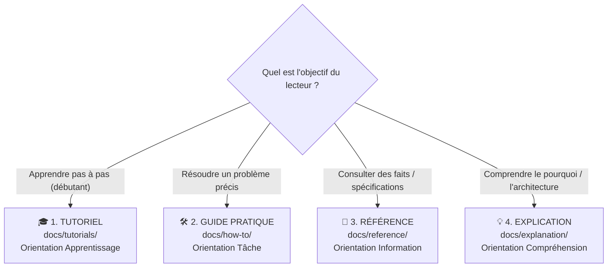

# 🛠️ Guide Pratique : Contribuer à la Documentation selon Diátaxis

Ce guide pratique fournit les règles impératives, la méthode d'affectation et les gabarits prêts à l'emploi pour enrichir la documentation du projet `pydbsrt` en respectant l'architecture **[Diátaxis](https://diataxis.fr/)**.

---

## 1. Règle d'Affectation Immédiate (Arbre de Décision)

Avant de rédiger une seule ligne, identifiez le quadrant unique auquel appartient votre document :



---

## 2. Procédure pour Documenter une Nouvelle Fonctionnalité

Toute nouvelle fonctionnalité (Pull Request) doit obligatoirement être accompagnée de sa documentation Diátaxis selon la matrice suivante :

| Nature du Changement | Documents Obligatoires à Créer ou Mettre à Jour |
| :--- | :--- |
| **Nouvelle commande CLI ou sous-commande** | 1. Référence exhaustive dans `docs/reference/cli.md`<br/>2. Recette orientée problème dans `docs/how-to/<tache>.md`<br/>3. Mise à jour de la table des commandes dans `README.md` |
| **Nouvelle route API REST Axum** | 1. Spécification OpenAPI / JSON dans `docs/reference/api-rest.md`<br/>2. Exemple curl / fetch dans `docs/reference/api-rest.md` |
| **Nouveau sous-système complexe** | 1. Tutoriel pas à pas d'initiation dans `docs/tutorials/`<br/>2. Document d'architecture et compromis dans `docs/explanation/`<br/>3. Recettes pratiques d'exploitation dans `docs/how-to/` |
| **Évolution du schéma SQL ou des tables** | 1. Mise à jour des tables dans `docs/reference/schema-postgresql.md`<br/>2. Complétion de `docs/how-to/migrer-schema-postgresql.md` |
| **Nouvelle cible Taskfile** | 1. Déclaration dans `docs/reference/taskfile.md`<br/>2. Synchronisation dans `README.md` |

---

## 3. Gabarits Prêts à l'Emploi (Templates)

### Gabarit 1 : Tutoriel (`docs/tutorials/XX-nom.md`)

```markdown
---
title: "Tutoriel : <Intitulé d'Action Débutant>"
tags:
  - tutoriel
  - debutant
---

# 🎓 Tutoriel : <Titre Orienté Apprentissage>

Dans ce tutoriel, vous allez apprendre à <réalisation finale> étape par étape.

> [!NOTE]
> **Temps estimé** : XX minutes.
> **Objectif** : <Résultat tangible et vérifiable>.

## 1. Prérequis
- <Prérequis 1>
- <Prérequis 2>

## 2. Étape 1 : <Action 1>
<Instructions directes, zéro alternative>

## 3. Étape 2 : <Action 2>
<Instructions directes>

## 4. Félicitations !
Vous avez réussi à <résultat>.
Prochaine étape : 👉 [Lien vers suite](../how-to/...)
```

### Gabarit 2 : Guide Pratique (`docs/how-to/nom.md`)

```markdown
---
title: "Guide Pratique : <Comment accomplir X>"
tags:
  - howto
  - <domaine>
---

# 🛠️ Guide Pratique : <Comment accomplir X>

Ce guide explique comment résoudre <problème concret>.

## Problème
<Description de la situation de blocage ou du besoin>.

## Procédure

### 1. <Étape A>
```bash
<commande>
```

### 2. <Étape B>
<Instructions ciblées>

## Validation
```bash
<commande de vérification>
```
```

### Gabarit 3 : Référence (`docs/reference/nom.md`)

```markdown
---
title: "Référence : <Composant ou API>"
tags:
  - reference
---

# 📖 Référence : <Composant>

## Vue d'Ensemble
<Description austère et factuelle de la machine>.

## Paramètres / Options
| Paramètre | Type | Valeur par défaut | Description |
| :--- | :--- | :--- | :--- |
| `--option` | String | `none` | Spécification stricte. |

## Codes d'Erreur & Réponses
| Code | Statut | Signification |
| :--- | :--- | :--- |
| `200` | OK | Opération réussie. |
| `400` | Bad Request | Payload invalide. |
```

### Gabarit 4 : Explication (`docs/explanation/nom.md`)

```markdown
---
title: "Explication : <Sujet Conceptuel>"
tags:
  - explication
  - architecture
---

# 💡 Explication : <Titre Conceptuel>

## Contexte & Enjeux
<Pourquoi ce sujet est important, genèse historique>.

## Analyse du Problème & Compromis
<Pourquoi les solutions intuitives échouent>.

## L'Architecture Retenue
<Diagrammes, formules mathématiques, comparaisons alternatives>.
```

---

## 4. Règles de Qualité & Validation Automatisée

Avant de soumettre votre modification documentaire, appliquez ces contrôles stricts :

1. **Zéro Chemin Absolu Machine** :
   - Strictement interdit d'écrire `/home/utilisateur/...` ou `file:///...` dans les fichiers versionnés.
   - Toujours utiliser des chemins relatifs au dépôt (`data/snippets/...`, `docs/tutorials/...`).
2. **Syntaxe Python-Markdown** :
   - **Toujours insérer une ligne vide** avant et après chaque liste (`*`, `-`, `1.`) pour éviter l'écrasement dans un paragraphe HTML `<p>`.
   - Indenter les sous-listes d'**exactement 4 espaces**.
3. **Formules Mathématiques** :
   - Écrire les formules en ligne avec `\( ... \)` et en bloc avec `$$ ... $$` entouré de lignes vides.
4. **Validation Automatisée en 1 Commande** :
   ```bash
   task doc:check
   ```
   Cette commande exécute le build strict MkDocs (0 avertissement toléré), l'analyse AST BeautifulSoup (0 fuite LaTeX, 0 liste écrasée) et le smoke test Chrome headless.

5. **Synchronisation MkDocs & README** :
   - Déclarer chaque nouveau document dans l'arborescence `nav:` de `mkdocs.yml`.
   - Si une nouvelle commande CLI ou cible Taskfile a été introduite, répercuter son existence dans `README.md`.
