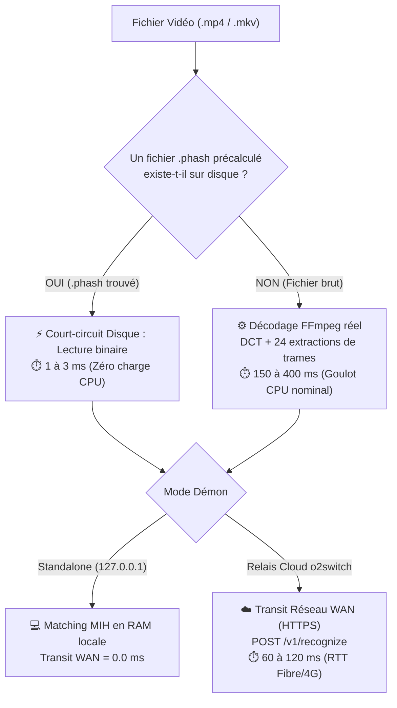
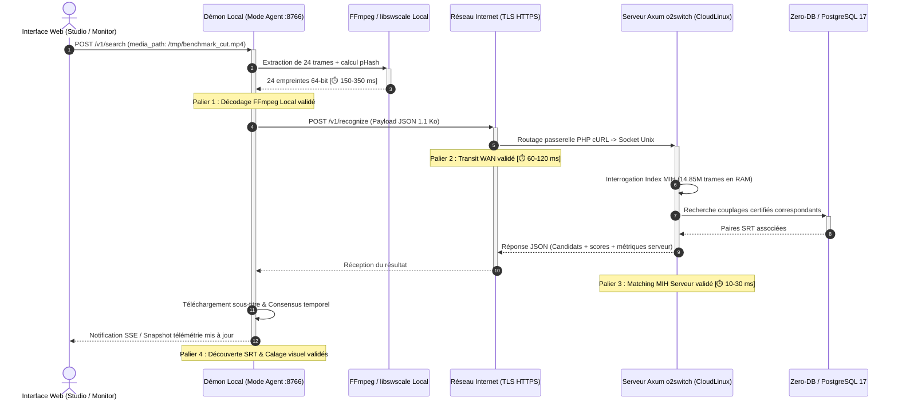

# 🛠️ Guide Pratique : Exécuter un Matching E2E Réel et Mesurer la Chaîne de Performance

> Cette recette opérationnelle décrit comment déclencher un scénario de matching de bout en bout réel (véritable décodage FFmpeg, transit réseau WAN chiffré vers l'infrastructure Cloud o2switch, interrogation de l'index MIH distant et calage temporel SRT), interpréter les métriques de latence par palier, et comprendre le court-circuit du cache d'empreintes.

---

## 🎯 Problème Résolu

Lors de l'évaluation du pipeline sur le tableau de bord web (`/monitoring#catalogue` ou `/studio#tab-observability`), deux comportements contre-intuitifs peuvent survenir :

1. **Décodage FFmpeg à 2 ms au lieu de 250 ms** : L'étape 1 semble anormalement rapide et n'illustre pas le goulot d'étranglement CPU réel du transcodage vidéo.
2. **Transport Réseau (WAN) à 0.0 ms** : L'étape 2 affiche un temps nul alors que l'infrastructure cible est hébergée sur le Cloud o2switch.

Ce guide explique comment amorcer un test **100% réel** sans cache résiduel pour valider chaque palier physique et logique de la chaîne.

---

## 💡 Comprendre les Court-Circuits d'Optimisation

Le moteur dbsrt intègre des mécanismes d'économie de ressources qui masquent les temps de calcul nominaux lorsqu'ils sont sollicités de manière répétitive :



- **Le Court-Circuit pHash** : Si un fichier `nom_video.phash` existe dans les répertoires d'empreintes (`data/snippets` ou `data/__PHASH__`), le moteur lit directement les 2.8 Ko d'empreinte sur disque (~2 ms) plutôt que d'invoquer FFmpeg.
- **Le Mode Standalone** : Si le démon local n'est pas configuré avec `--remote-api`, la recherche MIH s'effectue dans la RAM locale sans franchir le réseau WAN (temps réseau nul).

---

## 📋 Recette Pas à Pas : Le Workflow 100% Réel

### Étape 1 : Basculer le Démon Local en Mode Relais Cloud o2switch

Pour activer l'acheminement des empreintes vers la production o2switch au lieu de l'index local, exécuter la cible déclarée dans le Taskfile :

```bash
task target:o2switch
```

*Alternative directe en script :*
```bash
./scripts/switch_target.sh o2switch
```

**Vérification :**

1. Le badge d'état sur le Studio (`/studio#tab-observability`) passe à : `Agent -> https://2026-pydbsrt.fr/dbsrt`.
2. L'inspection réseau via CLI confirme la cible active :
   ```bash
   task target:status
   ```

---

### Étape 2 : Préparer un Échantillon Vidéo Sans Cache `.phash`

Afin d'obliger le moteur à exécuter l'extraction vidéo complète par FFmpeg :

1. Utiliser un extrait vidéo ne possédant **pas** de fichier `.phash` associé dans son dossier parent.
2. À défaut, dupliquer temporairement un snippet sous un nom neutre sans fichier `.phash` adjacent :
   ```bash
   cp data/snippets/2-Blue_Forever_mid15s.mp4 /tmp/benchmark_cut.mp4
   ```

---

### Étape 3 : Déclencher le Matching Depuis le Tableau de Bord

1. Ouvrir le tableau de bord web : [`http://127.0.0.1:8766/monitoring#catalogue`](http://127.0.0.1:8766/monitoring#catalogue) ou [`http://127.0.0.1:8766/studio#tab-observability`](http://127.0.0.1:8766/studio#tab-observability).
2. Dans le champ de texte **Média / Snippet**, renseigner le chemin absolu du fichier brut :
   ```text
   /tmp/benchmark_cut.mp4
   ```
3. Cliquer sur **`[ ⚡ Lancer le Matching ]`**.

---

## 📊 Interprétation des Résultats du Diagramme de Performance

Le diagramme interactif décompose alors la chaîne en 5 paliers réels :



| Palier | Intitulé | Ordre de Grandeur Nominal | Ce que la Métrique Valide |
| :--- | :--- | :--- | :--- |
| **1** | **Décodage FFmpeg Local** | `150 à 350 ms` | Capacité du CPU local à découper le conteneur, convertir l'espace colorimétrique et calculer les DCT. |
| **2** | **Transport Réseau (WAN)** | `60 à 120 ms` | Latence aller-retour HTTPS vers le datacenter o2switch (négociation TLS, passerelle PHP, bande passante). |
| **3** | **Matching MIH Serveur** | `10 à 30 ms` | Efficacité algorithmique du Multi-Index Hashing sur 14,85 millions d'empreintes dans la RAM CloudLinux. |
| **4** | **Découverte SRT (REST)** | `1 à 5 ms` | Résolution de la piste sous-titres certifiée et lecture du fichier physique sur disque. |
| **5** | **Calage SRT & Consensus** | `< 1 ms` | Algorithme de décalage temporel appliqué aux repères de sous-titres (cues). |

---

## 🔮 Roadmap UX : Vers le Déclenchement en 1 Clic

Afin de supprimer toute friction opérationnelle (ouverture de terminal, bascule manuelle de scripts, copie de fichiers neutres pour éviter le cache), la conception cible prévoit l'intégration native de deux éléments ergonomiques directement dans l'interface web :

1. **Sélecteur de Mode dans le Bandeau Web** :
   Un interrupteur interactif `[ Mode : 💻 Local Standalone | ☁️ Relais o2switch ]` permettant de modifier dynamiquement la configuration du démon via l'API REST sans redémarrage manuel.
2. **Bouton Preset "Démo Réelle Complète"** :
   Un bouton dédié `[ ⚡ Démo E2E Réelle ]` forçant une extraction complète sans cache sur un extrait de référence étalon et animant le diagramme de performance de bout en bout en un clic unique.
