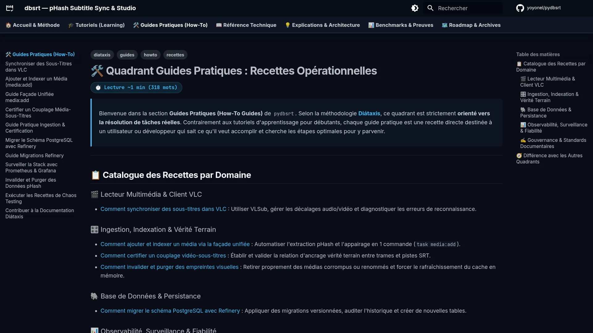

# 🛠️ Quadrant Guides Pratiques : Recettes Opérationnelles

> Bienvenue dans la section **Guides Pratiques (How-To Guides)** de `pydbsrt`.
> Selon la méthodologie **[Diátaxis](https://diataxis.fr/)**, ce quadrant est strictement **orienté vers la résolution de tâches réelles**.
> Contrairement aux tutoriels d'apprentissage pour débutants, chaque guide pratique est une recette directe destinée à un utilisateur ou développeur qui sait ce qu'il veut accomplir et cherche les étapes optimales pour y parvenir.

---

## 📸 Aperçu du Quadrant Guides Pratiques

<figure markdown="1">
  
  <figcaption>Figure 1 : Interface du catalogue des guides pratiques et recettes d'ingénierie.</figcaption>
</figure>

---

## 📋 Catalogue des Recettes par Domaine

### 🎬 Lecteur Multimédia & Client VLC
* [Comment synchroniser des sous-titres dans VLC](synchroniser-sous-titres-vlc.md) : Utiliser VLSub, gérer les décalages audio/vidéo et diagnostiquer les erreurs de reconnaissance.
* [Comment basculer les cibles de backend VLC (Local, Cloud o2switch, RPi4)](basculer-cibles-vlc-local-cloud-rpi4.md) : Choisir facilement la cible de calcul et d'indexation sans modifier la configuration VLC.

### 🎛️ Ingestion, Indexation & Vérité Terrain
* [Comment ajouter et indexer un média via la façade unifiée](ajouter-et-indexer-un-media.md) : Automatiser l'extraction pHash et l'appairage en 1 commande (`task media:add`).
* [Comment certifier un couplage vidéo-sous-titres](certifier-un-couplage.md) : Établir et valider la relation d'ancrage vérité terrain entre trames et pistes SRT.
* [Comment invalider et purger des empreintes visuelles](invalider-donnees-phash.md) : Retirer proprement des médias corrompus ou renommés et forcer le rafraîchissement du cache en mémoire.
* [Comment vérifier l'intégrité du catalogue et du stockage multipalier](2026-10-26-audit-integrite-catalogue-et-stockage.md) : Exécuter l'audit automatisé en 1 commande (`task catalog:verify`) sur 4 paliers physiques.

### 🐘 Base de Données & Persistance
* [Comment migrer le schéma PostgreSQL avec Refinery](migrer-schema-postgresql.md) : Appliquer des migrations versionnées, auditer l'historique et créer de nouvelles tables.

### 📊 Observabilité, Surveillance & Fiabilité
* [Comment surveiller la stack avec Prometheus & Grafana](surveiller-stack-telemetrie.md) : Accéder aux métriques temps réel, surveiller les latences d'interrogation et la mémoire vive.
* [Comment exécuter les recettes de chaos testing et tests d'infra](executer-recettes-chaos-testing.md) : Valider la résilience du démon face aux coupures réseau, plantages de sockets et redémarrages inopinés.

### 🌐 Déploiement Multi-Cibles & Hébergement
* [Comment déployer sur un hébergement mutualisé o2switch](deployer-o2switch-cloud-cpanel.md) : Orchestrer le démon statique musl en mode Zero-DB avec reverse-proxy LiteSpeed sans root.
* [Comment interconnecter un NAS Synology et le Cloud o2switch en SFTP](interconnecter-nas-synology-et-o2switch-sftp.md) : Ouvrir un accès distant sécurisé par liste blanche IP, configurer DSM, router les ports Freebox et tester la liaison SFTP/SMB.

### ✍️ Gouvernance & Standards Documentaires
* [Comment contribuer à la documentation selon Diátaxis](contribuer-documentation-diataxis.md) : Consignes méthodologiques, gabarits et checklists pour enrichir incrémentalement les 4 quadrants.

---

## 🧭 Différence avec les Autres Quadrants

* Pour une prise en main pas à pas d'un système sans prérequis : **[Tutoriels](../tutorials/index.md)**.
* Pour la spécification formelle des paramètres, tables SQL ou routes API : **[Référence Technique](../reference/index.md)**.
* Pour comprendre les concepts algorithmiques sous-jacents (MIH, CAS, pHash) : **[Explications & Architecture](../explanation/index.md)**.
