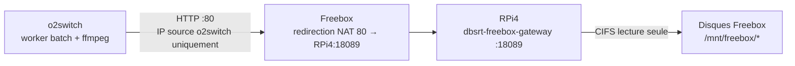

# 🛠️ Guide Pratique : Ingérer les Médias de la Freebox sur o2switch via le RPi4

Ce guide explique comment faire calculer par o2switch les empreintes pHash des vidéos stockées sur les disques de la Freebox, en passant par le gateway HTTP du Raspberry Pi 4.

> [!NOTE]
> Pourquoi ce transport (NAT + gateway HTTP) et pas un tunnel SSH inverse : voir l'[ADR Transport Freebox vers o2switch](../decisions/2026-10-30-transport-freebox-nat-gateway-http.md).

---

## 🎯 Problème

- Les vidéos résident sur les disques de la Freebox (partages SMB `Disque 1`, `Disque 2`, `Disque 1 1`).
- Le calcul pHash tourne sur o2switch, qui ne sort que sur les ports TCP `21`, `80` et `443`.
- La Freebox n'expose pas ses disques sur Internet : le RPi4 les monte en CIFS et les sert en HTTP avec support des `Range` (`scripts/rpi4_freebox_gateway.py`).

---

## 🗺️ Chemin des Données



| Composant | Valeur |
| :--- | :--- |
| Hôte public | `NAS_HOST` de `etc/.nas_config` sur o2switch (même box que le NAS Synology) |
| Port WAN | TCP `80` (le `21` est déjà redirigé vers le Synology) |
| Gateway RPi4 | `0.0.0.0:18089`, unité systemd utilisateur `dbsrt-freebox-gateway.service` |
| Racine servie | `/mnt/freebox` |
| Chemins servis | `Disque_1/Téléchargements/`, `Disque_2/Téléchargements/`, `Disque_1_1/Vidéos/` (tout le reste renvoie `404`) |

---

## 🚀 Procédure

### 1. Fixer l'IP du RPi4

Dans Freebox OS : **Paramètres de la Freebox** > **DHCP** > onglet **Baux Statiques**. Vérifiez qu'un bail statique existe pour `raspberrypi`. Sans bail fixe, la redirection NAT pointe dans le vide après un changement d'IP.

### 2. Déclarer les identifiants SMB sur le RPi4

Le mot de passe du compte `freebox` est lu dans `pass` sur le poste de travail et transmis **par stdin**, jamais en argument de commande :

```bash
pass show services/freebox/ftp_pass | head -1 | ssh rpi4 \
  'sudo install -m 600 -o root -g root /dev/null /etc/freebox.cred &&
   { echo username=freebox; printf "password="; cat; } | sudo tee /etc/freebox.cred >/dev/null'
```

### 3. Déclarer les montages dans `/etc/fstab` du RPi4

Un montage fait à la main avec `mount` disparaît au reboot. Ajoutez une ligne par partage (`\040` encode les espaces) :

`<freebox_lan_ip>` est l'IP LAN de la Freebox (adresse `.254` du sous-réseau par défaut).

```text
//<freebox_lan_ip>/Disque\0401 /mnt/freebox/Disque_1 cifs ro,credentials=/etc/freebox.cred,uid=1000,gid=1000,iocharset=utf8,vers=1.0,_netdev,nofail 0 0
//<freebox_lan_ip>/Disque\0402 /mnt/freebox/Disque_2 cifs ro,credentials=/etc/freebox.cred,uid=1000,gid=1000,iocharset=utf8,vers=1.0,_netdev,nofail 0 0
//<freebox_lan_ip>/Disque\0401\0401 /mnt/freebox/Disque_1_1 cifs ro,credentials=/etc/freebox.cred,uid=1000,gid=1000,iocharset=utf8,vers=1.0,_netdev,nofail 0 0
```

Vérifiez la syntaxe avec `sudo findmnt --verify`. Les montages sont en lecture seule (`ro`) : le gateway n'a jamais besoin d'écrire.

### 4. Installer et démarrer le gateway

```bash
task freebox:install   # copie le script et l'unité systemd sur le RPi4
task freebox:start     # monte les partages fstab manquants et démarre le gateway
task freebox:status    # montages CIFS et état du service
```

`task freebox:install` refuse de s'exécuter sur le RPi4 lui-même : lancez-le depuis le poste de travail.

### 5. Créer la redirection NAT dans Freebox OS

**Paramètres de la Freebox** > Mode avancé > **Gestion des ports** > onglet **Redirections de ports** > **Ajouter une redirection** :

| Champ | Valeur |
| :--- | :--- |
| IP de destination | IP fixe du RPi4 (`raspberrypi`) |
| Redirection active | Cochée |
| IP source | `<o2switch_ip>` (jamais `Toutes`) |
| Protocole | TCP |
| Port de début / Port de fin | `80` / `80` |
| Port de destination | `18089` |
| Commentaire | `dbsrt freebox gateway (o2switch only)` |

> [!WARNING]
> Le flux HTTP circule **en clair**. Le filtre **IP source** est la seule protection : avec `Toutes`, n'importe qui sur Internet pourrait lire les vidéos servies par le gateway.

Pour obtenir `<o2switch_ip>` : `curl -4 https://ifconfig.me` exécuté sur o2switch.

### 6. Lancer l'ingestion

En régime normal, le superviseur RPi4 lance le batch `freebox` tout seul, dans la rotation `tvshow` → `movies` → `freebox` → `tvshow` (voir [Superviser les batchs o2switch depuis un RPi4](superviser-batch-o2switch-depuis-rpi4.md)).

Lancement manuel :

```bash
task freebox:batch:start -- --workers 5
```

La commande sonde d'abord le gateway depuis o2switch, scanne les médias éligibles, envoie `data/reports/freebox_batch_targets.json` sur o2switch, puis démarre le worker en `--fresh-only`. Le scan s'exécute sur la machine qui lance la commande : il lit `/mnt/freebox` s'il existe, sinon `/media/$USER/Freebox`.

---

## ✅ Validation

```bash
task freebox:test           # attendu : ✓ Gateway reachable (HTTP 404)
task freebox:batch:status   # progression, workers actifs, derniers journaux
```

`HTTP 404` est le résultat attendu : la sonde vise le dossier `Disque_1/`, que le gateway refuse de lister. Toute réponse HTTP prouve que la chaîne o2switch → NAT → gateway fonctionne.

Un test depuis le LAN ou un téléphone échoue : le filtre IP source n'accepte que o2switch.

Mesure du 2026-10-30 : environ 2,1 à 2,7 Mo/s par vidéo, environ 600 s par épisode, 5 vidéos en parallèle.

---

## 🔍 Dépannage

| Symptôme | Cause probable | Solution |
| :--- | :--- | :--- |
| `task freebox:test` affiche `HTTP 000` | Redirection NAT absente ou inactive, IP source erronée, ou gateway arrêté. | Vérifier la règle Freebox, puis `task freebox:status`. |
| `404` sur un média qui existe | Chemin hors des bibliothèques servies, ou partage non monté. | `task freebox:status` ; vérifier que le chemin commence par un préfixe servi. |
| Superviseur : `Remote batch is aborted (freebox)` | Le worker a vu 50 échecs rapides consécutifs : transport cassé. | Corriger le transport (`task freebox:test`), puis `task freebox:batch:start` (efface le marqueur). |
| Lancement freebox en échec dans le superviseur | Sonde du gateway en échec. | Le superviseur passe automatiquement à la bibliothèque suivante (`tvshow`). Corriger, puis attendre le prochain tour de rotation. |
| Des vidéos Freebox ne sont jamais retentées | Elles ont échoué 3 fois de suite (`MAX_FAILED_ATTEMPTS`) dans `data/reports/batch_tvshow_nightly.jsonl` : le worker les ignore. | Après une panne de transport, retirer ces lignes d'échec du journal, avec le worker arrêté et une sauvegarde du fichier. Aucune cible Taskfile ne le fait encore. |
| Partages absents après un reboot du RPi4 | Montages faits à la main, absents de `/etc/fstab`. | Étapes 2 et 3, puis `task freebox:mount`. |

---

## 🔗 Voir Aussi

- [ADR Transport Freebox vers o2switch (NAT + gateway HTTP)](../decisions/2026-10-30-transport-freebox-nat-gateway-http.md)
- [Superviser les batchs o2switch depuis un RPi4](superviser-batch-o2switch-depuis-rpi4.md)
- [Interconnecter NAS Synology et o2switch en FTP](interconnecter-nas-synology-et-o2switch-ftp.md)
- [Référence Taskfile, section `freebox:*`](../reference/taskfile.md)
