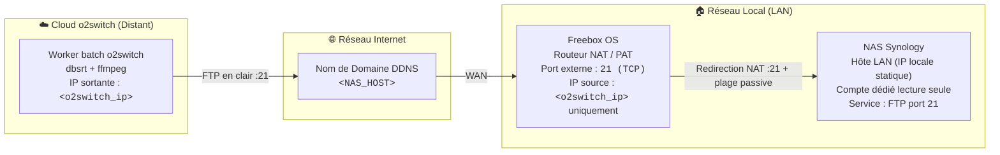

# 🛠️ Guide Pratique : Interconnecter un NAS Synology et le Cloud o2switch en FTP

> Cette recette opérationnelle décrit pas à pas la configuration permettant au worker batch o2switch de lire directement les bibliothèques multimédias d'un NAS Synology local en FTP (port 21), à travers une box Internet Freebox dont la redirection NAT est restreinte à la seule IP sortante d'o2switch.

---

## 🎯 Problème

Dans le cadre du déploiement multi-cibles de `pydbsrt` :

- Le worker batch (`scripts/o2switch_batch_worker.py`) s'exécute sur un serveur Cloud mutualisé **o2switch**.
- Les fichiers vidéos volumineux résident sur un **NAS Synology** domestique derrière une **Freebox**.
- Le `ffmpeg` statique disponible sur o2switch ne supporte pas SFTP : il lit les vidéos directement via une URL `ftp://<NAS_HOST>:21/<chemin>`, sans relais intermédiaire ni copie disque.
- Vous devez appliquer le principe du **moindre privilège** : compte dédié en lecture seule, accès FTP restreint à l'IP sortante d'o2switch (et au sous-réseau local pour les tests).
- Vous ne devez jamais inscrire d'hôte, de compte ou de mot de passe NAS dans le dépôt Git.

> [!WARNING]
> FTP transporte les identifiants et les données **en clair**. Les seules protections sont le filtrage IP (Freebox et DSM) et un compte NAS en **lecture seule** sans accès aux partages sensibles. N'utilisez jamais un compte administrateur ni un mot de passe réutilisé ailleurs.

---

## 🗺️ Cartographie Réseau & Prérequis



### Paramètres d'Adressage & Identifiants

| Composant | Hôte / Domaine | Adresse IP | Port / Protocole | Rôle |
| :--- | :--- | :--- | :--- | :--- |
| **Serveur Cloud o2switch** | `<o2switch_server>` | `<o2switch_ip>` (IP sortante) | Sortant TCP `21` + plage passive | Client FTP (ffmpeg / ffprobe) |
| **Routeur Passerelle** | `mafreebox.freebox.fr` | IP Publique WAN | Entrant TCP `21` + plage passive, filtré sur `<o2switch_ip>` | Redirection NAT vers le NAS |
| **NAS Synology** | `<NAS_HOST>` (DDNS) | IP LAN statique | Service FTP TCP `21` | Serveur de stockage médias |
| **Sous-réseau Local LAN** | Réseau local | Masque `255.255.255.0` | Tous flux internes | Postes de travail locaux |

---

## 🚀 Étapes de Réalisation

### Étape 1 : Créer un Compte Dédié en Lecture Seule sur Synology DSM

Pour isoler les accès du serveur distant, n'utilisez **jamais** de compte administrateur. Créez un compte de service dédié (par exemple `dbsrt-svc`) :

1. Connectez-vous à l'interface Synology DSM (IP locale de votre NAS, port `5000`).
2. Ouvrez **Panneau de configuration** > **Utilisateur et groupe** > Onglet **Utilisateur**.
3. Créez l'utilisateur dédié avec un mot de passe long et unique.
4. Dans l'onglet **Permissions** (Dossiers partagés) :
   - Cochez **Lecture seule** pour les dossiers médias (`tvshow`, `video`).
   - Laissez tous les autres partages (personnels ou sensibles) en **Pas d'accès**.

---

### Étape 2 : Verrouiller les Applications par IP (Liste Blanche)

> [!CAUTION]
> **Piège de Priorité Synology DSM : `Deny > Allow`**
> Dans l'onglet **Applications** de DSM, si la case **Refuser** (*Deny*) est cochée sur une application, elle prévaut systématiquement sur toute liste d'autorisation par IP (*By IP*). Cochez **Refuser** pour les services interdits (DSM, Drive, File Station) et **Par IP** (*By IP*) pour FTP.

1. Dans les propriétés de l'utilisateur dédié, basculez sur l'onglet **Applications**.
2. Affectez les droits applicatifs :
   - **DSM Web UI** : Cocher `Refuser` (le serveur distant ne doit pas accéder à l'interface d'administration).
   - **FTP** : Cocher `Par IP` (*By IP*).
   - **SFTP**, **SMB**, **Synology Drive**, **File Station** et autres : Cocher `Refuser` (inutiles pour le worker).
3. Cliquez sur le lien **Par IP** en face de **FTP** pour définir la liste blanche :
   - **Ajouter une adresse IP** > **Hôte unique** : `<o2switch_ip>` (IP sortante du serveur o2switch).
   - **Ajouter une adresse IP** > **Sous-réseau** (tests depuis votre LAN) : `<IP_DE_VOTRE_SOUS_RESEAU_LAN>`, masque `255.255.255.0`.
4. Validez en cliquant sur **Sauvegarder**.

---

### Étape 3 : Activer le Service FTP sur Synology DSM

1. Dans DSM, ouvrez **Panneau de configuration** > **Services de fichiers**.
2. Cliquez sur l'onglet **FTP**.
3. Dans la section **FTP** :
   - Cochez **Activer le service FTP (aucun chiffrement)**.
   - Numéro de port : `21`.
   - Notez la **plage de ports passifs** (PASV) proposée par DSM : elle doit aussi être redirigée par la Freebox (étape 4).
   - Cochez **Signaler l'IP externe en mode PASV** pour que le NAS annonce son IP publique au client o2switch.
4. Laissez le service **SFTP** désactivé : il n'est pas utilisé par le worker.
5. Cliquez sur **Appliquer**.

---

### Étape 4 : Configurer la Redirection NAT Filtrée sur Freebox OS

Pour que la connexion FTP venant d'o2switch parvienne au NAS, la Freebox doit rediriger le port externe 21 (et la plage passive) vers l'IP locale du NAS, **uniquement** pour l'IP sortante d'o2switch :

1. Ouvrez l'interface d'administration Freebox OS (`http://mafreebox.freebox.fr/`).
2. Ouvrez **Paramètres de la Freebox** > Mode avancé > **Gestion des ports** (onglet **Redirections de ports**).
3. Cliquez sur **Ajouter une redirection** :
   - **IP Destination** : IP locale fixe du NAS.
   - **Redirection active** : Coché.
   - **IP source** : `<o2switch_ip>` (jamais `Toutes`).
   - **Protocole** : `TCP`.
   - **Port de début** / **Port de fin** / **Port de destination** : `21`.
   - **Commentaire** : `ftp - o2switch vers NAS Synology`.
4. Ajoutez une seconde redirection identique pour la **plage de ports passifs** relevée à l'étape 3 (même IP source restreinte).
5. Supprimez ou désactivez toute ancienne redirection du port `22` vers le NAS si elle n'a plus d'usage.
6. Cliquez sur **Sauvegarder** puis sur **Appliquer**.

---

### Étape 5 : Déclarer les Identifiants hors du Dépôt

Aucune valeur par défaut n'est versionnée. `NAS_HOST`, `NAS_USER` et `NAS_PASS` proviennent de l'environnement ou du fichier `.env` local non versionné :

```bash
# .env (non versionné)
NAS_HOST=<NAS_HOST>
NAS_USER=<nas_user>
```

Le mot de passe peut aussi être conservé dans le gestionnaire GPG `pass` (entrée lue par défaut par `o2switch_ctl.sh`) :

```bash
pass insert services/synology/nas_pass
```

Au lancement d'un batch, `o2switch_ctl.sh` transmet ces valeurs **par stdin** vers `etc/.nas_config` et `etc/.nas_pass` (mode 600) sur o2switch. Le worker les passe à chaque processus `dbsrt` via `DBSRT_FTP_USER` / `DBSRT_FTP_PASSWORD`, puis `dbsrt` à `ffmpeg` / `ffprobe` via `-ftp-user` / `-ftp-password`. Les identifiants n'apparaissent jamais dans l'URL ni dans les journaux.

---

### Étape 6 : Validation Empirique depuis o2switch

Connectez-vous au serveur o2switch via SSH (alias `o2switch` de `~/.ssh/config`) pour vérifier la chaîne complète (résolution DNS, traversée NAT Freebox, service FTP Synology) :

#### 1. Vérification de la connectivité TCP

```bash
ssh o2switch
nc -zv <NAS_HOST> 21
# Résultat attendu : Connection to <NAS_HOST> 21 port [tcp/ftp] succeeded!
```

#### 2. Test de listing distant via cURL FTP

Le mot de passe est lu depuis le fichier déployé, sans apparaître dans l'historique shell :

```bash
cd ~/dbsrt
curl -s --netrc-file <(printf 'machine %s login %s password %s\n' \
  "<NAS_HOST>" "<nas_user>" "$(cat etc/.nas_pass)") \
  "ftp://<NAS_HOST>:21/tvshow/"
```

Une liste de répertoires de séries doit s'afficher. Un blocage après la connexion signale en général une plage passive non redirigée (étape 4).

#### 3. Test de lecture de bout en bout

Lancez un batch limité à quelques épisodes depuis votre poste :

```bash
task o2switch:batch:tvshow -- --workers 2 --fresh-only --limit 5
```

---

## 🔍 Dépannage & Pièges Fréquents

| Symptôme | Cause Probable | Solution |
| :--- | :--- | :--- |
| `Connection refused` sur le port 21 | Le service FTP n'est pas activé dans DSM ou la règle Freebox est inactive. | 1. Vérifier **Services de fichiers > FTP > Activer le service FTP**.<br/>2. Vérifier que la règle Freebox est **Active**. |
| `Connection timed out` | L'IP sortante d'o2switch n'est pas autorisée (Freebox ou liste blanche DSM) ou la résolution DDNS est obsolète. | 1. Vérifier `<o2switch_ip>` dans la règle Freebox et la liste blanche DSM.<br/>2. Vérifier la résolution DDNS avec `dig <NAS_HOST>`. |
| Connexion établie mais listing ou flux bloqué | La plage de ports passifs n'est pas redirigée, ou le NAS annonce son IP LAN en mode PASV. | Rediriger la plage passive (étape 4) et cocher **Signaler l'IP externe en mode PASV** (étape 3). |
| `530 Login incorrect` | Mauvais identifiants ou option **Refuser** cochée sur FTP dans l'onglet Applications. | Vérifier `etc/.nas_pass` et que **FTP** n'est PAS coché sous *Refuser* (prioritaire sur *Par IP*). |
| Vidéo en `STALLED` ou `TIMEOUT` dans le batch | Coupure réseau pendant le flux FTP. | Relancer les échecs avec `task o2switch:batch:tvshow -- --retry-failed --daemon`. |
| `No video frames could be extracted` en 1 à 3 s, listing OK | `550 Permission denied` sur `RETR` : le compte FTP voit le fichier mais ne peut pas le lire (droits du dossier). | Donner la lecture au compte FTP sur le dossier dans DSM, puis relancer avec `--retry-failed`. |

---

## 🔐 Durcissement restant (à faire)

L'installation actuelle fonctionne mais n'applique pas encore toutes les étapes ci-dessus. Actions à faire, dans l'ordre :

1. **Changer le mot de passe du compte NAS** : l'ancien a circulé en clair (URL ffmpeg, journaux, transcriptions locales de session Claude sous `~/.claude/projects/`). Mettre le nouveau dans le `.env` local ; le prochain lancement de batch le repousse vers `etc/.nas_pass` sur o2switch.
2. **Compte NAS dédié en lecture seule** (étape 1), si le compte actuel a plus de droits.
3. **Filtrer la redirection Freebox** du port 21 et de la plage passive sur l'IP sortante d'o2switch (étape 4), et activer la liste blanche DSM (étape 2).
4. **Droits de lecture** : plusieurs dossiers (`⭐️Shogun`, `⭐️Halo`, `What IF`, etc.) renvoient `550 Permission denied` en lecture au compte FTP.

---

## 🔗 Voir Aussi

- [Comment exécuter les batchs de calcul et synchroniser avec o2switch](executer-batch-calcul-et-synchronisation-o2switch.md)
- [Comment déployer sur un hébergement mutualisé o2switch](deployer-o2switch-cloud-cpanel.md)
- [Architecture déport calcul, stockage et synchronisation o2switch](../explanation/architecture-deport-calcul-stockage-et-synchronisation-o2switch.md)
