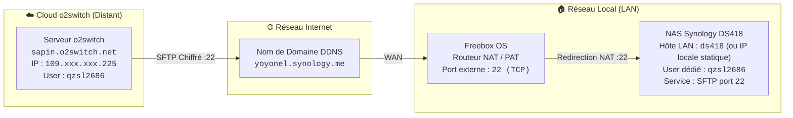

# 🛠️ Guide Pratique : Interconnecter un NAS Synology et le Cloud o2switch en SFTP

> Cette recette opérationnelle décrit pas à pas la configuration sécurisée permettant au serveur distant o2switch d'accéder aux bibliothèques multimédias hébergées sur un NAS Synology local via SFTP (SSH File Transfer Protocol), à travers une box Internet Freebox avec filtrage strict par liste blanche IP.

---

## 🎯 Problème

Dans le cadre du déploiement multi-cibles de `pydbsrt` :

- Le démon d'indexation ou l'agent distant s'exécute sur un serveur Cloud mutualisé **o2switch** (`sapin.o2switch.net`).
- Les fichiers vidéos volumineux résident sur un **NAS Synology** domestique (`ds418`) derrière une **Freebox**.
- Vous devez ouvrir un accès distant **SFTP** sécurisé sans exposer le NAS au bruit ou aux attaques par force brute d'Internet.
- Vous devez appliquer le principe du **moindre privilège** : compte dédié, accès en lecture seule aux séries, restriction stricte de l'accès aux seules adresses IP autorisées (`109.xxx.xxx.225` pour o2switch et le sous-réseau local).
- Vous devez stocker les mots de passe de manière chiffrée avec `pass` sans jamais inscrire de secret en clair dans le dépôt Git.

---

## 🗺️ Cartographie Réseau & Prérequis



### Paramètres d'Adressage & Identifiants

| Composant | Hôte / Domaine | Adresse IP | Port / Protocole | Rôle |
| :--- | :--- | :--- | :--- | :--- |
| **Serveur Cloud o2switch** | `sapin.o2switch.net` | `109.xxx.xxx.225` | SSH `2022` / Sortant `22` | Client SFTP distant |
| **Routeur Passerelle** | `mafreebox.freebox.fr` | IP Publique WAN Free | Entrant TCP `22` | Redirection NAT vers le NAS |
| **NAS Synology** | `yoyonel.synology.me` | `ds418` (LAN statique) | Démon SFTP TCP `22` | Serveur de stockage médias |
| **Sous-réseau Local LAN** | Réseau local | Masque `255.255.255.0` | Tous flux internes | Postes de travail locaux |

---

## 🚀 Étapes de Réalisation

### Étape 1 : Configurer le Compte Dédié sur Synology DSM

Pour isoler les accès du serveur distant, n'utilisez **jamais** de compte administrateur. Créez un compte de service dédié nommé `qzsl2686` :

1. Connectez-vous à l'interface Synology DSM (`http://ds418:5000` ou IP locale de votre NAS).
2. Ouvrez **Panneau de configuration** > **Utilisateur et groupe** > Onglet **Utilisateur**.
3. Sélectionnez ou créez l'utilisateur `qzsl2686` (Description : `o2switch serveur`).
4. Dans l'onglet **Permissions** (Dossiers partagés) :
   - Cochez **Lecture seule** pour le dossier `tvshow`.
   - Cochez **Lecture/Écriture** pour le dossier `video` (si nécessaire pour l'injection des SRT).
   - Laissez tous les autres partages personnels ou sensibles non cochés ou refusés.

<figure markdown="1">
  
  <figcaption>Figure 1 : Permissions d'accès aux dossiers partagés pour l'utilisateur qzsl2686.</figcaption>
</figure>

---

### Étape 2 : Verrouiller les Applications par IP (Liste Blanche)

> [!CAUTION]
> **Piège de Priorité Synology DSM : `Deny > Allow`**
> Dans l'onglet **Applications** de DSM, si la case **Refuser** (*Deny*) est cochée sur une application, elle prévaut systématiquement sur toute liste d'autorisation par IP (*By IP*). Veillez à ne cocher **Refuser** QUE pour les services totalement interdits (DSM, Drive, File Station), et sélectionnez **Par IP** (*By IP*) pour SFTP, FTP et SMB.

1. Dans les propriétés de l'utilisateur `qzsl2686`, basculez sur l'onglet **Applications**.
2. Affectez les droits applicatifs :
   - **DSM Web UI** : Cocher `Refuser` (le serveur distant ne doit pas accéder à l'interface d'administration).
   - **SFTP** : Cocher `Par IP` (*By IP*).
   - **FTP** : Cocher `Par IP` (*By IP*).
   - **SMB** : Cocher `Par IP` (*By IP*) si des montages Samba sont envisagés.
   - **Synology Drive / Note Station / Search** : Cocher `Refuser`.

<figure markdown="1">
  
  <figcaption>Figure 2 : Filtrage granulaire des applications autorisées par IP.</figcaption>
</figure>

3. Cliquez sur le lien **Par IP** en face de **SFTP** (et **SMB**) pour définir la liste blanche :
   - Cliquez sur **Ajouter une adresse IP** > Sélectionner **Hôte unique** :
     - Adresse IP : `109.xxx.xxx.225` (IP publique fixe du serveur o2switch).
   - Cliquez sur **Ajouter une adresse IP** > Sélectionner **Sous-réseau** (pour autoriser les tests depuis votre LAN) :
     - Adresse IP : `<IP_DE_VOTRE_SOUS_RESEAU_LAN>` (ex: réseau local privé)
     - Masque de sous-réseau : `255.255.255.0`
4. Validez en cliquant sur **Sauvegarder**.

<figure markdown="1">
  
  <figcaption>Figure 3 : Liste blanche restreinte à l'IP d'o2switch (109.xxx.xxx.225) et au sous-réseau local.</figcaption>
</figure>

---

### Étape 3 : Activer le Démon SFTP sur Synology DSM

Le service SFTP de Synology est géré sous le module FTP du panneau de configuration :

1. Dans DSM, ouvrez **Panneau de configuration** > **Services de fichiers**.
2. Cliquez sur l'onglet **FTP**.
3. Faites défiler jusqu'à la section **SFTP** :
   - Cochez **Activer le service SFTP**.
   - Numéro de port : `22` (ou port personnalisé si vous préférez un port haut).
4. Cliquez sur **Appliquer**.

<figure markdown="1">
  
  <figcaption>Figure 4 : Activation du démon SFTP Synology sur le port standard 22.</figcaption>
</figure>

---

### Étape 4 : Configurer la Redirection de Port NAT/PAT sur Freebox OS

Pour que le paquet SFTP venant d'o2switch parvienne au NAS, la Freebox doit rediriger les paquets du port externe 22 vers l'IP locale du NAS :

1. Ouvrez l'interface d'administration Freebox OS (`http://mafreebox.freebox.fr/`).
2. Ouvrez **Paramètres de la Freebox** > Mode avancé > **Gestion des ports** (onglet **Redirections de ports**).
3. Cliquez sur **Ajouter une redirection** (ou modifiez la règle existante) :
   - **IP Destination** : Sélectionner votre NAS dans la liste (`ds418` ou adresse IP locale fixe du NAS).
   - **Redirection active** : Coché.
   - **IP source** : `Toutes` (le filtrage granulaire par IP est assuré par le pare-feu Synology DSM configuré à l'étape 2).
   - **Protocole** : `TCP`.
   - **Port de début** : `22`.
   - **Port de fin** : `22`.
   - **Port de destination** : `22`.
   - **Commentaire** : `sftp - o2switch vers NAS Synology`.
4. Cliquez sur **Sauvegarder** puis sur **Appliquer**.

<figure markdown="1">
  
  <figcaption>Figure 5 : Vue d'ensemble des redirections de ports sur Freebox OS.</figcaption>
</figure>

<figure markdown="1">
  
  <figcaption>Figure 6 : Paramétrage exact de la redirection NAT TCP port 22 vers l'équipement NAS.</figcaption>
</figure>

---

### Étape 5 : Enregistrer les Identifiants dans `pass`

Conformément aux règles de sécurité du projet, aucun mot de passe ne doit être conservé en clair dans des scripts, configs ou historiques shell. Enregistrez les identifiants dans le gestionnaire sécurisé GPG `pass` :

```bash
# Stockage de l'accès NAS
pass insert nas-synology/qzsl2686
# Saisir le mot de passe généré lors de l'invite masquée
```

Pour récupérer le mot de passe dans un script ou dans le presse-papier sans l'afficher en clair :

```bash
# Copie directe dans le presse-papier (sans affichage terminal)
pass -c nas-synology/qzsl2686
```

---

### Étape 6 : Validation Empirique depuis o2switch

Connectez-vous au serveur o2switch via SSH pour vérifier la chaîne complète (résolution DNS, traversée NAT Freebox, poignée de main SFTP Synology) :

#### 1. Connexion SSH au serveur o2switch

```bash
ssh qzsl2686@sapin.o2switch.net -p 2022
```

#### 2. Vérification de la connectivité TCP & Bannière SSH

Vérifiez que le port 22 du NAS répond et que la bannière OpenSSH de Synology est renvoyée :

```bash
nc -zv yoyonel.synology.me 22
# Résultat attendu : Connection to yoyonel.synology.me 22 port [tcp/ssh] succeeded!
```

#### 3. Test de listing distant via cURL SFTP

Exécutez un listing non interactif du dossier partagé `tvshow` :

```bash
curl -s -k -u "qzsl2686:$(pass show nas-synology/qzsl2686)" \
  "sftp://yoyonel.synology.me/tvshow/"
```

**Sortie empiriquement constatée** :
```text
drwxrwxrwx   1 root     root         4096 Oct 28 14:00 .
drwxr-xr-x   1 root     root         4096 Oct 28 14:00 ..
drwxrwxrwx   1 root     root         4096 Oct 20 18:32 Carnivàle
drwxrwxrwx   1 root     root         4096 Oct 20 18:35 The Leftovers
drwxrwxrwx   1 root     root         4096 Oct 20 18:37 WestWorld
drwxrwxrwx   1 root     root         4096 Oct 20 18:40 The Dark Crystal
drwxrwxrwx   1 root     root         4096 Oct 20 18:42 ⭐️The Acolyte
```

#### 4. Connexion Interactive SFTP

Pour parcourir ou transférer des fichiers interactivement :

```bash
sftp -P 22 qzsl2686@yoyonel.synology.me
# qzsl2686@yoyonel.synology.me's password:
# Connected to yoyonel.synology.me.
# sftp> cd tvshow
# sftp> ls
# sftp> bye
```

---

## 🔍 Dépannage & Pièges Fréquents

| Symptôme | Cause Probable | Solution |
| :--- | :--- | :--- |
| `Connection refused` sur le port 22 | Le service SFTP n'est pas activé dans DSM ou la règle Freebox est inactive. | 1. Vérifier **Services de fichiers > FTP > Activer le service SFTP**.<br/>2. Vérifier que la règle Freebox est cochée **Active** (voir Fig. 5). |
| `Permission denied (password)` | Le compte utilisateur a l'option **Refuser** cochée sur SFTP dans l'onglet Applications. | Dans DSM, vérifier que **SFTP** n'est PAS coché sous la colonne *Refuser* (la colonne *Refuser* a priorité absolue sur *Par IP*). |
| `Connection timed out` | L'IP source n'est pas dans la liste blanche de l'application ou l'IP dynamique de la Freebox a changé. | 1. Vérifier que l'IP d'o2switch `109.xxx.xxx.225` est bien présente dans la liste blanche (Fig. 3).<br/>2. Vérifier la résolution DDNS avec `dig yoyonel.synology.me`. |
| Échec d'authentification par clé SSH | Synology DSM bloque l'accès SSH complet pour les utilisateurs standards non-administrateurs. | Le service SFTP fonctionne en émulation d'accès fichiers sans shell interactif. Utilisez l'authentification par mot de passe robuste géré via `pass`. |

---

## 🔗 Voir Aussi

- [Comment déployer sur un hébergement mutualisé o2switch](deployer-o2switch-cloud-cpanel.md)
- [Comment basculer les cibles de backend VLC (Local, Cloud o2switch, RPi4)](basculer-cibles-vlc-local-cloud-rpi4.md)
- [Architecture du Cache Hybride Local & Cloud o2switch](../explanation/architecture-cache-hybride-local-cloud.md)
