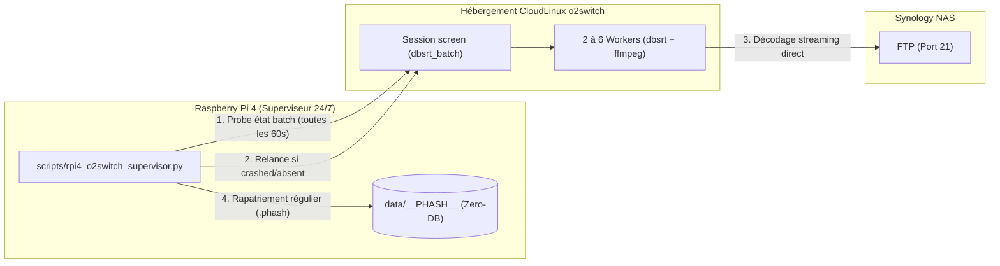
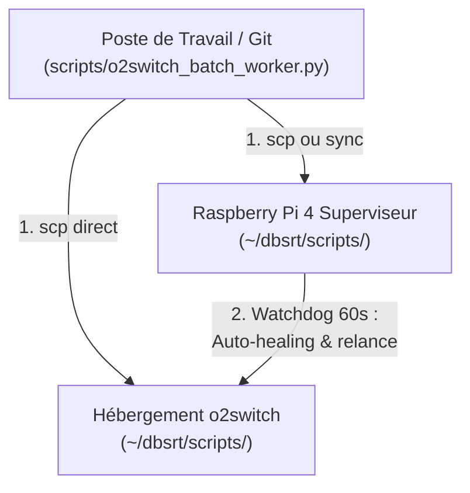

# Comment superviser et auto-guérir les batchs o2switch en continu depuis un Raspberry Pi 4 (24/7)

Ce guide pratique détaille la mise en œuvre d'un agent de supervision autonome (**Watchdog Supervisor**) exécuté en continu sur Raspberry Pi 4 (ou serveur local Debian/Linux). Cet agent surveille l'état d'exécution des batchs sur o2switch, auto-guérit les pannes de processus, régule dynamiquement le nombre de workers selon l'horaire pour préserver la bande passante du NAS Synology, et rapatrie automatiquement les empreintes visuelles `.phash` produites.

---

## 🎯 Objectifs opérationnels

1. **Surveillance permanente (24/7)** : Vérifier régulièrement l'intégrité de la session et des workers sur o2switch sans intervention humaine.
2. **Auto-guérison (Auto-Healing)** : Relancer automatiquement le batch en tâche de fond (`screen -dmS`) s'il a planté (`crashed`) ou disparu (`absent`). Quand une file est vidée (`finished`), le superviseur bascule sur l'autre bibliothèque (`tvshow` ↔ `movies`) pour occuper les CPU en continu. Deux lancements sont espacés d'au moins 30 min, pour qu'une file de fichiers toujours en échec ne boucle pas. Un arrêt manuel (`stopped`) ou une sonde en échec (`unknown`) ne déclenchent jamais de lancement.
3. **Autoscaling adaptatif en boucle fermée** : Sonde en temps réel la charge CPU CloudLinux LVE sur o2switch (quota de 12 vCPUs) et adapte dynamiquement la concurrence (2 à 6 workers) pour exploiter la marge résiduelle (cible 78% à 92%), avec repli d'urgence immédiat si pic > 96% et ajustement fluide via `run/desired_workers` sans interruption des flux en cours.
4. **Rapatriement continu (Continuous Pull)** : Synchroniser périodiquement les nouveaux fichiers `.phash` et sous-titres vers le catalogue local (`data/__PHASH__`, stockage Zero-DB).

---

## 🏗️ Architecture du superviseur



---

## 🛠️ Déploiement et exploitation

### Étape 0 : Installer le service sur le RPi4

L'unité systemd est versionnée dans `deploy/rpi4/dbsrt-supervisor.service`. L'installation synchronise les scripts (`rpi4_o2switch_supervisor.py`, `o2switch_ctl.sh`, `o2switch_batch_worker.py`) vers `~/dbsrt/scripts/`, copie l'unité dans `~/.config/systemd/user/`, puis exécute `daemon-reload` et `enable` :

```bash
task rpi4:supervisor:install
task rpi4:supervisor:restart   # charge le nouveau code
```

Relancez cette installation après toute modification de ces scripts.

### Étape 1 : Démarrer l'agent superviseur

Le cycle de vie de l'agent est piloté par le service systemd utilisateur `dbsrt-supervisor.service` (`Restart=always`) installé sur le Raspberry Pi 4. Les cibles `task rpi4:supervisor:*` appellent `systemctl --user` : ne lancez jamais le script à la main, le verrou `run/rpi4_supervisor.pid` refuserait le doublon et systemd le relancerait en boucle.

Pour démarrer le service :

```bash
task rpi4:supervisor:start
```

### Étape 2 : Vérifier l'état de l'agent superviseur

Pour contrôler que l'agent s'exécute correctement :

```bash
task rpi4:supervisor:status
```

Sortie attendue :
```text
● dbsrt-supervisor.service - dbsrt o2switch 24/7 Watchdog Supervisor
     Active: active (running) since ...
```

### Étape 3 : Suivre le journal d'activité en direct

Pour visualiser en temps réel les vérifications, relances et synchronisations :

```bash
task rpi4:supervisor:logs
```

Exemple d'activité consignée :
```text
[2026-10-28 22:20:44] 🚀 RPi4 Supervisor Agent active (polling: 60s, pull: 600s).
[2026-10-28 22:20:45] ● Remote batch healthy (PID 1815957, workers: 4, CPU baseline pending).
[2026-10-28 22:30:45] 📥 Synchronizing catalog and .phash artifacts from o2switch...
[2026-10-28 22:30:48] ✓ Catalog synchronization complete.
```

### Étape 4 : Inspecter ou régler manuellement la concurrence (Workers)

Pour inspecter la concurrence active sur o2switch :

```bash
task o2switch:batch:workers
# === Querying remote batch concurrency on o2switch ===
# 5
```

Pour forcer un palier de concurrence sans interrompre le worker en vol :

```bash
task o2switch:batch:workers -- 5
# === Setting remote batch concurrency to 5 workers on o2switch ===
# ✓ Set desired workers to 5.
```

Le worker lit dynamiquement `run/desired_workers` et fait monter ou descendre le nombre de threads d'ingestion à la fin de chaque tâche vidéo.

---

### Étape 5 : Arrêter l'agent superviseur

Pour interrompre proprement l'agent :

```bash
task rpi4:supervisor:stop
```

---

## 🔄 Cycle de vie du code et synchronisation multi-niveaux (Workstation ↔ RPi4 ↔ o2switch)

### Problématique
Le système repose sur une architecture distribuée à trois niveaux. Lorsque vous modifiez un script de traitement (comme `scripts/o2switch_batch_worker.py` ou `scripts/o2switch_ctl.sh`) sur votre poste de développement, comment ces modifications se répercutent-elles sur le superviseur autonome Raspberry Pi 4 et les travailleurs distants o2switch ?

### Répartition des Rôles et Stockage du Code



1. **Poste de développement** : Contient le code source sous contrôle Git.
2. **Raspberry Pi 4 (`~/dbsrt/scripts/`)** : Le démon superviseur exécute `rpi4_o2switch_supervisor.py`, qui appelle `o2switch_ctl.sh batch-status`, `batch-workers` et, en cas de crash, `batch-<type>` (type mémorisé dans `run/batch_type` sur o2switch). Lors d'une relance, `o2switch_ctl.sh` synchronise sa copie locale de `o2switch_batch_worker.py` vers o2switch.
3. **Serveur distant o2switch (`~/dbsrt/scripts/`)** : Le script `o2switch_batch_worker.py` y est exécuté en tâche de fond dans une session `screen` détachée (`dbsrt_batch`).

### États du batch (`batch-status`)

`task o2switch:batch:status` affiche une ligne machine lue par le superviseur :

```text
BATCH_STATE=<running|stopped|aborted|finished|crashed|absent> PID=<pid|none> TYPE=<tvshow|movies>
```

| État | Signification | Action du superviseur |
| :--- | :--- | :--- |
| `running` | Le PID du pidfile est vivant. | Autoscaling uniquement. |
| `stopped` | Marqueur `run/batch_stopped` posé par `batch:stop`. | Aucune relance. |
| `aborted` | Marqueur `run/batch_aborted` posé par le worker après 50 échecs consécutifs de moins de 10 s (erreur systémique : ffmpeg, NAS, identifiants). | Aucune relance, ni changement de bibliothèque. Corriger la cause, puis relancer à la main. |
| `finished` | `run/batch_queue.json` indique `remaining_targets: 0`. | Lance l'autre type (`tvshow` ↔ `movies`) `--fresh-only --daemon`. |
| `crashed` | Pidfile présent, processus mort, sans marqueur d'arrêt. | Relance le même type `--fresh-only --daemon`. |
| `absent` | Aucun pidfile ni marqueur. | Relance `--fresh-only --daemon`. |

### Conséquences Opérationnelles d'une Modification

> [!IMPORTANT]
>
> - **Règle de double déploiement :** Le RPi4 injecte **sa propre copie** de `o2switch_batch_worker.py` lors de chaque relance. Après modification, exécutez `task rpi4:supervisor:install` en plus de `task o2switch:sync`.
> - **Persistance en mémoire RAM :** Modifier un script Python sur le disque o2switch ne modifie **PAS** le processus en vol : l'interpréteur a déjà chargé le code au démarrage.
> - **Un arrêt manuel est définitif :** `task o2switch:batch:stop` pose le marqueur `run/batch_stopped` ; le superviseur ne relance plus le batch. Seul un nouveau `batch-tvshow` / `batch-movies` efface ce marqueur.

### Procédure de Déploiement et Prise en Compte Immédiate

Pour déployer un correctif de worker et l'activer immédiatement :

```bash
# Étape 1 : Pousser les scripts à jour vers o2switch ET le superviseur RPi4
task o2switch:sync
task rpi4:supervisor:install
task rpi4:supervisor:restart

# Étape 2 : Arrêter le batch en cours puis le relancer explicitement
task o2switch:batch:stop
task o2switch:batch:tvshow -- --fresh-only --daemon   # ou o2switch:batch:movies
```

---

## 🔐 Variables d'environnement

Toutes ces valeurs se définissent dans l'environnement ou dans le fichier `.env` local non versionné. Aucune valeur par défaut n'est versionnée.

| Variable | Lu par | Rôle |
| :--- | :--- | :--- |
| `NAS_HOST`, `NAS_USER` | `o2switch_ctl.sh`, worker | Hôte et compte FTP du NAS. Écrits dans `etc/.nas_config` (mode 600) sur o2switch s'ils sont définis localement. |
| `NAS_PASS` | `o2switch_ctl.sh`, worker | Mot de passe FTP. Transmis par stdin et écrit dans `etc/.nas_pass` (mode 600) ; jamais en argument ni dans une URL. |
| `DBSRT_FTP_USER`, `DBSRT_FTP_PASSWORD` | `dbsrt` (ffmpeg/ffprobe) | Positionnés par le worker pour chaque processus enfant, puis passés à ffmpeg via `-ftp-user` / `-ftp-password`. Jamais journalisés. |
| `DBSRT_FFMPEG_THREADS` | `dbsrt` (ffmpeg) | Threads de décodage par worker (`2` posé par le worker o2switch ; `0` = auto hors worker). |
| `O2SWITCH_URL` | `o2switch_ctl.sh rotate-key` | URL publique de la passerelle ; la vérification post-rotation est sautée si absente. |

> [!WARNING]
>
> FTP transporte les identifiants en clair. Restreignez la règle NAT du port 21 à l'IP sortante d'o2switch et utilisez un compte NAS en lecture seule.

---

## ⚙️ Configuration avancée

L'agent accepte les options suivantes en ligne de commande :

| Option | Défaut | Description |
| :--- | :--- | :--- |
| `--check-interval` | `60` | Intervalle de contrôle de l'état distant (en secondes). |
| `--pull-interval` | `600` | Intervalle de synchronisation descendante des `.phash` (en secondes). |
| `--remote-host` | `o2switch` | Alias de l'hôte distant défini dans `~/.ssh/config`. |
| `--remote-base` | `dbsrt` | Répertoire distant racine du projet sur o2switch. |

---

## 🔗 Guides associés

- [Exécuter les batchs de calcul et synchroniser avec o2switch](executer-batch-calcul-et-synchronisation-o2switch.md)
- [Architecture déport calcul, stockage et synchronisation o2switch](../explanation/architecture-deport-calcul-stockage-et-synchronisation-o2switch.md)
- [Déploiement appliance Raspberry Pi 4](../tutorials/04-deploiement-appliance-rpi4.md)
