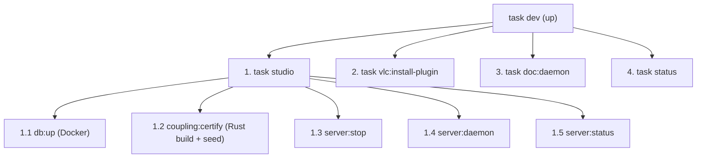

# ⚡ Guide Opérationnel & Référence Rapide (`Taskfile`, CLI, REST API)

> **Date** : 18 Octobre 2026 | **Statut** : `Empirically Proven` | **Périmètre** : Point d'entrée unique pour piloter la stack complète (`dbsrt-server`, `PostgreSQL 17`, `PgWeb`, `VLC`, `dbsrt Studio` et qualité du code).

---

## 1. Démarrage en Une Commande (`task dev` / `task up`)

La commande unifiée `task dev` (alias de `task up`) orchestre l'ensemble de la pile de développement en 4 phases séquentielles :



```bash
# Lancer la stack complète de développement (Backend, DB, Daemon, VLC, Documentation)
task dev

# Vérifier l'état et les compteurs SQL à tout moment
task status

# Arrêter l'ensemble des services en une commande
task down
```

### Décomposition des 4 Phases et Rôles Opérationnels

#### Phase 1 : Socle Backend & Données (`task studio`)
1. **`task db:up`** : Démarre les conteneurs Docker de persistance et monitoring en arrière-plan (`docker-compose.yml`) :
    - `bktreedb` : PostgreSQL 17 avec extension `spgist_hamming` (port `5433`).
    - `pgweb` : Interface SQL web (port `8086`).
    - `postgres_exporter` : Exportateur de métriques PostgreSQL (port `9187`).
    - `prometheus` : Moteur TSDB et scrape Prometheus (port `9090`).
    - `grafana` : Dashboard de monitoring PostgreSQL 17 clé en main (port `3000`, zero-login).
2. **`task coupling:certify`** :
    - Déclenche la compilation optimisée du CLI Rust (`task cli:build`).
    - Exécute `scripts/seed_couplings.sh` pour auto-découvrir et certifier les couples vérité-terrain (`data/__PHASH__/*.phash` et `data/SRT/*.srt`). Enregistre les ancres temporelles sous-titres $\leftrightarrow$ trames visuelles dans `data/SRT/couplings.json` et synchronise les tables `subtitles` et `sub_frames` dans PostgreSQL 17.
3. **`task server:stop`** : Tue proprement toute instance précédente de `dbsrt-server` pour libérer le port `8765`.
4. **`task server:daemon`** : Démarre `dbsrt-server` en arrière-plan (PID persisté, journalisation dans `/tmp/dbsrt-server.log`). Expose l'API REST `/v1/...` et le backoffice web `/studio`.
5. **`task server:status`** : Interroge `GET http://127.0.0.1:8765/v1/status` pour valider la disponibilité immédiate du daemon et la connectivité PostgreSQL.

#### Phase 2 : Intégration Lecteur VLC (`task vlc:install-plugin`)
- Déploie automatiquement les plugins Lua `pydbsrt` dans le profil utilisateur local via `scripts/vlc_ctl.sh` :
    - `vlsub_dbsrt.lua` dans `~/.local/share/vlc/lua/extensions/` (GUI de recherche et recalage).
    - `dbsrt_intf.lua` dans `~/.local/share/vlc/lua/intf/` (contrôle daemon et CLI headless).

#### Phase 3 : Portail Documentaire (`task doc:daemon`)
- Démarre le serveur MkDocs Material en démon d'arrière-plan sur `http://127.0.0.1:8000` avec hot-reload via `scripts/stack_ctl.sh`.

#### Phase 4 : Contrôle d'Intégrité Unifié (`task status`)
- Exécute la sonde globale `scripts/stack_ctl.sh status` :
    - Contrôle de santé HTTP sur les services de la stack (`Studio :8765`, `MkDocs :8000`, `Grafana :3000`, `PgWeb :8086`, `Prometheus :9090`, `Exporter :9187`).
    - Affiche en direct le décompte des entités PostgreSQL (`medias`, `frames`, `subtitles`, `sub_frames`) et le total des couplages certifiés.
    - Présente le guide complet des points d'accès IHM, routes API et commandes de logs.

---

## 2. Interfaces Web & Services Locaux

| Interface / Service | URL Locale | Port | Rôle & Fonctionnalités |
| :--- | :--- | :---: | :--- |
| **🎛️ dbsrt Studio** | `http://127.0.0.1:8765/studio` | `8765` | Backoffice interactif : Timeline bi-piste (`Frames` ↔ `SRT Cues`), Loupe pHash 8×8, lecteur `<video>` synchronisé, pagination serveur et certification en 1 clic. |
| **📊 Grafana Dashboards** | `http://127.0.0.1:3000` | `3000` | Suite de 3 dashboards out-of-the-box (Corpus Explorer, NAS Benchmarks, PostgreSQL 17 health - zero login). Guide complet : [`Observabilité & Grafana`](history/2026-10-20-observabilite-prometheus-grafana-et-telemetrie-pydbsrt.md). |
| **📚 Portail Documentation** | `http://127.0.0.1:8000` | `8000` | Serveur MkDocs Material avec recherche instantanée, diagrammes Mermaid Panzoom, équations MathJax vectorielles et Dashboard E2E VLC. |
| **🐘 PgWeb (SQL Explorer)** | `http://127.0.0.1:8086` | `8086` (ou `$PGWEB_PORT`) | Explorateur web zero-conf branché sur PostgreSQL 17 (`bktreedb`) pour inspecter `medias`, `frames`, `subtitles` et `sub_frames`. |
| **🔥 Prometheus Console** | `http://127.0.0.1:9090` | `9090` | Moteur TSDB Prometheus, exploration de requêtes PromQL et statut des cibles de scraping. |
| **⚡ API REST Daemon** | `http://127.0.0.1:8765/v1/status` | `8765` | Daemon Rust Axum découvert dynamiquement via `/tmp/dbsrt-server.json` par les extensions VLC. |

> [!TIP] Coexistence Multi-Projets & Isolation des Ports Locaux
> Si un port par défaut est déjà occupé sur la machine de développement (par exemple le port `8086` utilisé par des conteneurs professionnels ou d'autres projets sans devoir y toucher), vous pouvez surcharger dynamiquement le port exposé sans altérer vos autres conteneurs :
> ```bash
> # Lancer la stack en redirigeant PgWeb sur un port alternatif (ex: 8088)
> PGWEB_PORT=8088 task dev
> # ou pour le studio seul :
> PGWEB_PORT=8088 task studio
> ```
> `stack_ctl.sh status` et `docker compose` détecteront automatiquement `PGWEB_PORT` et afficheront le lien mis à jour (`http://127.0.0.1:8088`).

---

## 3. Matrice des Commandes `Taskfile.yml`

Conformément à la règle **Taskfile-First**, toutes les opérations récurrentes passent par `task <cible>` (orchestrant les scripts dédiés sous `scripts/` et découpées sous `taskfiles/`) :

> [!TIP] Guide Développeur & Architecture Modulaire
> Consultez le **[Tutoriel Développeur & Guide d'Ordonnancement Taskfile](tutorials/2026-10-21-tutoriel-orchestration-taskfile-et-guide-developpeur.md)** pour le détail de l'architecture modulaire `taskfiles/` et les 4 workflows clés.

=== "🎛️ Stack & Couplages"

    | Commande `task` | Script / Outil | Description Technique |
    | :--- | :--- | :--- |
    | `task dev` / `task up` | `Taskfile.yml` | Démarre la stack unifiée complète (Docker, seed couplages, daemon `dbsrt-server :8765`, plugins VLC, MkDocs). |
    | `task down` | `scripts/stack_ctl.sh` | Arrête proprement le daemon `dbsrt-server`, MkDocs et les conteneurs Docker. |
    | `task status` | `scripts/stack_ctl.sh status` | Affiche l'état HTTP 200 des 4 services et les compteurs d'entités PostgreSQL. |
    | `task studio` | `Taskfile.yml` | Démarre le socle backend seul (Docker + seed couplages + daemon `dbsrt-server`). |
    | `task media:add` | `scripts/media_add.sh` | Façade unifiée d'ingestion média (pHash, extraction MKV/MP4 embarqué, certification couplage et rechargement dynamique RAM). [Voir guide](how-to/2026-10-25-guide-media-add-facade.md). |
    | `task coupling:certify` | `scripts/seed_couplings.sh` | Découvre et certifie tous les couples de référence (`data/__PHASH__` $\leftrightarrow$ `data/SRT`). |
    | `task server:status` | `scripts/stack_ctl.sh server-status` | Interroge le statut du daemon via `GET /v1/status`. |
    | `task server:reload` | `scripts/stack_ctl.sh server-reload` | Déclenche le rechargement atomique à chaud du catalogue (`/v1/catalog/reload`). |
    | `task catalog:status`| `scripts/stack_ctl.sh catalog-status`| Affiche l'état d'indexation (Base immuable + Delta RAM + Couplages). |

=== "🐘 Base de Données & Migrations"

    | Commande `task` | Script / Outil | Description Technique |
    | :--- | :--- | :--- |
    | `task db:migrate` | `./target/release/dbsrt migrate` | Applique les migrations déclaratives en attente (`refinery` V1, V2, V3...) de façon atomique. |
    | `task db:status` | `./target/release/dbsrt migrate --status` | Affiche l'historique et l'état des versions appliquées (`refinery_schema_history`). |
    | `task db:up` | `docker compose up -d` | Démarre le conteneur PostgreSQL 17 SP-GiST BK-Tree et les services associés. |
    | `task db:down` | `docker compose down` | Arrête la stack de base de données. |
    | `task db:psql` | `psql` | Ouvre une session interactive `psql` dans le conteneur PostgreSQL 17. |
    | `task db:import:all-phash` | `./target/release/dbsrt import-phash` | Importe en batch les `.phash` dans PostgreSQL via streaming `COPY`. |

=== "🎬 Lecteur VLC & VLSub"

    | Commande `task` | Script / Outil | Description Technique |
    | :--- | :--- | :--- |
    | `task vlc:install-plugin` | `scripts/vlc_ctl.sh install` | Installe `vlsub_dbsrt.lua` (GUI Qt) et `dbsrt_intf.lua` (intf CLI/daemon) dans le profil VLC utilisateur. |
    | `task vlc:run` | `scripts/vlc_ctl.sh run` | Lance VLC en assurant que `dbsrt-server` tourne en arrière-plan. |
    | `task vlc:demo` | `scripts/vlc_ctl.sh demo` | Lance la démo interactive avec sous-titre recalé et notification OSD native. |
    | `task vlc:test` | `vlc:test:unit` + `vlc:test:e2e` | Exécute la pyramide complète de tests VLC (unitaires + cvlc + GUI Xvfb). |
    | `task vlc:record-demo` | `scripts/record_vlsub_demo.sh` | Enregistre la preuve E2E `1080p` H.264/MP4 sous serveur X11 virtuel `Xvfb`. |

=== "🛡️ Qualité, Tests & CI"

    | Commande `task` | Script / Outil | Description Technique |
    | :--- | :--- | :--- |
    | `task lint` | `scripts/code_quality.sh lint` | Exécute la suite complète multi-langage (Rust, Python, Shell, Lua, Web, YAML, Docs). |
    | `task fmt` | `scripts/code_quality.sh fmt` | Formate automatiquement le code Rust (`cargo fmt`), Python (`ruff`), Shell (`shfmt`) et Lua (`stylua`). |
    | `task test` | `test:rs` + `pytest` | Exécute les tests unitaires et d'intégration sur Rust et Python. |
    | `task test:rs` | `cargo test --workspace` | Exécute tous les tests unitaires et E2E du workspace Rust. |
    | `task coverage` | `scripts/code_quality.sh coverage` | Mesure la couverture 1:1 avec la CI GitHub Actions (PostgreSQL 17 + `cargo llvm-cov` + `pytest --cov`). |
    | `task ci:local` | `Taskfile.yml` | Suite rapide de reproduction CI locale (< 10s chrono). |
    | `task pre-commit` | `pre-commit run --all-files` | Exécute les 17 hooks pre-commit sur l'ensemble du dépôt. |
    | `task clean` | `scripts/disk_guard.sh clean` | Purge unifiée des artefacts et caches (`cargo clean`, `.pytest_cache`, `.ruff_cache`, `__pycache__`). |

=== "🚀 Déploiement & Démos"

    | Commande `task` | Script / Outil | Description Technique |
    | :--- | :--- | :--- |
    | `task test:recipe:debian` | `scripts/test_recipe_debian.sh` | Teste la recette de déploiement client en conteneur Docker systemd isolé (8s). |
    | `task demo:sync` | `./target/release/dbsrt` | Recalage temporel standalone SRT $\to$ média cible en Rust natif (~0.5 ms). |
    | `task demo:vlc` | `scripts/vlc_ctl.sh demo` | Démonstration interactive avec sous-titres recalés et OSD dans VLC. |
    | `task demo:studio` | `http://127.0.0.1:8765/studio` | Lance le backoffice web Studio (timeline bi-piste et loupe 8x8 pHash). |

=== "📚 Documentation"

    | Commande `task` | Script / Outil | Description Technique |
    | :--- | :--- | :--- |
    | `task doc` | `scripts/serve_docs.py` | Lance le serveur MkDocs Material avec rechargement à chaud sur `:8000`. |
    | `task doc:check` | `scripts/validate_docs.py` | Valide le build strict, l'AST HTML, les équations LaTeX et le rendu Chrome headless. |
    | `task doc:build` | `mkdocs build --strict` | Compile le site statique HTML/CSS/JS dans `site/` en mode strict. |

---

## 4. Référence de l'API REST (`dbsrt-server :8765`)

| Méthode & Endpoint | Paramètres / Payload | Description & Usage |
| :--- | :--- | :--- |
| `GET /studio` | — | Interface web complète **dbsrt Studio** (Backoffice Couplages & Timeline pHash). |
| `GET /v1/status` | — | État du démon, uptime, versions, catalogues (`subtitles_dir`, `phash_dir`) et statut PostgreSQL. |
| `GET /v1/media/stream` | `?path=<video_path>` | Streaming vidéo HTTP `206 Partial Content` (`Range: bytes=...`) pour le lecteur HTML5 de Studio. |
| `GET /v1/couplings` | `?summary=true` | Liste légère des couplages certifiés (métadonnées + compteurs sans charger les tableaux massifs). |
| `GET /v1/couplings/sub_frames` | `?media_stem=...&offset=0&limit=50` | Pagination serveur (`offset`/`limit`) des répliques SRT ancrées aux frames pHash (`sub_frames`). |
| `POST /v1/certify` | `{"video_path": "...", "srt_path": "...", "language": "fr"}` | Certifie à chaud un couplage Ground-Truth (extraction hybride + écriture JSON & PostgreSQL 17). |
| `POST /v1/search` | `{"video_path": "...", "query": "...", "language": "fr"}` | Recherche multi-sources (1. Couplages Certifiés pHash → 2. Catalogue Local → 3. OpenSubtitles). |
| `POST /v1/download` | `{"subtitle_id": "...", "video_path": "..."}` | Télécharge le `.srt` et applique automatiquement le recalage temporel pHash si une référence existe. |
| `POST /v1/sync` | `{"video_path": "...", "srt_path": "..."}` | Recalage direct en 1 clic et génération du fichier `.dbsrt.srt` synchronisé. |
| `GET /v1/media/stream` | `?path=<video_path>` | Streaming vidéo HTTP `206 Partial Content` (`Range: bytes=...`) pour le lecteur HTML5 de Studio. |
| `GET /v1/couplings` | `?summary=true` | Liste légère des couplages certifiés (métadonnées + compteurs sans charger les tableaux massifs). |
| `GET /v1/couplings/sub_frames` | `?media_stem=...&offset=0&limit=50` | Pagination serveur (`offset`/`limit`) des répliques SRT ancrées aux frames pHash (`sub_frames`). |
| `POST /v1/certify` | `{"video_path": "...", "srt_path": "...", "language": "fr"}` | Certifie à chaud un couplage Ground-Truth (extraction hybride + écriture JSON & PostgreSQL 17). |
| `POST /v1/search` | `{"video_path": "...", "query": "...", "language": "fr"}` | Recherche multi-sources (1. Couplages Certifiés pHash → 2. Catalogue Local → 3. OpenSubtitles). |
| `POST /v1/download` | `{"subtitle_id": "...", "video_path": "..."}` | Télécharge le `.srt` et applique automatiquement le recalage temporel pHash si une référence existe. |
| `POST /v1/sync` | `{"video_path": "...", "srt_path": "..."}` | Recalage direct en 1 clic et génération du fichier `.dbsrt.srt` synchronisé. |

---

## 5. FAQ Opérationnelle & Bonnes Pratiques

### 🛡️ Gestion de l'Espace Disque & Profil de Compilation Rust
* **Problème** : `target/` enfle rapidement jusqu'à plusieurs dizaines de gigaoctets lors des itérations de tests (`cargo test`).
* **Causes identifiées** : L'accumulation de centaines de binaires de tests d'intégration statiques combinée au niveau de debug par défaut DWARF (`debug = 2`).
* **Garde-fous déployés** :
  1. `Cargo.toml` configure désormais `debug = 1` sur les profils `dev` et `test` : les backtraces conservent les numéros de ligne et fichiers, mais les volumineux dictionnaires de types sont éludés (taille divisée par $4\times$ à $5\times$).
  2. Le script `scripts/disk_guard.sh` surveille les seuils critiques ($> 10\text{ Go}$ libres sur la partition, $< 4\text{ Go}$ pour `target/`) et auto-nettoie si le seuil est franchi.
  3. La commande `task disk:check` est intégrée comme palier de validation `[7/7]` dans `task lint` et `task check`.
  4. Pour purger manuellement : `task clean:rs` (Rust seul) ou `task clean` (purge unifiée Rust + caches Python).

### 🎬 Dashboard E2E VLC GUI & Navigation Synchronisée
* **Accès** : Disponible sur le portail documentaire via [`Dashboard Interactif E2E VLC`](history/2026-10-20-dashboard-interactif-e2e-vlc-corpus-nas.md).
* **Navigation Clavier** :
  * Flèche gauche $\leftarrow$ (`ArrowLeft`) et Flèche droite $\rightarrow$ (`ArrowRight`) : défilement instantané entre les captures avec bouclage circulaire.
  * Touche $\text{Échap}$ : fermeture immédiate du modal plein écran.
* **Synchronisation Bidirectionnelle** :
  * La sélection reste contextualisée au filtre en cours (Tous, Matchs Valides $\ge 90\%$, Plans Fixes).
  * Lors de la navigation ou à la sortie du modal, la DataTable change automatiquement de page si nécessaire (`table.page(targetPage).draw(false)`), applique la classe cyan `.active-selected-row` et centre la ligne correspondante dans la fenêtre via `scrollIntoView`.

### 🖼️ Optimisation des Médias : WebP 720p vs PNG
* **Pourquoi pas de PNG bruts ?** : 1 334 captures $1920 \times 1080$ totalisaient $861\text{ Mo}$ dans `docs/screenshots/e2e_vlc_all/`, provoquant un dépassement de quota et l'échec du déploiement Surge.sh (`pr-preview`).
* **Conversion Automatisée** : `task doc:optimize-images` invoque `scripts/convert_dashboard_webp.py` en multithread (`cwebp -q 80 -resize 1280 720`), réduisant la charge utile à $73.5\text{ Mo}$ ($-91.5\%$).
* **Évitement des collisions de Lightbox** : La directive `glightbox: false` dans le frontmatter garantit que le plugin MkDocs n'interfère pas avec le modal plein écran natif du dashboard.
