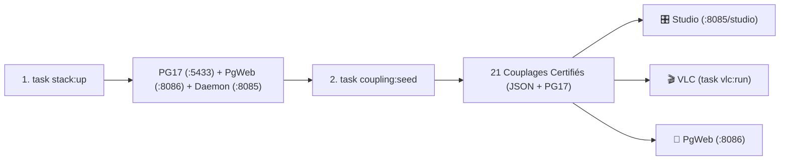

# ⚡ Guide Opérationnel & Référence Rapide (`Taskfile`, CLI, REST API)

> **Date** : 18 Octobre 2026 | **Statut** : `Empirically Proven` | **Périmètre** : Point d'entrée unique pour piloter la stack complète (`dbsrt-server`, `PostgreSQL 17`, `PgWeb`, `VLC`, `dbsrt Studio` et qualité du code).

---

## 1. Démarrage en 60 Secondes (Workflow Complet)



```bash
# 1. Démarrer toute l'infrastructure (PostgreSQL 17 SP-GiST + PgWeb + Daemon Rust Axum)
task stack:up

# 2. Indexer et certifier les 21 épisodes/extraits de référence (JSON + PostgreSQL 17)
task coupling:seed

# 3. Vérifier l'état de santé de tous les services et les URLs actives
task stack:status
```

---

## 2. Interfaces Web & Services Locaux

| Interface / Service | URL Locale | Port | Rôle & Fonctionnalités |
| :--- | :--- | :---: | :--- |
| **🎛️ dbsrt Studio** | `http://127.0.0.1:8085/studio` | `8085` | Backoffice interactif : Timeline bi-piste (`Frames` ↔ `SRT Cues`), Loupe pHash 8×8, lecteur `<video>` synchronisé, pagination serveur et certification en 1 clic. |
| **⚡ API REST Daemon** | `http://127.0.0.1:8085/v1/health` | `8085` | Daemon Rust Axum découvert dynamiquement via `/tmp/dbsrt-server.json` par les extensions VLC. |
| **🐘 PgWeb (SQL Explorer)** | `http://127.0.0.1:8086` | `8086` | Explorateur web zero-conf branché sur PostgreSQL 17 (`bktreedb`) pour inspecter `medias`, `frames`, `subtitles` et `sub_frames`. |
| **📚 Portail Documentation** | `http://127.0.0.1:8000` | `8000` | Serveur MkDocs Material avec recherche instantanée, diagrammes Mermaid Panzoom et équations MathJax vectorielles (`task doc:serve`). |

---

## 3. Matrice des Commandes `Taskfile.yml`

Conformément à la règle **Taskfile-First**, toutes les opérations récurrentes passent par `task <cible>` (orchestrant les scripts dédiés sous `scripts/`) :

=== "🎛️ Stack & Couplages"

    | Commande `task` | Script Sous-Jacent | Description Technique |
    | :--- | :--- | :--- |
    | `task stack:up` | `scripts/stack_ctl.sh up` | Démarre `postgres` (`:5433`), `pgweb` (`:8086`) et le daemon `dbsrt-server` (`:8085`). |
    | `task stack:status` | `scripts/stack_ctl.sh status` | Affiche les PIDs, conteneurs Docker, santé `/v1/health` et compteurs de couplages. |
    | `task stack:down` | `scripts/stack_ctl.sh down` | Arrête proprement le daemon `dbsrt-server` et les conteneurs Docker. |
    | `task coupling:certify` | `dbsrt certify-coupling` | Certifie un couple `(Vidéo, SRT)` dans `couplings.json` + PostgreSQL 17. |
    | `task coupling:seed` | `scripts/seed_couplings.sh` | Découvre et certifie tous les couples de référence (`Big Buck Bunny` + `20` épisodes DBZ). |
    | `task coupling:list` | `scripts/stack_ctl.sh couplings` | Liste les couplages certifiés via `GET /v1/couplings?summary=true`. |

=== "🎬 Lecteur VLC & VLSub"

    | Commande `task` | Script Sous-Jacent | Description Technique |
    | :--- | :--- | :--- |
    | `task vlc:install-plugin` | Installation `~/.local/share/vlc/...` | Installe `vlsub_dbsrt.lua` (GUI Qt) et `dbsrt_Sync.lua` (intf) dans le profil VLC utilisateur. |
    | `task vlc:run` | `scripts/vlc_ctl.sh run` | Lance VLC en assurant que `dbsrt-server` tourne en arrière-plan. |
    | `task vlc:demo` | `scripts/vlc_ctl.sh demo` | Lance la démo interactive avec sous-titre recalé et notification OSD native. |
    | `task vlc:record-demo` | `scripts/record_vlsub_demo.sh` | Enregistre la preuve E2E `1080p` H.264/MP4 sous serveur X11 virtuel `Xvfb`. |

=== "🛡️ Qualité, Tests & CI"

    | Commande `task` | Script Sous-Jacent | Description Technique |
    | :--- | :--- | :--- |
    | `task check` | `scripts/code_quality.sh check` | Exécute la suite complète multi-langage (Rust, Python, Shell, Lua, Web, YAML, Docs). |
    | `task lint:all` | `scripts/code_quality.sh lint` | Vérifie le formatage et le linting sur `.rs`, `.py`, `.sh`, `.lua`, `.html`, `.css`, `.js`, `.json`, `.yml`. |
    | `task format` | `scripts/code_quality.sh format` | Formate automatiquement le code Rust (`cargo fmt`), Python (`ruff`), Shell (`shfmt`) et Lua (`stylua`). |
    | `task coverage` | `scripts/code_quality.sh coverage` | Mesure la couverture 1:1 avec la CI GitHub Actions (PostgreSQL 17 + `cargo llvm-cov` + `pytest --cov`). |
    | `task pre-commit:run` | `pre-commit run --all-files` | Exécute les `17/17` hooks pre-commit sur l'ensemble du dépôt. |

=== "📚 Documentation"

    | Commande `task` | Script Sous-Jacent | Description Technique |
    | :--- | :--- | :--- |
    | `task doc` / `task doc:serve` | `scripts/serve_docs.py` | Lance le serveur MkDocs avec allocation dynamique de port (`8000`–`8020`). |
    | `task doc:build` | `mkdocs build --strict` | Compile le site statique HTML/CSS/JS dans `site/` en mode strict. |
    | `task doc:check` | `scripts/validate_docs.py` | Valide le build strict, l'AST HTML, les équations LaTeX et les liens d'images. |

---

## 4. Référence de l'API REST (`dbsrt-server :8085`)

| Méthode & Endpoint | Paramètres / Payload | Description & Usage |
| :--- | :--- | :--- |
| `GET /studio` | — | Interface web complète **dbsrt Studio** (Backoffice Couplages & Timeline pHash). |
| `GET /v1/health` | — | État du démon, uptime, chemins des catalogues (`subtitles_dir`, `phash_dir`) et statut PostgreSQL. |
| `GET /v1/media/stream` | `?path=<video_path>` | Streaming vidéo HTTP `206 Partial Content` (`Range: bytes=...`) pour le lecteur HTML5 de Studio. |
| `GET /v1/couplings` | `?summary=true` | Liste légère des couplages certifiés (métadonnées + compteurs sans charger les tableaux massifs). |
| `GET /v1/couplings/sub_frames` | `?media_stem=...&offset=0&limit=50` | Pagination serveur (`offset`/`limit`) des répliques SRT ancrées aux frames pHash (`sub_frames`). |
| `POST /v1/certify` | `{"video_path": "...", "srt_path": "...", "language": "fr"}` | Certifie à chaud un couplage Ground-Truth (extraction hybride + écriture JSON & PostgreSQL 17). |
| `POST /v1/search` | `{"video_path": "...", "query": "...", "language": "fr"}` | Recherche multi-sources (1. Couplages Certifiés pHash → 2. Catalogue Local → 3. OpenSubtitles). |
| `POST /v1/download` | `{"subtitle_id": "...", "video_path": "..."}` | Télécharge le `.srt` et applique automatiquement le recalage temporel pHash si une référence existe. |
| `POST /v1/sync` | `{"video_path": "...", "srt_path": "..."}` | Recalage direct en 1 clic et génération du fichier `.dbsrt.srt` synchronisé. |
