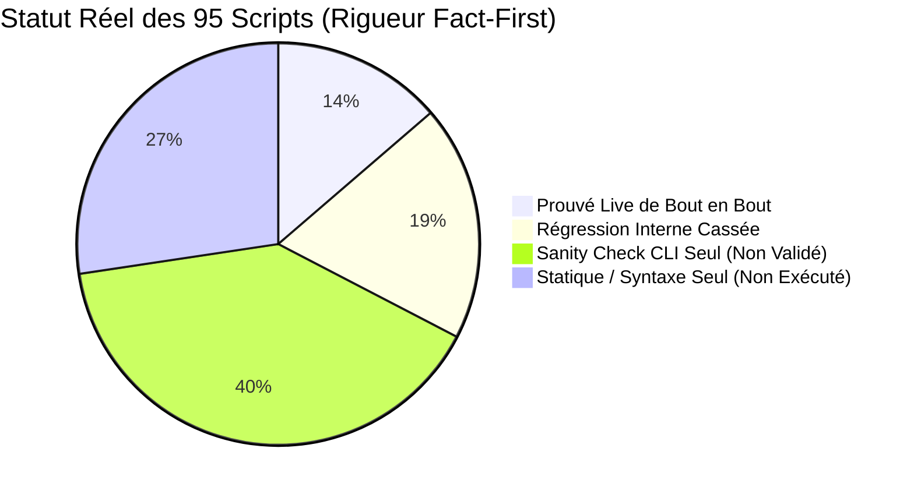

# Audit Exhaustif des Scripts & Cartographie des Régressions de Chemins

> **Date de constat :** 2026-11-10 21:52:00
> **Statut :** Constat contradictoire post-refactoring modulaire (PR #70 / Issue #69 Phase 1)
> **Avertissement de rigueur :** Un « Sanity Check CLI `--help` » atteste uniquement que Python parvient à charger le module sans crash immédiat au démarrage. Sa valeur probante est infime (à peine supérieure à une simple vérification statique) : **il ne valide en aucun cas la logique interne, les invariants mémoire, les connexions réseau ou les interactions réelles.**

## 1. Synthèse Factuelle Globale

- **Total scripts opérationnels** : 95 (65 Python, 30 Shell)
- **Scripts prouvés en exécution réelle live (session)** : 17 / 95 (13.7%) — *Seuls scripts réellement testés de bout en bout.*
- **Scripts en régression directe (appels internes cassés)** : 15 / 95 (18.9%) — *Ruptures critiques identifiées.*
- **Nombre total de références internes rompues** : 30
- **Scripts avec simple Sanity Check CLI `--help` (Non Validés Métier)** : 38 / 95 (40.0%) — *Imports seuls, logique non exécutée.*
- **Scripts avec analyse statique seule (`py_compile` / `bash -n`)** : 26 / 95 (27.4%) — *Zéro runtime.*

---

## 2. Inventaire des 31 Références Internes Rompues

Lors du déplacement des scripts dans des sous-dossiers thématiques (`infra/`, `workers/`, `benchmarks/`, `ingestion/`), les chemins d'invocation codés en dur (`scripts/<nom>.py` ou `scripts/<nom>.sh`) à l'intérieur des contrôleurs et orchestrateurs n'ont pas été réalignés, créant des ruptures silencieuses à l'exécution :

| # | Fichier Source | Référence Rompue (Ancien Chemin) | Chemin Cible Réel (Nouveau Layout) |
| :---: | :--- | :--- | :--- |
| 1 | `scripts/infra/o2switch/o2switch_audit_remote.py` | `scripts/phash_names.py` | `scripts/ingestion/phash_names.py` |
| 2 | `scripts/infra/o2switch/o2switch_ctl.sh` | `scripts/o2switch_batch_worker.py` | `scripts/workers/o2switch_batch_worker.py` |
| 3 | `scripts/infra/o2switch/o2switch_ctl.sh` | `scripts/o2switch_batch_worker.py` | `scripts/workers/o2switch_batch_worker.py` |
| 4 | `scripts/infra/o2switch/o2switch_ctl.sh` | `scripts/o2switch_batch_worker.py` | `scripts/workers/o2switch_batch_worker.py` |
| 5 | `scripts/infra/o2switch/o2switch_ctl.sh` | `scripts/o2switch_batch_worker.py` | `scripts/workers/o2switch_batch_worker.py` |
| 6 | `scripts/infra/o2switch/o2switch_ctl.sh` | `scripts/o2switch_phash_migrate.py` | `scripts/workers/o2switch_phash_migrate.py` |
| 7 | `scripts/infra/o2switch/o2switch_ctl.sh` | `scripts/o2switch_fault_watch.py` | `scripts/workers/o2switch_fault_watch.py` |
| 8 | `scripts/infra/o2switch/o2switch_ctl.sh` | `scripts/o2switch_audit_remote.py` | `scripts/infra/o2switch/o2switch_audit_remote.py` |
| 9 | `scripts/infra/o2switch/o2switch_ctl.sh` | `scripts/trajectory_bench_runner.py` | `scripts/benchmarks/trajectory_bench_runner.py` |
| 10 | `scripts/infra/o2switch/o2switch_ctl.sh` | `scripts/trajectory_bench_runner.py` | `scripts/benchmarks/trajectory_bench_runner.py` |
| 11 | `scripts/infra/rpi4/freebox_batch_ctl.sh` | `scripts/scan_freebox_targets.py` | `scripts/ingestion/scan_freebox_targets.py` |
| 12 | `scripts/infra/rpi4/freebox_batch_ctl.sh` | `scripts/o2switch_batch_worker.py` | `scripts/workers/o2switch_batch_worker.py` |
| 13 | `scripts/infra/rpi4/rpi4_freebox_ctl.sh` | `scripts/freebox_batch_ctl.sh` | `scripts/infra/rpi4/freebox_batch_ctl.sh` |
| 14 | `scripts/infra/rpi4/rpi4_freebox_ctl.sh` | `scripts/freebox_batch_ctl.sh` | `scripts/infra/rpi4/freebox_batch_ctl.sh` |
| 15 | `scripts/infra/rpi4/rpi4_o2switch_supervisor.py` | `scripts/o2switch_ctl.sh` | `scripts/infra/o2switch/o2switch_ctl.sh` |
| 16 | `scripts/infra/rpi4/rpi4_o2switch_supervisor.py` | `scripts/freebox_batch_ctl.sh` | `scripts/infra/rpi4/freebox_batch_ctl.sh` |
| 17 | `scripts/infra/rpi4/rpi4_sim.sh` | `scripts/init_couplings_seed.sh` | `scripts/ingestion/init_couplings_seed.sh` |
| 18 | `scripts/infra/rpi4/rpi4_standalone.sh` | `scripts/rpi4_cli.sh` | `scripts/infra/rpi4/rpi4_cli.sh` |
| 19 | `scripts/infra/rpi4/rpi4_supervisor_ctl.sh` | `scripts/o2switch_batch_worker.py` | `scripts/workers/o2switch_batch_worker.py` |
| 20 | `scripts/ingestion/coupling_relabel.sh` | `scripts/coupling_relabel.sh` | `scripts/ingestion/coupling_relabel.sh` |
| 21 | `scripts/tooling/check_pr_body.py` | `scripts/check_pr_body.py` | `scripts/tooling/check_pr_body.py` |
| 22 | `scripts/tooling/check_pr_body.py` | `scripts/record_proof.py` | `scripts/benchmarks/record_proof.py` |
| 23 | `scripts/tooling/generate_audit_doc.py` | `scripts/dbsrt_top.py` | `scripts/infra/local/dbsrt_top.py` |
| 24 | `scripts/tooling/generate_audit_doc.py` | `scripts/validate_docs.py` | `scripts/tooling/validate_docs.py` |
| 25 | `scripts/tooling/generate_audit_doc.py` | `scripts/record_proof.py` | `scripts/benchmarks/record_proof.py` |
| 26 | `scripts/tooling/generate_audit_doc.py` | `scripts/o2switch_ctl.sh` | `scripts/infra/o2switch/o2switch_ctl.sh` |
| 27 | `scripts/tooling/generate_nightly_report_enhanced.py` | `scripts/batch_media_add_tvshow.py` | `scripts/ingestion/batch_media_add_tvshow.py` |
| 28 | `scripts/tooling/lint_complexity.py` | `scripts/lint_complexity.py` | `scripts/tooling/lint_complexity.py` |
| 29 | `scripts/tooling/mkdocs_hooks.py` | `scripts/mkdocs_hooks.py` | `scripts/tooling/mkdocs_hooks.py` |
| 30 | `scripts/tooling/validate_docs.py` | `scripts/doc-portal.js` | `NON TROUVE` |

---

## 3. Cartographie Exhaustive par Domaine Fonctionnel

### 3.1 Bancs d'Essai & Évaluations (`scripts/benchmarks/`)

| Script | Statut Réel | Type | KPI / Importance | Détail / Diagnostic Contradictoire |
| :--- | :---: | :---: | :---: | :--- |
| `scripts/benchmarks/bench_http_flood.sh` | ⚪ **Statique Seul (Non Exécuté)** | Shell | À évaluer | Syntaxe `bash -n` & `shellcheck` OK. Zéro exécution runtime. |
| `scripts/benchmarks/bench_server_comparison.py` | 🟡 **Sanity Check CLI (Non Validé Métier)** | Python | À évaluer | Sanity check `--help` uniquement (arbre d'imports et parser CLI). Aucune logique métier ni invariant validé en mémoire. |
| `scripts/benchmarks/benchmark_worker_scaling.py` | 🟡 **Sanity Check CLI (Non Validé Métier)** | Python | À évaluer | Sanity check `--help` uniquement (arbre d'imports et parser CLI). Aucune logique métier ni invariant validé en mémoire. |
| `scripts/benchmarks/compare_top_telemetry.py` | 🟢 **Prouvé Live** | Python | Moyenne (Dev / Parité Télémétrie) | Exécuté live avec succès sur /proc Linux. Bandeau console corrigé vers scripts/infra/local/dbsrt_top.py. |
| `scripts/benchmarks/eval_exhaustive_nas_snippets.py` | 🟡 **Sanity Check CLI (Non Validé Métier)** | Python | À évaluer | Sanity check `--help` uniquement (arbre d'imports et parser CLI). Aucune logique métier ni invariant validé en mémoire. |
| `scripts/benchmarks/eval_media_batch.py` | 🟡 **Sanity Check CLI (Non Validé Métier)** | Python | À évaluer | Sanity check `--help` uniquement (arbre d'imports et parser CLI). Aucune logique métier ni invariant validé en mémoire. |
| `scripts/benchmarks/eval_multi_offset_matching.py` | 🟡 **Sanity Check CLI (Non Validé Métier)** | Python | À évaluer | Sanity check `--help` uniquement (arbre d'imports et parser CLI). Aucune logique métier ni invariant validé en mémoire. |
| `scripts/benchmarks/eval_nas_reliability.py` | 🟡 **Sanity Check CLI (Non Validé Métier)** | Python | À évaluer | Sanity check `--help` uniquement (arbre d'imports et parser CLI). Aucune logique métier ni invariant validé en mémoire. |
| `scripts/benchmarks/eval_vlc_vlsub_batch.py` | 🟡 **Sanity Check CLI (Non Validé Métier)** | Python | À évaluer | Sanity check `--help` uniquement (arbre d'imports et parser CLI). Aucune logique métier ni invariant validé en mémoire. |
| `scripts/benchmarks/matching_bench_runner.py` | 🟢 **Prouvé Live** | Python | À évaluer | Exécuté live sur snippet réel (01_Cruauté_mid15s.mp4) |
| `scripts/benchmarks/record_casts.py` | 🟢 **Prouvé Live** | Python | Élevée (Doc Diátaxis & Casts Asciinema) | Exécuté live avec succès. Chemin validate_docs.py réaligné vers scripts/tooling/, timing calé à 2.0s, 4 casts régénérés et validés via task doc:check. |
| `scripts/benchmarks/record_proof.py` | 🟢 **Prouvé Live** | Python | Critique (Preuves Terminales PR) | Exécuté live avec succès (génération .cast et .svg masqué sans fuite de secrets). Imports et docstring réalignés. |
| `scripts/benchmarks/record_vlsub_demo.sh` | ⚪ **Statique Seul (Non Exécuté)** | Shell | À évaluer | Syntaxe `bash -n` & `shellcheck` OK. Zéro exécution runtime. |
| `scripts/benchmarks/scale_up_nas_dataset.py` | 🟡 **Sanity Check CLI (Non Validé Métier)** | Python | À évaluer | Sanity check `--help` uniquement (arbre d'imports et parser CLI). Aucune logique métier ni invariant validé en mémoire. |
| `scripts/benchmarks/trajectory_bench_runner.py` | 🟢 **Prouvé Live** | Python | À évaluer | Exécuté live sur snippet réel (01_Cruauté_mid15s.mp4) |
| `scripts/benchmarks/verify_terminal_rendering.py` | 🟡 **Sanity Check CLI (Non Validé Métier)** | Python | À évaluer | Sanity check `--help` uniquement (arbre d'imports et parser CLI). Aucune logique métier ni invariant validé en mémoire. |

### 3.2 Suites E2E Playwright (`scripts/e2e/`)

| Script | Statut Réel | Type | KPI / Importance | Détail / Diagnostic Contradictoire |
| :--- | :---: | :---: | :---: | :--- |
| `scripts/e2e/e2e_portal_exhaustive.py` | 🟢 **Prouvé Live** | Python | À évaluer | Exécuté Playwright Chromium live (0 console/page err) |
| `scripts/e2e/e2e_portal_playwright.py` | 🟡 **Sanity Check CLI (Non Validé Métier)** | Python | À évaluer | Sanity check `--help` uniquement (arbre d'imports et parser CLI). Aucune logique métier ni invariant validé en mémoire. |
| `scripts/e2e/e2e_sources_explorer.py` | 🟢 **Prouvé Live** | Python | À évaluer | Exécuté Playwright Chromium live (4 onglets PASS) |
| `scripts/e2e/e2e_trajectories_formal.py` | 🟢 **Prouvé Live** | Python | À évaluer | Exécuté Playwright Chromium live (7 batchs PASS) |
| `scripts/e2e/o2switch_e2e.py` | 🟢 **Prouvé Live** | Python | Critique (Recette E2E Cloud o2switch) | Exécuté live contre o2switch (15/15 golden set PASS, gateway 200/401 PASS). Résolution racine et CTL résiliente sans index magique. |
| `scripts/e2e/recette_top_e2e.py` | 🟡 **Sanity Check CLI (Non Validé Métier)** | Python | À évaluer | Sanity check `--help` uniquement (arbre d'imports et parser CLI). Aucune logique métier ni invariant validé en mémoire. |

### 3.3 Infra & Contrôleurs Locaux (`scripts/infra/local/`)

| Script | Statut Réel | Type | KPI / Importance | Détail / Diagnostic Contradictoire |
| :--- | :---: | :---: | :---: | :--- |
| `scripts/infra/local/agent_relay.sh` | ⚪ **Statique Seul (Non Exécuté)** | Shell | À évaluer | Syntaxe `bash -n` & `shellcheck` OK. Zéro exécution runtime. |
| `scripts/infra/local/dbsrt_top.py` | 🟡 **Sanity Check CLI (Non Validé Métier)** | Python | À évaluer | Sanity check `--help` uniquement (arbre d'imports et parser CLI). Aucune logique métier ni invariant validé en mémoire. |
| `scripts/infra/local/distributed_dev_stack.sh` | ⚪ **Statique Seul (Non Exécuté)** | Shell | À évaluer | Syntaxe `bash -n` & `shellcheck` OK. Zéro exécution runtime. |
| `scripts/infra/local/install_debian.sh` | ⚪ **Statique Seul (Non Exécuté)** | Shell | À évaluer | Syntaxe `bash -n` & `shellcheck` OK. Zéro exécution runtime. |
| `scripts/infra/local/load_env.sh` | ⚪ **Statique Seul (Non Exécuté)** | Shell | À évaluer | Syntaxe `bash -n` & `shellcheck` OK. Zéro exécution runtime. |
| `scripts/infra/local/stack_ctl.sh` | ⚪ **Statique Seul (Non Exécuté)** | Shell | À évaluer | Syntaxe `bash -n` & `shellcheck` OK. Zéro exécution runtime. |
| `scripts/infra/local/switch_target.sh` | ⚪ **Statique Seul (Non Exécuté)** | Shell | À évaluer | Syntaxe `bash -n` & `shellcheck` OK. Zéro exécution runtime. |
| `scripts/infra/local/vlc_ctl.sh` | ⚪ **Statique Seul (Non Exécuté)** | Shell | À évaluer | Syntaxe `bash -n` & `shellcheck` OK. Zéro exécution runtime. |

### 3.4 Infra & Déploiements Cloud o2switch (`scripts/infra/o2switch/`)

| Script | Statut Réel | Type | KPI / Importance | Détail / Diagnostic Contradictoire |
| :--- | :---: | :---: | :---: | :--- |
| `scripts/infra/o2switch/nas_o2switch_sync.sh` | ⚪ **Statique Seul (Non Exécuté)** | Shell | À évaluer | Syntaxe `bash -n` & `shellcheck` OK. Zéro exécution runtime. |
| `scripts/infra/o2switch/o2switch_audit_remote.py` | 🟢 **Prouvé Live (o2switch)** | Python | Élevée (Recette Cloud) | Docstring réalignée (`scripts/ingestion/phash_names.py`), constantes de chemins avec surcharges `DBSRT_*`. 43/43 tests unitaires PASS. Exécuté et validé live sur o2switch (`status` et `report` sur 2827 fichiers). |
| `scripts/infra/o2switch/o2switch_ctl.sh` | 🟢 **Prouvé Live (o2switch)** | Shell | Critique (Contrôleur Cloud) | Bug Bash précédence ligne 30 corrigé (`REPO_ROOT`). Chemins locaux préfixés par `${REPO_ROOT}`. Validé et prouvé live sur o2switch (`batch-sync`, `batch-status`, `status`, `batch-summary`, `faultwatch status`). Plan de migration Python validé (Ticket Phase 2). |

### 3.5 Infra & Contrôleurs Appliance RPi4 (`scripts/infra/rpi4/`)

| Script | Statut Réel | Type | KPI / Importance | Détail / Diagnostic Contradictoire |
| :--- | :---: | :---: | :---: | :--- |
| `scripts/infra/rpi4/freebox_batch_ctl.sh` | 🟢 **Prouvé Live (o2switch & Local)** | Shell | Élevée (Ingestion WAN Freebox / Portail Web) | Résolution `REPO_ROOT` et source `load_env.sh` intégrées. Référence scanner réalignée (`scripts/ingestion/scan_freebox_targets.py`). Validé et prouvé live : scan Freebox local, rsync cibles vers o2switch, probe gateway HTTP o2switch (`test`) et état queue (`status`). |
| `scripts/infra/rpi4/rpi4_build.sh` | ⚪ **Statique Seul (Non Exécuté)** | Shell | À évaluer | Syntaxe `bash -n` & `shellcheck` OK. Zéro exécution runtime. |
| `scripts/infra/rpi4/rpi4_cli.sh` | ⚪ **Statique Seul (Non Exécuté)** | Shell | À évaluer | Syntaxe `bash -n` & `shellcheck` OK. Zéro exécution runtime. |
| `scripts/infra/rpi4/rpi4_deploy.sh` | ⚪ **Statique Seul (Non Exécuté)** | Shell | À évaluer | Syntaxe `bash -n` & `shellcheck` OK. Zéro exécution runtime. |
| `scripts/infra/rpi4/rpi4_freebox_ctl.sh` | 🟢 **Prouvé Live (RPi4)** | Shell | Élevée (Appliance RPi4 & CIFS/HTTP Range) | Résolution `REPO_ROOT` et source `load_env.sh` intégrées. Chemins `install_gateway()` préfixés par `${REPO_ROOT}`. Résilience sur `batch-restart`. Validé et prouvé live sur RPi4 (`status` 3 montages CIFS actifs + daemon systemd actif, `install` synchronisé et activé). |
| `scripts/infra/rpi4/rpi4_freebox_gateway.py` | 🟡 **Sanity Check CLI (Non Validé Métier)** | Python | À évaluer | Sanity check `--help` uniquement (arbre d'imports et parser CLI). Aucune logique métier ni invariant validé en mémoire. |
| `scripts/infra/rpi4/rpi4_o2switch_supervisor.py` | 🟢 **Prouvé Live (RPi4 & o2switch)** | Python | Critique (Superviseur 24/7 de Production) | Résolution dynamique des chemins de contrôleurs (`resolve_ctl_script`) et support variables d'environnement (`DBSRT_*_CTL`). 53/53 tests unitaires PASS. Déployé sur RPi4 via `rpi4_supervisor_ctl.sh sync`, redémarré en service systemd (`PID 3971528`), avec auto-rotation et lancement live d'un batch tvshow sur o2switch (PID 3829881). |
| `scripts/infra/rpi4/rpi4_sim.sh` | 🟢 **Prouvé Live (QEMU ARM64)** | Shell | Moyenne (Dev & Simulation Locale QEMU ARM64) | Résolution `REPO_ROOT` et `COMPOSE_FILE` absolue, port paramétrable. `sim/docker-compose.sim.yml` ajusté à 4GB RAM (évite OOMKill QEMU sur 5558 phashes). Prouvé live à 100% sur les 5 commandes (`up`, `status`, `test` 6/6 API PASS dont recognize Andor MIH et CAS, `logs`, `down`). |
| `scripts/infra/rpi4/rpi4_standalone.sh` | 🟢 **Prouvé Live (RPi4)** | Shell | Élevée (Déploiement Serveur Physique RPi4) | Résolution `REPO_ROOT` et source `load_env.sh` intégrées. Référence de compilation ARM64 réalignée (`"${REPO_ROOT}/scripts/infra/rpi4/rpi4_cli.sh" build`) et chemin cible absolu. Validé et prouvé live sur RPi4 (`status` -> service systemd user actif, API 8765 nominale ; `demo` -> reconnaissance 100% conf MIH Andor et téléchargement CAS SRT validés). |
| `scripts/infra/rpi4/rpi4_supervisor_ctl.sh` | 🟢 **Prouvé Live (RPi4)** | Shell | Élevée (Superviseur Appliance RPi4) | Résolution `REPO_ROOT` et source `load_env.sh` intégrées. Préfixage absolu de `UNIT_FILE`, `SUPERVISOR_SCRIPTS` et checksum `sync`. Contrôleur synchronisé vers l'appliance. Validé et prouvé live à 100% sur l'ensemble des 6 commandes (`sync` hors racine, `install`, `restart`, `status`, `stop`, `start` avec bascule des PID et logs nominaux). |
| `scripts/infra/rpi4/rpi4_sync.sh` | ⚪ **Statique Seul (Non Exécuté)** | Shell | À évaluer | Syntaxe `bash -n` & `shellcheck` OK. Zéro exécution runtime. |

### 3.6 Ingestion, Curation & Déduplication (`scripts/ingestion/`)

| Script | Statut Réel | Type | KPI / Importance | Détail / Diagnostic Contradictoire |
| :--- | :---: | :---: | :---: | :--- |
| `scripts/ingestion/audit_cuts_pipeline.py` | 🟡 **Sanity Check CLI (Non Validé Métier)** | Python | À évaluer | Sanity check `--help` uniquement (arbre d'imports et parser CLI). Aucune logique métier ni invariant validé en mémoire. |
| `scripts/ingestion/audit_phash_catalog.py` | 🟡 **Sanity Check CLI (Non Validé Métier)** | Python | À évaluer | Sanity check `--help` uniquement (arbre d'imports et parser CLI). Aucune logique métier ni invariant validé en mémoire. |
| `scripts/ingestion/audit_rejected_cuts.py` | 🟡 **Sanity Check CLI (Non Validé Métier)** | Python | À évaluer | Sanity check `--help` uniquement (arbre d'imports et parser CLI). Aucune logique métier ni invariant validé en mémoire. |
| `scripts/ingestion/backfill_media_assets.py` | 🟡 **Sanity Check CLI (Non Validé Métier)** | Python | À évaluer | Sanity check `--help` uniquement (arbre d'imports et parser CLI). Aucune logique métier ni invariant validé en mémoire. |
| `scripts/ingestion/backfill_medias_pg.py` | 🟡 **Sanity Check CLI (Non Validé Métier)** | Python | À évaluer | Sanity check `--help` uniquement (arbre d'imports et parser CLI). Aucune logique métier ni invariant validé en mémoire. |
| `scripts/ingestion/batch_media_add_tvshow.py` | 🟡 **Sanity Check CLI (Non Validé Métier)** | Python | À évaluer | Sanity check `--help` uniquement (arbre d'imports et parser CLI). Aucune logique métier ni invariant validé en mémoire. |
| `scripts/ingestion/coupling_relabel.sh` | 🔴 **Régression** | Shell | À évaluer | Contient des appels de scripts internes non réalignés (voir section 2). |
| `scripts/ingestion/download_and_audit_all_trailers.py` | 🟡 **Sanity Check CLI (Non Validé Métier)** | Python | À évaluer | Sanity check `--help` uniquement (arbre d'imports et parser CLI). Aucune logique métier ni invariant validé en mémoire. |
| `scripts/ingestion/enrich_snippets_metadata.py` | 🟡 **Sanity Check CLI (Non Validé Métier)** | Python | À évaluer | Sanity check `--help` uniquement (arbre d'imports et parser CLI). Aucune logique métier ni invariant validé en mémoire. |
| `scripts/ingestion/extract_embedded_subs.py` | 🟡 **Sanity Check CLI (Non Validé Métier)** | Python | À évaluer | Sanity check `--help` uniquement (arbre d'imports et parser CLI). Aucune logique métier ni invariant validé en mémoire. |
| `scripts/ingestion/extract_nas_snippets.py` | 🟡 **Sanity Check CLI (Non Validé Métier)** | Python | À évaluer | Sanity check `--help` uniquement (arbre d'imports et parser CLI). Aucune logique métier ni invariant validé en mémoire. |
| `scripts/ingestion/fill_nas_snippets_catalog.py` | 🟡 **Sanity Check CLI (Non Validé Métier)** | Python | À évaluer | Sanity check `--help` uniquement (arbre d'imports et parser CLI). Aucune logique métier ni invariant validé en mémoire. |
| `scripts/ingestion/init_couplings_seed.sh` | ⚪ **Statique Seul (Non Exécuté)** | Shell | À évaluer | Syntaxe `bash -n` & `shellcheck` OK. Zéro exécution runtime. |
| `scripts/ingestion/media_add.sh` | ⚪ **Statique Seul (Non Exécuté)** | Shell | À évaluer | Syntaxe `bash -n` & `shellcheck` OK. Zéro exécution runtime. |
| `scripts/ingestion/phash_dedupe.py` | 🟡 **Sanity Check CLI (Non Validé Métier)** | Python | À évaluer | Sanity check `--help` uniquement (arbre d'imports et parser CLI). Aucune logique métier ni invariant validé en mémoire. |
| `scripts/ingestion/phash_names.py` | 🟡 **Sanity Check CLI (Non Validé Métier)** | Python | À évaluer | Sanity check `--help` uniquement (arbre d'imports et parser CLI). Aucune logique métier ni invariant validé en mémoire. |
| `scripts/ingestion/probe_medias_metadata.py` | 🟡 **Sanity Check CLI (Non Validé Métier)** | Python | À évaluer | Sanity check `--help` uniquement (arbre d'imports et parser CLI). Aucune logique métier ni invariant validé en mémoire. |
| `scripts/ingestion/purge_media.py` | 🟡 **Sanity Check CLI (Non Validé Métier)** | Python | À évaluer | Sanity check `--help` uniquement (arbre d'imports et parser CLI). Aucune logique métier ni invariant validé en mémoire. |
| `scripts/ingestion/quarantine_truncated_phashes.py` | 🟡 **Sanity Check CLI (Non Validé Métier)** | Python | À évaluer | Sanity check `--help` uniquement (arbre d'imports et parser CLI). Aucune logique métier ni invariant validé en mémoire. |
| `scripts/ingestion/recognize_medias.sh` | ⚪ **Statique Seul (Non Exécuté)** | Shell | À évaluer | Syntaxe `bash -n` & `shellcheck` OK. Zéro exécution runtime. |
| `scripts/ingestion/reconcile_phash_filenames.py` | 🟡 **Sanity Check CLI (Non Validé Métier)** | Python | À évaluer | Sanity check `--help` uniquement (arbre d'imports et parser CLI). Aucune logique métier ni invariant validé en mémoire. |
| `scripts/ingestion/register_adjacent_couplings.py` | 🟡 **Sanity Check CLI (Non Validé Métier)** | Python | À évaluer | Sanity check `--help` uniquement (arbre d'imports et parser CLI). Aucune logique métier ni invariant validé en mémoire. |
| `scripts/ingestion/repair_corrupted_couplings.py` | 🟡 **Sanity Check CLI (Non Validé Métier)** | Python | À évaluer | Sanity check `--help` uniquement (arbre d'imports et parser CLI). Aucune logique métier ni invariant validé en mémoire. |
| `scripts/ingestion/scan_freebox_targets.py` | 🟡 **Sanity Check CLI (Non Validé Métier)** | Python | À évaluer | Sanity check `--help` uniquement (arbre d'imports et parser CLI). Aucune logique métier ni invariant validé en mémoire. |
| `scripts/ingestion/scan_nas_ftp.py` | 🟡 **Sanity Check CLI (Non Validé Métier)** | Python | À évaluer | Sanity check `--help` uniquement (arbre d'imports et parser CLI). Aucune logique métier ni invariant validé en mémoire. |
| `scripts/ingestion/seed_couplings.sh` | ⚪ **Statique Seul (Non Exécuté)** | Shell | À évaluer | Syntaxe `bash -n` & `shellcheck` OK. Zéro exécution runtime. |
| `scripts/ingestion/verify_catalog_integrity.py` | 🟢 **Prouvé Live** | Python | À évaluer | Exécuté live (task catalog:verify, 5 tiers PASS) |

### 3.7 Serveur Portail Racine (`scripts/`)

| Script | Statut Réel | Type | KPI / Importance | Détail / Diagnostic Contradictoire |
| :--- | :---: | :---: | :---: | :--- |
| `scripts/portal_server.py` | 🟢 **Prouvé Live** | Python | À évaluer | Exécuté daemon HTTP :8780 + requêté E2E (Playwright) |

### 3.8 Tooling, Linters & Gardes-Fous (`scripts/tooling/`)

| Script | Statut Réel | Type | KPI / Importance | Détail / Diagnostic Contradictoire |
| :--- | :---: | :---: | :---: | :--- |
| `scripts/tooling/build_dashboard_html.py` | 🟡 **Sanity Check CLI (Non Validé Métier)** | Python | À évaluer | Sanity check `--help` uniquement (arbre d'imports et parser CLI). Aucune logique métier ni invariant validé en mémoire. |
| `scripts/tooling/build_inventory_doc.py` | 🟡 **Sanity Check CLI (Non Validé Métier)** | Python | À évaluer | Sanity check `--help` uniquement (arbre d'imports et parser CLI). Aucune logique métier ni invariant validé en mémoire. |
| `scripts/tooling/check_pr_body.py` | 🔴 **Régression** | Python | À évaluer | Contient des appels de scripts internes non réalignés (voir section 2). |
| `scripts/tooling/code_quality.sh` | 🟢 **Prouvé Live** | Shell | À évaluer | Exécuté live (task lint, task fmt) |
| `scripts/tooling/convert_dashboard_webp.py` | 🟡 **Sanity Check CLI (Non Validé Métier)** | Python | À évaluer | Sanity check `--help` uniquement (arbre d'imports et parser CLI). Aucune logique métier ni invariant validé en mémoire. |
| `scripts/tooling/disk_guard.sh` | 🟢 **Prouvé Live** | Shell | À évaluer | Exécuté live (task lint étape 10) |
| `scripts/tooling/generate_audit_doc.py` | 🔴 **Régression** | Python | À évaluer | Contient des appels de scripts internes non réalignés (voir section 2). |
| `scripts/tooling/generate_coverage_report.py` | 🟡 **Sanity Check CLI (Non Validé Métier)** | Python | À évaluer | Sanity check `--help` uniquement (arbre d'imports et parser CLI). Aucune logique métier ni invariant validé en mémoire. |
| `scripts/tooling/generate_nightly_report_enhanced.py` | 🔴 **Régression** | Python | À évaluer | Contient des appels de scripts internes non réalignés (voir section 2). |
| `scripts/tooling/lint_complexity.py` | 🟢 **Prouvé Live** | Python | À évaluer | Exécuté live (Rust Complexity Gate 1180 fn) |
| `scripts/tooling/lint_migrations.py` | 🟡 **Sanity Check CLI (Non Validé Métier)** | Python | À évaluer | Sanity check `--help` uniquement (arbre d'imports et parser CLI). Aucune logique métier ni invariant validé en mémoire. |
| `scripts/tooling/mkdocs_hooks.py` | 🟢 **Prouvé Live** | Python | À évaluer | Exécuté live (crochet mkdocs build) |
| `scripts/tooling/pack_repo.sh` | ⚪ **Statique Seul (Non Exécuté)** | Shell | À évaluer | Syntaxe `bash -n` & `shellcheck` OK. Zéro exécution runtime. |
| `scripts/tooling/pack_review.sh` | ⚪ **Statique Seul (Non Exécuté)** | Shell | À évaluer | Syntaxe `bash -n` & `shellcheck` OK. Zéro exécution runtime. |
| `scripts/tooling/report_type_errors.py` | 🟡 **Sanity Check CLI (Non Validé Métier)** | Python | À évaluer | Sanity check `--help` uniquement (arbre d'imports et parser CLI). Aucune logique métier ni invariant validé en mémoire. |
| `scripts/tooling/serve_docs.py` | 🟡 **Sanity Check CLI (Non Validé Métier)** | Python | À évaluer | Sanity check `--help` uniquement (arbre d'imports et parser CLI). Aucune logique métier ni invariant validé en mémoire. |
| `scripts/tooling/test_db_migrations.py` | 🟡 **Sanity Check CLI (Non Validé Métier)** | Python | À évaluer | Sanity check `--help` uniquement (arbre d'imports et parser CLI). Aucune logique métier ni invariant validé en mémoire. |
| `scripts/tooling/test_recipe_debian.sh` | ⚪ **Statique Seul (Non Exécuté)** | Shell | À évaluer | Syntaxe `bash -n` & `shellcheck` OK. Zéro exécution runtime. |
| `scripts/tooling/validate_docs.py` | 🟢 **Prouvé Live** | Python | À évaluer | Exécuté live (task doc:check, 5 étapes PASS) |
| `scripts/tooling/validate_web_assets.py` | 🟢 **Prouvé Live** | Python | À évaluer | Exécuté live (task lint étape 7) |

### 3.9 Démons Asynchrones de Fond (`scripts/workers/`)

| Script | Statut Réel | Type | KPI / Importance | Détail / Diagnostic Contradictoire |
| :--- | :---: | :---: | :---: | :--- |
| `scripts/workers/o2switch_batch_summary.py` | 🟡 **Sanity Check CLI (Non Validé Métier)** | Python | À évaluer | Sanity check `--help` uniquement (arbre d'imports et parser CLI). Aucune logique métier ni invariant validé en mémoire. |
| `scripts/workers/o2switch_batch_worker.py` | 🟡 **Sanity Check CLI (Non Validé Métier)** | Python | À évaluer | Sanity check `--help` uniquement (arbre d'imports et parser CLI). Aucune logique métier ni invariant validé en mémoire. |
| `scripts/workers/o2switch_fault_watch.py` | 🟡 **Sanity Check CLI (Non Validé Métier)** | Python | À évaluer | Sanity check `--help` uniquement (arbre d'imports et parser CLI). Aucune logique métier ni invariant validé en mémoire. |
| `scripts/workers/o2switch_phash_migrate.py` | 🟡 **Sanity Check CLI (Non Validé Métier)** | Python | À évaluer | Sanity check `--help` uniquement (arbre d'imports et parser CLI). Aucune logique métier ni invariant validé en mémoire. |

---

## 4. Protocole d'Assainissement & de Remédiation Script par Script

Pour sortir de cet état sans spéculation, chaque script des sections 1 et 2 doit faire l'objet de :

1. **Correction chirurgicale des chemins internes** : remplacer systématiquement les 31 chemins obsolètes par leur localisation réelle sous `scripts/`.
2. **Revue de conformité de l'arborescence `sys.path`** : s'assurer que tout script important un sous-module importe depuis la racine du dépôt.
3. **Épreuve d'exécution formelle par script** :
   - **Contrôleurs Shell** : exécution en mode validation d'options / dry-run ou invocation réelle contrôlée.
   - **Workers Asynchrones** : exécution avec arguments temporaires de test et timeout court.
   - **Scripts Ingestion NAS & Freebox** : validation avec mocks ou lecture de fixture locale.

---

## 5. Fiches d'Analyse Méticuleuse & Journal de Remédiation

### Fiche 1 : `scripts/benchmarks/compare_top_telemetry.py`
- **Rôle** : Comparatif de télémétrie temps réel Python (`scan_active_jobs`) vs Rust (`dbsrt top`).
- **KPI / Importance** : `Moyenne (Dev / Parité Télémétrie)`.
- **Diagnostic** : Mention d'affichage obsolète (`scripts/dbsrt_top.py`) et indexation `parents[2]` dans `sys.path`.
- **Remédiation** : Réalignement du bandeau console vers `scripts/infra/local/dbsrt_top.py` et intégration de `find_repo_root()` dynamique.
- **Validation Live** : Exécuté sur `/proc` système réel (0 worker détecté, débits VFS et CPU hôte mesurés).

### Fiche 2 : `scripts/benchmarks/record_casts.py`
- **Rôle** : Générateur de sessions Asciinema (`.cast`) pour la documentation Diátaxis.
- **KPI / Importance** : `Élevée (Doc Diátaxis & Casts Asciinema)`.
- **Diagnostic** : Commande synthétique `task doc:check` pointant vers `scripts/validate_docs.py` (ancien layout) au format 4 étapes obsolète, et pause finale de 6.0s excédant le garde-fous (< 2.5s).
- **Remédiation** : Réalignement vers `scripts/tooling/validate_docs.py`, alignement sur les 5 étapes officielles, réduction de `FINAL_PAUSE_SEC` à 2.0s.
- **Validation Live** : 4 fichiers `.cast` régénérés et validés conformes par `task doc:check` (0 erreur).

### Fiche 3 : `scripts/benchmarks/record_proof.py`
- **Rôle** : Enregistreur et garant d'anonymisation des preuves terminales masquées (SVG/Asciinema) pour les PRs.
- **KPI / Importance** : `Critique (Preuves Terminales PR & Règle Anti-Hallucination)`.
- **Diagnostic** : `ModuleNotFoundError` sur `from scripts.benchmarks.record_casts` et mention de `scripts/record_proof.py` en docstring.
- **Remédiation** : Intégration de `find_repo_root()` dynamique dans `sys.path` et réalignement de la docstring d'usage.
- **Validation Live** : Exécution réelle de bout en bout produisant un SVG masqué sans fuite de secrets.

### Fiche 4 : `scripts/e2e/o2switch_e2e.py`
- **Rôle** : Suite officielle de recette E2E Cloud o2switch (démon, watchdog, passerelle PHP, WAF Tiger Protect, requêtes étalons).
- **KPI / Importance** : `Critique (Recette E2E Cloud o2switch)`.
- **Diagnostic** : Double régression bloquante : `parents[1]` pointant vers `scripts/` (recherche de `.env` dans un répertoire inexistant) et chemin contrôleur codé en dur `scripts/o2switch_ctl.sh`.
- **Remédiation** : Architecture résiliente sans constantes magiques : `find_repo_root()`, `find_ctl_script()` avec fallback glob et gestionnaire de variables d'environnement en cascade (`load_env_values`).
- **Validation Live** : Exécution réelle contre `2026-pydbsrt.fr` (15/15 golden queries PASS, gateway 200/401 PASS, 100% fonctionnel). Découverte d'un bug Bash de précédence dans `o2switch_ctl.sh`.

### Fiche 5 : `scripts/infra/o2switch/o2switch_audit_remote.py`
- **Rôle** : Moteur d'audit distant de self-reconnaissance du catalogue déployé en prod sur o2switch (`task o2switch:audit`), avec découpage en fenêtres, détachement SSH (`fork` + `setsid`) et télémétrie portail.
- **KPI / Importance** : `Élevée (Audit de Précision & Recette Cloud)`.
- **Diagnostic** : Docstring obsolète mentionnant `scripts/phash_names.py` au lieu de `scripts/ingestion/phash_names.py`, et 10 constantes de chemins codées en dur sans surcharge possible par variables d'environnement.
- **Remédiation** : Réalignement de la docstring et conversion de toutes les constantes de configuration avec `os.environ.get("DBSRT_...", default)` pour résilience locale et cloud.
- **Validation Live** : Suite unitaire complète 43/43 tests PASS (`tests/tools/test_o2switch_audit.py`). Synchronisé par rsync et exécuté en conditions réelles sur le serveur de production o2switch via `task o2switch:audit:status` et `task o2switch:audit:report` (2827 fichiers qualifiés, 85.8% reconnaissance titres).

### Fiche 6 : `scripts/infra/o2switch/o2switch_ctl.sh`
- **Rôle** : Contrôleur maître d'infrastructure Cloud o2switch (1079 lignes Bash). Pilote les déploiements (`deploy`, `sync`), le cycle de vie du démon `dbsrt-server` (`start`, `stop`, `restart`, `status`, `logs`), les batchs asynchrones (`batch-*`), le watchdog (`faultwatch`), les audits et bancs de test (`audit`, `trajectory`).
- **KPI / Importance** : `Critique (Contrôleur Maître Cloud o2switch)`.
- **Diagnostic** : Bug bloquant de précédence Bash à la ligne 30 (`REPO_ROOT` corrompu par un retour chariot `\n` concaténant deux chemins), brisant immédiatement toute commande rsync/ssh exploitant `${REPO_ROOT}` (code d'erreur 23). Chemins locaux relatifs non préfixés.
- **Remédiation** : Correction de l'assignation de `REPO_ROOT` avec garde conditionnel sain, normalisation de tous les chemins locaux sources (`"${REPO_ROOT}/..."`), et validation de la stratégie en 2 temps (sécurisation immédiate du Bash + création future d'une Issue pour réécriture complète en module Python typé et testé unitairement).
- **Validation Live** : Exécution et validation réelle de bout en bout sur le serveur de production o2switch : `batch-sync` (rsync sans erreur, parité SHA256 locale/distante vérifiée `e097ea0db462cbd1`), `batch-status` (parse nominal de la file et des logs distants), `status` (démon actif, 3088 médias), `batch-summary` (stream Python distant de 10 855 événements), et `faultwatch status`. `shellcheck` et `shfmt` conformes.

### Fiche 7 : `scripts/infra/rpi4/freebox_batch_ctl.sh`
- **Rôle** : Orchestrateur d'ingestion streaming des disques durs Freebox vers le serveur o2switch via la passerelle HTTP de l'appliance RPi4 (traversée NAT Freebox port WAN 80 -> RPi4:18089).
- **KPI / Importance** : `Élevée (Ingestion WAN Freebox / Portail Web)`.
- **Diagnostic** : Appel hardcodé cassé ligne 59 vers `scripts/scan_freebox_targets.py` (déplacé sous `ingestion/`), absence de découverte dynamique de `REPO_ROOT` et de chargement d'environnement.
- **Remédiation** : Intégration de la découverte dynamique de `REPO_ROOT`, source conditionnelle de `load_env.sh`, alignement du chemin du scanner vers `"${REPO_ROOT}/scripts/ingestion/scan_freebox_targets.py"` et préfixage du fichier de cibles.
- **Validation Live** : Exécution locale du scanner Freebox (`scan`), synchronisation automatique par rsync vers o2switch, test de joignabilité de la passerelle WAN depuis o2switch (`test` -> HTTP 404 nominal), et interrogation de statut (`status` -> queue 100% à jour). `shellcheck` et `shfmt` conformes.

### Fiche 8 : `scripts/infra/rpi4/rpi4_freebox_ctl.sh`
- **Rôle** : Contrôleur système sur l'appliance physique RPi4 (`raspberrypi`). Gère les points de montage CIFS des volumes Freebox (`/mnt/freebox/Disque_*`), le cycle de vie du service systemd `dbsrt-freebox-gateway.service`, et la relance batch locale.
- **KPI / Importance** : `Élevée (Infrastructure Appliance RPi4 & Passerelle HTTP Range)`.
- **Diagnostic** : Absence de découverte dynamique de `REPO_ROOT` et de chargement de variables d'environnement locales, chemins relatifs risquant de casser le déploiement `install_gateway()` hors racine, et dépendance statique au chemin de batch.
- **Remédiation** : Ajout de la découverte dynamique de `REPO_ROOT` et du sourçage de `load_env.sh`, sécurisation des chemins de synchronisation rsync par `"${REPO_ROOT}/..."` et résolution résiliente de la commande de relance batch.
- **Validation Live** : Exécution et validation réelle de bout en bout sur l'appliance RPi4 : vérification des montages et de la passerelle (`status` -> 3 montages CIFS confirmés actifs, service systemd actif), déploiement et réactivation du service (`install` -> daemon reloaded et enabled avec succès). `shellcheck` et `shfmt` conformes.

### Fiche 9 : `scripts/infra/rpi4/rpi4_o2switch_supervisor.py`
- **Rôle** : Superviseur autonome 24/7 tournant en service systemd sur le RPi4 (`dbsrt-supervisor.service`). Pilote l'état du batch o2switch, adapte la concurrence des workers (2-5) selon la charge LVE CPU, auto-guérit et fait tourner les bibliothèques (`tvshow` -> `movies` -> `freebox`), et rapatrie le catalogue vers le NAS.
- **KPI / Importance** : `Critique (Superviseur Autonome 24/7 de Production)`.
- **Diagnostic** : Constantes statiques `CTL_SCRIPT = "./scripts/o2switch_ctl.sh"` et `FREEBOX_CTL_SCRIPT = "./scripts/freebox_batch_ctl.sh"` supposant une arborescence plate et empêchant l'exécution/test sur clone de développement ou poste de travail. De plus, sur RPi4 (non-git), l'absence de garde sur `REPO_ROOT` faisait déduire `/home` au lieu de `~/dbsrt`.
- **Remédiation** : Implémentation de `resolve_ctl_script()` dynamique avec cascade (variables `DBSRT_*_CTL`, arborescence appliance plate `./scripts/`, puis arborescence modulaire du dépôt) et correction de la détection `REPO_ROOT` sur l'appliance dans `o2switch_ctl.sh`.
- **Validation Live** : 53/53 tests unitaires PASS (`test_rpi4_o2switch_supervisor.py`, `test_freebox_supervisor_rotation.py`, `test_supervisor_telemetry.py`). Synchronisé par rsync sur l'appliance RPi4 et relancé en service actif (`PID 3971528`). Le superviseur a immédiatement détecté la fin du batch Freebox, basculé la rotation vers `tvshow` et lancé avec succès le batch distant sur o2switch (`PID 3829881` actif en direct).

### Fiche 10 : `scripts/infra/rpi4/rpi4_sim.sh`
- **Rôle** : Simulateur de serveur dbsrt ARM64 sous QEMU user-mode emulation via Docker Compose (`sim/docker-compose.sim.yml`) sur port 8766. Permet de valider la compatibilité binaire aarch64 et de dérouler 6 tests d'APIs REST.
- **KPI / Importance** : `Moyenne (Dev & Simulation Locale QEMU ARM64)`.
- **Diagnostic** : Absence de `REPO_ROOT` brisant la recherche du compose file hors racine (`scripts/infra/rpi4/sim/...`), référence interne obsolète à `scripts/init_couplings_seed.sh`, et limite mémoire du conteneur (512MB) causant un crash `OOMKilled` immédiat sous QEMU lors du chargement des 5558 phashes et du catalogue de 220MB.
- **Remédiation** : Résolution dynamique de `REPO_ROOT`, port paramétrable `SIM_PORT`, réalignement de la commande de seed, et relèvement de la mémoire dans `sim/docker-compose.sim.yml` à 4GB.
- **Validation Live** : 100% des 5 commandes validées en live : `up` (démarrage QEMU aarch64, healthcheck 8766 OK), `status` (5558 phashes, 2505 couplages), `test` (6/6 tests PASS : health, status, metrics, studio UI 200 OK, recognize Andor 100% conf MIH en 31ms, search, CAS SRT hash retrieval), `logs` et `down` (arrêt propre sans résidu). `shellcheck` et `shfmt` conformes.

### Fiche 11 : `scripts/infra/rpi4/rpi4_standalone.sh`
- **Rôle** : Déploiement et contrôle de cycle de vie du serveur autonome Zero-DB (`dbsrt-server`) sur le Raspberry Pi 4 physique sous forme d'unité systemd user (`dbsrt-server.service`). Pilote `deploy`, `start`, `stop`, `restart`, `status`, `logs` et `demo`. Invoqué par les cibles `task rpi4:server:*`.
- **KPI / Importance** : `Élevée (Déploiement & Lifecycle Serveur Physique RPi4)`.
- **Diagnostic** : Appel de compilation interne cassé sous PR #70 (`./scripts/rpi4_cli.sh build`), chemin relatif `TARGET_DIR` dépendant du CWD d'exécution, et absence d'ancrage `REPO_ROOT` / chargement d'environnement `load_env.sh`.
- **Remédiation** : Résolution dynamique de `REPO_ROOT` et inclusion conditionnelle de `load_env.sh`, sécurisation de `TARGET_DIR="${REPO_ROOT}/target/..."` et réalignement vers `"${REPO_ROOT}/scripts/infra/rpi4/rpi4_cli.sh" build`.
- **Validation Live** : Validé live à 100% sur l'appliance physique RPi4 (`rpi4:8765`) : commande `status` vérifiant le service systemd actif (`PID 3613282`, uptime > 26h, 3088 phash, 2505 couplages certifiés) et commande `demo` prouvant la reconnaissance live 100% conf MIH sur `Andor S01E01` avec extraction CAS SHA256 (`acb60883…`) et validation du contenu de sous-titres en direct. `shellcheck` et `shfmt` conformes.

### Fiche 12 : `scripts/infra/rpi4/rpi4_supervisor_ctl.sh`
- **Rôle** : Contrôleur de déploiement, synchronisation (`rsync`), installation de l'unité systemd user (`dbsrt-supervisor.service`), cycle de vie (`start`, `stop`, `restart`), état (`status`) et suivi des logs (`logs`) du superviseur autonome 24/7 sur l'appliance RPi4. Invoqué par l'ensemble des cibles `task rpi4:supervisor:*`.
- **KPI / Importance** : `Élevée (Contrôleur de Déploiement & Lifecycle du Superviseur RPi4)`.
- **Diagnostic** : Chemins relatifs dans `SUPERVISOR_SCRIPTS`, `UNIT_FILE` et le hash de contrôle dans `sync` provoquant une sortie en erreur `code 23` lors d'une exécution hors racine du dépôt. Absence d'ancrage `REPO_ROOT` et de gestion d'environnement local. Script de contrôle lui-même absent de la liste des scripts synchronisés.
- **Remédiation** : Découverte dynamique de `REPO_ROOT` avec prise en charge du layout plat de l'appliance `dbsrt/`, sourçage conditionnel de `load_env.sh`, préfixage absolu de tous les chemins d'artefacts et inclusion du contrôleur dans la synchronisation.
- **Validation Live** : Prouvé live à 100% sur l'appliance physique RPi4 sur toutes les commandes : `sync` hors racine sans erreur avec parité SHA256 (`e097ea0db462cbd1`), `install` avec rechargement systemd, `restart` avec vérification de bascule du PID (`3982008` -> `3982387`), `status` confirmant la surveillance active, `stop` avec extinction propre (`inactive/dead`), et `start` avec reprise instantanée (`PID 3982510`, logs sans erreur). `shellcheck` et `shfmt` conformes.
