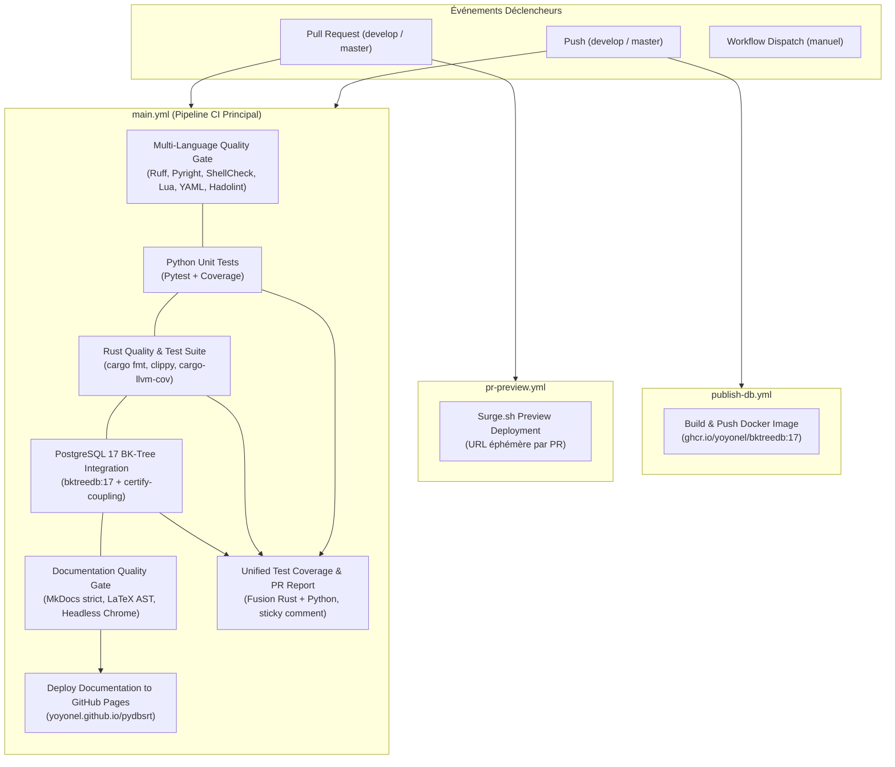

# 📖 Référence : Architecture & Pipelines CI/CD

> Spécification technique formelle des workflows d'intégration continue (CI), de déploiement continu (CD), de contrôle qualité multi-langages et des optimisations de temps de cycle sur GitHub Actions.

---

## 1. Vue d'Ensemble & Cartographie des Workflows

Le dépôt dispose de 5 workflows GitHub Actions déclarés sous `.github/workflows/` :

---

## 2. Matrice des Workflows GitHub Actions

| Fichier Workflow | Nom du Workflow | Déclencheurs (`on:`) | Intention & Responsabilités |
| :--- | :--- | :--- | :--- |
| [`.github/workflows/main.yml`](https://github.com/yoyonel/pydbsrt/blob/develop/.github/workflows/main.yml) | `ci` | `push`, `pull_request`, `workflow_dispatch` | Pipeline d'intégrité globale : compilation Rust, tests unitaires, intégration base de données, validation documentaire et couverture unifiée. |
| [`.github/workflows/pr-preview.yml`](https://github.com/yoyonel/pydbsrt/blob/develop/.github/workflows/pr-preview.yml) | `pr-preview` | `pull_request` (opened, synchronize, closed) | Génère et déploie un aperçu web complet de la documentation sur `Surge.sh` avec publication de l'URL en commentaire de PR. |
| [`.github/workflows/publish-db.yml`](https://github.com/yoyonel/pydbsrt/blob/develop/.github/workflows/publish-db.yml) | `publish-db` | `push` sur `docker/pg-spgist_hamming/**`, `workflow_dispatch` | Compile l'image conteneur PostgreSQL 17 avec l'extension C SP-GiST BK-Tree et publie sur GitHub Container Registry (`ghcr.io`). |
| [`.github/workflows/pr-labeler.yml`](https://github.com/yoyonel/pydbsrt/blob/develop/.github/workflows/pr-labeler.yml) | `PR Labeler` | `pull_request_target` | Étiquette automatiquement les PRs selon les zones de code modifiées (Rust, Python, Docs, CI, Docker). |
| [`.github/workflows/pr-title-lint.yml`](https://github.com/yoyonel/pydbsrt/blob/develop/.github/workflows/pr-title-lint.yml) | `PR Title Lint` | `pull_request_target` | Vérifie la conformité du titre de la Pull Request avec la convention *Conventional Commits* (`feat`, `fix`, `docs`, `ci`, etc.). |

---

## 3. Spécification des Jobs du Pipeline Principal (`main.yml`)

### 3.1. `code-quality` : Multi-Language Code Quality Gate
- **Image** : `ubuntu-latest`
- **Timeout** : 5 minutes
- **Outils installés** :
  - Python 3.11 via `astral-sh/setup-uv@v5`
  - Linters système : `shellcheck` (préinstallé), `shfmt`, `lua5.2`, `yamllint`, `hadolint` (binaire v2.12.0)
- **Commande exécutée** : `bash scripts/code_quality.sh lint-fast`
- **Vérifications** :
  1. Python : Formatage et règles de linting Ruff.
  2. Python : Typage statique strict via Pyright (0 erreur tolérée).
  3. Shell : Conformité POSIX / Bash via `shellcheck` et formatage via `shfmt`.
  4. Lua : Compilation bytecode `luac` et exécution des 42 tests unitaires mockant LibVLC (`vlsub_dbsrt.lua`).
  5. YAML : Validation syntaxique de tous les `.yml` et Docker Compose.
  6. Docker : Audit statique des Dockerfiles avec Hadolint.
  7. Web & JSON : Intégrité des assets JSON et HTML/JS.
  8. Rust Complexity Gate : Contrôle strict de complexité cyclomatique (CCN $\le$ 20) et taille des fonctions (LOC $\le$ 150, nesting $\le$ 4, arguments $\le$ 4) via `scripts/lint_complexity.py` avec mécanisme anti-régression ratchet (inspection tabulaire complète via `task complexity:report`).

### 3.2. `python-unit` : Python Unit Tests
- **Image** : `ubuntu-latest`
- **Timeout** : 5 minutes
- **Outils installés** :
  - FFmpeg & FFprobe via `AnimMouse/setup-ffmpeg@v1` (binaires statiques BtbN)
  - Python 3.11 via `astral-sh/setup-uv@v5`
- **Commande exécutée** : `uv run pytest --cov=src --cov-report=term --cov-report=json:coverage-python.json tests/tools/`
- **Artefact produit** : `python-coverage` (`coverage-python.json`, rétention 1 jour).

### 3.3. `rust-ci` : Rust Quality & Test Suite
- **Image** : `ubuntu-latest`
- **Timeout** : 5 minutes
- **Services** : Conteneur `bktreedb:17` éphémère (PostgreSQL 17 + extension SP-GiST BK-Tree).
- **Outils installés** :
  - FFmpeg & FFprobe via `AnimMouse/setup-ffmpeg@v1`
  - Toolchain Rust `stable` via `dtolnay/rust-toolchain@stable` avec composants `rustfmt` et `clippy`
  - `cargo-llvm-cov` via `taiki-e/install-action@cargo-llvm-cov`
  - Cache Cargo via `Swatinem/rust-cache@v2`
- **Vérifications & Commandes** :
  1. Formatage : `cargo fmt --all -- --check`
  2. Linting : `cargo clippy --workspace --all-targets -- -D warnings`
  3. Verrou de Complexité Architecturale : `uv run python scripts/lint_complexity.py` (interdit toute nouvelle fonction > 150 LOC ou CCN > 20 et bloque toute dégradation de fonctions historiques)
  4. Tests & Couverture : `cargo llvm-cov --workspace --json --output-path coverage-rust.json` (englobe l'intégralité des tests unitaires, d'intégration et les scénarios TUI déclaratifs `test_scenarios.rs` en mode headless).
- **Artefact produit** : `rust-coverage` (`coverage-rust.json`, rétention 1 jour).

### 3.4. `db-integration` : PostgreSQL 17 BK-Tree Integration
- **Image** : `ubuntu-latest`
- **Timeout** : 5 minutes
- **Services** : Conteneur `bktreedb:17` éphémère sur port 5432.
- **Séquence opérationnelle** :
  1. Téléchargement FFmpeg (`AnimMouse/setup-ffmpeg@v1`).
  2. Démarrage conteneur PostgreSQL 17 et attente disponibilité via `pg_isready`.
  3. Initialisation de la fixture de seed des couplages certifiés (`bash scripts/init_couplings_seed.sh`).
  4. Compilation des binaires de test Rust `dbsrt`.
  5. Ingestion et indexation pHash d'un média de référence (`dbsrt export-phash` + `dbsrt import-phash`).
  6. Exécution des tests d'intégration Rust DB (`cargo test -p dbsrt-cli --test integration_test`).
  7. Certification d'un couplage relationnel complet (`dbsrt certify-coupling`).
  8. Exécution des tests d'intégration Python DB (`uv run pytest --cov=src ... tests/ --ignore=tests/tools/`).
- **Artefact produit** : `python-db-coverage` (`coverage-python-db.json`, rétention 1 jour).

### 3.5. `docs-check` : Documentation Quality Gate
- **Image** : `ubuntu-latest`
- **Timeout** : 5 minutes
- **Outils installés** :
  - `arduino/setup-task@v2` (Taskfile v3)
  - Python 3.11 via `astral-sh/setup-uv@v5`
  - Groupe de dépendances `docs` synchronisé via `uv sync --only-group docs --no-install-project`
- **Commande exécutée** : `task doc:check`
- **Contrôles appliqués** :
  - Compilation stricte MkDocs Material (`--strict`, 0 avertissement toléré).
  - Validation du rendu vectoriel MathJax / LaTeX (aucun marqueur brut non rendu).
  - Détection automatique de chemins machine-locaux interdits (`/home/...`, `file://...`).
  - Validation de l'arbre syntaxique HTML AST.
  - Smoke test Chrome Headless : montage DOM des lecteurs interactifs Asciinema (`.ap-player`, `.ap-terminal`).

### 3.6. `coverage` : Unified Test Coverage & PR Report
- **Image** : `ubuntu-latest`
- **Timeout** : 5 minutes
- **Dépendance** : `needs: [python-unit, rust-ci, db-integration]`
- **Script exécuté** : `python3 scripts/generate_coverage_report.py`
- **Action GitHub** : `actions/github-script@v7`
- **Fonctionnement** : Télécharge les artefacts de couverture Rust et Python, génère un rapport différentiel Markdown vis-à-vis de la branche cible (`origin/develop`), et publie/met à jour un commentaire "sticky" unique sur la Pull Request.

### 3.7. `deploy-docs` : Deploy Documentation to GitHub Pages
- **Déclenchement** : Merges sur `develop` ou `master` (`push` direct ou `workflow_dispatch`).
- **Permissions** : `pages: write`, `id-token: write`.
- **Commandes** : `task doc:build`, `actions/upload-pages-artifact@v3`, `actions/deploy-pages@v4`.
- **Cible** : [https://yoyonel.github.io/pydbsrt/](https://yoyonel.github.io/pydbsrt/)

---

## 4. Stratégie d'Optimisation des Binaires & Outils

### 4.1. Installation FFmpeg : Migration APT vers BtbN Static
- **Problème initial** : Sur les images `ubuntu-24.04` (Noble), FFmpeg n'est plus préinstallé. L'exécution de `sudo apt-get update && sudo apt-get install -y ffmpeg` téléchargeait plus de 80 paquets de dépendances partagées depuis les miroirs Azure, entraînant un temps d'attente de **3m 55s** par job.
- **Solution implémentée** : Utilisation de **`AnimMouse/setup-ffmpeg@v1`** avec authentification GitHub Token.
- **Mécanisme** : Télécharge un binaire statique officiel depuis [BtbN/FFmpeg-Builds](https://github.com/BtbN/FFmpeg-Builds/releases) sur le CDN GitHub Releases et le place dans le cache local `actions/tool-cache`.
- **Résultat mesuré** : Temps d'installation réduit à **13–17 secondes** (**gain de 94.5%**).

### 4.2. Caching & Herméticité
1. **Rust (`Swatinem/rust-cache@v2`)** : Mise en cache des dépendances Cargo compilées sous `target/`, évitant la recompilation des crates inchangées.
2. **Python (`astral-sh/setup-uv@v5`)** : Cache global des wheels pré-téléchargés, synchronisation de l'environnement en moins de 2 secondes.
3. **Conteneur PostgreSQL 17 (`ghcr.io/yoyonel/bktreedb:17`)** : L'extension C SP-GiST BK-Tree est pré-compilée dans l'image conteneur publiée sur GHCR, éliminant tout temps de compilation C lors des runs de tests.

---

## 5. Parité Stricte : Reproduction Locale via Taskfile

Tous les contrôles exécutés en CI sont reproductibles à l'identique en local grâce à l'orchestrateur `Taskfile` :

| Contrôle CI | Commande Taskfile Locale Équivalente | Durée Locale Typique |
| :--- | :--- | :--- |
| **Validation Pré-Push Rapide** | `task ci:local` | < 10 secondes |
| **Linting Multi-Langages** | `task lint` | ~15 secondes |
| **Vérification Typage Python** | `task typecheck` | ~3 secondes |
| **Tests Unitaires & Intégration Rust** | `task test:rs` | ~20 secondes |
| **Validation Stricte Documentation** | `task doc:check` | ~8 secondes |
| **Rapport Couverture Unifiée** | `task coverage` | ~45 secondes |
| **Vérification Rendu Terminaux** | `task doc:verify-terminal` | ~4 secondes |
