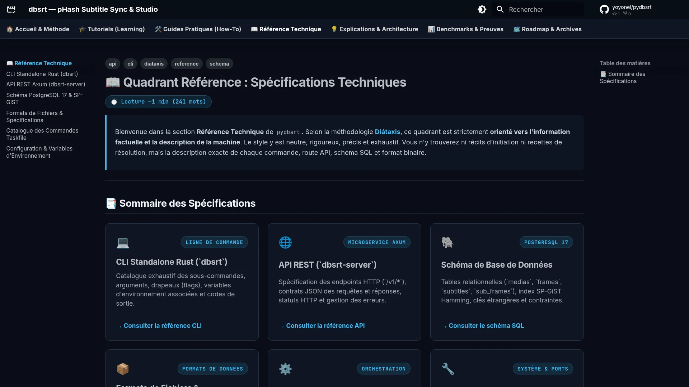

# 📖 Quadrant Référence : Spécifications Techniques

> Bienvenue dans la section **Référence Technique** de `pydbsrt`.
> Selon la méthodologie **[Diátaxis](https://diataxis.fr/)**, ce quadrant est strictement **orienté vers l'information factuelle et la description de la machine**.
> Le style y est neutre, rigoureux, précis et exhaustif. Vous n'y trouverez ni récits d'initiation ni recettes de résolution, mais la description exacte de chaque commande, route API, schéma SQL et format binaire.

---

## 📸 Aperçu du Quadrant Référence

<figure markdown="1">
  
  <figcaption>Figure 1 : Interface du portail de référence technique et spécifications formelles.</figcaption>
</figure>

---

## 📑 Sommaire des Spécifications

  

    

      💻
      LIGNE DE COMMANDE
    

    <h3>CLI Standalone Rust (`dbsrt`)</h3>
    
Catalogue exhaustif des sous-commandes, arguments, drapeaux (flags), variables d'environnement associées et codes de sortie.

    

      <a href="cli/">→ Consulter la référence CLI</a>
    

  

  

    

      🌐
      MICROSERVICE AXUM
    

    <h3>API REST (`dbsrt-server`)</h3>
    
Spécification des endpoints HTTP (`/v1/*`), contrats JSON des requêtes et réponses, statuts HTTP et gestion des erreurs.

    

      <a href="api-rest/">→ Consulter la référence API</a>
    

  

  

    

      🐘
      POSTGRESQL 17
    

    <h3>Schéma de Base de Données</h3>
    
Tables relationnelles (`medias`, `frames`, `subtitles`, `sub_frames`), index SP-GiST Hamming, clés étrangères et contraintes.

    

      <a href="schema-postgresql/">→ Consulter le schéma SQL</a>
    

  

  

    

      📦
      FORMATS DE DONNÉES
    

    <h3>Formats de Fichiers & Spécifications</h3>
    
Structure binaire des fichiers `.dbphash` v2 (en-tête magic bytes, empreintes 64-bit), schéma JSON de `couplings.json` et normalisation SRT.

    

      <a href="formats-fichiers/">→ Consulter les formats</a>
    

  

  

    

      ⚙️
      ORCHESTRATION
    

    <h3>Catalogue Taskfile (`Taskfile.yml`)</h3>
    
Dictionnaire complet de toutes les cibles du projet réparties par namespace (`dev`, `db:*`, `server:*`, `media:*`, `test:*`, `doc:*`).

    

      <a href="taskfile/">→ Consulter le dictionnaire Taskfile</a>
    

  

  

    

      🔧
      SYSTÈME & PORTS
    

    <h3>Configuration & Variables d'Environnement</h3>
    
Matrice des variables d'environnement (`.env`), allocation des ports réseau (`8765`, `5433`, `8086`, etc.) et constantes système.

    

      <a href="configuration/">→ Consulter la configuration</a>
    

  

  

    

      📐
      ZERO MAGIC CONSTANTS
    

    <h3>Constantes Nommées & Seuils Algorithmiques</h3>
    
Répertoire centralisé de toutes les constantes typées du codebase (Rust & Python) : seuils pHash, facteurs temporels et timeouts réseau.

    

      <a href="constants/">→ Consulter les constantes</a>
    

  

