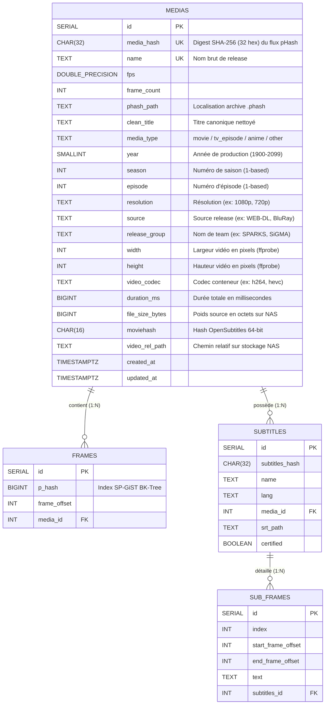
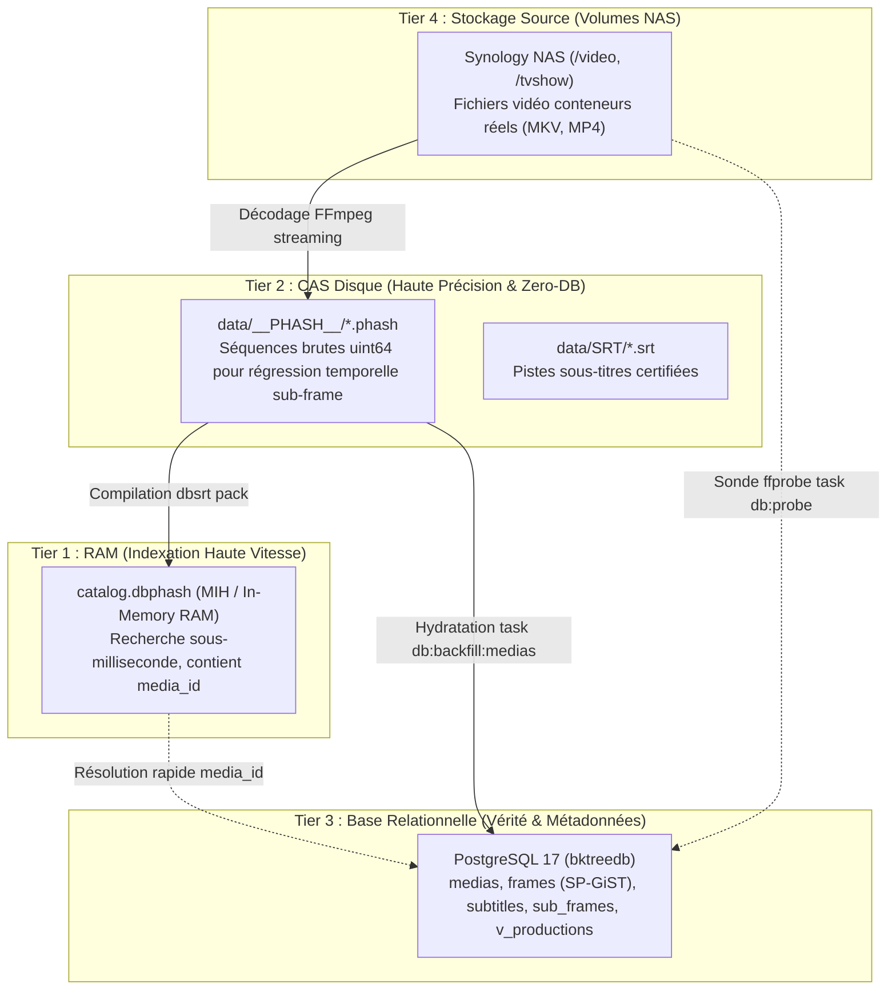

# 📖 Référence : Schéma de Base de Données PostgreSQL 17

Cette page documente la structure relationnelle, les types de données, les contraintes et les index spatiaux/métriques de la base de données PostgreSQL 17 (`bktreedb`).

---

## 1. Diagramme Entité-Association (ERD)



---

## 2. Dictionnaire des Tables

### Table `medias`
Enregistre chaque fichier vidéo de référence unique par son empreinte cryptographique d'images, enrichie de toutes ses métadonnées techniques et sémantiques (Migration V4).

| Colonne | Type SQL | Nullable | Contraintes / Défaut | Description |
| :--- | :--- | :---: | :--- | :--- |
| `id` | `SERIAL` | Non | `PRIMARY KEY` | Identifiant interne séquentiel relationnel. |
| `media_hash` | `CHAR(32)` | Non | `UNIQUE` | Empreinte SHA-256 (32 hex) du flux pHash (`compute_media_phash_digest`). Sert d'identifiant visuel invariant. |
| `name` | `TEXT` | Non | `UNIQUE` | Nom brut du fichier source ou titre canonique du média. |
| `fps` | `DOUBLE PRECISION`| Oui | `DEFAULT 25.0` | Cadence d'images par seconde d'origine. |
| `frame_count`| `INT` | Oui | `DEFAULT 0` | Nombre total de trames échantillonnées. |
| `phash_path` | `TEXT` | Oui | `NULL` | Chemin relatif vers l'archive binaire `.phash` sur disque ou NAS. |
| `clean_title` | `TEXT` | Oui | `NULL` | Titre canonique nettoyé de tout bruit de release (indexé via `idx_medias_clean_title`). |
| `media_type` | `TEXT` | Non | `DEFAULT 'other'`, `CHECK IN ('movie', 'tv_episode', 'anime', 'other')` | Classification de haut niveau (indexé via `idx_medias_media_type`). |
| `year` | `SMALLINT` | Oui | `NULL` | Année de production / sortie (1900..=2099). |
| `season` | `INT` | Oui | `NULL` | Numéro de saison (1-based, indexé composite avec `clean_title` et `episode`). |
| `episode` | `INT` | Oui | `NULL` | Numéro d'épisode (1-based). |
| `resolution` | `TEXT` | Oui | `NULL` | Tag de résolution verticale (ex: `1080p`, `720p`, `2160p`). |
| `source` | `TEXT` | Oui | `NULL` | Origine de la release (ex: `BluRay`, `WEB-DL`, `WEBRip`, `HDTV`). |
| `release_group` | `TEXT` | Oui | `NULL` | Nom de la team ou du release group (ex: `SPARKS`, `SiGMA`, `LOST`). |
| `width` | `INT` | Oui | `NULL` | Largeur géométrique native de la trame vidéo en pixels extraite par `ffprobe` (source de vérité). |
| `height` | `INT` | Oui | `NULL` | Hauteur géométrique native de la trame vidéo en pixels extraite par `ffprobe` (source de vérité). |
| `video_codec` | `VARCHAR(32)` | Oui | `NULL` | Codec matériel du conteneur vidéo source (`h264`, `hevc`, `vp9`, `av1`). |
| `duration_ms` | `BIGINT` | Non | `DEFAULT 0` | Durée totale en millisecondes calculée (`frame_count / fps * 1000`). |
| `file_size_bytes` | `BIGINT` | Non | `DEFAULT 0` | Poids du fichier vidéo source en octets sur le NAS. |
| `moviehash` | `CHAR(16)` | Oui | `NULL` | Checksum OpenSubtitles 64-bit (indexé via `idx_medias_moviehash`). |
| `video_rel_path` | `TEXT` | Oui | `NULL` | Chemin relatif d'accès sur le stockage NAS source (`/video/...` ou `/tvshow/...`). |
| `created_at` | `TIMESTAMPTZ` | Non | `DEFAULT NOW()` | Horodatage d'insertion initiale de la fiche média en base. |
| `updated_at` | `TIMESTAMPTZ` | Non | `DEFAULT NOW()` | Horodatage de dernière mise à jour de la fiche. |

---

### Table `frames`
Stocke l'ensemble des trames visuelles extraites et leurs signatures pHash 64-bit.

| Colonne | Type SQL | Nullable | Contraintes / Défaut | Description |
| :--- | :--- | :---: | :--- | :--- |
| `id` | `SERIAL` | Non | `PRIMARY KEY` | Identifiant de trame. |
| `p_hash` | `BIGINT` | Non | Indexé (`bktree_ops`) | Empreinte perceptuelle 64-bit signée. |
| `frame_offset`| `INT` | Non | - | Indice temporel de la trame au sein du média (\( t = \text{offset} / \text{fps} \)). |
| `media_id` | `INT` | Non | `REFERENCES medias(id) ON DELETE CASCADE` | Clé étrangère vers le média parent. |

#### Index SP-GiST BK-Tree
```sql
CREATE INDEX frames_phash_bk_tree_index
ON frames USING spgist ( p_hash bktree_ops );
```
Permet la recherche sous-linéaire des voisins les plus proches en distance de Hamming sans balayer l'ensemble de la table.

---

### Table `subtitles`
Enregistre chaque piste de sous-titres certifiée et sa langue associée.

| Colonne | Type SQL | Nullable | Contraintes / Défaut | Description |
| :--- | :--- | :---: | :--- | :--- |
| `id` | `SERIAL` | Non | `PRIMARY KEY` | Identifiant interne du sous-titre. |
| `subtitles_hash`| `CHAR(32)` | Non | - | Hash SHA-256 du contenu textuel normalisé. |
| `name` | `TEXT` | Non | - | Nom de fichier de la piste de sous-titres. |
| `lang` | `TEXT` | Oui | `DEFAULT 'FR'` | Code langue ISO-639-1 (`fr`, `en`, `es`, etc.). |
| `media_id` | `INT` | Non | `REFERENCES medias(id) ON DELETE CASCADE` | Référence au média vidéo de certification. |
| `srt_path` | `TEXT` | Oui | `NULL` | Emplacement du fichier `.srt` sur le disque ou CAS. |
| `certified` | `BOOLEAN` | Oui | `DEFAULT TRUE` | Indicateur d'alignement vérité-terrain vérifié. |

#### Contrainte d'Unicité Composite
```sql
UNIQUE(media_id, subtitles_hash, lang)
```
Interdit les doublons stricts pour une même piste et même langue sur un média donné, tout en permettant le multi-piste et le multi-release.

---

### Table `sub_frames`
Table de granularité fine associant chaque réplique textuelle aux trames de début et de fin.

| Colonne | Type SQL | Nullable | Contraintes / Défaut | Description |
| :--- | :--- | :---: | :--- | :--- |
| `id` | `SERIAL` | Non | `PRIMARY KEY` | Identifiant du bloc de sous-titre. |
| `index` | `INT` | Non | - | Numéro séquentiel de réplique (1, 2, 3...). |
| `start_frame_offset`| `INT` | Non | - | Trame d'apparition à l'écran. |
| `end_frame_offset` | `INT` | Non | `CHECK (end >= start)` | Trame de disparition de la réplique. |
| `text` | `TEXT` | Oui | `DEFAULT ''` | Contenu textuel de la réplique. |
| `subtitles_id` | `INT` | Non | `REFERENCES subtitles(id) ON DELETE CASCADE` | Référence au sous-titre parent. |

---

## 3. Vues Conceptuelles & SoC (Séparation des Préoccupations)

### Vue `v_productions`
La vue `v_productions` matérialise la séparation nette entre :

1. **L'Œuvre / Production (Intangible)** : L'entité cinématographique ou télévisuelle (film, épisode, documentaire) identifiée par ses métadonnées éditoriales (`clean_title`, `media_type`, `year`, `season`, `episode`).
2. **Le Média / Release (Physique)** : Le fichier vidéo numérique concret (`medias`), caractérisé par son empreinte cryptographique d'images (`media_hash`), son conteneur, son codec et sa géométrie (`width`, `height`).

Plusieurs releases d'une même œuvre (ex: 720p WEB-DL, 1080p BluRay, 4K Remux) sont ainsi fédérées sous une même Production canonique.

```sql
CREATE OR REPLACE VIEW v_productions AS
SELECT
    clean_title,
    media_type,
    year,
    season,
    episode,
    COUNT(*)::INTEGER AS release_count,
    ARRAY_AGG(id ORDER BY id) AS media_ids,
    ARRAY_AGG(media_hash ORDER BY id) AS media_hashes,
    MAX(duration_ms) AS max_duration_ms,
    MIN(created_at) AS first_ingested_at,
    MAX(updated_at) AS last_updated_at
FROM medias
WHERE clean_title IS NOT NULL
GROUP BY
    clean_title,
    media_type,
    year,
    season,
    episode;
```

| Colonne | Type SQL | Description |
| :--- | :--- | :--- |
| `clean_title` | `TEXT` | Titre canonique de la production cinématographique ou télévisuelle. |
| `media_type` | `TEXT` | Catégorie éditoriale (`movie`, `tv_episode`, `anime`, `other`). |
| `year` | `SMALLINT` | Année de production / diffusion initiale. |
| `season` | `INT` | Numéro de saison pour les productions épisodiques (NULL pour les films). |
| `episode` | `INT` | Numéro d'épisode dans la saison (NULL pour les films). |
| `release_count` | `INT` | Nombre total de fichiers de releases physiques recensés pour cette production. |
| `media_ids` | `INT[]` | Tableau des identifiants `medias.id` rattachés à cette production. |
| `media_hashes` | `TEXT[]` | Tableau des digests pHash SHA-256 (`media_hash`) des flux physiques. |
| `max_duration_ms` | `BIGINT` | Durée maximale constatée parmi les différentes releases physiques. |
| `first_ingested_at` | `TIMESTAMPTZ` | Date d'ingestion de la toute première release de cette production. |
| `last_updated_at` | `TIMESTAMPTZ` | Horodatage de la dernière mise à jour parmi les releases. |

---

## 4. Modèles de Représentation & Cycle de Vie Opérationnel

`pydbsrt` orchestre quatre niveaux complémentaires de stockage et de représentation pour concilier vitesse de recherche instantanée (RAM), portabilité autonome (CAS / Zero-DB) et richesse relationnelle (PostgreSQL).

### Architecture Multi-Niveaux des Données (Storage Tiers)



1. **Tier 1 - RAM / In-Memory (`catalog.dbphash`)** : Structure mémoire compacte utilisant l'algorithme Multi-Index Hashing (MIH). Garantit des recherches d'empreintes sous-millisecondes lors des requêtes VLC sans solliciter le disque.
2. **Tier 2 - CAS Disque (`data/__PHASH__/*.phash`)** : Fichiers d'empreintes séquentiels purs (entiers non signés 64 bits). Utilisés pour la régression affine à haute résolution lors des recalages millimétriques et pour le mode autonome sans base Zero-DB.
3. **Tier 3 - Base Relationnelle PostgreSQL 17 (`medias`, `frames`, `v_productions`)** : Registre centralisé garantissant l'intégrité référentielle, les couplages certifiés avec `subtitles` et `sub_frames`, les métadonnées éditoriales et les recherches métriques spatiales SP-GiST.
4. **Tier 4 - Stockage Vidéo NAS (`video_rel_path`)** : Volume source sur serveur NAS (Synology), accédé via streaming direct (FTP/NFS) pour le décodage initial sans copie locale, puis pour les vérifications de géométrie matérielle.

### Cycle de Vie du Traitement (Batch Processing Lifecycle)

Lors du traitement d'une nouvelle release vidéo sur le cluster de calcul (o2switch ou Raspberry Pi 4), le cycle de vie s'articule comme suit :

| Étape | Ce qui s'exécute sur la machine de calcul | Ce qui est persisté dans le système de stockage et la base |
| :--- | :--- | :--- |
| **1. Extraction** | Décodage FFmpeg en streaming direct depuis le NAS (zéro copie locale du conteneur vidéo) générant le flux de signatures `hashes: Vec<u64>`. | En mémoire vive (tampons de décodage). |
| **2. Sérialisation** | Écriture du fichier binaire CAS `data/__PHASH__/<nom>.<fps>fps.phash` sur le disque persistant. | Fichier binaire brut ordonné sur le système de fichiers. |
| **3. Empreinte Pivot** | Calcul de l'empreinte cryptographique invariante `media_hash = compute_media_phash_digest(&hashes)` (SHA-256 tronqué à 32 hex). | Empreinte logique immuable du flux vidéo. |
| **4. Ingestion / Upsert** | Insertion ou mise à jour atomique dans PostgreSQL via `task db:backfill:medias`. | Une ligne dans `medias` (`media_hash`, `clean_title`, `phash_path`, `duration_ms`, etc.). |
| **5. Sonde Physique** | Interrogation du conteneur NAS via `task db:probe` (`ffprobe` LAN). | Enregistrement de `width`, `height`, `video_codec` et déduction de `resolution` (zéro NULL). |
| **6. Compilation Zero-DB** | Exécution de `dbsrt pack` pour compiler tous les fichiers `.phash` unitaires. | Mise à jour de `catalog.dbphash` pour distribution en mémoire sans base. |

### Articulation Clé : Identité Logique (`media_hash`) vs Accès Physique (`phash_path` & `video_rel_path`)

Une séparation stricte est maintenue entre l'identité logique et les chemins d'accès fichiers :

* **`media_hash` (Identité Logique Invariante)** :
  Représente la signature SHA-256 de la suite d'images pHash. Si le fichier vidéo source est renommé, déplacé d'un dossier à un autre sur le NAS, ou recompressé sans altération de trame, son `media_hash` demeure rigoureusement identique. Il sert de clé pivot unique dans toutes les relations de base de données.
* **`phash_path` (Accès Physique CAS)** :
  Fournit le chemin relatif immédiat vers l'archive binaire `.phash` sur disque. Il permet aux outils d'analyse sub-frame d'ouvrir directement le flux binaire sans devoir interroger une couche de conversion.
* **`video_rel_path` (Localisation Source NAS)** :
  Indique l'arborescence relative sur le NAS pour permettre les re-vérifications d'intégrité, les extractions de snippets visuels et les sondes de métadonnées conteneur.
