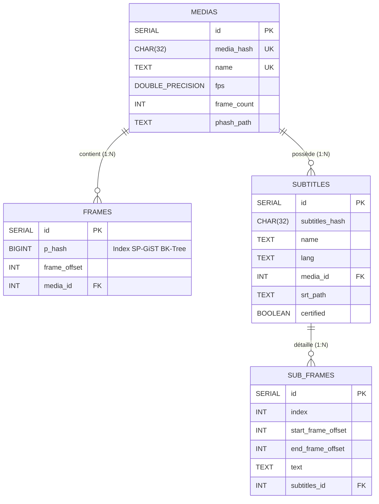

# 📖 Référence : Schéma de Base de Données PostgreSQL 17

Cette page documente la structure relationnelle, les types de données, les contraintes et les index spatiaux/métriques de la base de données PostgreSQL 17 (`bktreedb`).

---

## 1. Diagramme Entité-Association (ERD)



---

## 2. Dictionnaire des Tables

### Table `medias`
Enregistre chaque fichier vidéo de référence unique par son empreinte cryptographique.

| Colonne | Type SQL | Nullable | Contraintes / Défaut | Description |
| :--- | :--- | :---: | :--- | :--- |
| `id` | `SERIAL` | Non | `PRIMARY KEY` | Identifiant interne séquentiel. |
| `media_hash` | `CHAR(32)` | Non | `UNIQUE` | Empreinte SHA-256 tronquée (128-bit hex) du flux vidéo. |
| `name` | `TEXT` | Non | `UNIQUE` | Nom de fichier ou titre canonique du média. |
| `fps` | `DOUBLE PRECISION`| Oui | `DEFAULT 25.0` | Cadence de prise de vue (framerate d'origine). |
| `frame_count`| `INT` | Oui | `DEFAULT 0` | Nombre total de trames échantillonnées. |
| `phash_path` | `TEXT` | Oui | `NULL` | Chemin relatif vers l'archive binaire `.phash` sur disque. |

---

### Table `frames`
Stocke l'ensemble des trames visuelles extraites et leurs signatures pHash 64-bit.

| Colonne | Type SQL | Nullable | Contraintes / Défaut | Description |
| :--- | :--- | :---: | :--- | :--- |
| `id` | `SERIAL` | Non | `PRIMARY KEY` | Identifiant de trame. |
| `p_hash` | `BIGINT` | Non | Indexé (`bktree_ops`) | Empreinte perceptuelle 64-bit signée. |
| `frame_offset`| `INT` | Non | - | Indice temporel de la trame au sein du média (\( t = \text{offset} / \text{fps} \)). |
| `media_id` | `INT` | Non | `REFERENCES medias(id) ON DELETE CASCADE` | Clé étrangère vers le média parent. |

#### Index SP-GiST BK-Tree
```sql
CREATE INDEX frames_phash_bk_tree_index
ON frames USING spgist ( p_hash bktree_ops );
```
Permet la recherche sous-linéaire des voisins les plus proches en distance de Hamming sans balayer l'ensemble de la table.

---

### Table `subtitles`
Enregistre chaque piste de sous-titres certifiée et sa langue associée.

| Colonne | Type SQL | Nullable | Contraintes / Défaut | Description |
| :--- | :--- | :---: | :--- | :--- |
| `id` | `SERIAL` | Non | `PRIMARY KEY` | Identifiant interne du sous-titre. |
| `subtitles_hash`| `CHAR(32)` | Non | - | Hash SHA-256 du contenu textuel normalisé. |
| `name` | `TEXT` | Non | - | Nom de fichier de la piste de sous-titres. |
| `lang` | `TEXT` | Oui | `DEFAULT 'FR'` | Code langue ISO-639-1 (`fr`, `en`, `es`, etc.). |
| `media_id` | `INT` | Non | `REFERENCES medias(id) ON DELETE CASCADE` | Référence au média vidéo de certification. |
| `srt_path` | `TEXT` | Oui | `NULL` | Emplacement du fichier `.srt` sur le disque ou CAS. |
| `certified` | `BOOLEAN` | Oui | `DEFAULT TRUE` | Indicateur d'alignement vérité-terrain vérifié. |

#### Contrainte d'Unicité Composite
```sql
UNIQUE(media_id, subtitles_hash, lang)
```
Interdit les doublons stricts pour une même piste et même langue sur un média donné, tout en permettant le multi-piste et le multi-release.

---

### Table `sub_frames`
Table de granularité fine associant chaque réplique textuelle aux trames de début et de fin.

| Colonne | Type SQL | Nullable | Contraintes / Défaut | Description |
| :--- | :--- | :---: | :--- | :--- |
| `id` | `SERIAL` | Non | `PRIMARY KEY` | Identifiant du bloc de sous-titre. |
| `index` | `INT` | Non | - | Numéro séquentiel de réplique (1, 2, 3...). |
| `start_frame_offset`| `INT` | Non | - | Trame d'apparition à l'écran. |
| `end_frame_offset` | `INT` | Non | `CHECK (end >= start)` | Trame de disparition de la réplique. |
| `text` | `TEXT` | Oui | `DEFAULT ''` | Contenu textuel de la réplique. |
| `subtitles_id` | `INT` | Non | `REFERENCES subtitles(id) ON DELETE CASCADE` | Référence au sous-titre parent. |
